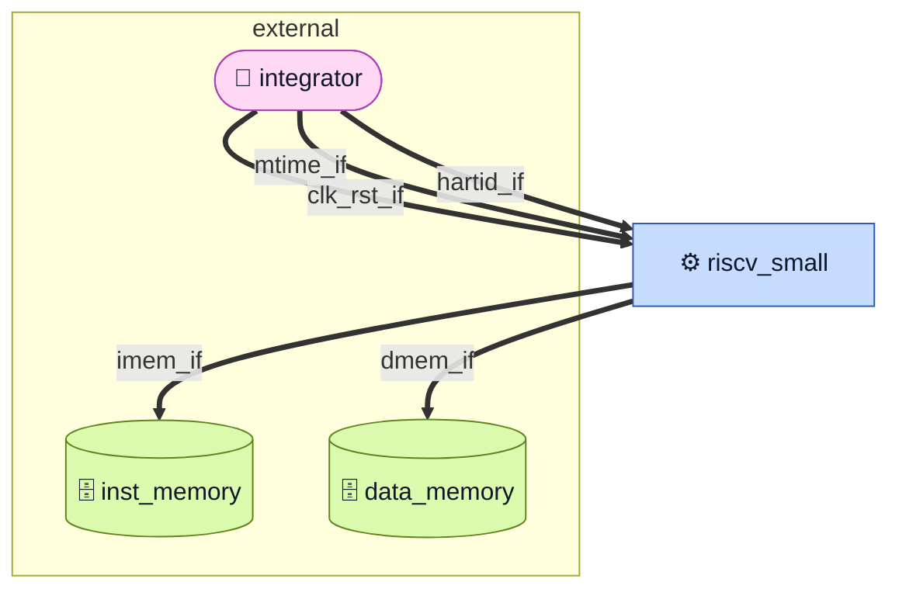
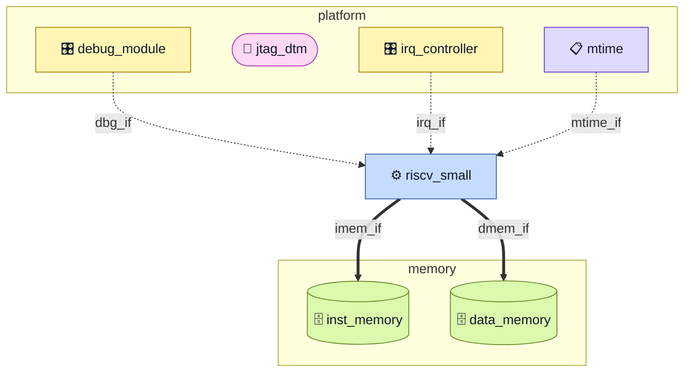
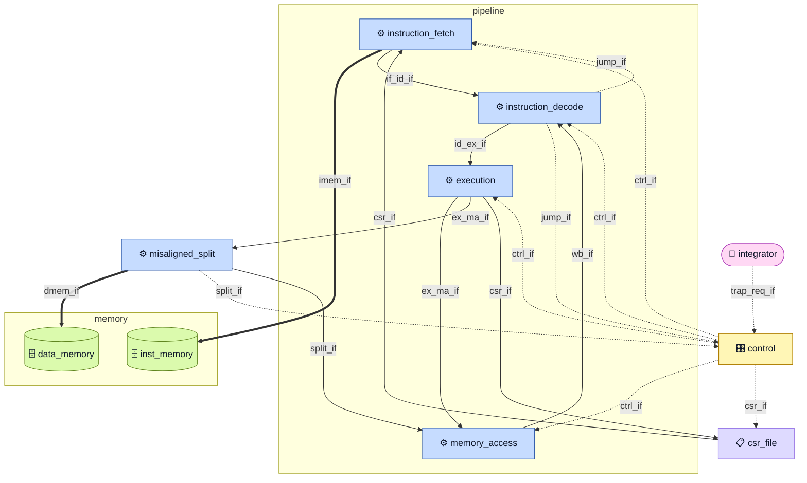
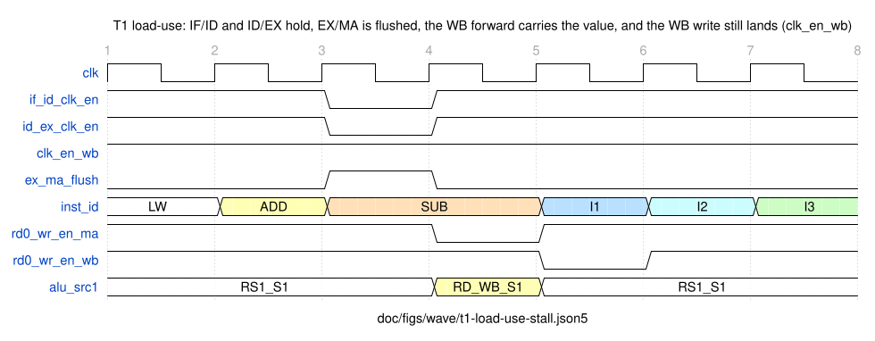
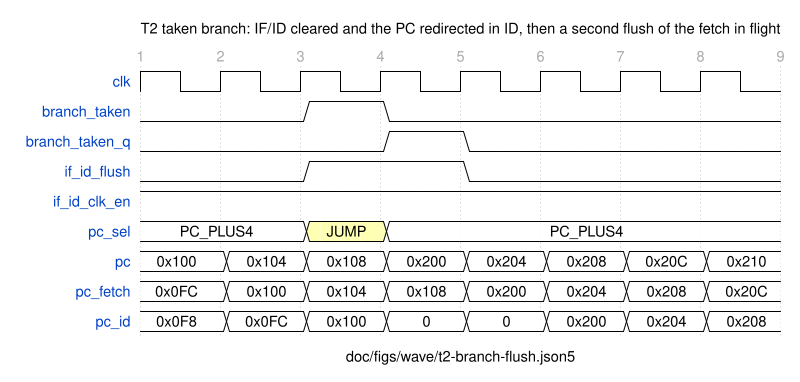
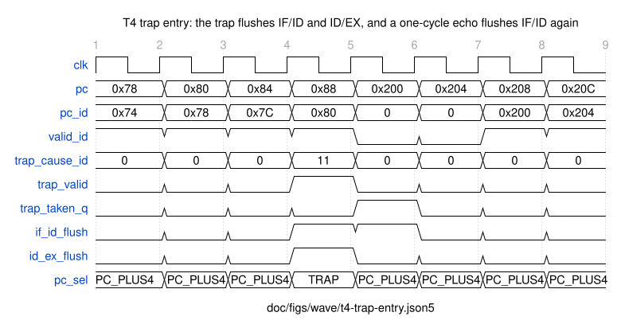
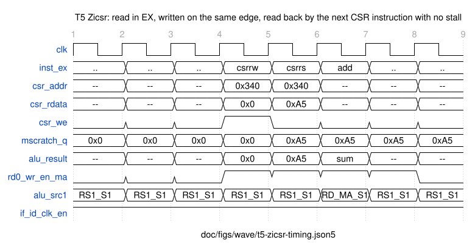
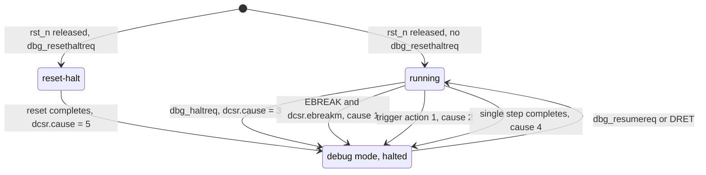

# riscv-small Microarchitecture

| Field | Value |
|---|---|
| Status | draft |
| Implements | [spec.md](spec.md) v0.8.8 |
| Baseline | the WP-14 tree the citations were read from: `rtl_digest` `sha256:2e91301d3496c0753af3678dc82181230f0a3433d52a123007c9f47875cec056` and `tb_digest` `sha256:0091e2601b8721cdc4d1ba2c4e1a9520ef9d0a0c58d58729ddfd620af43acbee` (`build/regress/2026-11-21T00-35-59Z/results.json`, 50 of 50 green). WP-14 added `rtl/csr_file.sv` and lines to `rtl/control.sv`, `rtl/execution.sv`, `rtl/instruction_decode.sv`, `rtl/alu.sv`, `rtl/riscv_definitions_pkg.sv` and `rtl/riscv_small.sv`, so **every citation to those six files and to the two testbench probes was re-read against this tree**, not merely checked for range: a number that still resolves and lands on a different construct is a defect `make docs-check` cannot see. The project forbids automatic commits, so the content digest is the evidence key; `spec.md` still names `bb789bb` as its v0.1 as-built baseline, with v0.2..v0.8 adding intent only |
| Scope | as built: this document describes `rtl/*.sv`, not the target rows of `spec.md` §4 and §7.1; a target obligation of `spec.md` that the RTL does not meet is written down as **target** and never as built. The spec revision that records WP-14 is v0.8.8, which is in the tree; where the two documents differ, the RTL is the source of truth and the difference is named with its gap |

Everything below is read from the RTL. Where a `file:line` citation is missing, the sentence is a
pointer to another section, not a behavioural claim. Where the target of `spec.md` differs from the
code, the difference is named with its existing gap ID and the code is described as it is. The
requirement table of `spec.md` v0.8.8 has 59 rows, of which 25 are `verified`, 6 `implemented`, 5 `partial` and 23 `deferred` in that revision, and **nine rows moved to `verified` with WP-14**: the trap entry at `mtvec` (`FR-29`) with `mepc`/`mcause` (`FR-23`), `ECALL`/`EBREAK` (`FR-25`), `misa` from the build parameters (`FR-37`), `mhartid` from the new `hart_id` port (`FR-32`), the six `Zicsr` instructions (`FR-47`), the counters and their views (`FR-49`), and `mscratch` and `mtval` (`FR-51`, `FR-52`). Three of the work package's rows stopped short, and each has a gap rather than a claim: `FR-22` is `implemented`, because no test drives the external `exception[3:0]` request (`G-37`); `FR-24` is `partial`, because `ECALL`/`EBREAK` with a non-zero `rd`/`rs1` still retire instead of trapping (`G-38`); and `FR-50`, the CSR file and its address map, is `partial`, because its read-only-view clause is not met — `minstret` reads the raw register while `instret` reads a derived value, so the two addresses of one architectural counter disagree (`G-39`). The rows that are still target only are the debug group — `FR-53` (debug mode with `dcsr`/`dpc`/`dscratch`), `FR-54` (run control), `FR-55` (abstract commands), `FR-56` (the program buffer), `FR-57` (`Sdtrig` triggers), `FR-58` (single step) and `FR-59` (`dbg_auth` strap) — plus the three interrupt inputs `mtip`/`meip`/`msip` (`FR-39`, `FR-40`, `G-14`) and the trap return `MRET` (`FR-45`), which decodes as a legal no-operation. No module, port or register implements any of those, and no sentence of this document claims otherwise. The reset vector left the target list with WP-11 P3a: `RESET_VECTOR` is a parameter and `pc` takes it on the
reset edge (section 5).

## 1. Overview

`riscv_small` is a single-issue, in-order, five-stage RV32I core: instruction fetch (IF), instruction
decode (ID), execute (EX), memory access (MA), write back (WB). Both memories are outside the
boundary: the core presents an instruction address and a data address and expects the integrator to
answer (`rtl/riscv_small.sv:51-70`). There is no cache, no memory, and no bus fabric inside the core
(`C-03`).

Four properties shape the rest of the document. First, **branches and jumps are resolved in ID**:
`jump_decision` sits inside `instruction_decode` and drives `branch_taken` and `jump_addr` straight
back to the fetch stage (`rtl/instruction_decode.sv:206-217`), so a taken branch costs two fetch
slots: the fall-through and the fetch already in flight are both discarded (`rtl/control.sv:283-291`).
Second, **validity travels with the instruction but decides nothing**: `valid_id` is born in the
IF/ID register — 0 on reset and on `if_id_flush`, 1 otherwise (`rtl/instruction_fetch.sv:83-101`) —
and is registered forward as `valid_ex`, `valid_ma` and `valid_wb` alongside the instruction word and
its PC (`rtl/instruction_decode.sv:144-145`, `rtl/execution.sv:123`,
`rtl/memory_access.sv:130`). `control` reads it only to qualify a trap, and a stage still does nothing when its
`rd0_wr_en` is zero, and every flush writes zeros into the pipeline register and clears validity
together (for example `rtl/instruction_decode.sv:115-136`). The bit exists so the write-back slot can
say whether it holds a real instruction: a flushed fetch is written as the zero word at pc 0 and
would otherwise retire as a phantom instruction (section 7.1). Third, **stalls are expressed as clock enables, not as a single
`stall` signal**: `control` drives four enables and three flushes independently
(`rtl/control.sv:133-139`). Fourth, **the unit of the data port is the beat, not the access**: a
crossing access is issued as two transactions by `misaligned_split`, which also freezes the pipeline
while they are outstanding, so the address, the store data and the strobes of one instruction can
change on the port while the instruction is still in MA (§4.4, §7.5, §8). Fifth,
**the CSR file is a stage-2 reader with a same-edge side effect**: the CSR address and operation are
latched into EX with the rest of ID/EX (`rtl/instruction_decode.sv:154-156`), the read is
combinational from that address (`rtl/csr_file.sv:134-159`), and the write commits on the edge the
instruction leaves EX (`rtl/csr_file.sv:205-237`), so a `CSR*` and the instruction behind it need no
bubble (§7.11). The value a counter reads is the counter as of the **end** of the read cycle —
`mcycle_q + 1` (`rtl/csr_file.sv:114-116`) — which is a convention this document states once because
the absolute value of `mcycle` at a given PC is implementation-defined (§7.11, T5).

Deliberately absent, and cited so that a reader does not look for them: no caches or line fills
(`G-15`), no interrupt subsystem — the trap request is the level-sensitive cause bus
`exception[3:0]` (`rtl/riscv_small.sv:54`), and no `mtip`/`meip`/`msip` input exists (`G-14`) — no
atomics and no second hart (`G-16`), and no trap **return**: `MRET` decodes as a legal no-operation
(`rtl/instruction_decode.sv:337`, `FR-45`). `FENCE` is still an empty arm (`G-06`), and the
instruction-address-misaligned exception `FR-07` asks for does not exist. What is no longer absent is
everything the previous revision listed here: an access that crosses a word boundary **is** split into
two transactions, each confined to one word, by `misaligned_split`, and a store **is** held in MA
until the data memory grants it (`FR-42`, `FR-38`; `G-22` and `G-18` close 2026-11-19); and as of
WP-14 the core **has** a machine-mode CSR file (`rtl/csr_file.sv`, `FR-50`), the six `Zicsr`
instructions (`FR-47`), a writable trap vector (`mtvec.BASE`, `FR-29`), a real cause (`mcause`,
`FR-23`) with four architectural cause values (2, 3, 11 and `TRAP_NONE`,
`rtl/riscv_definitions_pkg.sv:293-298`), the counters and their read-only views (`FR-49`), `mscratch`
(`FR-51`), a read-only-zero `mtval` (`FR-52`), `misa` composed from the build parameters
(`FR-37`) and `mhartid` reading its input port (`FR-32`). `G-01` and `G-02` therefore leave the
open list, `G-13` is narrowed to the fetch-misalignment cause and stays open, and the sentence that
used to say the vector was the constant 1000 is gone from this document; §11 records what closed and
what the WP-14 plan left named.
The target for each remaining absence is in
`spec.md` §4. v0.7 adds the target obligations whose statement is recorded in §7.12–§7.13: debug
mode with `dcsr`/`dpc`/`dscratch` (`FR-53`), the run-control handshake (`FR-54`), abstract commands
(`FR-55`), the program buffer (`FR-56`), `Sdtrig` triggers (`FR-57`), single step (`FR-58`) and the
`dbg_auth` strap (`FR-59`), none of which has a module, port or register here. Of the four boundary
changes v0.7 records, three have landed: the trap request **is** the four-bit cause bus
`exception[3:0]` (`FR-22`, `rtl/riscv_small.sv:54`), the 64-bit `mtime` **is** an input feeding
`time`/`timeh` (`FR-49`, `:55`) and read by the CSR file (`rtl/csr_file.sv:151`, `:154`), and the
reset vector **is** the `RESET_VECTOR` parameter (`FR-41`, section 5); the fourth, the three
level-sensitive interrupt inputs `mtip`/`meip`/`msip`, is still absent (`FR-39`, `FR-40`, `G-14`).
`hart_id[3:0]` is a fourth new input, the one `mhartid` reports (`FR-32`, `rtl/riscv_small.sv:56`).
The seven rows of the revision before that are still target — `M` (`FR-43`), `C` with `IALIGN=16`
(`FR-44`), `MRET` (`FR-45`), `WFI` (`FR-46`), machine
interrupt entry with the `mstatus` stack and the MEI > MSI > MTI priority (`FR-48`) — and the core
implements none of them, so every one of them is marked target where this document touches it.

The context is small: one core, two external memories, four control inputs (H0).



*H0 — one core, two external memories, one interface per boundary. `trap_req_if` (`C10`) reaches
`control` directly and is not drawn here (H1 draws it). The two platform straps are as-built inputs since WP-14:
`mtime_if` (`C12`) is the 64-bit counter `time`/`timeh` view, and `hartid_if` (`C21`) is the value
`mhartid` reports. Source: inline, section 1.*

The context is wider than H0 shows once the product is considered: Debug, the timer and the interrupt controller are platform blocks; the core reaches each through one named interface.



*H2 — target: Debug, the timer and the interrupt controller are platform blocks; the core reaches each
through one named interface. Two of the three drawn here are still target: `dbg_if` (`C13`) and
`irq_if` (`C11`). `mtime_if` (`C12`) is no longer target — it landed with WP-14 and H0 draws it —
while `imem_if` (`C5`) and `dmem_if` (`C6`) are the as-built memory boundaries. In the
target the JTAG DTM reaches the Debug Module over the DMI, which `C-13` keeps outside the core
boundary and therefore out of this figure. Source: inline, section 1.*

## 2. Diagram index

| ID | Claim | Level | Embedded in |
|---|---|---|---|
| H0 | The core owns no memory; instruction fetch and data access are two independent external ports, and the two platform straps `mtime` and `hart_id` are the core's only other inputs | context | section 1 |
| H1 | Four pipeline stage modules, the split block that owns the data port, one control block and the CSR file are joined by one interface per stage boundary; the instruction and data memories stay outside, the external trap cause reaches `control`, and write-back is not a module | top | section 6 |
| H2 | Debug, the timer and the interrupt controller are platform blocks; the core reaches each through one named interface | block | section 1 |
| S1 | Debug mode is entered from running by run control, a breakpoint, a trigger or a step, and left only by resume or DRET | state | section 7.13 |
| T1 | A load-use insertion is one cycle of `ex_ma_flush` with IF/ID and ID/EX held, and the WB write still commits because the register file is clocked by `clk_en_wb`, not by `id_ex_clk_en` | cycle | section 7.6 |
| T2 | A taken branch clears IF/ID and redirects the PC in ID, and a second flush discards the fetch in flight | cycle | section 7.6 |
| T3 | A withheld fetch grant deletes the fetch and the PC runs on; nothing is held | cycle | section 7.1 |
| T4 | One trap costs two IF/ID flushes — its own and a one-cycle echo — and the second is what discards the fetch in flight | cycle | section 7.6 |
| T5 | The CSR is read in EX and written on the same edge, so the next `CSR*` reads what the previous one wrote with no bubble | cycle | section 7.11 |

Nine figures exist. H0 and H1 are the as-built structure. H2 is target structure — the three
platform blocks the product adds and the interfaces the core will expose to them; of the three edges it
draws only `mtime_if` is built, and S1 is the
target debug state machine; both H2 and S1 are target, and neither describes a register of the RTL.
The five timing figures T1–T5 are hand-derived from the same
enable and flush expressions as section 9 — they are not captured from a simulation — and each draws
the as-built behaviour: T3 shows the `G-09` fetch defect, T1 shows the post-WP-6 load-use
insertion, in which the WB write commits although `id_ex_clk_en` is low (section 7.6), T4 shows the
WP-14 trap entry and the echo `trap_taken_q` that makes it cost two fetch slots, and T5 shows the
same-edge CSR read/write and the read-after-write a second `CSR*` sees without a stall.

## 3. Parameters and typedefs

The core has **four module parameters** on the top: `RESET_VECTOR`, declared on the top and again on
the fetch stage (`rtl/riscv_small.sv:43`, `rtl/instruction_fetch.sv:47`), and the three extension
switches `ENABLE_A`, `ENABLE_M` and `ENABLE_C`, which exist for one purpose — `misa` reports the
**configured** set, never a literal (`rtl/riscv_small.sv:44-49`, `FR-37`). `MISA_VALUE` is the
localparam they compose (`rtl/riscv_small.sv:171`). Every width is literal or comes from the
package. The two further parameters in the repository belong to a simulation model that is not part of
the DUT (`rtl/inst_memory.sv:41-42`, see section 7.10).

| Parameter | Module | Type | Default | Meaning | Cite |
|---|---|---|---|---|---|
| `RESET_VECTOR` | `riscv_small`, propagated to `instruction_fetch` | `dataBus_t` | `32'h8000_0000` | address of the first fetch after reset; a build input, not a CSR, so software cannot move it (`FR-41`, `Q-33`) | `rtl/riscv_small.sv:43`, `:186`, `rtl/instruction_fetch.sv:47`, `:110` |
| `ENABLE_A` | `riscv_small` | `bit` | `1'b0` | declares the `A` extension present in `misa[0]`; the encoding set does not change with it (`D11`) | `rtl/riscv_small.sv:47` |
| `ENABLE_M` | `riscv_small` | `bit` | `1'b0` | declares `M` present in `misa[12]`; no `M` instruction exists yet (`FR-43`) | `rtl/riscv_small.sv:48` |
| `ENABLE_C` | `riscv_small` | `bit` | `1'b0` | declares `C` present in `misa[2]`; no 16-bit encoding is decoded (`FR-44`) | `rtl/riscv_small.sv:49` |
| `MISA_VALUE` | `riscv_small` (localparam) | `dataBus_t` | `misa_value(ENABLE_A, ENABLE_M, ENABLE_C)` | the word `misa` reads: `MXL = 01` and bit 8 always set, bits 0/2/12 from the three switches | `rtl/riscv_small.sv:171`, `rtl/riscv_definitions_pkg.sv:412-421` |

Reader-visible types, all from `rtl/riscv_definitions_pkg.sv`:

| Name | Kind | Width | Values / meaning | Cite |
|---|---|---|---|---|
| `dataBus_t` | typedef | 32 | address and data bus | `rtl/riscv_definitions_pkg.sv:549` |
| `dataBus_u` | packed union | 32 | one bus seen as `u_data`, `s_data`, `u_bytes[0:3]`, `u_half[0:1]`, `s_bytes[0:3]`, `s_half[0:1]` | `rtl/riscv_definitions_pkg.sv:550-557` |
| `regAddr_t` | typedef | 5 | architectural register index | `rtl/riscv_definitions_pkg.sv:128` |
| `instruction_u` | packed union | 32 | one word seen as `r_type`, `i_type`, `i_type_load`, `i_type_alu`, `s_type`, `b_type`, `u_type`, `j_type`, `csr_type`, `memory_b`, `memory_w` | `rtl/riscv_definitions_pkg.sv:532-544` |
| `accessSize_e` | enum | 2 | `ACCESS_BYTE` `00`, `ACCESS_HALF` `01`, `ACCESS_WORD` `10` — the one width decode shared by `data_rd_wr_ctrl`, the store lane/strobe and the split condition | `rtl/riscv_definitions_pkg.sv:268-272` |
| `csrOpType_e` | enum | 3 | `CSRRW` `001`, `CSRRS` `010`, `CSRRC` `011`, `CSRRWI` `101`, `CSRRSI` `110`, `CSRRCI` `111` — the operation *is* the instruction's `funct3`, so no second decode exists (`FR-47`) | `rtl/riscv_definitions_pkg.sv:279-286` |
| `trapCause_e` | enum | 4 | `TRAP_NONE` 0 (legal), `TRAP_ILLEGAL_INSTRUCTION` 2, `TRAP_BREAKPOINT` 3, `TRAP_ECALL_M` 11 — the causes this build raises (`FR-22`..`FR-25`) | `rtl/riscv_definitions_pkg.sv:293-298` |
| `nextPCType_e` | enum | 2 | `PC_PLUS4` `00`, `JUMP` `01`, `TRAP` `1?` (wildcard: `10` and `11` both select the trap) | `rtl/riscv_definitions_pkg.sv:50-54` |
| `aluSrc1_e` | enum | 1 | `PC` `0`, `RS1` `1` — decode-side operand 1 select | `rtl/riscv_definitions_pkg.sv:61-64` |
| `aluSrc2_e` | enum | 1 | `RS2` `0`, `IMM` `1` — decode-side operand 2 select | `rtl/riscv_definitions_pkg.sv:69-72` |
| `ctrlAluSrc1_e` | enum | 2 | `PC_S1` `00`, `RS1_S1` `01`, `RD_MA_S1` `10`, `RD_WB_S1` `11` — EX operand 1 select | `rtl/riscv_definitions_pkg.sv:77-82` |
| `ctrlAluSrc2_e` | enum | 2 | `RS2_S2` `00`, `IMM_S2` `01`, `RD_MA_S2` `10`, `RD_WB_S2` `11` — EX operand 2 and store-data select | `rtl/riscv_definitions_pkg.sv:87-92` |
| `ctrlCJmpSrc_e` | enum | 2 | `RD_ID` `00`, `RD_EX` `01`, `RD_MA` `10`, `RD_WB` `11` — branch operand select | `rtl/riscv_definitions_pkg.sv:97-102` |
| `aluOpType_e` | enum | 4 | see the ALU operation table in section 7.8; `CSR_PASS` is the `Zicsr` arm | `rtl/riscv_definitions_pkg.sv:108-125` |
| `opcodeType_e` | enum | 7 | the eleven decoded opcodes of section 7.2 | `rtl/riscv_definitions_pkg.sv:133-191` |
| `funct3RType_e`, `funct3ITypeALU_e`, `funct3ITypeLOAD_e`, `funct3SType_e`, `funct3BType_e` | enum | 3 | function fields per instruction format | `rtl/riscv_definitions_pkg.sv:197-262` |

Instruction-format overlays used by the decoder (`rs1` is always `[19:15]`, `rs2` always `[24:20]`,
`rd` always `[11:7]`, `opcode` always `[6:0]`):
`instRType_s` `rtl/riscv_definitions_pkg.sv:427-434`, `instIType_s` `:439-445`,
`instITypeLoad_s` `:450-456`, `instITypeALU_s` `:462-468`, `instSType_s` `:473-480`,
`instBType_s` `:485-494`, `instUType_s` `:499-503`, `instJType_s` `:508-515`,
`instCSRType_s` `:521-527`.
The CSR overlay is the one that matters to `Zicsr`: `csr` is the 12-bit `[31:20]` field, `rs1` is
`[19:15]` and doubles as the 5-bit `zimm`, and `opcode` is `ECBK_C` — `0110011` is `ALU_C`, so the
SYSTEM group is the only place a CSR access can come from (`rtl/riscv_definitions_pkg.sv:521-527`,
`rtl/instruction_decode.sv:468-480`).

The width decoder is one function, not a field test at each consumer: `access_size(logic [2:0])`
returns `ACCESS_BYTE` for `000`/`100`, `ACCESS_HALF` for `001`/`101`, `ACCESS_WORD` for `010` and for
the remaining encodings `011`/`110`/`111`, so a reserved `funct3` legalises to a word instead of
producing `X`
(`rtl/riscv_definitions_pkg.sv:306-313`). The top-level `data_rd_wr_ctrl` port and the store
lane/strobe in `execution` both call it (section 8).

A second function turns that width back into a byte count, and the split condition is derived from it
rather than enumerated: `access_bytes(accessSize_e)` returns `1`, `2` or `4` and defaults to `4`
(`rtl/riscv_definitions_pkg.sv:320-327`). `misaligned_split` reads it as
`split_needed = access_ma && (({1'b0, lane_ma} + bytes_ma) > 3'd4)`
(`rtl/misaligned_split.sv:100-108`), so the three encodings that can cross are covered by one
expression: a byte never crosses, a halfword only at lane 3, a word at lanes 1, 2 and 3.

## 4. Interfaces

Two views of the same boundary. The **catalogue** (§4.1–§4.3) groups the connections into named
interfaces with modports, so a figure can draw one line per connection; the **port table** (§4.4) is the
1:1 transcription of the module header and is the proof that the grouping loses nothing. No `interface`
construct exists in the RTL: the as-built names below are a documentation grouping of existing nets, and
every as-built modport row lists the as-built signals. The `interface` constructs in the tree are the two
simulation-only probes of §4.5, `riscv_small_retire_if` and `riscv_small_trap_if`, which are testbench
observations and not part of the DUT.
Rows marked **target** are the v0.7 contract that
the RTL does not implement; the target rows are listed so that a figure or a block section can name the
connection, and they carry a requirement cite instead of an RTL cite. Four rows changed side in WP-14:
`trap_req_if` is now a four-bit cause bus, `mtime_if` is built, `csr_if` is built and has three
initiators, and `hartid_if` is new.

### 4.1 Interface catalogue

| Interface | Initiator modport | Target modport | Payload | Handshake | Clock / reset | Edge |
|---|---|---|---|---|---|---|
| `clk_rst_if` | `integrator` | `core` | `clk`, `clk_en`, `rst_n` | none | — | C9 |
| `trap_req_if` | `integrator` | `control` | `exception[3:0]`, the external trap cause | level | `clk`, `rst_n` | C10 |
| `mtime_if` | `platform` | `csrfile` | `mtime[63:0]` | none; a free-running platform counter read as `time`/`timeh` (`FR-49`, `Q-42`) | `clk`, `rst_n` | C12 |
| `hartid_if` | `integrator` | `csrfile` | `hart_id[3:0]` | none; a static strap read as `mhartid` (`FR-32`) | — | C21 |
| `imem_if` | `fetch` | `memory` | `inst_addr`, `inst_rd_en` → `inst_data`, `inst_ready` | ready/valid | `clk`, `rst_n` | C5 |
| `dmem_if` | `beat` | `memory` | `data_addr`, `data_wr`, `data_wr_strb`, `data_rd_en_ma`, `data_wr_en_ma`, `data_rd_wr_ctrl` → `data_rd`, `data_ready` | grant on `ready`, per beat; a crossing access is two beats (§4.4) | `clk`, `rst_n` | C6 |
| `if_id_if` | `fetch` | `decode` | `pc_id`, `inst_id`, `valid_id` | none (registered) | `clk`, `if_id_clk_en`, `rst_n` | C1 |
| `id_ex_if` | `decode` | `execute` | `pc_ex`, `inst_ex`, `valid_ex`, `rs1_ex`, `rs2_ex`, `imm_ex`, `alu_op_ex`, `alu_src1_ex`, `alu_src2_ex`, `rd0_addr_ex`, `rd0_wr_en_ex`, `data_rd_en_ex`, `data_wr_en_ex`, `funct3_ex`, `rs1_addr_ex`, `rs2_addr_ex` | none (registered) | `clk`, `id_ex_clk_en`, `rst_n` | C2 |
| `ex_ma_if` | `execute` | `memory`, `split` | `alu_ma`, `pc_ma`, `inst_ma`, `valid_ma`, `rs2_ma`, `rs2_raw_ma`, `data_wr_strb_ma`, `rd0_addr_ma`, `rd0_wr_en_ma`, `data_rd_en_ma`, `data_wr_en_ma`, `rd_wr_ctrl` | none (registered) | `clk`, `ex_ma_clk_en`, `rst_n` | C3, C20 |
| `split_if` | `split` | `control`, `memory` | `split_stall`, `ld_split_en`, `ld_split_word` | level hold plus a one-cycle complete pulse | `clk`, `rst_n` | C18, C19 |
| `ma_wb_if` | `memory` | `writeback` | `alu_wb`, `pc_wb`, `inst_wb`, `valid_wb`, `ld_data_wb`, `rd0_addr_wb`, `rd0_wr_en_wb`, `wb_mux_sel_wb` | none (registered) | `clk`, `ma_wb_clk_en`, `rst_n` | C4 |
| `wb_if` | `writeback` | `decode` | `rd0_addr_wb`, `rd0_data_wb`, `rd0_wr_en_wb` | none (combinational) | `clk`, `rst_n` | C4 |
| `retire_if` | — (bind, no modport) | — (bind, no modport) | `valid_wb`, `pc_wb`, `inst_wb`, `rd0_wr_en_wb`, `rd0_addr_wb`, `rd0_data_wb`, `ma_wb_clk_en`; derives `retire_valid`, `retire_pc`, `retire_inst`, `retire_rd`, `retire_wdata` | none; a conditional read at the clock edge | `clk`; no reset | C17 |
| `trap_evt_if` | — (bind, no modport) | — (bind, no modport) | `trap_valid`, `trap_pc`, `trap_inst`, `trap_cause[3:0]`, published verbatim | none; an event sampled at every clock edge | `clk`; no reset | C22 |
| `ctrl_if` | `control` | `stage` | 4 enables, 3 flushes, `pc_sel`, `inst_rd_en`, `alu_src1`, `alu_src2`, `storage_src`, `jmp_src1`, `jmp_src2`, `trap_valid`, `trap_cause` | none (level) | `clk`, `rst_n` | C7 |
| `jump_if` | `decode` | `fetch`, `control` | `jump_addr`, `branch_taken`, `cond_jump`, `jalr` | redirect | `clk`, `rst_n` | C8 |
| `irq_if` — target | `irqctrl` | `core` | `mtip`, `meip`, `msip` | level-sensitive, one input per cause (`FR-39`, `FR-40`, `FR-48`) | `clk`, `rst_n` | C11 |
| `dbg_if` — target | `debug_module` | `hart` | 17 signals in three channels: 4 run-control inputs and 4 status outputs, 5 abstract-command signals, 4 program-buffer signals (§4.2; `FR-53`..`FR-58`, `C-13`) | request/status levels plus a command handshake | `clk`, `rst_n`, `dbg_dmactive` | C13 |
| `auth_if` — target | `integrator` | `core` | `dbg_auth` | none; a static platform strap, low means the hart ignores halt and reset-halt, never enters debug mode and reports `dbg_halted` = 0 (`FR-59`, `C-14`, `D-11`) | — | C16 |
| `csr_if` | `pipeline` (EX), `control` | `csrfile`, `fetch` (the `mtvec_base` half) | `csr_addr[11:0]`, `csr_op[2:0]`, `csr_wdata`, `csr_we` → `csr_rdata`; `trap_we`, `trap_pc`, `trap_cause[3:0]` (the entry writes `mepc`/`mcause`); `csrfile` → `fetch`: `mtvec_base` | read in EX, written on the same edge; one request per `CSR*` instruction, one write per trap | `clk`, `rst_n` | C14, C15, C23 |

`retire_if` and `trap_evt_if` are the two rows that are not DUT boundaries. They are
`riscv_small_retire_if` and `riscv_small_trap_if`, declared in
`tb/riscv_small_interface.sv:157-181` and `:223-233` and bound inside `riscv_small` by
`tb/riscv_small_tb.sv:50-59` and `:67-73`; nothing drives either, the DUT keeps its eighteen ports, and
both are simulation-only: they are compiled only
through `srclist/riscv_small_interface.srclist` (`srclist/riscv_small_interface.srclist:1-2`), never
through the DUT list `srclist/riscv_small.srclist`.
Because `bind` connects by port name there are no modports: `retire_if` presents the MA/WB slot's
`valid_wb`, `pc_wb`, `inst_wb` and destination, and derives the commit rule
`retire_valid = valid_wb && ma_wb_clk_en` itself (`tb/riscv_small_interface.sv:175`) rather than asking
the RTL for a retire signal; `trap_evt_if` derives nothing and presents the four top-level nets of the
trap event (`:223-233`). Their contracts and the reason each rule lives in the probe are in §10.

> **`trap_req_if` — the bus is built, the stimulus is not.** The row above is the as-built contract since
> WP-14: `exception` is `[3:0]` (`rtl/riscv_small.sv:54`) and `control` maps it to a cause with
> `trapCause_e'(exception)` when no internal cause is pending (`rtl/control.sv:373-376`), so the
> `exception != 4'b0000` test replaces the one-bit level. Two limits stay written down: the testbench
> binds the DUT's `exception` to a **local constant zero** (`tb/riscv_small_tb.sv:32`, `:79`) and never
> drives the interface's copy, so no test in the manifest exercises the external arm of
> `proc_trap_priority`; and the phase-2 interrupt inputs `mtip`/`meip`/`msip` are still absent
> (`G-14`, `FR-39`, `FR-40`).

> **`csr_if` — one truth table, three initiators.** The interface is the `FR-50` map, and it is the
> reason the CSR decode and the CSR storage cannot drift: `instruction_decode` decides legality from
> `csr_implemented()` and `csr_read_only()`, and `csr_file` masks its writes with `csr_write_mask()` —
> three functions over one `localparam` table in the package (`rtl/riscv_definitions_pkg.sv:330-404`),
> with no second copy of an address anywhere in the RTL. The three initiators are the pipeline (EX
> presents the address, the operation and the write data; the read value returns on the same row), the
> trap path (`control` asserts `trap_we` with `trap_pc` and `trap_cause`, which win over a younger CSR
> write to `mepc`/`mcause` in the same cycle, `rtl/csr_file.sv:232-235`), and the fetch stage, which
> consumes `mtvec_base` as its trap vector (`rtl/csr_file.sv:103`, `rtl/riscv_small.sv:201`). §7.11 is
> the block description.


> **`dmem_if` — the beat is not the access.** The row is the interface the RTL declares, and since
> WP-13 it carries **beats**, not accesses. `misaligned_split` detects an access whose byte lane plus
> its width passes the fourth byte — `split_needed = access_ma && (({1'b0, lane_ma} + bytes_ma) > 3'd4)`
> (`rtl/misaligned_split.sv:108`) — and presents it as two transactions on this one port: beat 1 at the
> address the core computed, carrying the bytes that fit in that word, and beat 2 at
> `(addr & 32'hFFFF_FFFC) + 32'd4`, the first byte of the next word
> (`rtl/misaligned_split.sv:115-126`). So **one instruction can produce two transactions**, no
> transaction crosses a word boundary, and `data_addr` changes under an instruction that is still in
> MA. The two enables (`data_rd_en_ma`, `data_wr_en_ma`) and `data_rd_wr_ctrl` still come from the
> EX/MA register and are therefore stable for both beats (`rtl/riscv_small.sv:279-281`); the address,
> the store data and the byte strobe come from the split block (`rtl/misaligned_split.sv:124-126`). A
> crossing store drives a strobe covering the **low bytes of the access** — the bytes at the access's own
> byte address, which sit in the high lanes of the word it starts in — on beat 1, and the **high bytes** —
> the bytes past the word boundary, in the low lanes of the next word — on beat 2, never `4'b1111` for the
> access as a whole; and a crossing load receives two words that `memory_access` merges into one aligned
> word before extension (§7.4, §8). The two names are used throughout in this sense: *low bytes* is the
> low-addressed end of the access, not the low lanes of a word.
> Two parts of the contract remain target: `SC` needs a success-or-failure indication on the response
> side, which the present `data_rd` / `data_ready` pair does not carry (`FR-35`); and misaligned atomics
> are excluded from the split, because `LR`, `SC` and `AMO` must be naturally aligned and otherwise take a
> misaligned or access-fault exception rather than a second beat (`FR-42`, `FR-35`).

`writeback` is not a module: it is the top-level mux at `rtl/riscv_small.sv:312`, which is why §4.3 has
one row for the pair `ma_wb_if`/`wb_if` and the H1 figure collapses both into a single `wb_if` edge.

`jalr` travels on the `decode` → `control` half of `jump_if` only. It is the decode-side export of a
`JALR` (`rtl/instruction_decode.sv:73`, set at `:406`) and `control` uses it to open the jump-compare
forward mux, because a `JALR` target is `rs1 + imm` (`rtl/control.sv:152`). It is an internal net, so
§4.4 still counts eighteen ports.

### 4.2 Modport map

One row per side. Direction is from the modport's point of view; the signal names are the as-built nets,
except in the rows marked **target**, which name signals the target adds and the RTL does not have.

| Interface | Modport | Dir | Signals | Sampling / timing | Cite |
|---|---|---|---|---|---|
| `clk_rst_if` | `integrator` | out | `clk`, `clk_en`, `rst_n` | free-running; `rst_n` asserts and releases asynchronously (`G-21`) | `rtl/riscv_small.sv:51-53` |
| `clk_rst_if` | `core` | in | `clk`, `clk_en`, `rst_n` | every `always_ff` | `rtl/riscv_small.sv:51-53` |
| `trap_req_if` | `integrator` | out | `exception[3:0]` | level; the external cause, taken on the next edge the pipeline advances | `rtl/riscv_small.sv:54` |
| `trap_req_if` | `control` | in | `exception[3:0]` | second priority, after the internal cause, and only when `!= 4'b0000` | `rtl/control.sv:373-376` |
| `mtime_if` | `platform` | out | `mtime[63:0]` | free-running; read as `time`/`timeh` with no memory access | `rtl/riscv_small.sv:55` |
| `mtime_if` | `csrfile` | in | `mtime[63:0]` | sampled combinationally in the CSR read path | `rtl/csr_file.sv:151`, `:154` |
| `hartid_if` | `integrator` | out | `hart_id[3:0]` | static strap; sampled combinationally | `rtl/riscv_small.sv:56` |
| `hartid_if` | `csrfile` | in | `hart_id[3:0]` | zero-extended into the `mhartid` read | `rtl/csr_file.sv:156` |
| `imem_if` | `fetch` | out | `inst_addr`, `inst_rd_en` | `inst_addr` is `pc`, or `pc_fetch` while `clk_en` is low | `rtl/instruction_fetch.sv:76` |
| `imem_if` | `memory` | out | `inst_data`, `inst_ready` | `inst_ready` low flushes IF/ID | `rtl/control.sv:299-301` |
| `dmem_if` | `beat` | out | `data_addr`, `data_wr`, `data_wr_strb`, `data_rd_en_ma`, `data_wr_en_ma`, `data_rd_wr_ctrl` | `data_addr`/`data_wr`/`data_wr_strb` are the current beat (split block); the two enables and the width are the EX/MA register, stable across beats | `rtl/riscv_small.sv:279-281`, `:330-332`, `rtl/misaligned_split.sv:122-126` |
| `dmem_if` | `memory` | out | `data_rd`, `data_ready` | `data_ready` low freezes the pipeline while a load is in WB, while a store is in MA, and while a split beat is outstanding | `rtl/control.sv:309-314`, `:321-326` |
| `if_id_if` | `fetch` | out | `pc_id`, `inst_id`, `valid_id` | registered, held while `if_id_clk_en` is low; `flush` clears all three | `rtl/instruction_fetch.sv:83-101` |
| `if_id_if` | `decode` | in | `pc_id`, `inst_id`, `valid_id` | combinationally in ID; `valid_id` becomes `valid_ex` | `rtl/instruction_decode.sv:46-48`, `:145` |
| `id_ex_if` | `decode` | out | see §4.1, plus `csr_op_ex`, `csr_valid_ex`, `csr_write_ex` | registered, cleared by `id_ex_flush` | `rtl/instruction_decode.sv:115-158` |
| `id_ex_if` | `execute` | in | see §4.1 | sampled on an enabled edge | `rtl/execution.sv:104-133` |
| `ex_ma_if` | `execute` | out | see §4.1, plus `csr_wdata` | registered, cleared by `ex_ma_flush` | `rtl/execution.sv:104-133` |
| `ex_ma_if` | `memory` | in | see §4.1 | registered onward into MA/WB; the same payload is beat 1 of the port while no access crosses | `rtl/riscv_small.sv:271-281` |
| `ex_ma_if` | `split` | in | see §4.1 | read combinationally, not registered: the split block is a slave of the MA stage | `rtl/riscv_small.sv:320-325` |
| `split_if` | `split` | out | `split_stall`, `ld_split_en`, `ld_split_word` | `split_stall` level; `ld_split_en` one cycle, on the granted edge of beat 2 | `rtl/misaligned_split.sv:131-143` |
| `split_if` | `control` | in | `split_stall` | freezes all four stage enables | `rtl/control.sv:321-326` |
| `split_if` | `memory` | in | `ld_split_en`, `ld_split_word` | registered into MA/WB as `split_wb`/`split_word_wb` | `rtl/memory_access.sv:131-132` |
| `ma_wb_if` | `memory` | out | see §4.1 | registered, never flushed; a slot held by the MA/WB enable keeps `valid_wb` | `rtl/memory_access.sv:108-134` |
| `ma_wb_if` | `writeback` | in | see §4.1 | muxed by `wb_mux_sel_wb` | `rtl/riscv_small.sv:312` |
| `wb_if` | `writeback` | out | see §4.1 | combinational | `rtl/riscv_small.sv:312` |
| `wb_if` | `decode` | in | see §4.1 | register-file write port | `rtl/reg_file.sv:94-105` |
| `ctrl_if` | `control` | out | see §4.1 | one `always_comb`, plus the trap priority block | `rtl/control.sv:127-377` |
| `ctrl_if` | `stage` | in | see §4.1 | every stage and the top-level ports; **not** the split block, which uses `clk_en` | `rtl/riscv_small.sv:185-408` |
| `jump_if` | `decode` | out | `jump_addr`, `branch_taken`, `cond_jump`, `jalr` | combinational from `jump_decision`, except `jalr` from the decode arm | `rtl/instruction_decode.sv:206-217`, `:73`, `:406` |
| `jump_if` | `fetch` | in | `jump_addr` | selected as the next PC | `rtl/instruction_fetch.sv:112-122` |
| `jump_if` | `control` | in | `branch_taken`, `cond_jump`, `jalr` | selects `JUMP`, flushes IF/ID; `jalr` opens the `rs1` forward | `rtl/control.sv:283-286`, `:152` |
| `csr_if` | `pipeline` | out | `csr_addr[11:0]` = `inst_ex.csr_type.csr`, `csr_op[2:0]` = `csr_op_ex`, `csr_we` = `csr_valid_ex && csr_write_ex`, `csr_wdata` | one request per `CSR*` instruction in EX; the address and operation are latched with ID/EX | `rtl/riscv_small.sv:175-176`, `rtl/instruction_decode.sv:154-156`, `rtl/execution.sv:253-259` |
| `csr_if` | `csrfile` | out | `csr_rdata` | combinational from `csr_addr`; the same value the ALU returns through `CSR_PASS` | `rtl/csr_file.sv:134-159`, `rtl/riscv_small.sv:177` |
| `csr_if` | `control` | out | `trap_we` = `ctrl_trap_valid`, `trap_pc` = `pc_id`, `trap_cause` | one cycle per trap; writes `mepc`/`mcause` and wins over a younger CSR write in the same cycle | `rtl/riscv_small.sv:178-181`, `:350-352`, `rtl/csr_file.sv:232-235` |
| `csr_if` | `csrfile` | out | `mtvec_base` = `{mtvec_q[31:2], 2'b00}` | combinational; the fetch stage's trap vector | `rtl/csr_file.sv:103`, `rtl/riscv_small.sv:201` |
| `csr_if` | `fetch` | in | `trap_addr` | selected when `pc_sel == TRAP` | `rtl/instruction_fetch.sv:62`, `:119-122` |
| `irq_if` — target | `irqctrl` | out | `mtip`, `meip`, `msip` | level; target samples every enabled edge | `spec.md` §6 (`FR-39`, `FR-40`) |
| `irq_if` — target | `core` | in | `mtip`, `meip`, `msip` | level; target feeds `mip` and the entry priority, never latched as an edge | `spec.md` §6 (`FR-48`) |
| `dbg_if` — target | `debug_module` | out | `dbg_dmactive`, `dbg_haltreq`, `dbg_resumereq`, `dbg_resethaltreq`, `dbg_command[31:0]`, `dbg_data0_wdata[31:0]`, `dbg_progbuf_inst[31:0]`, `dbg_progbuf_wr_en` | target: requests, command and program-buffer words | `spec.md` §6 (`FR-54`..`FR-56`) |
| `dbg_if` — target | `debug_module` | in | `dbg_halted`, `dbg_running`, `dbg_havereset`, `dbg_resumeack`, `dbg_data0_rdata[31:0]`, `dbg_busy`, `dbg_cmderr[2:0]`, `dbg_progbuf_ready`, `dbg_progbuf_done` | target: status and completion read back | `spec.md` §6 (`FR-54`..`FR-56`) |
| `dbg_if` — target | `hart` | in | the eight inputs listed above | target: sampled in debug mode or at an instruction boundary | `spec.md` §6 (`FR-54`) |
| `dbg_if` — target | `hart` | out | the nine outputs listed above | target: driven from debug state | `spec.md` §6 (`FR-53`, `FR-55`) |
| `auth_if` — target | `integrator` | out | `dbg_auth` | target: a static platform strap, sampled when the hart considers a halt or reset-halt request | `spec.md` §6 (`FR-59`, `C-14`, `D-11`) |
| `auth_if` — target | `core` | in | `dbg_auth` | target: low holds the hart out of debug mode and forces `dbg_halted` = 0 | `spec.md` §6 (`FR-59`, `D-11`) |
| `retire_if` | — (bind, no modport) | out | `valid_wb`, `pc_wb`, `inst_wb`, `rd0_wr_en_wb`, `rd0_addr_wb`, `rd0_data_wb`, `ma_wb_clk_en` | sampled on `posedge clk`; the probe derives `retire_valid = valid_wb && ma_wb_clk_en` | `tb/riscv_small_interface.sv:157-181` |
| `retire_if` | — (bind, no modport) | in | `retire_valid`, `retire_pc`, `retire_inst`, `retire_rd`, `retire_wdata` | read by the monitor at that same edge | `tb/riscv_small_interface.sv:167-179`, `tb/env/agents/riscv_small_agent/riscv_small_monitor.sv:462-500` |
| `trap_evt_if` | — (bind, no modport) | out | `trap_valid`, `trap_pc`, `trap_inst`, `trap_cause[3:0]` | sampled on every `posedge clk`, **not** gated by `clk_en` | `tb/riscv_small_interface.sv:223-233`, `tb/riscv_small_tb.sv:67-73` |
| `trap_evt_if` | — (bind, no modport) | in | the same four signals, published verbatim as one transaction per event | one publication per trap; the monitor derives and filters nothing | `tb/env/agents/riscv_small_agent/riscv_small_monitor.sv:286-300` |

Four interfaces (`id_ex_if`, `ex_ma_if`, `ma_wb_if`, `ctrl_if`) repeat §4.1 rather than duplicating a
20-signal list four times; the payload is identical on both sides of a pipeline register by construction.
`ex_ma_if` has two target modports because the EX/MA register is read twice: by `memory_access`, which
registers it onward, and by `misaligned_split`, which turns it into the beat the port is presenting
without registering anything of its own beyond the beat-1 word (`rtl/misaligned_split.sv:72-76`).
The four probe rows have no modport because each probe is a `bind` instance, not an interface port,
and `bind` connects by name; they are listed so the probe payloads are catalogued like every other
boundary. None of their signals is a DUT port (section 4.5).

### 4.3 Connection table

One row per directed edge a figure may draw. `#` is stable and cited from figure captions.

| # | From | To | Interface | Modports | Edge style |
|---|---|---|---|---|---|
| C1 | `instruction_fetch` | `instruction_decode` | `if_id_if` | `fetch` → `decode` | solid |
| C2 | `instruction_decode` | `execution` | `id_ex_if` | `decode` → `execute` | solid |
| C3 | `execution` | `memory_access` | `ex_ma_if` | `execute` → `memory` | solid |
| C4 | `memory_access` | `instruction_decode` (via the write-back mux) | `ma_wb_if`, `wb_if` | `memory` → `writeback`, `writeback` → `decode` | solid |
| C5 | `instruction_fetch` | instruction memory | `imem_if` | `fetch` → `memory` | thick |
| C6 | `misaligned_split` | data memory | `dmem_if` | `beat` → `memory` | thick |
| C7 | `control` | every stage | `ctrl_if` | `control` → `stage` | dashed |
| C8 | `instruction_decode` | `instruction_fetch`, `control` | `jump_if` | `decode` → `fetch`, `decode` → `control` | dashed |
| C9 | integrator | core | `clk_rst_if` | `integrator` → `core` | thick |
| C10 | integrator | `control` | `trap_req_if` | `integrator` → `control` | dashed |
| C11 | interrupt controller (target) | core | `irq_if` | `irqctrl` → `core` | dashed |
| C12 | platform timer | `csr_file` | `mtime_if` | `platform` → `csrfile` | dashed |
| C13 | external Debug Module (target) | core hart side | `dbg_if` | `debug_module` → `hart` | thick |
| C14 | `execution` (the `CSR*` in EX) | `csr_file` | `csr_if` | `pipeline` → `csrfile` | solid |
| C15 | `control` | `csr_file` | `csr_if` | `control` → `csrfile` | dashed |
| C16 | platform strap (target) | core | `auth_if` | `integrator` → `core` | dashed |
| C17 | MA/WB register (`bind` probe) | monitor | `retire_if` | — (bind, no modport) | dashed, simulation only |
| C18 | `misaligned_split` | `control` | `split_if` | `split` → `control` | solid |
| C19 | `misaligned_split` | `memory_access` | `split_if` | `split` → `memory` | solid |
| C20 | `execution` | `misaligned_split` | `ex_ma_if` | `execute` → `split` | solid |
| C21 | integrator | `csr_file` | `hartid_if` | `integrator` → `csrfile` | dashed |
| C22 | `control`/`csr_file` event (`bind` probe) | monitor | `trap_evt_if` | — (bind, no modport) | dashed, simulation only |
| C23 | `csr_file` | `instruction_fetch` | `csr_if` | `csrfile` → `fetch` | solid |

Rows **C11, C13 and C16** are target: no such net, port or module exists in `rtl/`
(`rtl/riscv_small.sv:51-70`). In the target, C13 is the hart side of an external Debug Module and
carries no DMI, which `C-13` keeps
between the DTM and the Debug Module. C12, C14, C15, C21 and C23 are as built since WP-14: the timer and
the hart id are plain input ports read by the CSR file (`rtl/riscv_small.sv:55-56`), and the CSR
contract is one interface with three initiators and one consumer of `mtvec_base`
(`rtl/riscv_small.sv:175-181`, `:201`). C17 and C22 exist in the tree but not in `rtl/`: they are the
`bind` instances of `tb/riscv_small_tb.sv:50-59` and `:67-73`, which read the MA/WB slot and the trap
event and are compiled only in
simulation. C18–C20 are the split block's three connections and are the reason C6 hangs off
`misaligned_split` rather than off `execution`: the EX/MA register no longer reaches the port
directly (H1).

### 4.4 Top-level ports

Transcription of `rtl/riscv_small.sv:40-71`, one row per port, eighteen ports in header order.
Direction is from the core's point of view.

| Signal | Dir | Width | Producer | Consumer | Protocol / timing | Reset value |
|---|---|---|---|---|---|---|
| `clk` | in | 1 | integrator | every `always_ff` | rising edge; single domain (`C-01`) | — |
| `clk_en` | in | 1 | integrator | `control` (`rtl/riscv_small.sv:364`), the register-file enable of `instruction_decode` (`:208`), `misaligned_split` (`:319`) and `csr_file` (`:343`) | level; inside `control` it gates `branch_taken_q`/`trap_taken_q`, and it gates the whole CSR file (`G-12`); the split block takes the global enable so it can release its own hold (§7.5) | — |
| `rst_n` | in | 1 | integrator | every `always_ff` | active low; assertion and release both asynchronous as built — no de-assertion synchroniser and no reset-style macro (`G-21`); target: asynchronous assertion, synchronous release through `RESET_SYNC_STAGES`, default 2 (`C-01`, `FR-41`, `A-06`) | — |
| `exception` | in | 4 | integrator | `control` | level; a non-zero value is the external cause, taken on the next edge the pipeline advances and reported in `mcause` (`rtl/control.sv:373-376`) | 0 |
| `mtime` | in | 64 | platform timer | `csr_file` | free-running counter; read as `time` (0xC01) and `timeh` (0xC81) with no memory access (`FR-49`) | — |
| `hart_id` | in | 4 | integrator | `csr_file` | static strap; read as `mhartid` (0xF14), zero-extended (`FR-32`) | — |
| `inst_ready` | in | 1 | instruction memory | `control` | level; low flushes IF/ID for that cycle; the PC is **not** held (`G-09`) | — |
| `inst_data` | in | 32 | instruction memory | `instruction_fetch` | `instruction_u`; registered into `inst_id` on every enabled edge, regardless of `inst_ready` | — |
| `inst_addr` | out | 32 | `instruction_fetch` | instruction memory | `dataBus_t`; `pc` while the stage runs, `pc_fetch` while it is frozen (`rtl/instruction_fetch.sv:76`); changes only when IF/ID advances or the request falls back | 0 |
| `inst_rd_en` | out | 1 | `control` | instruction memory | combinational; tied to `1'b1`, never deasserted (`rtl/control.sv:141`) | 1 |
| `data_ready` | in | 1 | data memory | `control`, `misaligned_split` | level; low freezes all four stages while a load is in WB, a store is in MA, or a split beat is outstanding | — |
| `data_rd` | in | 32 | data memory | `memory_access`, `misaligned_split` | `dataBus_u`; the word of the beat being granted. A split load's beat-1 word is registered inside `misaligned_split`, and the two are merged before extension (§7.5) | — |
| `data_rd_en_ma` | out | 1 | `execution` (EX/MA register) | data memory | registered read strobe; held while MA is frozen, so a split load presents it for every one of its beats | 0 |
| `data_wr_en_ma` | out | 1 | `execution` (EX/MA register) | data memory | registered write strobe; held in MA until the memory grants it (`FR-38`), and held across both beats of a crossing store | 0 |
| `data_wr` | out | 32 | `misaligned_split` | data memory | `dataBus_u`; the store data **of the beat**: beat 1 is `rs2_ma`, the operand already rotated into the addressed lane by EX (`rtl/execution.sv:207-245`), and beat 2 is `rs2_raw_ma` shifted down out of the lanes beat 1 consumed (`rtl/misaligned_split.sv:118-125`); meaningful only with `data_wr_strb != 4'b0000` | 0 |
| `data_addr` | out | 32 | `misaligned_split` | data memory | `dataBus_u`; byte address **of the beat**: beat 1 is `alu_ma`, the address the access computed, and beat 2 is `(addr & 32'hFFFF_FFFC) + 32'd4` (`rtl/misaligned_split.sv:115-124`) | 0 |
| `data_rd_wr_ctrl` | out | 2 | `execution` (`funct3_ma`) through `access_size` | data memory | `logic [1:0]`; `2'b00` byte, `2'b01` halfword, `2'b10` word (`rtl/riscv_small.sv:173`, `rtl/riscv_definitions_pkg.sv:306-313`); the **access** width, so the same value on both beats of a crossing access (section 8) | 0 |
| `data_wr_strb` | out | 4 | `misaligned_split` | data memory | one bit per byte lane of `data_wr`, **of the beat**: beat 1 covers the low bytes of the access — the strobe that starts at the access lane, `4'b0001 << lane` / `4'b0011 << lane` / `4'b1111 << lane`, computed in EX (`rtl/execution.sv:207-245`) — and beat 2 covers the high bytes, `(4'b0001 << spill) - 4'b0001` with `spill = lane + bytes - 4` (`rtl/misaligned_split.sv:112-126`); `4'b0000` with no write | 0 |

**One instruction, two `dmem_if` transactions.** The row that a reader has to leave this table with is
that the port no longer carries the access. When `data_rd_en_ma || data_wr_en_ma` is set and the byte
lane of `data_addr` plus the width in `data_rd_wr_ctrl` passes the fourth byte, `misaligned_split`
presents the access as two transactions, each held for at least two cycles and each granted separately:

| | beat 1 | beat 2 |
|---|---|---|
| `data_addr` | `alu_ma` — the address the access computed, still byte-addressed | `(alu_ma & 32'hFFFF_FFFC) + 32'd4` — the first byte of the next word (`rtl/misaligned_split.sv:117`) |
| `data_wr` (store) | `rs2_ma`, the operand already rotated into the addressed lanes by EX | `rs2_raw_ma >> (32 - 8 * lane)`, that is `>> 8 * (4 - lane)`: a right shift by the **complement** of the lane rotation, so the first byte that did not fit lands on byte 0 and the low `spill` bytes are the ones beat 2 carries (`rtl/misaligned_split.sv:119`) |
| `data_wr_strb` (store) | the **low bytes of the access**, in this word's high lanes: `4'b0001` / `4'b0011` / `4'b1111` shifted left by the access lane, so `SW` at `+2` drives `4'b1100`, never `4'b1111` (`rtl/execution.sv:207-245`) | the **high bytes**, in the next word's low lanes: `(4'b0001 << spill) - 4'b0001` with `spill = lane + bytes - 4`, so `SW` at `+2` drives `4'b0011` (`rtl/misaligned_split.sv:112-113`) |
| `data_rd` (load) | the word the access starts in, registered as `beat1_word` on its grant | the next word, merged with `beat1_word` on its granted edge (`rtl/misaligned_split.sv:141-142`, `:160`) |
| `data_rd_wr_ctrl` | the access width (`rtl/riscv_small.sv:173`) | the same access width |

**Two worked examples, because one lane cannot tell the beat-2 shift from its mirror.** With
`a = alu_ma & 32'hFFFF_FFFC`, the word the access starts in:

| `SW` at | lane | beat-1 `data_wr_strb` | beat-2 `data_addr` | beat-2 `data_wr_strb` | beat-2 `data_wr` |
|---|---|---|---|---|---|
| `a+2` | 2 | `4'b1100`, `4'b1111 << 2` | `a+4` | `4'b0011`, `spill = 2` | `rs2_raw_ma >> 16` |
| `a+1` | 1 | `4'b1110`, `4'b1111 << 1` | `a+4` | `4'b0001`, `spill = 1` | `rs2_raw_ma >> 24` |

Lane 2 is the **only** lane where `8 * lane` and `32 - 8 * lane` agree (`8 * 2 = 16 = 32 - 8 * 2`),
so the `a+2` row is also what the wrong formula — a right shift by `8 * lane` — produces; the `a+1` row
is the one that separates them. `rs2_raw_ma` is the operand before EX rotates it into the addressed
lane (`rtl/execution.sv:130`), and the strobe and the shift are `rtl/misaligned_split.sv:113`, `:119`.

Neither beat crosses a word boundary, and no single beat names every byte of the access: only the pair
does. A split **load** is therefore not committed from `data_rd`: `misaligned_split` registers the
beat-1 word, and on the granted edge of beat 2 it assembles
`(beat1_word >> 8 * lane) | (data_rd << (32 - 8 * lane))` — an **aligned** word whose byte 0 is the
first byte of the access — and `memory_access` extends that word with `ld_lane = 0` instead of
`data_rd` (§7.4). A split **store** writes exactly the two strobe patterns above, so the memory still
never shifts or justifies (`FR-11`, `Q-28`). A non-crossing access is unaffected by all of this: with
`split_needed = 0` the split block drives the EX/MA register outputs unchanged, which is beat 1 of a
one-beat access (`rtl/misaligned_split.sv:124-126`).

> **Target, not as built.** The eighteen rows above are the as-built port set of `rtl/riscv_small.sv:51-70`,
> and the as-built port count is therefore eighteen. `data_wr_strb[3:0]` is one of them: WP-6 added it, so
> the core places the store value in the addressed lane, asserts the strobes for the bytes it drives and
> the memory never shifts or justifies (`FR-11`, `Q-28`). WP-14 added three more: `exception` widened
> from one bit to `exception[3:0]`, a cause bus carrying the reason of a synchronous request
> (`FR-22`, `Q-35`, `rtl/riscv_small.sv:54`); the 64-bit `mtime[63:0]` input that `time` and `timeh`
> view (`FR-49`, `Q-42`, `:55`); and `hart_id[3:0]`, the strap `mhartid` reports (`FR-32`, `:56`). What
> is still target at this boundary: three
> level-sensitive interrupt inputs, `mtip`, `meip` and `msip`, one per machine interrupt source
> (`FR-39`, `FR-40`, `FR-36`, `FR-48`); the debug group of eighteen signals — seventeen on
> `dbg_if`, the run-control, abstract-command and program-buffer channels, and one on `auth_if`, the
> `dbg_auth` strap from the platform (`FR-54`..`FR-56`, `FR-59`, `C-14`, `D-11`) — and
> that group is absent when `DEBUG_ENABLED` = 0 (`C-13`, `spec.md` §6); and the
> store-conditional success indication on the data response side that `FR-35` requires, which is not
> one of the eighteen rows. This document counted sixteen ports until WP-14, and `spec.md` §6 records
> the same eighteen as of v0.8.8 — the two agree, and a reader of an older revision is reading the
> data path of that revision.

WP-8 added the validity chain and the retire observation without adding a port: `valid_id`,
`valid_ex`, `valid_ma` and `valid_wb` are internal `logic` nets of the top
(`rtl/riscv_small.sv:79`, `:96`, `:121`, `:132`), and the probe that reads them is a `bind` inside
`riscv_small` (`tb/riscv_small_tb.sv:50-59`, §4.5). WP-13 added the split block and its three nets —
`rs2_raw_ma`, `data_wr_strb_ma` and the `split_stall`/`ld_split_en`/`ld_split_word` triple
(`rtl/riscv_small.sv:140-144`) — and WP-14 added the four trap nets and the CSR nets
(`:146-167`) — again without touching the header beyond the three ports above. The table above is
therefore the whole DUT boundary: where a port's producer moved, the
producer column names the new block, not a new signal.

Four internal connections are part of this contract and are easy to miss:

- `data_rd_wr_ctrl` is the decoded width, not a cast:
  `assign data_rd_wr_ctrl = access_size(rd_wr_ctrl);` (`rtl/riscv_small.sv:173`), one function shared with
  the store lane/strobe (`rtl/execution.sv:211`). `funct3 = 010` therefore reads `2'b10` and a word
  access is distinguishable from a byte access; the reserved `3'b011`/`3'b110`/`3'b111` arms legalise to
  `2'b10` in the function's default (`rtl/riscv_definitions_pkg.sv:306-313`).
- `clk_en` reaches `control`, the register-file enable of `instruction_decode`, the split block and the
  CSR file (`rtl/riscv_small.sv:364`, `:208`, `:319`, `:343`); inside `control` it gates
  `branch_taken_q`/`trap_taken_q` only (`rtl/control.sv:121-124`), and the pipeline is gated by `control`'s own
  enables (`G-12`). `misaligned_split` runs on the global `clk_en` on purpose: it is the block that
  releases the freeze it asks for, so a stage enable would deadlock it. The CSR file takes it as its
  single enable, so the counters and every CSR advance only on an enabled edge (§7.11).
- `jalr` is the third: `instruction_decode` declares it as an output (`rtl/instruction_decode.sv:73`),
  the top declares the wire (`rtl/riscv_small.sv:85`) and connects it to `instruction_decode`
  (`:237`) and `control` (`:383`, port at `rtl/control.sv:61`). It is not a DUT port, so the eighteen
  rows above are unchanged; `control` uses it only to include `JALR` in the jump-compare forward
  (`rtl/control.sv:152`).
- The fourth is the validity chain of the three properties: `valid_id` enters `instruction_decode`
  (`rtl/riscv_small.sv:212`), `inst_ex`/`valid_ex` enter `execution` (`:226-227`), and
  `pc_ma`/`inst_ma`/`valid_ma` enter `memory_access` (`:291-293`), all as internal nets. `control`
  never sees any of them (`rtl/control.sv:41-86`).

### 4.5 Simulation probes — `riscv_small_retire_if` and `riscv_small_trap_if`

`riscv_small_retire_if` is the commit observation of `G-28`, and it is deliberately not a DUT port. It
is declared in `tb/riscv_small_interface.sv:157-181` with eight inputs — `clk`, `valid_wb`, `pc_wb`,
`inst_wb`, `rd0_wr_en_wb`, `rd0_addr_wb`, `rd0_data_wb` and `ma_wb_clk_en` — and bound inside the target,
`bind riscv_small riscv_small_retire_if u_retire (...)`, by `tb/riscv_small_tb.sv:50-59`. The testbench
reads the bound instance through `uvm_config_db` as `retire_vif` (`tb/riscv_small_tb.sv:107`).

The probe derives the commit rule rather than reading one: `retire_valid = valid_wb && ma_wb_clk_en`
(`tb/riscv_small_interface.sv:175`), with `retire_pc = pc_wb`, `retire_inst = inst_wb`,
`retire_rd = rd0_addr_wb` and `retire_wdata = rd0_data_wb` (`:176-179`). The rule lives here, not in
`rtl/`, because it is an observation and not a behaviour: a write-back slot held by the data-wait stall
has `valid_wb` high for several cycles, and only counting the cycle in which the MA/WB register
advances (`ma_wb_clk_en`) makes one instruction one event. The monitor reads the probe at the same
`posedge clk` (`tb/env/agents/riscv_small_agent/riscv_small_monitor.sv:462-469`), so the sample is the
value the register file commits at that edge. The probe is simulation-only: it is compiled only through
`srclist/riscv_small_interface.srclist` (`srclist/riscv_small_interface.srclist:1-2`) and never through
the DUT list, so it adds no port and the DUT's port count is still eighteen (§4.4).

`riscv_small_trap_if` is the fourth observation stream and exists because of an architectural fact, not
for symmetry: **an instruction that traps never retires.** The trap path flushes IF/ID and ID/EX
(`rtl/control.sv:355-359`), so the trapping instruction is discarded before write-back and the retire
probe of §4.5 above cannot see it. A model fed only by retire is therefore blind to exactly the event
the trap path implements, and inferring the event from a PC discontinuity does not work either, because
a jump produces the same discontinuity. The probe is declared in `tb/riscv_small_interface.sv:223-233`
with five inputs — `clk`, `trap_valid`, `trap_pc`, `trap_inst` and `trap_cause[3:0]` — and bound by
`tb/riscv_small_tb.sv:67-73`; the testbench reads it as `trap_vif` (`:110`). It derives nothing and
filters nothing: the four signals are the top-level nets of §7.0 (`rtl/riscv_small.sv:150-153`,
`:178-181`), so one `trap_valid` pulse is one trap, and the monitor publishes `trap_pc`, `trap_inst`
and `trap_cause` verbatim (`tb/env/agents/riscv_small_agent/riscv_small_monitor.sv:286-300`).
**`trap_inst` is published on purpose**: it is what lets the reference model *derive* the expected cause
from the instruction — an unallocated encoding 2, `EBREAK` 3, `ECALL` 11
(`tb/env/ref_model/riscv_small_ref_model.sv:340-420`) — and compare it against the cause the core took.
Publishing only `trap_cause` would leave the model repeating the DUT's value, which is not evidence.

## 5. Clocks and resets

| Clock | Nominal | Source | Domains |
|---|---|---|---|
| `clk` | not specified — no frequency target exists (`A-08`, `G-05`) | integrator | all registers; no divided or gated clock is generated |

| Reset | Kind | Polarity | Synchronization | Scope |
|---|---|---|---|---|
| `rst_n` | asynchronous as built — assertion **and** release (`G-21`); target: hybrid, asynchronous assertion with a synchronised release (`C-01`, `FR-41`, `A-06`, `D-09`) | active low | none in the code: every sequential block hardcodes `posedge clk or negedge rst_n` and there is no reset-style macro (`rtl/instruction_fetch.sv:83`, `rtl/control.sv:116`, `rtl/csr_file.sv:205`, `G-21`); target: `RESET_SYNC_STAGES` enabled edges, default 2 (`FR-41`) | every `always_ff`, listed below |

Reset de-assertion is the **core's** obligation, not the integrator's: `C-01` has the integrator drive
`rst_n` directly and add no second synchroniser, and `FR-41` requires the core to release reset through
`RESET_SYNC_STAGES` enabled edges, with `A-06` and the project decision `D-09` fixing the hybrid style
(`doc/spec.md` §0.1, §5.1, §5.2). None of that exists in `rtl/`: the release is as asynchronous as the
assertion, which is `G-21`. The other half of `FR-41` is as built: the first fetch address after reset
is the build-time parameter `RESET_VECTOR`, default `0x8000_0000`, fixed by `Q-33`, and software cannot
move it because it is not a CSR (§3, `rtl/riscv_small.sv:43`, `:186`, `rtl/instruction_fetch.sv:47`).
The fetch stage takes the parameter as the reset value of `pc` — `pc <= RESET_VECTOR` on the
asynchronous assertion edge (`rtl/instruction_fetch.sv:108-110`) — so the first address presented on
`inst_addr` after release is that value. `T-50` makes the observation: `riscv_small_reset_checker`
compares the first fetch the monitor publishes after reset with the value the testbench top published
from the elaborated parameter (`tb/env/top/riscv_small_reset_checker.sv:81-98`,
`tb/riscv_small_tb.sv:116`, §10). Only the default elaboration has been run, so parameter
configurability — the second build with another value that `FR-41`'s acceptance asks for — is not
demonstrated; `G-33` is closed on the default value alone (section 11).

The asynchronous reset appears in nine `always_ff` blocks of the DUT, all with the same sensitivity list
`posedge clk or negedge rst_n`:

| Register(s) | Block | Reset value | Cite |
|---|---|---|---|
| `pc` | fetch program counter | `RESET_VECTOR` (default `0x8000_0000`, parameter at `rtl/instruction_fetch.sv:47`) | `rtl/instruction_fetch.sv:108-110` |
| `pc_id`, `inst_id`, `valid_id` | IF/ID | 0, 0, 0 | `rtl/instruction_fetch.sv:83-101` |
| `rd0_wr_en_ex`, `inst_ex`, `valid_ex`, `csr_op_ex`, `csr_valid_ex`, `csr_write_ex` and the remaining ID/EX fields | ID/EX | all 0, except `alu_src1_ex = RS1`, `alu_src2_ex = RS2`, `alu_op_ex = ALU_ADD`, `funct3_ex = LB`, `csr_op_ex = CSRRW` | `rtl/instruction_decode.sv:115-136` |
| `alu_ma`, `pc_ma`, `inst_ma`, `valid_ma`, `rd0_wr_en_ma`, `data_rd_en_ma`, `data_wr_en_ma`, `funct3_ma`, `rd0_addr_ma`, `rs2_ma`, `rs2_raw_ma`, `data_wr_strb_ma` | EX/MA | all 0, except `funct3_ma = LB` | `rtl/execution.sv:105-117` |
| `rd0_addr_wb`, `wb_mux_sel_wb`, `rd0_wr_en_wb`, `alu_wb`, `pc_wb`, `inst_wb`, `valid_wb`, `split_wb`, `split_word_wb` | MA/WB | all 0 | `rtl/memory_access.sv:109-120` |
| `split_state`, `beat1_word` | split FSM | `SPLIT_IDLE`, 0 | `rtl/misaligned_split.sv:145-149` |
| `regs[1:31]` | register file | `'X` — deliberately unspecified (`A-04`) | `rtl/reg_file.sv:94-98` |
| `branch_taken_q`, `trap_taken_q` | redirect echo flops | 0, 0 | `rtl/control.sv:116-125` |
| `mstatus_q`, `mie_q`, `mtvec_q`, `mscratch_q`, `mepc_q`, `mcause_q`, `mcycle_q`, `minstret_q` | CSR file | all 0 | `rtl/csr_file.sv:205-215` |

`rd_wr_ctrl_wb` is the one MA/WB field the reset branch does not assign; it is `X` until the first
enabled edge, and `rd0_wr_en_wb` is 0 until then, which suppresses any use (section 7.4).

`MA/WB` has no flush input: once an instruction reaches MA it always reaches WB
(`rtl/memory_access.sv:108-134`). That is why a trap cannot cancel the instruction already in EX or
beyond (section 7.6). `valid_wb` follows the same rule: it is cleared only by reset and by the value
the EX/MA register carried, never by a flush, and a slot the data-wait stall holds in WB keeps it high
until the register advances.

## 6. Pipeline and control

Four pipeline stage modules, one split block, one control block and one CSR file; the write-back stage is
not a module (H1).



*H1 — One interface per stage boundary; control is the only fan-out, the data port hangs off the
split block, and the CSR file is a second state block beside it. The two memory edges run from the
initiator to the memory (`C5`, `C6`) and are drawn once
each: the data and the grant come back on the same interface, so they are not a second edge.
The integrator is drawn once, for the one as-built boundary H0 omits at its level: the four-bit
external cause enters `control` over `trap_req_if` (`C10`, `rtl/riscv_small.sv:54`). The three
integrator boundaries that are not drawn here — `clk_rst_if` (`C9`), `mtime_if` (`C12`) and `hartid_if`
(`C21`) — are drawn in H0.
`misaligned_split` is the module the EX/MA register reaches before the port (`C20`), it returns the
hold and the assembled load to control and to MA (`C18`, `C19`), and since WP-13 it is the initiator of
`dmem_if`. It carries the `stage` role, not `control`: it is an RTL datapath module that owns the data
port and holds `split_state` (`rtl/misaligned_split.sv:145-178`), it decides no enable and no redirect,
and it is not on `ctrl_if` at all — the freeze it asks for travels back over `split_if`. `csr_file` is
the fourth state block and it is drawn because §7 has one section per `rtl/*.sv` module: the `Zicsr`
request travels from EX to the file (`C14`) and the file answers on the same edge, `control` writes
`mepc`/`mcause` over it as the trap is taken (`C15`), and the file hands `mtvec.BASE` to the fetch
stage as its trap vector (`C23`). It carries the `csr` role: it decides no enable, no redirect and no
port beat, and no edge of `ctrl_if` reaches it. Source: inline, section 6.*

Every solid edge is one interface from §4.1 and the dashed ones are `jump_if`, `trap_req_if`,
`ctrl_if` and the hold half of `split_if`; the signal count per line is deliberately zero, because the
payload lives in §4.2.
The two thick memory edges point from the initiator to the memory, matching `C5` and `C6`; the data and
the grant return inside the same interface. `ctrl_if` reaches the four stages and not the split block:
`misaligned_split` is not gated by an enable, it runs on the global `clk_en` and freezes the pipeline
through the `split_if` hold instead. The `wb_if` edge collapses the write-back mux (`C4`):
`memory_access` produces `ma_wb_if`, the top-level mux turns it into `wb_if`
(`rtl/riscv_small.sv:312`), and `instruction_decode` consumes it at its
`rd0_data_wb`/`rd0_wr_en`/`rd0_addr_wb` ports (`rtl/riscv_small.sv:216-218`) and at the register-file
write port (`rtl/instruction_decode.sv:51-53`, `:229-240`).

**IF.** Holds `pc` and the IF/ID register. `inst_addr` is `pc`, or `pc_fetch` while `clk_en` is low
(`rtl/instruction_fetch.sv:76`), so the address and `inst_rd_en` appear in the same cycle while the
stage runs, and a frozen stage re-requests the address whose word is on the bus (section 7.1). On an
enabled edge `pc` advances by four, or takes `jump_addr`, or takes `trap_addr`, as `pc_sel` says
(`rtl/instruction_fetch.sv:112-122`); `trap_addr` is not a constant any more: it is
`mtvec_base` from the CSR file (`rtl/riscv_small.sv:201`, §7.11). `inst_data` is registered into
`inst_id` alongside `pc_id` and
`valid_id` (`rtl/instruction_fetch.sv:95-99`), which is 0 on reset (`:84-88`), 0 on a flush (`:91-94`)
and 1 otherwise (`:98`). `flush` clears IF/ID and the valid bit at the edge, but only while
`if_id_clk_en` is high (`:83-101`); ID/EX and EX/MA clear their validity regardless of their own
enables (`rtl/instruction_decode.sv:116`, `rtl/execution.sv:105`). Both the PC and IF/ID are gated by
`if_id_clk_en`, which is how a downstream stall freezes the fetch stream (`rtl/riscv_small.sv:189`).

**ID.** Reads `rs1`/`rs2` from the register file, generates the immediate, decodes the opcode into
`alu_op`, `alu_src1`, `alu_src2`, `data_rd_en`, `data_wr_en`, `rd0_wr_en`, `cond_jump`,
`uncond_jump` and `base_addr_sel` (`rtl/instruction_decode.sv:370-482`), decides legality and the
synchronous trap cause (`:283-365`), and resolves the branch
through `jump_decision` (`rtl/instruction_decode.sv:206-217`). It also exports `jalr`, the decode-side
flag a `JALR` sets (`rtl/instruction_decode.sv:73`, `:406`), which is the only signal `control` needs
in order to forward a `JALR` base (section 7.6). Branch operands pass through a
four-way forward mux before the comparison (`rtl/instruction_decode.sv:163-202`). The results are
registered into ID/EX, which is cleared by `flush` (`rtl/instruction_decode.sv:115-158`). It registers
`inst_ex` and `valid_ex` with `pc_ex` (`:143-145`); `valid_ex <= valid_id && !flush` is the incoming
valid bit qualified by the flush, although the flush arm of the same `always_ff` has already cleared it
(`:116`), so the `&& !flush` term is redundant and the bit is simply forwarded. It has to be born at
IF/ID and not at ID/EX: the register that receives `if_id_flush` is the only one that can tell the zero
word it writes at pc 0 (`rtl/instruction_fetch.sv:91-94`) apart from a real instruction, and a validity
created in ID would mark that phantom slot valid and let it retire (section 10). The register
file writes on `clk_en_wb`, the global `clk_en`, not on the ID/EX enable (`rtl/instruction_decode.sv:44`,
`:231`).

**EX.** Selects both ALU operands from `pc`, `rs1`, `alu_ma` or the write-back data
(`rtl/execution.sv:138-177`), selects the store data into `rs2_pipeline` from `rs2`, `alu_ma` or the
write-back data (`rtl/execution.sv:182-199`), rotates the store value into the addressed lane and
derives the byte strobes (`rtl/execution.sv:207-245`), and runs `alu` combinationally
(`rtl/execution.sv:264-270`). The `Zicsr` source operand is the third thing it produces: the register
forms take the forwarded `rs1`, the immediate forms zero-extend `zimm`
(`rtl/execution.sv:253-259`), and the `CSR_PASS` operation writes the read value back through the ALU
(`rtl/alu.sv:90-92`). `alu_ex` is the unregistered result for the ID forward path and
`alu_ma` is the registered one (`rtl/execution.sv:120`, `:276`). The block also registers `pc_ma`, `inst_ma`
and `valid_ma` with the other EX/MA fields, under the same `clk_en` and the same `flush`
(`rtl/execution.sv:119-123`).

**MA.** Asserts the data strobes, which are the registered EX outputs
(`rtl/execution.sv:119-131`, `rtl/riscv_small.sv:279-280`), extends the load data according to
`rd_wr_ctrl_wb` and the lane (`rtl/memory_access.sv:136-158`), and — since WP-13 — carries the split
load's `split_wb`/`split_word_wb` through the same register so that the extension reads the merged word
instead of `data_rd` (`rtl/memory_access.sv:103-106`, `:131-132`). The address, the store data and the
byte strobe of the access are no longer this block's to present: `misaligned_split` turns the EX/MA
register into the beat that is on the port (`rtl/misaligned_split.sv:124-126`), so a frozen EX/MA holds
the *access* while the block holds the *beat*. The block also registers
`pc_wb`, `inst_wb` and `valid_wb` under the same `clk_en` and reset as the rest of MA/WB
(`rtl/memory_access.sv:128-130`), and has no flush, so `valid_wb` leaves only when the register advances.

**WB.** There is no WB module: `memory_access` registers the MA result into MA/WB
(`rtl/memory_access.sv:108-134`), the top-level mux picks memory data or the ALU result
(`assign rd0_data_wb = wb_mux_sel_wb? ld_data_wb : alu_wb;`, `rtl/riscv_small.sv:312`), and the
register file inside ID commits it on the next enabled edge (`rtl/reg_file.sv:94-105`). The slot also
carries `pc_wb`, `inst_wb` and `valid_wb`, but the register file still writes on `rd0_wr_en_wb` and
not on `valid_wb` (`rtl/reg_file.sv:99-103`): validity reports the commit, it does not gate it. WB is
also the cycle the retire probe samples and the cycle the CSR file counts a retirement
(`rtl/riscv_small.sv:356`, §4.5).

**The CSR file.** `csr_file` is the one state block that is neither a pipeline register nor a stage
enable consumer: it runs on the global `clk_en` (`rtl/riscv_small.sv:343`), reads combinationally from
the address EX holds (`:175`), and writes on the same edge with the value EX computed
(`rtl/csr_file.sv:205-237`). It is described in §7.11.

**Control fan-out.** `control` is the only producer of `pc_sel`, `inst_rd_en`, the four stage enables
(`{if_id,id_ex,ex_ma,ma_wb}_clk_en`), the three flushes (`{if_id,id_ex,ex_ma}_flush`), the two ALU
selects, `storage_src`, the two jump selects, `trap_valid` and `trap_cause` (`rtl/control.sv:70-85`). Its defaults
are "run": every enable 1, every flush 0, `pc_sel = PC_PLUS4`, `inst_rd_en = 1`
(`rtl/control.sv:128-142`); every hazard is an override inside one `always_comb`
(`rtl/control.sv:127-361`). Because the overrides are ordered assignments in one block, the later
condition wins: the trap (`rtl/control.sv:353-359`) overrides `branch_taken`
(`rtl/control.sv:283-286`), the data stall (`rtl/control.sv:309`) overrides any enable set to 1
earlier, and the split hold (`rtl/control.sv:321-326`) overrides both. The trap override is not a
one-shot like the branch's: `trap_valid` itself is qualified by the four enables, so it fires only on
an edge the pipeline actually advances (`:353-354`), and its echo `trap_taken_q` raises the second
`if_id_flush` one cycle later (`:293-296`, T4).

## 7. Block sections

Block IDs, files and the instantiation that creates them. `BLK-REG` and `BLK-JMP` are instantiated
inside `instruction_decode`, not in the top (`rtl/instruction_decode.sv:206`, `:229`); `BLK-ALU` is
instantiated inside `execution` (`rtl/execution.sv:264`).

| ID | Module | File | Instance | Created by |
|---|---|---|---|---|
| BLK-TOP | `riscv_small` | `rtl/riscv_small.sv` | — (the boundary) | the integrator |
| BLK-IF | `instruction_fetch` | `rtl/instruction_fetch.sv` | `u_instruction_fetch` | `riscv_small` (`rtl/riscv_small.sv:187`) |
| BLK-ID | `instruction_decode` | `rtl/instruction_decode.sv` | `u_instruction_decode` | `riscv_small` (`rtl/riscv_small.sv:205`) |
| BLK-EX | `execution` | `rtl/execution.sv` | `u_exection` | `riscv_small` (`rtl/riscv_small.sv:248`) |
| BLK-MA | `memory_access` | `rtl/memory_access.sv` | `u_memory_access` | `riscv_small` (`rtl/riscv_small.sv:286`) |
| BLK-SPLIT | `misaligned_split` | `rtl/misaligned_split.sv` | `u_misaligned_split` | `riscv_small` (`rtl/riscv_small.sv:317`) |
| BLK-CSR | `csr_file` | `rtl/csr_file.sv` | `u_csr_file` | `riscv_small` (`rtl/riscv_small.sv:341`) |
| BLK-CTL | `control` | `rtl/control.sv` | `u_control` | `riscv_small` (`rtl/riscv_small.sv:362`) |
| BLK-REG | `reg_file` | `rtl/reg_file.sv` | `u_reg_file` | `instruction_decode` (`rtl/instruction_decode.sv:229`) |
| BLK-ALU | `alu` | `rtl/alu.sv` | `u_alu` | `execution` (`rtl/execution.sv:264`) |
| BLK-JMP | `jump_decision` | `rtl/jump_decision.sv` | `u_jump_decision` | `instruction_decode` (`rtl/instruction_decode.sv:206`) |

The instance name `u_exection` is the spelling in the RTL (`rtl/riscv_small.sv:248`).

Two further block IDs — `BLK-TRAP` and `BLK-DBG` — have no module, no file and no
instance: the trap path is split between `control` (the event and its priority, §7.6) and `csr_file`
(the state, §7.11), which is why `BLK-CSR` is in the table and `BLK-TRAP` is not; `BLK-DBG` is still the
target block of §7.13.

### 7.0 BLK-TOP — `riscv_small` (`rtl/riscv_small.sv`)

**Purpose.** Wiring only. It declares the external ports, connects the four stage modules, the split
block, the CSR file and `control` to each other and to the two memories, and holds the single write-back
multiplexer. It contains no sequential logic, so every timing property in this document belongs to one of
the modules below.

**Interface.** Eighteen ports, transcribed 1:1 in section 4.4; every internal connection is one of the
catalogue interfaces in section 4.1 (`clk_rst_if`, `trap_req_if`, `imem_if`, `dmem_if`, `if_id_if`,
`id_ex_if`, `ex_ma_if`, `split_if`, `ma_wb_if`, `wb_if`, `ctrl_if`, `jump_if`, `csr_if`, `mtime_if`,
`hartid_if`). The top adds no port that the table
omits. Internally it also crosses the module boundaries with `pc_id`, `inst_id`, `valid_id`, `inst_ex`,
`valid_ex`, `pc_ma`, `inst_ma`, `valid_ma`, `pc_wb`, `inst_wb`, `valid_wb`, `jump_addr`,
`pc_sel`, `cond_jump`, `branch_taken`, `rs2_raw_ma`, `data_wr_strb_ma`, the split triple
(`split_stall`, `ld_split_en`, `ld_split_word`), the four stage-enable / three flush nets and the CSR
group (`csr_op_ex`, `csr_valid_ex`, `csr_write_ex`, `csr_we`, `csr_addr`, `csr_rdata`, `csr_wdata`,
`mtvec_base`, `trap_cause_id`, `ctrl_trap_valid`, `ctrl_trap_cause`)
(`rtl/riscv_small.sv:73-167`). The `bind` probes of §4.5 are not created here: the testbench binds them
inside this scope (`tb/riscv_small_tb.sv:50-59`, `:67-73`), and they are simulation-only.

**State.** None. No `always_ff` and no register is declared in the top; every internal `logic`,
`dataBus_*` and enum is driven by a port of a submodule or by the one remaining continuous assignment.
The split state lives in `misaligned_split`, not here.

**Behaviour.** Seven instantiations in pipeline order: `u_instruction_fetch` (`rtl/riscv_small.sv:187`),
`u_instruction_decode` (`:205`), `u_exection` (`:248`), `u_memory_access` (`:286`),
`u_misaligned_split` (`:317`), `u_csr_file` (`:341`) and `u_control` (`:362`). One continuous assignment completes the
interface: `data_rd_wr_ctrl = access_size(rd_wr_ctrl)` (`:173`). The write-back mux
is `rd0_data_wb = wb_mux_sel_wb ? ld_data_wb : alu_wb` (`:312`). Three nets are pass-throughs worth
naming because they change producer on the way out: `data_wr` and `data_wr_strb` are driven by
`misaligned_split` (`:330-331`), `inst_rd_en` comes from `control` (`:400`), and `clk_en` is
wired to `control` (`:364`), to the register-file enable `clk_en_wb` (`:208`), to the split FSM
(`:319`) and to the CSR file (`:343`). The trap address is a pass-through of a different kind:
`instruction_fetch.trap_addr` is `mtvec_base` from the CSR file (`:201`), so the vector is state, not a
constant.
Four `assign` statements in one block (`:173-181`) are the whole CSR wiring: the address is
`inst_ex.csr_type.csr`, the write enable is `csr_valid_ex && csr_write_ex`, `trap_pc`/`trap_inst` are
the ID slot's PC and instruction word, and `trap_valid`/`trap_cause` are `control`'s outputs.

**Corner cases.**

- Three modules of this document are *not* instantiated here: `reg_file` and `jump_decision` live
  inside `instruction_decode` (`rtl/instruction_decode.sv:206`, `:229`) and `alu` inside `execution`
  (`rtl/execution.sv:264`). The H1 figure shows the seven top-level modules for that reason.
- The WB stage has no module: its register lives in `memory_access` and its mux lives in the top
  (`rtl/riscv_small.sv:312`).
- The validity chain is wiring only: `valid_id` is declared at `:79`, `valid_ex` at `:96`, `valid_ma`
  at `:121` and `valid_wb` at `:132`, and each is a plain connection between two submodule ports
  (`:198`, `:212`, `:227`, `:258`, `:275`, `:293`, `:304`). The top does not read any of them for a
  decision, which is why `control` cannot see a valid bit and the hazard logic of section 7.6 is
  unchanged; the one place the top does read one is the retire count the CSR file keeps
  (`:356-358`).
- `clk_en` is passed to `control` (`rtl/riscv_small.sv:364`), to the register-file enable of
  `instruction_decode` (`:208`), to `misaligned_split` (`:319`) and to `csr_file` (`:343`); the stage
  clock enables are all generated inside `control` (`G-12`).
- `data_addr` is no longer a top-level assignment. It is a port of `misaligned_split`
  (`rtl/riscv_small.sv:330`), and the `assign data_addr = alu_ma;` that lived here is gone: leaving it
  in place would be a second driver of a port that now belongs to the split block (§7.5).
- The trap event is four nets, not a port: `trap_valid`, `trap_pc`, `trap_inst` and `trap_cause` are
  declared at `:150-153` and driven at `:178-181`, and only the probe of §4.5 reads them. That is why
  the trap stream is observable without a nineteenth port (§4.5, §10).

### 7.1 BLK-IF — `instruction_fetch` (`rtl/instruction_fetch.sv`)

**Purpose.** Owns the program counter and the IF/ID register. It decides nothing: the next PC comes
from `pc_sel`, and whether the stage advances comes from `clk_en`. It does not check `inst_ready`
and does not know that a fetch is outstanding.

**Interface.** 12 ports, transcribed from `rtl/instruction_fetch.sv:49-63`, plus the `RESET_VECTOR`
parameter at `:47`, which is the reset value of `pc` and does not appear on the boundary (§3).

Interfaces: `clk_rst_if` (`core`), `imem_if` (`fetch`), `if_id_if` (`fetch`), `jump_if` (`fetch`), `ctrl_if` (`stage`).

| Signal | Dir | Width | Description |
|---|---|---|---|
| `clk` | in | 1 | clock |
| `clk_en` | in | 1 | wired to `if_id_clk_en`; gates both the PC and IF/ID (`rtl/riscv_small.sv:189`) |
| `rst_n` | in | 1 | asynchronous, active low |
| `inst_data` | in | 32 | `instruction_u` from the instruction memory |
| `flush` | in | 1 | wired to `if_id_flush`; clears IF/ID and `valid_id` at the edge, but only while `clk_en` is high |
| `inst_addr` | out | 32 | `dataBus_t`; equals `pc`, or `pc_fetch` while `clk_en` is low (`rtl/instruction_fetch.sv:76`) |
| `inst_id` | out | 32 | `instruction_u` registered for ID |
| `pc_id` | out | 32 | `dataBus_t` of the instruction registered for ID |
| `valid_id` | out | 1 | 0 on reset and after `flush`, 1 otherwise; registered with `pc_id`/`inst_id` (`rtl/instruction_fetch.sv:88`, `:94`, `:98`) |
| `jump_addr` | in | 32 | `dataBus_t` from `instruction_decode` |
| `trap_addr` | in | 32 | `dataBus_t` from `control` |
| `pc_sel` | in | 2 | `nextPCType_e` |

**State.** `pc` (32 bits, reset to the `RESET_VECTOR` parameter, `rtl/instruction_fetch.sv:108-110`)
and one `always_ff` holding
`pc_fetch`, `pc_id`, `inst_id` and `valid_id` (reset 0, `:83-101`). `pc_fetch` is the address of the
fetch whose word is on `inst_data`; `pc_id`/`inst_id` are what ID decodes and `valid_id` is the bit
beside them, and `flush` clears the triple but not `pc_fetch`. `valid_id` separates a real fetch from
the zero word a flush writes: a flushed slot holds `0` in `inst_id`, which decodes as "no write"
(section 7.2), and `valid_id = 0` is what says that zero word is not an instruction.

**Behaviour.**

- `inst_addr = clk_en ? pc : pc_fetch`, combinationally (`rtl/instruction_fetch.sv:76`). While the
  stage runs it presents `pc`; while IF/ID is paused it re-presents `pc_fetch`, the address whose word
  is on the bus. The memory answers one cycle after the address is presented, so the instruction on
  `inst_data` in cycle *n* belongs to the address presented in cycle *n-1*. `pc_fetch` is that
  address: it registers `pc` on every enabled edge (`:90`) and the IF/ID pair takes `pc_fetch` rather
  than `pc` (`:96`), which is what keeps `pc_id` aligned with `inst_id` — without it the decoder saw
  the next instruction's PC, the `branch target +4` of `G-27`.
  The mux is `G-29`'s fix: `pc_fetch` is gated by `if_id_clk_en` like the rest of the stage, while the
  external memory keeps answering the held `inst_addr`. Before the fix the release edge captured
  `pc_id = pc_fetch` (the old address) with `inst_id = inst_data` (the held address's word), so ID
  decoded `0x254` with the word of `0x258`; with the mux the request follows `pc_fetch` through the
  freeze and the release takes both halves from one address. `pc_fetch`, `pc_id`/`inst_id`, `flush`
  and `inst_rd_en` are unchanged. `G-29` is closed; `T-13`/`T-14` are its evidence (section 11).
- Next PC: `PC_PLUS4` adds four, `JUMP` takes `jump_addr`, `TRAP` takes `trap_addr`; the `default`
  arm also adds four (`rtl/instruction_fetch.sv:112-125`). `TRAP` is encoded as the wildcard `2'b1?`,
  so both `2'b10` and `2'b11` select it (`rtl/riscv_definitions_pkg.sv:53`).
- IF/ID is cleared by `flush` and loaded otherwise, both only when `clk_en`
  (`rtl/instruction_fetch.sv:89-100`). Reset clears `pc_fetch`, `pc_id`, `inst_id` and `valid_id`
  independent of `clk_en` (`:84-88`), and `pc` in its own block takes `RESET_VECTOR` (`:108-110`).
  `valid_id` is 1 on every
  enabled, non-flushed edge whether or not the word is later discarded downstream: it reports the
  fetch, not a promise about execution.

**Corner cases.**

- `pc_fetch` is not cleared by `flush`: the flush path writes zero into `pc_id`/`inst_id`/`valid_id`
  (`rtl/instruction_fetch.sv:91-94`) and still advances `pc_fetch <= pc` (`:90`). That is deliberate — the fetched
  address is a property of the bus, not of the decoded instruction — and it is why a second flush is
  needed when a branch discards two fetches (section 7.6).
- `inst_ready` is not an input of this block. When the memory withholds the grant, `control` flushes
  IF/ID but leaves `clk_en` high, so the PC advances and the pending instruction is dropped
  (`rtl/control.sv:299-301`, `G-09`). A memory that deasserts `inst_ready` cannot extend a fetch;
  it can only make the core skip an instruction.
- A `flush` in the same cycle as `jump_addr` changes nothing for IF/ID, which is cleared anyway; the
  redirect lands in `pc` at the same edge, and `pc_fetch` starts tracking it on the next enabled edge.
- The PC is gated by `if_id_clk_en`, so any stall that freezes IF/ID also freezes the address and the
  request falls back to `pc_fetch`. That is what makes the data-wait stall stop the fetch stream
  without a separate PC enable (`rtl/control.sv:309-311`, `rtl/riscv_small.sv:189`).

**Parcel alignment — target, not as built.** With `IALIGN=16` (`FR-44`) a 32-bit instruction may start
on a 2-mod-4 address, so the fetch must hold the previous word's trailing halfword — two bytes, the
minimum for a 2-mod-4 start, and buffering the line as `FR-27` asks removes the distinction — in order to
assemble the two parcels into one instruction. The as-built fetch presents one 32-bit
word per cycle (`rtl/instruction_fetch.sv:76`, `:95-99`) and the decoder picks its arm from that word's
`opcode` field alone (`rtl/instruction_decode.sv:46`, `:381`), so the parcel alignment does not exist and
a 32-bit instruction that begins at a 2-mod-4 address cannot be formed; `FR-20` is the per-word path that
would have to carry both parcels, `FR-27` the line fill that replaces it, and the missing length handling
is `G-06`.

Withholding the grant neither holds the fetch nor pauses the pipeline (T3).


*T3 — `inst_ready` low in cycles 3 and 4: `if_id_flush` covers exactly those two cycles, all four stage
enables stay 1, `inst_rd_en` stays 1, and `pc` runs on through `0x108` and `0x10C` while the fetches of
`0x104` and `0x108` are dropped, so neither word ever executes. This is what the RTL does (`rtl/control.sv:299-301`, `rtl/instruction_fetch.sv:108-127`);
the hold that `FR-28` specifies does not exist, which is `G-09` and the prerequisite for any cache in
front of this port. Source: `doc/figs/wave/t3-fetch-stall.json5`.*

### 7.2 BLK-ID — `instruction_decode` (`rtl/instruction_decode.sv`)

**Purpose.** Turns one 32-bit word into the control bundle for EX, reads the register file, generates
the immediate, decides whether the encoding is legal and what cause it traps with, and resolves branches
through `jump_decision`. It is also where the register file and
the branch unit live; it is the only block that produces `branch_taken`, `jump_addr` and
`trap_cause_id`, and the only one that decides whether an instruction may reach the CSR file at all.

**Interface.** 39 ports, transcribed from `rtl/instruction_decode.sv:42-82`.

Interfaces: `if_id_if` (`decode`), `id_ex_if` (`decode`), `wb_if` (`decode`), `jump_if` (`decode`), `ctrl_if` (`stage`), `csr_if` (`pipeline`, through the ID/EX payload).

| Signal | Dir | Width | Description |
|---|---|---|---|
| `clk` | in | 1 | clock |
| `clk_en` | in | 1 | wired to `id_ex_clk_en`; gates the ID/EX register (`rtl/riscv_small.sv:207`) |
| `clk_en_wb` | in | 1 | wired to the global `clk_en`; the register-file write enable (`rtl/riscv_small.sv:208`) |
| `rst_n` | in | 1 | asynchronous, active low |
| `inst` | in | 32 | `instruction_u` from IF |
| `pc` | in | 32 | `dataBus_t` from IF |
| `valid_id` | in | 1 | instruction valid from IF, 0 when the fetch was flushed (`rtl/instruction_decode.sv:48`) |
| `rd0_data_ex` | in | 32 | `alu_ex`, unregistered EX result, for the branch forward |
| `rd0_data_ma` | in | 32 | `alu_ma`, for the branch forward |
| `rd0_data_wb` | in | 32 | write-back data, for the branch forward |
| `rd0_wr_en` | in | 1 | `rd0_wr_en_wb`, write enable from WB |
| `rd0_addr_wb` | in | 5 | `regAddr_t`, destination of the WB instruction |
| `jmp_src1` | in | 2 | `ctrlCJmpSrc_e` from `control` |
| `jmp_src2` | in | 2 | `ctrlCJmpSrc_e` from `control` |
| `flush` | in | 1 | wired to `id_ex_flush`; clears ID/EX at the edge |
| `rd0_wr_en_ex` | out | 1 | registered write enable for EX |
| `alu_src1_ex` | out | 1 | `aluSrc1_e` |
| `alu_src2_ex` | out | 1 | `aluSrc2_e` |
| `pc_ex` | out | 32 | `dataBus_t`, PC of the instruction in EX |
| `inst_ex` | out | 32 | `instruction_u`, instruction word in EX, registered with `pc_ex`; carries the CSR address of a `CSR*` |
| `valid_ex` | out | 1 | instruction valid in EX, `valid_id && !flush` registered with the word (`rtl/instruction_decode.sv:145`) |
| `rs1_ex` | out | 32 | `dataBus_t`, `rs1` value |
| `rs2_ex` | out | 32 | `dataBus_t`, `rs2` value |
| `imm_ex` | out | 32 | `dataBus_t`, generated immediate |
| `data_rd_en_ex` | out | 1 | registered load indicator |
| `data_wr_en_ex` | out | 1 | registered store indicator |
| `alu_op_ex` | out | 4 | `aluOpType_e`; `CSR_PASS` for a legal `CSR*` |
| `branch_taken` | out | 1 | combinational branch decision |
| `jump_addr` | out | 32 | combinational branch/jump target |
| `cond_jump` | out | 1 | combinational, current instruction is `BRCH_C` |
| `jalr` | out | 1 | combinational, current instruction is `JALR`; exported so `control` can forward its `rs1` (`rtl/instruction_decode.sv:73`, `:406`) |
| `funct3_ex` | out | 3 | `funct3ITypeLOAD_e`, bits `[14:12]` of the word |
| `rd0_addr_ex` | out | 5 | `regAddr_t`, destination in EX |
| `rs1_addr_ex` | out | 5 | `regAddr_t`, `[19:15]` in EX |
| `rs2_addr_ex` | out | 5 | `regAddr_t`, `[24:20]` in EX |
| `csr_op_ex` | out | 3 | `csrOpType_e`, the `funct3` of the `CSR*` in EX; registered (`rtl/instruction_decode.sv:154`) |
| `csr_valid_ex` | out | 1 | a **legal** `CSR*` is in EX; 0 for `ECALL`, `EBREAK`, `MRET`, `WFI` and every illegal encoding (`:155`) |
| `csr_write_ex` | out | 1 | that access writes the CSR: `CSRRW`/`CSRRWI` always, the set/clear forms only when `rs1 != x0` (`:350`, `:156`) |
| `trap_cause_id` | out | 4 | `trapCause_e` decided in ID; `TRAP_NONE` for a legal instruction (`:288`, `:335-336`, `:361`) |

**State.** The ID/EX pipeline register: `data_rd_en_ex`, `data_wr_en_ex`, `alu_src1_ex`,
`alu_src2_ex`, `alu_op_ex`, `pc_ex`, `inst_ex`, `valid_ex`, `rs1_ex`, `rs2_ex`, `imm_ex`, `rd0_addr_ex`,
`rs1_addr_ex`, `rs2_addr_ex`, `rd0_wr_en_ex`, `funct3_ex`, `csr_op_ex`, `csr_valid_ex`,
`csr_write_ex` (`rtl/instruction_decode.sv:115-158`). Reset and
flush both write the values at `rtl/instruction_decode.sv:116-136`; `funct3_ex` resets to `LB`
(`3'b000`), `alu_op_ex` to `ALU_ADD`, `csr_op_ex` to `CSRRW`, and `inst_ex`/`valid_ex` to 0. In the enabled arm,
`valid_ex <= valid_id && !flush` (`:145`): because the flush branch is the first arm of the same
`always_ff` (`:116`), the `&& !flush` term never decides anything, and the bit is a pure forward of
`valid_id`. `rs1`, `rs2`, `imm`, `cond_jump`, `uncond_jump`, `jalr`, `branch_taken`, `jump_addr`,
`csr_valid`, `csr_write` and `trap_cause_id` are
combinational; `jalr` is not registered, so `control` sees it in the cycle the word is decoded.
Nothing in the decode logic reads `valid_id` or `valid_ex`: they travel to WB for the retire probe and
do not change what the instruction does.

**Behaviour.** The decoder is a priority-free `case` on the opcode with defaults applied first
(`rtl/instruction_decode.sv:371-380`): `uncond_jump = 0`, `cond_jump = 0`, `jalr = 0`,
`rd0_wr_en_2pipe = 0`, `base_addr_sel = PC`, `alu_src1 = RS1`, `alu_src2 = RS2`, `data_rd_en = 0`,
`data_wr_en = 0`, `alu_op = ALU_ADD`. Each opcode overrides a subset.

Decode table, quoted from `rtl/instruction_decode.sv:381-481`:

| Opcode | Instruction | `alu_op` | `alu_src1` | `alu_src2` | `rd0_wr_en` | `data_rd_en` | `data_wr_en` | `cond` | `uncond` | `base_addr_sel` | Cite |
|---|---|---|---|---|---|---|---|---|---|---|---|
| `0110111` | `LUI` | `ALU_BPS2` | `RS1` | `IMM` | 1 | 0 | 0 | 0 | 0 | `PC` | `:382-387` |
| `0010111` | `AUIPC` | `ALU_ADD` | `PC` | `IMM` | 1 | 0 | 0 | 0 | 0 | `PC` | `:388-394` |
| `1101111` | `JAL` | `ALU_ADD4` | `PC` | `RS2` | 1 | 0 | 0 | 0 | 1 | `PC` | `:395-402` |
| `1100111` | `JALR` | `ALU_ADD4` | `PC` | `RS2` | 1 | 0 | 0 | 0 | 1 | `RS1` | `:404-412` |
| `1100011` | `B<cond>` | `ALU_ADD` | `RS1` | `RS2` | 0 | 0 | 0 | 1 | 0 | `PC` | `:414-417` |
| `0000011` | `LB`/`LH`/`LW`/`LBU`/`LHU` | `ALU_ADD` | `RS1` | `IMM` | 1 | 1 | 0 | 0 | 0 | `PC` | `:418-431` |
| `0100011` | `SB`/`SH`/`SW` | `ALU_ADD` | `RS1` | `IMM` | 0 | 0 | 1 | 0 | 0 | `PC` | `:432-443` |
| `0010011` | `ADDI`..`ANDI`, `SLLI`, `SRLI`, `SRAI` | `{funct7[5], funct3}`, or `{1'b0, funct3}` when `funct3 != SRLI_SRAI` | `RS1` | `IMM` | 1 | 0 | 0 | 0 | 0 | `PC` | `:444-457` |
| `0110011` | `ADD`..`AND` | `{funct7[5], funct3}` | `RS1` | `RS2` | 1 | 0 | 0 | 0 | 0 | `PC` | `:458-464` |
| `0001111` | `FENCE`, `FENCE.I` | `ALU_ADD` | `RS1` | `RS2` | 0 | 0 | 0 | 0 | 0 | `PC` | `:465-467` |
| `1110011` | `ECALL`, `EBREAK`, `MRET`, `WFI` | `ALU_ADD` | `RS1` | `RS2` | 0 | 0 | 0 | 0 | 0 | `PC` | `:468-480` |
| `1110011` | `CSR*` (legal) | `CSR_PASS` | `RS1` | `IMM` | 1 iff `rd != x0` | 0 | 0 | 0 | 0 | `PC` | `:474-479` |
| other | — | `ALU_ADD` | `RS1` | `RS2` | 0 | 0 | 0 | 0 | 0 | `PC` | `:371-380` |

Legality and the synchronous cause are a second, separate decision — `proc_legality`
(`rtl/instruction_decode.sv:283-365`) — so that an illegal encoding is discarded in ID and never
reaches EX, MA or the CSR file. The table is the whole of it:

| Opcode | Legal when | `trap_cause_id` | CSR side effect | Cite |
|---|---|---|---|---|
| `LUI`, `AUIPC`, `JAL`, `FENCE` | always, in this build | `TRAP_NONE` | none | `:291-293` |
| `JALR` | `funct3 == 3'b000` | 2 otherwise | none | `:294-296` |
| `BRCH_C` | `funct3` in `000`, `001`, `100`, `101`, `110`, `111` | 2 otherwise | none | `:297-302` |
| `LOAD_C` | `funct3` in `000`, `001`, `010`, `100`, `101` | 2 otherwise | none | `:303-308` |
| `STORE_C` | `funct3` in `000`, `001`, `010` | 2 otherwise | none | `:309-314` |
| `ALUI_C` | the two shift arms must use `funct7` `0000000` (`SLLI`) or also `0100000` (`SRLI`/`SRAI`) | 2 otherwise | none | `:315-323` |
| `ALU_C` | `funct7` `0000000`, or `0100000` for `funct3` `000`/`101` | 2 otherwise | none | `:324-330` |
| `ECBK_C`, `funct3 = 000` | `csr` field `0x000` (`ECALL`), `0x001` (`EBREAK`), `0x302` (`MRET`), `0x105` (`WFI`) | 11 for `ECALL`, 3 for `EBREAK`, `TRAP_NONE` for `MRET`/`WFI` | none — `MRET`/`WFI` retire as no-operations | `:331-340` |
| `ECBK_C`, `funct3 = 100` | never; no `Zicsr` operation uses it | 2 | none | `:341` |
| `ECBK_C`, the six `Zicsr` `funct3` | `csr_implemented(csr)` **and** not (`csr_write` **and** `csr_read_only(csr)`) | 2 otherwise | `csr_valid` = 1, `csr_write` = `CSRRW`/`CSRRWI` or `rs1 != x0` | `:342-354` |
| any other opcode | never | 2 | none | `:357` |

Two consequences of the shape rather than of a row: `if (!legal)` overwrites whatever the arm decided —
cause 2, `csr_valid = 0`, `csr_write = 0` (`:360-364`) — so an illegal `CSR*` cannot both trap and
write; and the decision is made from the **encoding** alone, before any effect, which is what lets
`instruction_decode` and `csr_file` share one address table instead of two (`rtl/riscv_definitions_pkg.sv:367-404`, §7.11).

The `ALUI_C` row is the only conditional one in the decode table: `SRLI_SRAI` (`3'b101`) takes bit 5 of the register-form
function field, every other immediate-ALU `funct3` is used with a zero high bit
(`rtl/instruction_decode.sv:447-453`). `JAL` and `JALR` leave `alu_src2` at its `RS2` default, which
is harmless because `ALU_ADD4` ignores operand 2 (`rtl/alu.sv:84-86`). The `jalr` flag is not a column
of the table because it is not a pipeline field: the `JALR` arm is the only one that raises it
(`rtl/instruction_decode.sv:404-412`, the assignment at `:406`) and every other arm keeps the default
written at `:373`. That flag is what lets `control` treat a `JALR` base like a branch operand
(section 7.6, `G-31`).

Immediate generation is a second `case` on the opcode (`rtl/instruction_decode.sv:245-268`): I-type
forms take `imm0` sign-extended, S-type `{imm1, imm0}`, B-type `{imm4, imm3, imm2, imm1, 1'b0}`,
U-type `{imm1, 12'b0}`, J-type `{imm4, imm3, imm2, imm1, 1'b0}`; the default is zero. `ECBK_C` is on
the I-type arm, so a `CSR*` carries an immediate it does not use and a `zimm` it reads from `rs1`.

The branch path is `rs1`/`rs2` → forward mux → `jump_decision` (`rtl/instruction_decode.sv:163-217`).
The forward mux selects `RD_ID` (the register-file value), `RD_EX` (`rd0_data_ex`), `RD_MA`
(`rd0_data_ma`) or `RD_WB` (`rd0_data_wb`) independently for each operand, under `jmp_src1`/`jmp_src2`
from `control` (`rtl/riscv_small.sv:219-220`). `RD_EX` is the unregistered ALU result, `alu_ex`
(`rtl/execution.sv:276`), so a branch can compare against an operand the
instruction in EX is producing in the same cycle.

**Corner cases.**

- An unimplemented opcode **does** trap now: the `default` arm raises cause 2 (`rtl/instruction_decode.sv:357`,
  `:361`), which is what `FR-24` asks. `G-06` remains open for `FENCE` alone, because the `FENCE`
  arm is legal and empty (`:465-467`) and does no ordering.
- RV32M encodings share `0110011`; `funct3` `000`/`100`..`111` with `funct7 = 0000001` are illegal
  (cause 2), but `funct3` `001`..`011` with that `funct7` fall in the `ALUI_C`/`ALU_C` default arms and
  execute as the base operation selected by `funct7[5]` (`rtl/instruction_decode.sv:324-330`) — a
  residue of `G-06` that this work package did not close.
- After a flush, `inst = 0`, `pc = 0` and `valid_id = 0`; opcode `0` misses every arm, so the stage
  produces a no-write `ALU_ADD` with `rs1_addr_ex = rs2_addr_ex = rd0_addr_ex = 0`, and the `valid_ex`
  it registers is 0, so the slot is a bubble for the retire probe of §4.5. The `!= '0` guards in
  `control` then suppress every forward (`rtl/control.sv:152`, `:190`, `:232`, `:254`). Note that
  opcode `0` is also an **illegal** encoding and does raise cause 2 — but `trap_cause_id` is consumed
  only with `valid_id` (`rtl/control.sv:353`), so a flushed slot raises nothing.
- `rs1_ex`/`rs2_ex` are captured from the register file in the same cycle the word is registered, so
  a write-back in that cycle is already visible through the register-file bypass
  (`rtl/reg_file.sv:71-73`); `control` forwards from WB as well ("belt and braces",
  `rtl/control.sv:157-159`).
- `funct3_ex` is `inst.i_type_load.funct3` for every opcode (`rtl/instruction_decode.sv:151`), i.e.
  bits `[14:12]` of the word, not a decoded load type. Consequence in section 8.
- A `CSR*` with `rd = x0` still performs its write and simply discards the read value
  (`rd0_wr_en_2pipe = (inst.csr_type.rd != '0)`, `:478`, `D4`).
- **Target, not as built.** The decoder is 32-bit-only and decodes only the RV32I base subset plus
  `Zicsr`: `M` (`FR-43`), `C` (`FR-44`) and the debug system encodings (`FR-53`, `DRET` and the
  `EBREAK` that enters debug mode) are absent. `MRET` and `WFI` are decoded as **legal
  no-operations** (`rtl/instruction_decode.sv:337`), which is the `FR-46` choice for `WFI` and a
  documented non-implementation for `MRET` (`FR-45`): a handler written for this core cannot return
  with `MRET`, and nothing in the RTL reads `mepc` except software.

### 7.3 BLK-EX — `execution` (`rtl/execution.sv`)

**Purpose.** Applies the two operand selectors and the store-data selector, runs the ALU, and owns
the EX/MA pipeline register. It contains no control logic of its own.

**Interface.** 35 ports, transcribed from `rtl/execution.sv:41-76`.

Interfaces: `id_ex_if` (`execute`), `ex_ma_if` (`execute`), `dmem_if` (`beat`, through the split block), `ctrl_if` (`stage`), `csr_if` (`pipeline`: the `Zicsr` source operand leaves here).

| Signal | Dir | Width | Description |
|---|---|---|---|
| `clk` | in | 1 | clock |
| `clk_en` | in | 1 | wired to `ex_ma_clk_en` |
| `rst_n` | in | 1 | asynchronous, active low |
| `alu_op` | in | 4 | `aluOpType_e` from ID |
| `alu_src1` | in | 2 | `ctrlAluSrc1_e` from `control` |
| `alu_src2` | in | 2 | `ctrlAluSrc2_e` from `control` |
| `storage_src` | in | 2 | `ctrlAluSrc2_e` from `control`, selects the store data |
| `pc` | in | 32 | `dataBus_u`, `pc_ex` |
| `inst` | in | 32 | `instruction_u`, `inst_ex`; registered into EX/MA, not decoded here — except for the `Zicsr` `funct3`, which selects register versus immediate form |
| `valid` | in | 1 | `valid_ex`; registered into EX/MA |
| `rs1` | in | 32 | `dataBus_u`, `rs1_ex` |
| `rs2` | in | 32 | `dataBus_u`, `rs2_ex` |
| `imm` | in | 32 | `dataBus_u`, `imm_ex` |
| `rd0_data` | in | 32 | `dataBus_u`, `rd0_data_wb` |
| `csr_rdata` | in | 32 | `dataBus_u`, the value read from the CSR addressed in EX; consumed by the `CSR_PASS` arm (`rtl/execution.sv:55`, `rtl/alu.sv:90-92`) |
| `rd0_wr_en` | in | 1 | write enable from ID |
| `data_rd_en` | in | 1 | load indicator from ID |
| `data_wr_en` | in | 1 | store indicator from ID |
| `funct3` | in | 3 | `funct3ITypeLOAD_e` from ID |
| `rd0_addr` | in | 5 | `regAddr_t` from ID |
| `flush` | in | 1 | wired to `ex_ma_flush`; clears EX/MA at the edge, regardless of `clk_en` |
| `alu_ex` | out | 32 | `dataBus_u`, unregistered ALU result (ID forward only) |
| `alu_ma` | out | 32 | `dataBus_u`, registered ALU result; the effective address of a memory access |
| `csr_wdata` | out | 32 | `dataBus_u`, the `Zicsr` source operand: the forwarded `rs1` for the register forms, `{27'b0, zimm}` for the immediate ones (`rtl/execution.sv:253-259`) |
| `pc_ma` | out | 32 | `dataBus_u`, registered PC |
| `inst_ma` | out | 32 | `instruction_u`, registered instruction word |
| `valid_ma` | out | 1 | registered valid bit, cleared with the rest of EX/MA |
| `rs2_ma` | out | 32 | `dataBus_u`, registered store data, already placed in the addressed lane; the beat-1 data of a store |
| `rs2_raw_ma` | out | 32 | `dataBus_u`, the same operand **before** the lane rotation; the source of beat 2 (`rtl/execution.sv:130`) |
| `data_wr_strb_ma` | out | 4 | registered byte write strobe; the beat-1 strobe of a store |
| `rd0_wr_en_ma` | out | 1 | registered write enable |
| `data_rd_en_ma` | out | 1 | registered load strobe |
| `data_wr_en_ma` | out | 1 | registered store strobe |
| `funct3_ma` | out | 3 | `funct3ITypeLOAD_e`, registered `funct3` |
| `rd0_addr_ma` | out | 5 | `regAddr_t` |

**State.** The EX/MA register: `alu_ma`, `pc_ma`, `inst_ma`, `valid_ma`, `rd0_wr_en_ma`,
`data_rd_en_ma`, `data_wr_en_ma`, `funct3_ma`, `rd0_addr_ma`, `rs2_ma`, `rs2_raw_ma`,
`data_wr_strb_ma` (`rtl/execution.sv:104-133`). `alu_result`, `alu_data1`, `alu_data2`,
`rs2_pipeline`, `rs2_lane`, `data_wr_strb_ex` and `csr_wdata` are combinational. The validity chain stops here as
data: `valid_ma <= valid` on an enabled edge (`:123`) and is never read by this block's logic.

**Behaviour.** `alu_src1` selects `pc`, `rs1`, `alu_ma` or `rd0_data` (`rtl/execution.sv:138-155`);
`alu_src2` selects `rs2`, `imm`, `alu_ma` or `rd0_data` (`rtl/execution.sv:160-177`); `storage_src`
selects `rs2`, `alu_ma` or `rd0_data`, with `RS2_S2` as the default arm
(`rtl/execution.sv:182-199`). The ALU result is registered into MA when `clk_en`
(`rtl/execution.sv:120`), together with `pc_ma`, `inst_ma` and `valid_ma` (`:121-123`). `alu_ex` is the
same combinational result before that register:
`assign alu_ex = alu_result` (`rtl/execution.sv:276`), which is what makes the `RD_EX` arm of the
branch forward mux a driven value rather than an `X`.

The forwarding selectors themselves are not decoded here; they arrive from `control` as the encoded
value of the table in section 7.6.

**The `Zicsr` source operand.** Two forms reach EX and one block decides between them from the
encoding, not from a decode output: `inst.csr_type.funct3[2]` is 1 for `CSRRWI`/`CSRRSI`/`CSRRCI`, whose
source is the 5-bit `zimm` in the `rs1` field, and 0 for the three register forms, whose source is the
**forwarded** `rs1` that the ALU's operand-1 mux already produced (`rtl/execution.sv:253-259`). So a
`csrrw x5, mscratch, x7` one cycle after an ALU instruction that writes `x7` gets the forwarded value
with no extra hazard logic — the same `RD_MA_S1`/`RD_WB_S1` selects of section 7.6 serve it, because it
reads operand 1. The file, not this block, applies the set/clear mask and the WARL legalisation
(`rtl/csr_file.sv:166-178`).

**Store lane and byte strobe.** The lane is chosen in EX from the ALU result, which is the store's
effective address, and `data_wr` carries the rotated value; both are registered into EX/MA next to
`data_wr_en_ma` (`rtl/execution.sv:129-131`). The rotation and the strobe are **byte-granular for all
three widths** — `8 * addr[1:0]` in both, never `16 * addr[1]` — which is what makes a halfword at
offset 1 occupy bytes 1-2 of its word instead of bytes 0-1. The width is the shared
`access_size(funct3)` decode, the same function that drives the top-level `data_rd_wr_ctrl`
(`rtl/execution.sv:211`, `rtl/riscv_small.sv:173`), so a store cannot report one width and drive
another. Quoted from `rtl/execution.sv:207-245`:

| Instruction | Condition (`access_size(funct3)`) | `data_wr` (beat 1) | `data_wr_strb[3:0]` (beat 1) | Cite |
|---|---|---|---|---|
| `SB` | `ACCESS_BYTE` | `rs2_pipeline.u_data << {alu_result[1:0], 3'b000}` | `4'b0001 << alu_result[1:0]` | `:212-215` |
| `SH` | `ACCESS_HALF` | `rs2_pipeline.u_data << {alu_result[1:0], 3'b000}` | `4'b0011 << alu_result[1:0]` | `:216-227` |
| `SW` | `ACCESS_WORD` | `rs2_pipeline.u_data << {alu_result[1:0], 3'b000}` | `4'b1111 << alu_result[1:0]` | `:228-238` |
| no store (`data_wr_en = 0`) | any | `rs2_pipeline` unchanged | `4'b0000` | `:208-210` |
| reserved `funct3` (`011`/`110`/`111`) | `ACCESS_WORD`, the function's `default` arm | `rs2_pipeline.u_data << {alu_result[1:0], 3'b000}` | `4'b1111 << alu_result[1:0]` | `:228-238`, `rtl/riscv_definitions_pkg.sv:311` |

The `default` arm of the store-lane `case` (`rtl/execution.sv:239-242`) is unreachable: `access_size`
never returns a value outside the three enum members, so the reserved `funct3` encodings take the
`ACCESS_WORD` arm and are treated as a word store. That is the same legalisation the width port
applies (section 8), not a second rule.

The rotation is the identity at lane 0 and a crossing access keeps its host word's bytes: `SH` at
`+3` drives `4'b1000` with the operand's low byte at lane 3, and the byte at offset 4 is **not** written
by this beat — that is the split's second beat (section 7.5). `SB`/`SH` at every offset including the odd ones
are `FR-11`, observed by `T-13`/`T-14`/`T-15` and, for the odd halfword, `T-51`; the word-crossing
access is `FR-42`, observed by `T-52` (`G-34` and `G-22` close 2026-11-19).

**Corner cases.**

- `alu_ex` is the unregistered result and is used only by the branch forward path in ID
  (`rtl/riscv_small.sv:214`, `rtl/instruction_decode.sv:172-174`, `rtl/execution.sv:276`). It is
  labelled a critical path in the RTL (`rtl/execution.sv:62`).
- `RD_MA_S1`/`RD_MA_S2` forward `alu_ma`, which is the ALU result of the instruction in MA. For a
  load in MA, `alu_ma` is the *address*, not the data; `control` forbids that select while
  `data_rd_en_ma` is set (`rtl/control.sv:238-250`, `:263-279`).
- `flush` clears EX/MA at the edge regardless of `clk_en`, so a flush wins over a freeze in the
  same cycle. `valid_ma` is one of the fields it clears (`rtl/execution.sv:105-117`), which is what
  makes a flushed instruction a bubble in the retire stream rather than a commit — except while the
  pipeline is held by a data beat, where `control` suppresses the flush itself (§7.6).
- `rs2_raw_ma` is the pre-lane operand and has no consumer other than the split block. It is
  registered in the same arm as `rs2_ma` (`rtl/execution.sv:129-130`), so the two can never disagree
  about which instruction they belong to.
- `csr_wdata` is *not* registered: the CSR file consumes it combinationally in the same cycle the
  instruction is in EX (`rtl/riscv_small.sv:348`), which is what keeps the write and the read on one
  edge (T5, §7.11).

### 7.4 BLK-MA — `memory_access` (`rtl/memory_access.sv`)

**Purpose.** Owns the MA/WB pipeline register and the load extension. It is the block that turns the
granted word into the architectural load value — from `data_rd` for a one-beat load, from the split
block's merged word for a crossing one — and it produces the WB mux select. It drives no strobe and no
address: the beat on the data port belongs to `misaligned_split` (§7.5).

**Interface.** 22 ports, transcribed from `rtl/memory_access.sv:43-64`.

Interfaces: `ex_ma_if` (`memory`), `split_if` (`memory`), `ma_wb_if` (`memory`), `ctrl_if` (`stage`).

| Signal | Dir | Width | Description |
|---|---|---|---|
| `clk` | in | 1 | clock |
| `clk_en` | in | 1 | wired to `ma_wb_clk_en` |
| `rst_n` | in | 1 | asynchronous, active low |
| `alu_result` | in | 32 | `dataBus_u`, `alu_ma` |
| `pc` | in | 32 | `dataBus_u`, `pc_ma`; registered into MA/WB |
| `inst` | in | 32 | `instruction_u`, `inst_ma`; registered into MA/WB |
| `valid` | in | 1 | `valid_ma`; registered into MA/WB as `valid_wb` |
| `data` | in | 32 | `dataBus_u`, the external `data_rd` port (the beat being granted) |
| `split_word` | in | 32 | `dataBus_u`, `ld_split_word`: the aligned word the two beats of a crossing load assembled |
| `split_ld_en` | in | 1 | `ld_split_en`: this cycle completes a split load |
| `rd0_wr_en` | in | 1 | `rd0_wr_en_ma` |
| `data_rd_en` | in | 1 | `data_rd_en_ma`, becomes `wb_mux_sel_wb` |
| `rd_wr_ctrl` | in | 3 | `funct3ITypeLOAD_e`, `funct3_ma` |
| `rd0_addr` | in | 5 | `regAddr_t`, `rd0_addr_ma` |
| `alu_wb` | out | 32 | `dataBus_u`, registered ALU result |
| `pc_wb` | out | 32 | `dataBus_u`, registered PC |
| `inst_wb` | out | 32 | `instruction_u`, registered instruction word |
| `valid_wb` | out | 1 | registered valid bit; the retire probe reads it (§4.5) |
| `rd0_wr_en_wb` | out | 1 | registered write enable |
| `wb_mux_sel_wb` | out | 1 | registered load indicator; selects `ld_data_wb` at the WB mux |
| `ld_data_wb` | out | 32 | `dataBus_u`, combinational extension of the loaded word |
| `rd0_addr_wb` | out | 5 | `regAddr_t` |

**State.** `rd_wr_ctrl_wb`, `rd0_addr_wb`, `wb_mux_sel_wb`, `rd0_wr_en_wb`, `alu_wb`, `pc_wb`,
`inst_wb`, `valid_wb`, `split_wb` and `split_word_wb` (`rtl/memory_access.sv:108-134`). No flush
input; reset writes zero to every field it assigns except `rd_wr_ctrl_wb`, `valid_wb` included
(`:109-120`).

**Behaviour.** `wb_mux_sel_wb` is simply the registered `data_rd_en` (`rtl/memory_access.sv:125`), so
it marks a load for the WB mux (`rtl/riscv_small.sv:312`) and for the data-wait stall
(`rtl/control.sv:309`). The extension is combinational and keyed on the registered `funct3`, and the
word it reads is `ld_word`: `data`, or `split_word_wb` when `split_wb` is set
(`rtl/memory_access.sv:101-106`). The lane comes from
`ld_lane = split_wb ? 2'd0 : alu_wb.u_data[1:0]` (`rtl/memory_access.sv:84`): `alu_wb` is the effective
address registered at the same edge as `rd_wr_ctrl_wb`, so it stays aligned with `data` while the
load commits in WB, and a split load's lane is 0 because the merge already placed the accessed bytes
at bit 0. `dataBus_u` declares its byte array as `[0:3]`, where index 0 holds bits
`[31:24]`, so the lane is taken from an indexed part-select of `u_data` and never from a byte-array
index: offset 0 is `data[7:0]` and offset 3 is `data[31:24]`.

A **halfword** uses a second lane, `ld_lane_half = (ld_lane == 2'd3) ? 2'd2 : ld_lane`
(`rtl/memory_access.sv:95-96`). A halfword is byte-granular, so its lane is the address lane and
offset 1 reads bytes 1-2 of the same word; offset 3 would span bytes 3-4, and `8 * lane +: 16` would
then select bits `[39:24]` of which `[39:32]` do not exist. Offset 3 is the split's case, so until
beat 2 arrives the lane is clamped to 2 and reads the upper halfword of the word — defined, and the
value the pre-WP-13 halfword-granular lane produced there (`G-34`, closed 2026-11-19).

The stage also registers `pc_wb <= pc`, `inst_wb <= inst` and `valid_wb <= valid` on an enabled edge
(`rtl/memory_access.sv:128-130`); none of the three feeds the load extension or the WB mux. `valid_wb`
is the value the retire probe samples, and the probe qualifies it with `ma_wb_clk_en` rather than
reading a second RTL signal (§4.5, §10): the MA/WB register has no flush, so a slot held by the
data-wait stall keeps `valid_wb` high, and only the advancing edge is a commit.

| `rd_wr_ctrl_wb` | Lane used | Extension | Cite |
|---|---|---|---|
| `LB` `3'b000` | `ld_word[8*lane +: 8]` | sign | `rtl/memory_access.sv:138-140` |
| `LH` `3'b001` | `ld_word[8*lane_half +: 16]` | sign | `:141-143` |
| `LW` `3'b010` | `ld_word[31:0]` | none | `:144-146` |
| `LBU` `3'b100` | `ld_word[8*lane +: 8]` | zero | `:147-149` |
| `LHU` `3'b101` | `ld_word[8*lane_half +: 16]` | zero | `:150-152` |
| any other | `ld_word[31:0]` | none | `:153-155` |

The lane and the word are chosen so that a **split load needs no special arm here**: the merge in
`misaligned_split` puts the first byte of the access at bit 0 of `ld_split_word`, and `split_wb`
selects that word with `ld_lane = 0`, so `LB` reads byte 0, `LH`/`LHU` read `[15:0]` and `LW` reads
the whole word — the same extension code as an aligned load. That is why a crossing `LH` at offset 3
returns the two bytes of the access in address order without a second lane rule (`FR-42`, `T-52`).

**Corner cases.**

- `data_addr` is a **byte address that belongs to the beat**, not to this block: `misaligned_split`
  drives it (`rtl/riscv_small.sv:282`) and the `assign data_addr = alu_ma;` that lived here until
  WP-13 is gone. What `alu_wb` keeps is the effective address of the access, which is what the
  extension and — through `rd_wr_ctrl_wb` — the lane are derived from, and it is the right lane for
  beat 1. A **load** selects its lane from that address (`T-06`), a **store** writes exactly the bytes
  its strobe names (`FR-11`, `T-13`/`T-14`/`T-15`), and an access that crosses a word boundary is
  issued as two beats by the split block, whose second word this block never sees as an address
  (`FR-42`, `T-52`, `A-05`, `Q-29`). The target excludes atomics from that path: with `ENABLE_A=1`,
  `LR`, `SC` and `AMO` are **not** split, and they must be naturally aligned or take a misaligned or
  access-fault exception (`FR-35`, `FR-42`).
- `ld_data_wb` is not registered, so the load data must be present on `data_rd` in the cycle the
  write-back commits. While `data_ready` is low that commit is postponed, and the whole pipeline is
  frozen (`rtl/control.sv:309-314`). A split load is the exception that proves the rule: the value
  committed is `split_word_wb`, registered from `ld_split_word` on the granted edge of beat 2
  (`rtl/memory_access.sv:131-132`).
- `rd_wr_ctrl_wb` is not assigned in the reset branch (`rtl/memory_access.sv:109-120`), so it is `X`
  until the first enabled edge; `rd0_wr_en_wb` is 0 until then, which suppresses any use.
- `valid_wb` is not qualified by `rd0_wr_en_wb`: an instruction that writes nothing still retires,
  which is why the probe exposes both signals separately (`tb/riscv_small_interface.sv:162`, `:172-173`).
  A slot the control flushed arrives with `valid_wb = 0` and advances the register without publishing
  an event; that is the bubble a taken branch or a trap leaves behind.
- Because there is no MA/WB flush, an instruction in MA always reaches WB and commits if `valid_wb`
  and `rd0_wr_en_wb` are set; neither a branch nor a trap can cancel it (`G-01`).

### 7.5 BLK-SPLIT — `misaligned_split` (`rtl/misaligned_split.sv`)

**Purpose.** Presents one memory access as the beat the data port carries, and holds the pipeline
while more than one beat is needed. It owns the four-state register that sequences the beats, the
beat-1 word of a crossing load, and the three signals that say "hold" and "this is the last beat". It
decides nothing about *which* access happens: it reads the EX/MA register and the access width, and
it is a slave of the MA stage (`FR-42`, `G-22`; new in WP-13).

**Interface.** 18 ports, transcribed from `rtl/misaligned_split.sv:52-69`.

Interfaces: `ex_ma_if` (`split`), `dmem_if` (`beat`), `split_if` (`split`), `clk_rst_if` (`core`).

| Signal | Dir | Width | Description |
|---|---|---|---|
| `clk` | in | 1 | clock |
| `clk_en` | in | 1 | the **global** `clk_en`, not a stage enable (`rtl/riscv_small.sv:319`): the block must run while it is holding the pipeline |
| `rst_n` | in | 1 | asynchronous, active low |
| `addr_ma` | in | 32 | `dataBus_u`, `alu_ma`, the access's effective address |
| `funct3_ma` | in | 3 | `funct3ITypeLOAD_e`, `rd_wr_ctrl`, the access width |
| `data_rd_en_ma` | in | 1 | load strobe of the access |
| `data_wr_en_ma` | in | 1 | store strobe of the access |
| `store_data_ma` | in | 32 | `dataBus_u`, `rs2_raw_ma`, the store operand before the lane |
| `store_lane_ma` | in | 32 | `dataBus_u`, `rs2_ma`, the store operand in the beat-1 lanes |
| `store_strb_ma` | in | 4 | `data_wr_strb_ma`, the beat-1 byte strobe |
| `data_rd` | in | 32 | `dataBus_u`, the word of the beat being granted |
| `data_ready` | in | 1 | data grant |
| `data_addr` | out | 32 | `dataBus_u`, address of the beat on the port |
| `data_wr` | out | 32 | `dataBus_u`, store data of the beat |
| `data_wr_strb` | out | 4 | byte strobe of the beat |
| `split_stall` | out | 1 | hold the pipeline while a beat is outstanding |
| `ld_split_en` | out | 1 | this cycle completes a split load |
| `ld_split_word` | out | 32 | `dataBus_u`, the two beats merged into an aligned word |

**State.** `split_state` (2 bits, reset `SPLIT_IDLE`) and `beat1_word` (32 bits, reset 0), in one
`always_ff` on the global `clk_en` (`rtl/misaligned_split.sv:145-178`). `split_state` is the only
state register of this block and the only thing that makes the port multi-cycle.

| State | Encoding | Beat on the port | Leaves when | Cite |
|---|---|---|---|---|
| `SPLIT_IDLE` | `2'b00` | beat 1 — the EX/MA outputs unchanged | `split_needed`, then it enters `SPLIT_BEAT1` at the edge | `rtl/misaligned_split.sv:152-154` |
| `SPLIT_BEAT1` | `2'b01` | beat 1 | `!access_ma` (the access vanished) → `SPLIT_IDLE`; `data_ready` → `SPLIT_BEAT2`, latching `beat1_word` | `:155-163` |
| `SPLIT_BEAT2` | `2'b10` | beat 2 | `!access_ma` → `SPLIT_IDLE`; otherwise → `SPLIT_BEAT2_GRANT`, unconditionally | `:164-171` |
| `SPLIT_BEAT2_GRANT` | `2'b11` | beat 2 | `!access_ma` or `data_ready` → `SPLIT_IDLE` | `:172-174` |

**Behaviour.** The access is a load or a store, and it crosses the word boundary when its byte lane
plus its width passes the fourth byte:

```
access_ma    = data_rd_en_ma || data_wr_en_ma          // rtl/misaligned_split.sv:99
size_ma      = access_size(funct3_ma)                  // :100
bytes_ma     = access_bytes(size_ma)                   // :101
lane_ma      = addr_ma.u_data[1:0]                     // :102
split_needed = access_ma && (({1'b0, lane_ma} + bytes_ma) > 3'd4)   // :108
```

so `SB`/`LB` never split, `SH`/`LH` split at lane 3 only, and `SW`/`LW` split at lanes 1, 2 and 3.
The second beat is the bytes that did not fit — the high bytes of the access, taken from the top of the
store operand (a load has nothing to shift; only the strobe and the address change):

| Quantity | Expression | Cite |
|---|---|---|
| beat-2 address | `(addr_ma & 32'hFFFF_FFFC) + 32'd4` | `rtl/misaligned_split.sv:115-120` |
| spill | `{1'b0, lane_ma} + bytes_ma - 3'd4` | `:112` |
| beat-2 strobe | `(4'b0001 << spill_ma) - 4'b0001`, the high bytes of the access (`SW` at `+2` drives `4'b0011`) | `:113` |
| beat-2 data | `store_data_ma >> (6'd32 - {1'b0, lane_ma, 3'b000})` | `:119` |
| merged load word | `(beat1_word >> {1'b0, lane_ma, 3'b000}) \| (data_rd << (6'd32 - {1'b0, lane_ma, 3'b000}))` | `:141-142` |

The merged word is **aligned**: byte 0 of the result is the first byte of the access, which is why
`memory_access` extends it with lane 0 (§7.4). The registrations are `beat1_word <= data_rd` on the
granted edge of beat 1 (`:160`) and the merge is combinational from `data_rd` in beat 2, so
`ld_split_word` is valid in the cycle `ld_split_en` is high and MA/WB latches it (`:131-132` of
`rtl/memory_access.sv`).

`split_stall` is the hold, and it is low on exactly one edge of a crossing access:

```
split_stall = ((split_state != SPLIT_IDLE) || split_needed) &&
              !(split_state == SPLIT_BEAT2_GRANT && data_ready)          // :131-132
ld_split_en = (split_state == SPLIT_BEAT2_GRANT) && data_ready && data_rd_en_ma  // :133
```

Because `SPLIT_BEAT2` always advances to `SPLIT_BEAT2_GRANT` at the next enabled edge and
`SPLIT_BEAT1` leaves only on a grant, each beat occupies the port for **at least two cycles** even
against a memory that grants immediately. That is deliberate: `data_ready` is a level the memory
echoes while the request is on the bus, so the grant that ended beat 1 is still high in beat 2's first
cycle, and the `SPLIT_BEAT2`/`SPLIT_BEAT2_GRANT` pair is what keeps the two grants apart. A crossing
access therefore costs **three extra MA cycles** against the one-beat case (section 9).

**Corner cases.**

- A non-crossing access is untouched: with `split_needed = 0` and `split_state = SPLIT_IDLE` the
  three port outputs are the EX/MA register itself (`rtl/misaligned_split.sv:124-126`), which is why
  every test written before WP-13 still passes.
- On a load's beat 2 the port carries the high-bytes strobe (`:113`) while `data_wr_en_ma` is 0. The
  memory must gate the write with `data_wr_en_ma`, exactly as it always had to for a load's `data_wr`.
- `split_stall` freezes all four stage enables (`rtl/control.sv:321-326`), so the EX/MA register — and
  therefore `access_ma`, `lane_ma` and `store_data_ma` — cannot change under the FSM. The FSM itself
  is not frozen: it runs on the global `clk_en`, which is what lets it release the hold.
- The hold and the `data_ready` stall overlap on a crossing access whose memory is slow: `control`
  applies both, and the release is the one edge where `split_stall` is low.
- A *single-beat* load whose grant is withheld for two or more cycles is still lost, because control's
  load stall is evaluated one stage later than the beat: that is `G-35` (§11). The split neither fixes
  nor worsens it.

### 7.6 BLK-CTL — `control` (`rtl/control.sv`)

**Purpose.** Resolves forwarding, generates the four stage enables and the three flushes, selects the
next PC, drives `inst_rd_en`, and decides **the** trap event and its cause. It is the only writer of every one of those
signals. It is combinational except for two registers, `branch_taken_q` and `trap_taken_q`
(`rtl/control.sv:116-125`). One combinational flag, `branch_op_stall`
(`rtl/control.sv:114`, default 0 at `:142`), is not a stage enable and not a flush: it suppresses the
branch redirect while the branch operand is unresolved ("Branch redirect gate" below). Since WP-13 it
also owns the three hold rules that a data access needs: the store's grant wait, the split's beat
hold, and the suppression of `id_ex_flush`/`ex_ma_flush` while either of them is freezing the pipe.
Since WP-14 it owns the trap **priority** and the one-cycle `trap_valid` contract, and it deliberately
holds no trap state: `mepc` and `mcause` live in the CSR file (§7.11), so the read-back and the
entry write cannot drift.

**Interface.** 45 ports, transcribed from `rtl/control.sv:41-86`.

Interfaces: `ctrl_if` (`control`), `jump_if` (`control`), `trap_req_if` (`control`), `split_if` (`control`), `csr_if` (`control`: the trap write), `clk_rst_if` (`core`).

| Signal | Dir | Width | Description |
|---|---|---|---|
| `clk` | in | 1 | clock |
| `clk_en` | in | 1 | the top-level `clk_en`; gates `branch_taken_q`/`trap_taken_q` and the `trap_valid` qualification (`G-12`) |
| `rst_n` | in | 1 | asynchronous, active low |
| `rs1_addr_id` | in | 5 | `inst_id.r_type.rs1` (`rtl/riscv_small.sv:366`) |
| `rs2_addr_id` | in | 5 | `inst_id.r_type.rs2` |
| `rs1_addr_ex` | in | 5 | `rs1_addr_ex` from ID |
| `rs2_addr_ex` | in | 5 | `rs2_addr_ex` from ID |
| `rd0_addr_ex` | in | 5 | destination in EX |
| `rd0_addr_ma` | in | 5 | destination in MA |
| `rd0_addr_wb` | in | 5 | destination in WB |
| `rd0_wr_en_ex` | in | 1 | write enable in EX |
| `rd0_wr_en_ma` | in | 1 | write enable in MA |
| `rd0_wr_en_wb` | in | 1 | write enable in WB |
| `data_rd_en_ex` | in | 1 | load indicator in EX |
| `data_rd_en_ma` | in | 1 | load indicator in MA |
| `data_wr_en_ma` | in | 1 | store indicator in MA; with `data_ready` it is the store's completion (`FR-38`) |
| `data_wr_en_ex` | in | 1 | store indicator in EX |
| `split_stall` | in | 1 | the split block is holding the pipeline for a beat order (`FR-42`) |
| `mux_sel_rd_wb` | in | 1 | `wb_mux_sel_wb`, load indicator in WB |
| `cond_jump` | in | 1 | current ID instruction is a conditional branch |
| `jalr` | in | 1 | current ID instruction is a `JALR`, whose target reads `rs1` (`rtl/control.sv:61`, wired at `rtl/riscv_small.sv:383`) |
| `branch_taken` | in | 1 | branch decision from ID |
| `exception` | in | 4 | external trap cause bus (`FR-22`) |
| `trap_cause_id` | in | 4 | `trapCause_e` decided in ID for the instruction in ID |
| `valid_id` | in | 1 | the ID slot holds a real instruction; a flushed slot raises nothing |
| `inst_ready` | in | 1 | fetch grant |
| `data_ready` | in | 1 | data grant |
| `alu_src1_ex` | in | 1 | `aluSrc1_e` from ID |
| `alu_src2_ex` | in | 1 | `aluSrc2_e` from ID |
| `alu_src1` | out | 2 | `ctrlAluSrc1_e` |
| `alu_src2` | out | 2 | `ctrlAluSrc2_e` |
| `storage_src` | out | 2 | `ctrlAluSrc2_e` |
| `jmp_src1` | out | 2 | `ctrlCJmpSrc_e` |
| `jmp_src2` | out | 2 | `ctrlCJmpSrc_e` |
| `pc_sel` | out | 2 | `nextPCType_e` |
| `trap_valid` | out | 1 | a trap is taken this cycle; one cycle per trap (see "Trap entry" below) |
| `trap_cause` | out | 4 | `trapCause_e` of the trap being taken; also the write data of `mcause` (`rtl/riscv_small.sv:180`, `:352`) |
| `inst_rd_en` | out | 1 | instruction-memory read enable, tied high |
| `if_id_clk_en` | out | 1 | IF/ID and PC enable |
| `id_ex_clk_en` | out | 1 | ID/EX enable; it is **not** the register-file enable, which is `clk_en_wb` (section 7.7) |
| `ex_ma_clk_en` | out | 1 | EX/MA enable |
| `ma_wb_clk_en` | out | 1 | MA/WB enable |
| `if_id_flush` | out | 1 | insert NOP into IF/ID |
| `id_ex_flush` | out | 1 | insert NOP into ID/EX |
| `ex_ma_flush` | out | 1 | insert NOP into EX/MA |

**State.** `branch_taken_q` and `trap_taken_q`, one bit each. Both reset to 0 and are sampled on every
`clk_en` edge in one `always_ff` (`rtl/control.sv:116-125`): `branch_taken_q <= branch_taken &
~branch_op_stall` and `trap_taken_q <= trap_valid`. Each is the "a redirect resolved last cycle" echo
that drives a second `if_id_flush` one cycle later — `branch_taken_q` at `:289-291`, `trap_taken_q` at
`:293-296` — and each is qualified so it cannot fire for a redirect the current cycle suppressed.
`branch_taken_q` carries the `~branch_op_stall` term for the reason `G-30` records (`:122`).
**There is no trap state in this block**: `mepc` and `mcause` are registers of `csr_file` (§7.11),
written by the same edge that raises `trap_valid`.

**Trap entry — what exists, and why one trap needs two flushes.** Two causes reach this block and their
priority is defined once, in `proc_trap_priority` (`rtl/control.sv:367-377`): the **internal** cause
`trap_cause_id`, which belongs to the instruction in ID and must therefore report that instruction's PC,
wins; the **external** bus `exception[3:0]` is taken only when no internal cause is pending and only when
it is non-zero (`:370-376`). The event itself is qualified, not latched:

```
trap_valid = trap_request && valid_id && clk_en && if_id_clk_en && id_ex_clk_en   // :353-354
```

so `trap_valid` is high for exactly one cycle per trap and **never while the pipeline is held** — which
is `D12`/`D12b`: the trap fires on the edge the beat completes, not inside the freeze, and the monitor
samples it on every `posedge` without masking with `clk_en`
(`tb/env/agents/riscv_small_agent/riscv_small_monitor.sv:275-301`). On that edge
`control` raises both `if_id_flush` and `id_ex_flush` and selects `pc_sel = TRAP`
(`rtl/control.sv:355-359`), so the trapping instruction is discarded before it can write anything and
the fetch stage loads `mtvec.BASE` (§7.11). One cycle later `trap_taken_q` repeats `if_id_flush`
(`:293-296`) — the same echo `branch_taken_q` gives a jump, and it is what discards the fetch that was
**already in flight** when the trap resolved. Without it that fetch enters ID behind the handler: the
WP-14 directed program observed **4 of 6** traps before the echo existed, `EBREAK` and a `mhartid` write
being the two that were lost (`.opencode/plan/wp-14-csr-trap.md:282-291`, T4).

`valid_id` in the qualification is load-bearing twice: a flushed ID slot decodes as opcode `0`, which
`proc_legality` calls illegal (`rtl/instruction_decode.sv:357`), and without the `valid_id` term every
flush bubble would raise a trap.

What is still target is the *return* and the *interrupt entry*: `mstatus`/`mie`/`mip` do not exist, so
there is no `MIE`/`MPIE`/`MPP` stack, no evaluation point between instructions and no
MEI-then-MSI-then-MTI priority (`FR-48`, `G-14`), and `MRET` decodes as a legal no-operation
(`rtl/instruction_decode.sv:337`) so a handler cannot return (`FR-45`).

**Behaviour.** The defaults are set first (`rtl/control.sv:128-142`) and then overwritten in this
order, so a later condition wins over an earlier one.

Forwarding, quoted from `rtl/control.sv`:

| Consumer | Producer | Condition (verbatim) | Result | Cite |
|---|---|---|---|---|
| branch `rs1` (ID) | WB | `rs1_addr_id == rd0_addr_wb && rd0_wr_en_wb` | `jmp_src1 = RD_WB` | `:157-159` |
| branch `rs1` (ID) | MA, not a load | `rs1_addr_id == rd0_addr_ma && rd0_wr_en_ma` and `!data_rd_en_ma` | `jmp_src1 = RD_MA` | `:161`, `:170-172` |
| branch `rs1` (ID) | MA, load in flight | same match and `data_rd_en_ma` | `branch_op_stall = 1`, `ex_ma_flush = 1`, `if_id_clk_en = 0`, `id_ex_clk_en = 0` | `:161-168` |
| branch `rs1` (ID) | EX, not a load | `rs1_addr_id == rd0_addr_ex && rd0_wr_en_ex` and `!data_rd_en_ex` | `jmp_src1 = RD_EX` | `:175`, `:182-185` |
| branch `rs1` (ID) | EX, load in flight | same match and `data_rd_en_ex` | `branch_op_stall = 1`, `id_ex_flush = 1`, `if_id_clk_en = 0` | `:177-181` |
| branch `rs2` (ID) | WB / MA / EX | mirror of `rs1` on `rs2_addr_id` | `jmp_src2`, `branch_op_stall`, same flushes | `:190-225` |
| ALU `rs1` (EX) | WB | `rs1_addr_ex == rd0_addr_wb && rd0_wr_en_wb && alu_src1_ex == RS1` | `alu_src1 = RD_WB_S1` | `:234-236` |
| ALU `rs1` (EX) | MA | `rs1_addr_ex == rd0_addr_ma && rd0_wr_en_ma && alu_src1_ex == RS1`, and `!data_rd_en_ma` | `alu_src1 = RD_MA_S1` | `:238`, `:247-249` |
| ALU `rs1` (EX) | MA, load in flight | same match and `data_rd_en_ma` | `branch_op_stall = 1`, `ex_ma_flush = 1`, freeze IF/ID and ID/EX | `:238-245` |
| ALU `rs2` / store data (EX) | WB | `rs2_addr_ex == rd0_addr_wb && rd0_wr_en_wb` | `storage_src = RD_WB_S2`, and `alu_src2 = RD_WB_S2` when `alu_src2_ex == RS2` | `:256-261` |
| ALU `rs2` / store data (EX) | MA | `rs2_addr_ex == rd0_addr_ma && rd0_wr_en_ma && (alu_src2_ex == RS2 \|\| data_wr_en_ex)`, and `!data_rd_en_ma` | `alu_src2 = RD_MA_S2`, `storage_src = RD_MA_S2` | `:263`, `:272-278` |
| ALU `rs2` / store data (EX) | MA, load in flight | same match and `data_rd_en_ma` | `branch_op_stall = 1`, `ex_ma_flush = 1`, freeze IF/ID and ID/EX | `:263-270` |

Reading rules for this table:

- `x0` never forwards: every address comparison is guarded by `!= '0` on that address
  (`rtl/control.sv:152`, `:190`, `:232`, `:254`).
- The `rs1` row is also open to `JALR`: its gate is `cond_jump || jalr` (`rtl/control.sv:152`), while
  the `rs2` row keeps the narrower `cond_jump` (`:190`), because a `JALR` target is `rs1 + imm` and
  never reads `rs2` (`rtl/jump_decision.sv:99-118`). `JAL` takes `PC` as its base and is deliberately
  excluded, so it needs no operand forward. The `jalr` term is `G-31`: it was found and closed by
  WP-7, and without it a `JALR` decoded immediately after its producer read the stale register value
  and went to the wrong target.
- The same two ALU rows serve a `Zicsr` source operand, because `execution` takes it from the ALU's
  operand-1 mux (`rtl/execution.sv:253-259`): a `CSRRW` one cycle after the instruction that writes its
  `rs1` reads the forwarded value with no extra hazard logic (§7.3).
- The WB rows are redundant with the register-file bypass for the ID consumer
  (`rtl/reg_file.sv:71-73`); the RTL keeps them and says so (`rtl/control.sv:153-155`).
- The ALU `rs2`/WB row sets `storage_src` even when the instruction does not store
  (`rtl/control.sv:260`, marked `TODO:TBR` in the RTL); the value is unused unless
  `data_wr_en_ex` is set.

Stalls and flushes. Freezing is a clock enable of 0; flushing is a NOP inserted into a pipeline
register. They are different mechanisms and the table keeps them apart.

| Cause | Condition (verbatim) | `if_id_clk_en` | `id_ex_clk_en` | `ex_ma_clk_en` | `ma_wb_clk_en` | Flush | `pc_sel` | Cite |
|---|---|---|---|---|---|---|---|---|
| load in EX, branch consumer in ID | `rs1_addr_id == rd0_addr_ex && rd0_wr_en_ex` and `data_rd_en_ex` | 0 | 1 | 1 | 1 | `id_ex_flush` | `PC_PLUS4` | `:175-181` |
| load in MA, branch consumer in ID | `rs1_addr_id == rd0_addr_ma && rd0_wr_en_ma` and `data_rd_en_ma` | 0 | 0 | 1 | 1 | `ex_ma_flush` | `PC_PLUS4` | `:161-168` |
| load in MA, ALU `rs1` consumer in EX | `rs1_addr_ex == rd0_addr_ma && rd0_wr_en_ma && alu_src1_ex == RS1` and `data_rd_en_ma` | 0 | 0 | 1 | 1 | `ex_ma_flush` | `PC_PLUS4` | `:238-245` |
| load in MA, ALU `rs2` or store-data consumer in EX | `rs2_addr_ex == rd0_addr_ma && rd0_wr_en_ma && (alu_src2_ex == RS2 \|\| data_wr_en_ex)` and `data_rd_en_ma` | 0 | 0 | 1 | 1 | `ex_ma_flush` | `PC_PLUS4` | `:263-270` |
| branch taken | `branch_taken && !branch_op_stall` | 1 | 1 | 1 | 1 | `if_id_flush` | `JUMP` | `:283-286` |
| branch taken in the previous cycle | `branch_taken_q` | 1 | 1 | 1 | 1 | `if_id_flush` | `PC_PLUS4` | `:289-291` |
| trap taken | `trap_request && valid_id && clk_en && if_id_clk_en && id_ex_clk_en` | 1 | 1 | 1 | 1 | `if_id_flush`, `id_ex_flush` | `TRAP` | `:353-359` |
| trap taken in the previous cycle | `trap_taken_q` | 1 | 1 | 1 | 1 | `if_id_flush` | `PC_PLUS4` | `:293-296` |
| fetch grant withheld | `!inst_ready` | 1 | 1 | 1 | 1 | `if_id_flush` | `PC_PLUS4` | `:299-301` |
| load data grant withheld | `!data_ready && mux_sel_rd_wb` | 0 | 0 | 0 | 0 | none | `PC_PLUS4` | `:309-314` |
| store data grant withheld | `!data_ready && data_wr_en_ma` | 0 | 0 | 0 | 0 | none | `PC_PLUS4` | `:309-314` |
| split beat outstanding | `split_stall` | 0 | 0 | 0 | 0 | none | `PC_PLUS4` | `:321-326` |
| any of the three above | `(!data_ready && (mux_sel_rd_wb \|\| data_wr_en_ma)) \|\| split_stall` | — | — | — | — | `id_ex_flush = 0`, `ex_ma_flush = 0` | — | `:340-343` |

The `rs2` variants of the load-use rows are the same code at `rtl/control.sv:199-211` and
`:213-224`; the table lists the `rs1` twin and names the `rs2` one by citation.

Six notes that the table cannot hold:

- The fetch-grant row is not a stall. Every enable stays 1 and only the fetched instruction is
  discarded, so the program counter moves on without consuming it (`G-09`).
- The two data-grant rows are not symmetric. The load's is evaluated in the WB stage
  (`mux_sel_rd_wb` is `wb_mux_sel_wb`), so the load reaches WB before it can wait and its strobe was
  already issued in MA; the store's is evaluated in MA, the stage that presents the store, so the core
  holds the store on the bus until the memory grants it (`FR-38`, `G-18` closed 2026-11-19). The
  load's half of the contract still has a hole: a grant withheld for two or more cycles arrives after
  the strobe is gone, which is `G-35` (§11).
- The split row is the same four-enable freeze, but its cause is inside MA rather than a grant: the
  access needs a second beat. It is low on exactly one edge — the one that completes beat 2 — and that
  edge is the only one on which MA/WB advances (§7.5).
- The last row is a **suppression, not a stall**. `id_ex_flush` and `ex_ma_flush` are in the reset arm
  of their `always_ff` (`rtl/execution.sv:105`), so a flush fires whatever the enable says; while a
  data access holds the pipe, the instruction in EX is frozen and cannot move to MA, so a flush a
  dependent branch asks for would destroy the consumer instead of the instruction behind it. The rule
  holds both flushes at 0 and lets them fire on the edge that releases the hold. A **trap** is held the
  same way rather than excluded (`D12`): `trap_valid` itself needs the four enables, so it simply does
  not assert while the pipe is frozen, and the trap fires on the releasing edge with the same PC.
- The second branch row and the second trap row are the ones the fetch unit forces: `control` cannot
  know that a fetch is in flight, so it repeats `if_id_flush` for one cycle after the redirect and lets
  `instruction_fetch` discard the stale `pc_fetch`/`inst_data` pair (section 7.1, T2, T4).
- A trap does **not** flush EX/MA or MA/WB. An instruction already past ID completes and may write the
  register file (`rtl/memory_access.sv:108-134`), which is the precision `FR-22` accepts.

**Which instruction traps, when two could.** The internal cause belongs to the instruction in ID, so it
is taken in the cycle that instruction is in ID and `mepc` receives its PC (`trap_pc` = `pc_id`,
`rtl/riscv_small.sv:178`). The external bus has no such anchor: it is level-sensitive and asynchronous,
so it is taken on the next cycle in which ID holds a valid instruction and the pipeline advances, and
`mepc` is that instruction's PC — the one that was interrupted, which is what `FR-23` asks. Holding
`exception` high re-enters the handler once per instruction as long as the level persists; the core
does not latch the request.

**Branch redirect gate.** `branch_op_stall` is the one derived signal of this block that is neither an
enable nor a flush. It is set in exactly the six arms that freeze on a load in flight — the branch
`rs1` and `rs2` blocks and the ALU `rs1` and `rs2`/store-data blocks, two arms each
(`rtl/control.sv:164`, `:178`, `:202`, `:216`, `:241`, `:266`) — and it has no other producer: neither
the fetch-grant block (`:299-301`) nor the two data-grant blocks (`:309-314`) nor the split hold
(`:321-326`) touches it.

| Internal signal | Kind | Set by | Effect | Cite |
|---|---|---|---|---|
| `branch_op_stall` | combinational, default 0 | only the six `data_rd_en_ma`/`data_rd_en_ex` freeze arms; **never** `data_ready`, `split_stall` or `inst_ready` | suppresses the current-cycle redirect and the registered echo | `rtl/control.sv:114`, `:142`, `:164`, `:178`, `:202`, `:216`, `:241`, `:266` |

The gate has to be applied twice, and the WP-7 red is why. The current-cycle redirect is
`if (branch_taken && !branch_op_stall)` (`rtl/control.sv:283-286`): while the flag is up it raises no
`if_id_flush` and leaves `pc_sel` at `PC_PLUS4`, and the arm that set the flag has already held IF/ID
(`if_id_clk_en = 0` in all six), so the branch stays in ID and is re-evaluated on the next cycle —
against MA when its producer was in EX, against WB when it was in MA, which is the two-cycle
load-use/branch penalty of section 9. The registered echo is
`branch_taken_q <= branch_taken & ~branch_op_stall` (`rtl/control.sv:122`). Gating only the current
cycle was not enough: the pulse still satisfied the unqualified copy, and one cycle later
`branch_taken_q` raised `if_id_flush` by itself (`rtl/control.sv:289-291`) and discarded a valid
in-flight fetch. WP-7 measured exactly that, so both gates read the one flag; `T-16` separates them,
because the `branch-taken-stale` mutant reverts the echo and reproduces `testnum=2` (`G-30`, closed
2026-11-05, section 11).

The load-use row is the one a reader is most likely to mis-remember: it is not a four-enable freeze.
One insertion clears two enables and flushes EX/MA, and the register file is not one of its
casualties. T1 draws the as-built trace: in the stall cycle `id_ex_clk_en` is 0 while `clk_en_wb` stays
1, so the instruction in WB finishes its write (section 11.1).



*T1 — Load-use insertion, trace for `addi x5,x5,1; addi x7,x7,1; lw x1,0(x2); add x3,x1,x4;
sub x8,x9,x10; addi …`. In cycle 3 the load is in MA and `add` in EX, so `control` raises `ex_ma_flush`
and clears `if_id_clk_en` and `id_ex_clk_en` only: `ex_ma_clk_en` and `ma_wb_clk_en` stay 1
(`rtl/control.sv:242-244`). `add` is held in EX, EX/MA takes the bubble, and in cycle 4 the load is in
WB while `alu_src1` becomes `RD_WB_S1` (`rtl/control.sv:234-236`), so the value arrives by forward and
not from the register file. The fourth row is what WP-6 changed: the register file's clock enable is
`clk_en_wb`, the global `clk_en` (`rtl/riscv_small.sv:208`, `rtl/instruction_decode.sv:44`, `:231`),
not the ID/EX enable, so in cycle 3 the `addi x7` resident in WB (`rd0_wr_en_wb` = 1, `rd0_addr_wb` =
`x7`) commits at the edge that ends the stall although `id_ex_clk_en` is 0. Before WP-6 the register
file shared `id_ex_clk_en` and that write was lost — `G-19`, closed on 2026-11-05 (section 11.1). The
levels follow from those expressions; a cycle-accurate replay of the same window on `rtl/riscv_small`
reports `id_ex_clk_en=0`, `clk_en_wb=1` and `rd0_wr_en_wb=1` in the stall cycle, and prints
`RTL REG_WRITE: x7` at the edge that ends it.
Source: `doc/figs/wave/t1-load-use-stall.json5`.*

A taken branch costs two fetch slots. It resolves in ID, so the cycle that clears IF/ID is the cycle
that loads `jump_addr` into the PC; one cycle later `branch_taken_q` clears IF/ID again, which
discards the `pc_fetch`/`inst_data` pair the memory was already returning for the abandoned fetch
(`rtl/control.sv:283-291`, `rtl/instruction_fetch.sv:83-101`). The target therefore reaches ID two
cycles after the branch (T2).



*T2 — Taken branch with no operand hazard in the trace: in cycle 3 `branch_taken` raises `if_id_flush`
and `pc_sel = JUMP`, so the word fetched at `0x104` never enters IF/ID; the second `if_id_flush`, from
`branch_taken_q` in cycle 4, discards the fetch already in flight. ID holds the zero word in cycles 4
and 5 and the target `0x200` is in ID in cycle 6. `id_ex_flush` never rises and no stage enable
drops: two cycles lost, the two `branch taken` rows of the table above.
Source: `doc/figs/wave/t2-branch-flush.json5`.*

A trap pays the same two slots, for the same reason, and this is the behaviour WP-14 discovered by
test rather than by derivation: the trap's own flush discards the instruction behind the `ECALL`, and
one cycle later `trap_taken_q` discards the fetch that was in flight when the vector loaded (T4).



*T4 — `ECALL` in ID in cycle 3 with `mtvec.BASE` = `0x200`: `trap_cause_id` = 11, `trap_valid` is high
for that one cycle, and `if_id_flush` + `id_ex_flush` + `pc_sel = TRAP` fire together, so the PC loads
`0x200` and `mepc`/`mcause` are written at the same edge (`rtl/control.sv:353-359`,
`rtl/csr_file.sv:232-235`). Cycle 4 repeats `if_id_flush` from `trap_taken_q` and discards the fetch
that was already in flight; the handler's first instruction is in ID in cycle 6. Without the echo the
directed program observed 4 of 6 traps, `EBREAK` and a `mhartid` write being the two lost to the fetch
that entered ID behind the handler (`.opencode/plan/wp-14-csr-trap.md:282-291`). Source:
`doc/figs/wave/t4-trap-entry.json5`.*

**Corner cases.**

- The handler entry is `mtvec.BASE`, `{mtvec_q[31:2], 2'b00}`, so a write of `mtvec` with `MODE` ≥ 2
  is legalised to direct mode by the file, not by this block (`rtl/csr_file.sv:103`, `:174-175`).
  `G-01` used to record that the vector was the constant 1000; it is closed.
- `mepc` captures `pc_id`, the PC of the instruction in ID in the trap cycle, which is the trapping
  instruction for an internal cause and the interrupted one for an external request
  (`rtl/riscv_small.sv:178`). The file stores it as it stands; `mepc[1:0]` is zero on every write
  because its writer in this path is the trap, and `pc_id` is word-aligned (`rtl/csr_file.sv:232-235`).
- A trap does not flush EX/MA or MA/WB, so the instruction in EX and the instruction in MA both
  complete and may write the register file (`rtl/control.sv:355-359`, `rtl/memory_access.sv:108-134`).
  The acceptance criterion of `FR-22` states it in the same words ("an instruction already past
  decode still completes").
- If `branch_taken` and a trap are both pending, `pc_sel` ends as `TRAP` because the trap block is later
  in the same `always_comb` (`rtl/control.sv:283`, `:355`); both flushes are asserted.
- Holding `exception` high for *n* cycles enters the handler *n* times, once per valid instruction in
  ID, and rewrites `mepc`/`mcause` each time; nothing latches the request (`rtl/control.sv:373-376`).
- A trap is **held** while a data access or a split beat freezes the pipe, not taken: `trap_valid`
  requires all four enables (`rtl/control.sv:353-354`), so the event fires on the releasing edge with
  the same PC and the access is not aborted. `D12` is the decision and its consequence is a trap that
  is one or more cycles late under back-pressure.
- `clk_en` is used by this block only for `branch_taken_q`/`trap_taken_q` and, through the
  `trap_valid` qualification, for the trap event itself
  (`rtl/control.sv:116-125`, `:353`). Deasserting it does not stop the core (`G-12`). The split hold
  and the two data-grant stalls do stop the core, but they do it with the stage enables, not with
  `clk_en`.

### 7.7 BLK-REG — `reg_file` (`rtl/reg_file.sv`)

**Purpose.** Thirty-one 32-bit registers with a hardwired zero register, a combinational read port
pair, one synchronous write port, and a same-cycle write-to-read bypass. It is instantiated inside
`instruction_decode` (`rtl/instruction_decode.sv:229-240`).

**Interface.** 10 ports, transcribed from `rtl/reg_file.sv:42-51`.

Interfaces: `wb_if` (`decode`); internal to `instruction_decode`, so it adds no edge of its own.

| Signal | Dir | Width | Description |
|---|---|---|---|
| `clk` | in | 1 | clock |
| `clk_en` | in | 1 | the register-file enable, `clk_en_wb` (the global `clk_en`), not the ID/EX enable (`rtl/riscv_small.sv:208`) |
| `rst_n` | in | 1 | asynchronous, active low |
| `rs1_addr` | in | 5 | `regAddr_t`, `inst.r_type.rs1` |
| `rs2_addr` | in | 5 | `regAddr_t`, `inst.r_type.rs2` |
| `rd0_addr` | in | 5 | `regAddr_t`, destination from WB |
| `rd0_wr_en` | in | 1 | write enable from WB |
| `rd0_data` | in | 32 | `dataBus_u`, write data from WB |
| `rs1` | out | 32 | `dataBus_u` |
| `rs2` | out | 32 | `dataBus_u` |

**State.** `dataBus_u regs [1:31]`, reset to `'X` (`rtl/reg_file.sv:58`, `:97`); contents after reset
are deliberately unspecified (`A-04`).

**Behaviour.** Reads are combinational (`rtl/reg_file.sv:64-89`): address 0 returns zero; otherwise,
if the write port targets the same register in this cycle, the read returns `rd0_data` (the bypass,
`:71-73` and `:83-85`); otherwise it returns `regs[addr]`. Writes commit on an enabled edge when
`rd0_wr_en && rd0_addr != '0` (`:99-103`).

**Corner cases.**

- `regs` is indexed `[1:31]`, so address 0 is never used as an array index; the guard in the read
  branch is what keeps `x0` out of the array (`rtl/reg_file.sv:67`, `:79`).
- The write path contains a `$display` (`rtl/reg_file.sv:101`). It prints one line per architectural
  write in simulation and is part of the observable behaviour of a run, not of the hardware.
- **The write is gated by the global `clk_en`, not by the ID/EX enable.** The register file's clock
  enable is `clk_en_wb`, which the top wires to the top-level `clk_en`
  (`rtl/riscv_small.sv:208`, `rtl/instruction_decode.sv:44`, `:231`, `rtl/reg_file.sv:99`). This is
  the `G-19` fix, closed 2026-11-05: before it, the write was gated by `id_ex_clk_en`, and all four
  insertions that flush EX/MA clear exactly that enable (`rtl/control.sv:165`, `:203`, `:242`, `:267`),
  so the instruction resident in WB in that cycle lost its architectural write. The RTL comment states
  why the global enable is safe: during the bubble WB holds a completed instruction, rewriting the
  same register on the next cycle is idempotent, and `rd0_wr_en` still qualifies the write
  (`rtl/instruction_decode.sv:222-228`). The data-wait stall clears all four stage enables, including
  `ma_wb_clk_en` (`rtl/control.sv:309-314`), so it holds the write-back and the register file
  together. The evidence is `T-13`/`T-14`, which show `x4` written inside the test-12 loop while
  `id_ex_clk_en` is 0 (`build/regress/2026-11-05T18-37-01Z/T-13.log`, cited by the `G-19` row of
  [verification.md](verification.md#gaps)), and `rv32ui-p-lb`/`-lbu` going green (section 11).
  The write enable is therefore no longer gated by the IF/ID freeze, and the safety of that rests
  on the memory holding the word until it grants, not on the enable — `rd0_data_wb` is the load data
  combinationally from `data_rd` (`rtl/memory_access.sv:136-158`, `rtl/riscv_small.sv:294`, `:312`) —
  so a wait-state memory that changed `data_rd` before `data_ready` would break it, and no test
  covers that (`E8`, `G-35`).

### 7.8 BLK-ALU — `alu` (`rtl/alu.sv`)

**Purpose.** A combinational 32-bit integer ALU with two extra operations used by the control-flow
instructions and one used by `Zicsr`. It has no state and no clock. It is instantiated inside `execution`
(`rtl/execution.sv:264-270`).

**Interface.** 5 ports, transcribed from `rtl/alu.sv:41-46`.

Interfaces: none; internal to `execution`.

| Signal | Dir | Width | Description |
|---|---|---|---|
| `alu_op` | in | 4 | `aluOpType_e` |
| `alu_data1` | in | 32 | `dataBus_u`, operand 1 |
| `alu_data2` | in | 32 | `dataBus_u`, operand 2 |
| `csr_data` | in | 32 | `dataBus_u`, the value the CSR file read in this cycle; selected by `CSR_PASS` |
| `alu_result` | out | 32 | `dataBus_u` |

**State.** None.

**Behaviour.** One `case` over `alu_op` (`rtl/alu.sv:52-96`):

| `alu_op` | Value | Operation on the 32-bit operands | Cite |
|---|---|---|---|
| `ALU_ADD` | `4'b0000` | `alu_data1.s_data + alu_data2.s_data` | `rtl/alu.sv:54-56` |
| `ALU_SLL` | `4'b0001` | `alu_data1 << alu_data2[4:0]` | `:57-59` |
| `ALU_SLT` | `4'b0010` | `alu_data1.s_data < alu_data2.s_data`, zero-extended to 32 bits | `:60-62` |
| `ALU_SLTU` | `4'b0011` | `alu_data1.u_data < alu_data2.u_data` | `:63-65` |
| `ALU_XOR` | `4'b0100` | `alu_data1 ^ alu_data2` | `:66-68` |
| `ALU_SRL` | `4'b0101` | `alu_data1 >> alu_data2[4:0]` | `:69-71` |
| `ALU_OR` | `4'b0110` | `alu_data1 \| alu_data2` | `:72-74` |
| `ALU_AND` | `4'b0111` | `alu_data1 & alu_data2` | `:75-77` |
| `ALU_SUB` | `4'b1000` | `alu_data1 - alu_data2` | `:78-80` |
| `ALU_ADD4` | `4'b1001` | `alu_data1 + 4`, the link value | `:84-86` |
| `ALU_BPS2` | `4'b1010` | `alu_data2`, the `LUI` path | `:87-89` |
| `ALU_SRA` | `4'b1101` | `alu_data1.s_data >>> alu_data2[4:0]` | `:81-83` |
| `CSR_PASS` | `4'b1110` | `csr_data`, the `Zicsr` read value, written back untouched | `:90-92` |
| any other | — | `alu_data2` (the `default` arm) | `:93-95` |

**Corner cases.**

- `4'b1011` and `4'b1100` have no enum name and fall into `default`, so they return operand 2. They
  are reachable only from an instruction whose `{funct7[5], funct3}` is `1011` or `1100`, for example
  a `0110011` word with `funct7[5] = 1` and `funct3 = 011` (`rtl/instruction_decode.sv:460`).
- `SLL`/`SRL`/`SRA` use `alu_data2[4:0]` only, so the shift amount is the low five bits of the
  immediate for `SLLI`/`SRLI`/`SRAI` and of `rs2` for the register forms (`rtl/alu.sv:58`, `:70`,
  `:82`).
- `SLT`/`SLTU` produce a 1-bit result in bit 0 of the 32-bit result.
- `CSR_PASS` exists instead of a fourth write-back mux select: the CSR is read in EX, so the value is
  already in the ALU's result by the time the instruction reaches MA/WB, and `wb_mux_sel_wb` stays 0
  for it because `data_rd_en` is 0 (`rtl/alu.sv:90-92`, `rtl/instruction_decode.sv:474-479`, `D3`).
- `csr_data` is live for every instruction and is simply not selected unless `alu_op` is `CSR_PASS`,
  so a `CSR*` whose address is read-only still returns the value it read.

### 7.9 BLK-JMP — `jump_decision` (`rtl/jump_decision.sv`)

**Purpose.** Computes the branch/jump target and decides whether the branch is taken. It is
combinational and is instantiated inside `instruction_decode` (`rtl/instruction_decode.sv:206-217`),
so both results are available in the same cycle as the decode.

**Interface.** 10 ports, transcribed from `rtl/jump_decision.sv:44-53`.

Interfaces: produces `jump_if` (`decode`); internal to `instruction_decode`.

| Signal | Dir | Width | Description |
|---|---|---|---|
| `rs1` | in | 32 | `dataBus_u`, already forwarded |
| `rs2` | in | 32 | `dataBus_u`, already forwarded |
| `imm` | in | 32 | `dataBus_u`, generated immediate |
| `pc` | in | 32 | `dataBus_u`, PC of the instruction in ID |
| `funct3` | in | 3 | `funct3BType_e`, `inst.b_type.funct3` |
| `cond_jump` | in | 1 | instruction is `BRCH_C` |
| `uncond_jump` | in | 1 | instruction is `JAL` or `JALR` |
| `base_addr_sel` | in | 1 | `aluSrc1_e`: `PC` or `RS1` |
| `jump_addr` | out | 32 | `dataBus_u` |
| `branch_taken` | out | 1 | redirect request |

**State.** None.

**Behaviour.** The comparison block computes `equal`, `less_u` and `less_s` from `rs1` and `rs2`
(`rtl/jump_decision.sv:67-91`). The address block selects `pc` or `rs1` as the base, adds the
immediate and clears bit 0 for the `rs1` base alone (`rtl/jump_decision.sv:98-118`):
`jump_addr = base_addr + imm;` at `:111`, then
`if (base_addr_sel == RS1) jump_addr = jump_addr & ~32'h1;` at `:115-117`. `imm` arrives already
sign-extended to 32 bits (`rtl/instruction_decode.sv:245-268`), so the sum is a full 32-bit add and a
negative offset lands below the base. The decision block evaluates the six `funct3` values when
`cond_jump` is set, and asserts `branch_taken` unconditionally when `uncond_jump` is set
(`rtl/jump_decision.sv:123-170`):

| `funct3` | Branch | Taken when | Cite |
|---|---|---|---|
| `000` | `BEQ` | `equal` | `rtl/jump_decision.sv:127-131` |
| `001` | `BNE` | `!equal` | `:132-136` |
| `100` | `BLT` | `less_s` | `:138-142` |
| `101` | `BGE` | `!less_s` | `:144-148` |
| `110` | `BLTU` | `less_u` | `:150-154` |
| `111` | `BGEU` | `!less_u` | `:156-160` |
| any other | — | never; the `default` arm leaves `branch_taken` low | `:161-163` |

**Corner cases.**

- `funct3` `010` and `011` on opcode `1100011` are not a branch of RV32I; they select the default
  arm and the branch is never taken, while `cond_jump` is still 1 (`rtl/instruction_decode.sv:414-417`).
  `control` may then forward operands for a branch that cannot be taken.
- `JALR` alone clears bit 0 of the target, and `base_addr_sel == RS1` is its selector
  (`rtl/jump_decision.sv:115-117`). `instruction_decode` assigns `RS1` in the `JALR` arm only
  (`rtl/instruction_decode.sv:408`), so the `JAL` and branch targets — which take `PC` as base
  (`:398`, `:416`) — keep every one of their address bits, because the mask is applied on the base
  selector and not on the instruction type. This is `G-07`, closed 2026-11-05, and `T-17`/`T-37` are
  its evidence (section 11). The mask clears bit 0 only: a `JALR` target whose bit 1 survives is
  fetched rather than trapped, because the core has no instruction-address-misaligned path (`G-13`).
- The target is `base_addr + imm` (`rtl/jump_decision.sv:111`) before the `JALR` mask, with the full
  sign-extended immediate, so forward and backward offsets are both exact within the ±1 MiB the
  `J`/`B` encodings can express. Until WP-4c the line added `imm[20:0]`, a 21-bit unsigned slice, and every negative
  offset was taken as a large positive one: that was `G-20`, closed 2026-11-04 and measured by
  `T-12` (`rv32ui-p-beq`) and the negative loop offsets in the `rv32ui` images.

### 7.10 Modules present in `rtl/` but not in the DUT

`rtl/inst_memory.sv` and `rtl/data_memory.sv` are simulation models. Neither is instantiated by
`riscv_small` and neither appears in `srclist/riscv_small.srclist`, which lists five stage libraries
(`memory_access`, `execution`, `misaligned_split`, `instruction_decode`, `instruction_fetch`),
`rtl/riscv_definitions_pkg.sv`, `rtl/control.sv` and `rtl/riscv_small.sv`
(`srclist/riscv_small.srclist:1-8`, with `rtl/misaligned_split.sv` reached through
`srclist/misaligned_split.srclist:1-2`). They are recorded here so that the
module list is complete, not as part of the microarchitecture.

| Module | Parameters | Behaviour | Cite |
|---|---|---|---|
| `inst_memory` | `ADDR_WIDTH = 10`, `PROGRAM_HEX` | 1024-word combinational ROM, preloaded in an `initial` block from the `PROGRAM_HEX` file (`:56-61`); `inst_ready = addr < 1023` (`:63`); ignores `rd_en` and `clk_en` | `rtl/inst_memory.sv:42-70` |
| `data_memory` | none | 1024-word array; combinational read; `data_ready = addr.u_data <= 1023 \|\| !data_rd_en`; synchronous write when `clk_en && data_rd_en` | `rtl/data_memory.sv:37-79` |

Neither model implements the grant semantics of section 8: `inst_memory` never deasserts on the
address it is asked for, and `data_memory` grants on the address range only, writes on
`data_rd_en` rather than on a write strobe, and has no `data_wr_strb` input at all, so the byte
enables the core now drives reach no model in `rtl/` (`rtl/data_memory.sv:37-79`, `:66`, `:74-77`).
The DUT's real memory model is the testbench driver (`A-01`).

### 7.11 BLK-CSR — `csr_file` (`rtl/csr_file.sv`)

**Purpose.** The machine-mode CSR file of `FR-50`: it holds the trap CSRs, the two machine counters and
their read-only views, and it answers a `Zicsr` access with a combinational read and a write on the
same edge. It decides **no** legality and **no** priority: the address map is a table in the package
that `instruction_decode` also reads, and the trap event is `control`'s. It is the only block whose
state is not a pipeline register and not a counter of the data path.

**Interface.** 18 ports, transcribed from `rtl/csr_file.sv:59-80`.

Interfaces: `csr_if` (`csrfile`: the `Zicsr` request, the read value, `mtvec_base` to the fetch stage
and the trap write), `mtime_if` (`csrfile`), `hartid_if` (`csrfile`), `clk_rst_if` (`core`).

| Signal | Dir | Width | Description |
|---|---|---|---|
| `clk` | in | 1 | clock |
| `clk_en` | in | 1 | the **global** `clk_en`, wired at `rtl/riscv_small.sv:343`; the only enable, so the counters and every CSR advance together |
| `rst_n` | in | 1 | asynchronous, active low |
| `csr_addr` | in | 12 | `inst_ex.csr_type.csr`, the address of the instruction in EX (`rtl/riscv_small.sv:175`) |
| `csr_rdata` | out | 32 | `dataBus_t`, the value at that address, combinational |
| `csr_we` | in | 1 | `csr_valid_ex && csr_write_ex`: this access writes (`rtl/riscv_small.sv:176`) |
| `csr_wdata` | in | 32 | `dataBus_t`, the source operand EX produced (`rtl/execution.sv:253-259`) |
| `csr_op` | in | 3 | `csrOpType_e`, the `funct3` of the access, which selects replace/set/clear |
| `trap_we` | in | 1 | a trap is taken this cycle (`ctrl_trap_valid`) |
| `trap_pc` | in | 32 | `dataBus_t`, `pc_id`: the PC of the trapping instruction |
| `trap_cause` | in | 4 | `trapCause_e` selected by `control`'s priority |
| `mtime` | in | 64 | the platform counter `time`/`timeh` view (`FR-49`) |
| `hart_id` | in | 4 | the strap `mhartid` reports (`FR-32`) |
| `misa_val` | in | 32 | `MISA_VALUE`, composed from the build parameters (`FR-37`) |
| `retire_valid` | in | 1 | `valid_wb && ma_wb_clk_en`: an instruction retires this cycle |
| `valid_ma` | in | 1 | a valid instruction is in MA (older than the one in EX) |
| `valid_wb` | in | 1 | a valid instruction is in WB (older than the one in EX) |
| `mtvec_base` | out | 32 | `{mtvec_q[31:2], 2'b00}`, the trap vector the fetch stage loads (`FR-29`) |

**State.** Six 32-bit CSRs and two 64-bit counters, in one `always_ff` on the global `clk_en`
(`rtl/csr_file.sv:85-92`, `:205-237`): `mstatus_q`, `mie_q`, `mtvec_q`, `mscratch_q`, `mepc_q`,
`mcause_q`, all reset to 0; `mcycle_q` and `minstret_q`, reset to 0 and free-running. The counters are
64 bits so that a write to either 32-bit half keeps the other one and the carry between them is the
hardware's, not a test's (`:82-84`).

| Register | Address | Reset | Written by | Cite |
|---|---|---|---|---|
| `mstatus` | 0x300 | 0 | software only; accepted and stored, **not interpreted** (no `MIE`/`MPIE`/`MPP`) | `rtl/csr_file.sv:222` |
| `misa` | 0x301 | — | never: read-only view of `MISA_VALUE` | `:137` |
| `mie` | 0x304 | 0 | software only; no interrupt path reads it | `:223` |
| `mtvec` | 0x305 | 0 | software; `MODE` ≥ 2 legalised to 0 | `:224`, `:174-175` |
| `mstatush` | 0x310 | — | never: read-only zero | `:140` |
| `mscratch` | 0x340 | 0 | software (`FR-51`: a project choice for determinism) | `:225` |
| `mepc` | 0x341 | 0 | software **and the trap**, which wins; `[1:0]` forced to 0 | `:226`, `:176-177`, `:232-233` |
| `mcause` | 0x342 | 0 | software and the trap, which wins; `{28'b0, cause}` | `:227`, `:234` |
| `mtval` | 0x343 | — | never: read-only zero (`FR-52`) | `:144` |
| `mip` | 0x344 | — | never: read-only zero, because no interrupt input exists | `:145` |
| `mcycle` / `mcycleh` | 0xB00 / 0xB80 | 0 | free-running, plus a software write to either half | `:217`, `:191-192` |
| `minstret` / `minstreth` | 0xB02 / 0xB82 | 0 | free-running on `retire_valid`, plus a software write to either half; a read returns the raw register (`:147`, `:149`), so this row and the `instret` row below can disagree in the same cycle | `:218`, `:193-194` |
| `cycle`, `cycleh` | 0xC00 / 0xC80 | — | never: views of `mcycle` | `:150`, `:153` |
| `time`, `timeh` | 0xC01 / 0xC81 | — | never: views of `mtime` | `:151`, `:154` |
| `instret`, `instreth` | 0xC02 / 0xC82 | — | never: `instret_view` = `minstret_q + valid_ma + valid_wb`, **not** the raw `minstret` register — the aliasing the standard expects between the two addresses is what `G-39` records as missing | `:152`, `:155` |
| `mvendorid`, `marchid`, `mimpid`, `mconfigptr` | 0xF11..0xF13, 0xF15 | — | never: read-only zero | `:157` |
| `mhartid` | 0xF14 | — | never: `{28'b0, hart_id}` | `:156` |
| `mhpmcounter3`..`31`, `mhpmevent3`..`31` | 0xB03..0xB1F, 0x323..0x33F | — | never: read-only zero; not `2'b11` addresses, so a write is accepted and ignored | `rtl/csr_file.sv:157`, `rtl/riscv_definitions_pkg.sv:376-377`, `:400-402` |

**The address map is one table, in the package.** `rtl/riscv_definitions_pkg.sv:329-404` holds the
25 `localparam` addresses (`:335-359`) and the three functions every consumer calls, and there is no
second copy of an address anywhere in `rtl/`: a `grep` for `12'h3` finds the package and nothing else.
That is the property to preserve — the decode's notion of "implemented" and the file's notion of
"stored" cannot drift because they are the same functions.

| Rule | Function | What it decides | Consumers | Cite |
|---|---|---|---|---|
| which addresses exist | `csr_implemented(addr)` | the 25 named addresses, plus the two read-only-zero counter windows `0xB03..0xB1F` and `0x323..0x33F`; everything else traps with cause 2 | `instruction_decode` (`:344`), the model and the coverage collector | `rtl/riscv_definitions_pkg.sv:367-379` |
| which addresses may be written at all | `csr_read_only(addr)` = `addr[11:10] == 2'b11` | a **write** to a read-only address traps with cause 2; the rule is read from the address, not from a per-register flag | `instruction_decode` (`:352`) | `:387-389` |
| which bits a write may change | `csr_write_mask(addr)` | 0 for `misa`, `mstatush`, `mtval`, `mip` and the two counter windows — "accepted, ignored, no trap"; all-ones otherwise | `csr_file` (`:173`) | `:395-404` |
| what `misa` reads | `misa_value(a, m, c)` | `MXL = 01`, `I` always, `A`/`M`/`C` from the three build parameters | `riscv_small` (`:171`) | `:412-421` |

The third rule is what makes `FR-52` true without a register: a write to `mtval` returns mask 0, so
`csr_new` is 0, the file stores 0 and the instruction does not trap. `FR-50`'s read-only clause needs
the *second* rule instead, and the decode raises cause 2 before the file is ever reached
(`rtl/instruction_decode.sv:352`, `:360-364`) — which is why an illegal `CSR*` cannot both trap and
write.

**Behaviour.**

- **Read, combinational** (`rtl/csr_file.sv:134-159`). The `case` on `csr_addr` returns the register,
  the view or the constant; the `default` arm returns zero, and it is unreachable in practice because
  an absent address traps in ID before EX (`:131-132`, `:157`). There is no side effect and no
  registered read value: `csr_rdata` is live in the same cycle as the address.
- **Write, read-modify-write on the same edge** (`rtl/csr_file.sv:166-178`, `:205-237`).
  `CSRRW`/`CSRRWI` replace, `CSRRS`/`CSRRSI` set, `CSRRC`/`CSRRCI` clear, and the result is masked by
  `csr_write_mask(csr_addr)`; then two WARL legalisations: `mtvec.MODE` ≥ 2 becomes 0
  (`:174-175`, `FR-29`) and `mepc[1:0]` is always 0 (`:176-177`, `FR-23`, `IALIGN=32`). The write
  consumes `csr_wdata`, which is the **forwarded** `rs1` or the zero-extended `zimm`
  (§7.3), so the instruction that reads the CSR and the instruction that produces its source operand
  need no bubble.
- **The trap wins over a younger CSR write** (`rtl/csr_file.sv:200-204`, `:232-235`). Both assignments
  are in one arm and the trap stands last, so `mepc`/`mcause` are the pair of the trap when a `CSR*`
  to either register is in EX in the same cycle. The trap is the later architectural event and the
  instruction in EX is about to be flushed by the same edge (`rtl/control.sv:355-359`).
- **The counters** (`rtl/csr_file.sv:185-198`). `mcycle_q` increments once per enabled edge and
  `minstret_q` increments when `retire_valid` is high; a write to either half of a counter replaces
  that half and **suppresses its increment for that cycle**, which is the write-before-advance order
  `rv32mi-p-instret_overflow` expects (`:181-183`). The other half keeps incrementing, so a write of
  the low half does not disturb the high half's count.
- **The counter views** (`rtl/csr_file.sv:105-127`). `cycle` and `cycleh` are the low and high halves of
  `mcycle_view`, which is `mcycle_q + 1`: the counter as it stands at the **end** of the cycle the read
  happens in (`:114-116`). `instret` and `instreth` are the halves of
  `instret_view = minstret_q + valid_ma + valid_wb` (`:125-127`): the instructions older than the reader
  that have not retired yet retire before it, so their count belongs to the value it must observe, and
  the two halves are views of **one 64-bit quantity**, which is what makes the carry between them the
  hardware's. That is the value at the **view** addresses only: `minstret` itself (0xB02/0xB82) reads
  the raw register (`:147`, `:149`), so the read-only alias between the two addresses does not hold in
  this build, which is `G-39` and is stated once below rather than implied here. `time`/`timeh` are the
  halves of the `mtime` input (`:151`, `:154`) — the timer is a
  platform counter, not a memory-mapped register, and no data-port transaction is issued to read it
  (§8).

**Two conventions a future test must not assume the other way.**

1. **`mcycle` reads its end-of-cycle value.** The `CSR*` read is in EX, one cycle before the write-back
   of the instruction ahead of it, so a bare `mcycle_q` would lag by one against a model that counts
   the same edges. The RTL reads `mcycle_q + 1` (`rtl/csr_file.sv:114-116`), the value after the
   increment of the cycle it is read in; the model does not predict the low halves at all
   (`tb/env/ref_model/riscv_small_ref_model.sv:529-534`), so this is a documented convention and not a
   comparison. The absolute value of `mcycle` at a given PC is implementation-defined, which is what
   makes the choice legal — and what makes it invisible to any test that does not fix the
   convention.
2. **The two halves of a counter are one number.** Writing `mcycleh` and then reading `cycleh`, or
   writing `mcycle` with `0xFFFF_FFFF` and letting the increment carry, are the cases the `FR-50`
   acceptance names; they only hold if the halves are a 64-bit register and not two independent
   counters. The model keeps one 64-bit value per counter for the same reason
   (`tb/env/ref_model/riscv_small_ref_model.sv:126-148`).

The read and the write in one cycle are what T5 draws: the value EX reads is the value before the
edge, the write lands on that edge, and the next `CSR*` sees the new value with no bubble.



*T5 — `csrrw x5, mscratch, x7` in EX in cycle 3 reads `0x0` and writes `0xA5` on the edge ending that
cycle; `csrrs x6, mscratch, x0` in EX in cycle 4 reads `0xA5` and writes nothing, because the write
suppression is the register specifier `rs1 = x0` and not the value (`rtl/instruction_decode.sv:348-350`);
`add x8, x6, x9` in EX in cycle 5 takes `x6` from the EX/MA forward because its producer is in MA
(`rtl/control.sv:238-249`). `if_id_clk_en` never drops: no `CSR*` pair and no consumer of a `CSR*`
result costs a bubble. Hand-derived from the RTL, not captured. Source:
`doc/figs/wave/t5-zicsr-timing.json5`.*

**Corner cases.**

- **A finding, recorded rather than papered over: `minstret` and `instret` do not read the same value.**
  `CSR_MINSTRET`/`CSR_MINSTRETH` read the raw register (`rtl/csr_file.sv:147`, `:149`) while
  `CSR_INSTRET`/`CSR_INSTRETH` read `instret_view` (`:152`, `:155`), which adds `valid_ma + valid_wb`.
  Both addresses are the same architectural counter, so in a cycle where an older instruction is still
  in MA or WB the two reads differ by one or two — while `mcycle`/`cycle` are consistent because both
  read `mcycle_view` (`:146`, `:150`). The module's own comment (`:118-127`) and the model
  (`tb/env/ref_model/riscv_small_ref_model.sv:496-513`, which treats the two addresses identically)
  both assume the aliasing that the RTL does not implement for this pair. No test covers it: `T-03`
  reads `instret` (0xC02) and never `minstret` (0xB02). It is `G-39`.
- `mstatus` and `mie` are storage without behaviour: a write is stored and read back, and nothing reads
  either register (`rtl/csr_file.sv:222-223`). `FR-48`'s entry stack does not exist, so a handler cannot
  mask interrupts with them (`G-14`). `mip` reads zero for the same reason (`:145`).
- `mtvec` holds `BASE` only: `MODE` is legalised to 0 on write and `mtvec_base` forces the low two bits
  to zero, so direct mode is the only mode and vectored mode (`FR-30`) is absent.
- A write to a read-only address never reaches the file — the decode trapped it in ID — so `csr_we` is
  never high for 0xC00..0xC82 or 0xF11..0xF15. The mask rule and the address rule are therefore
  disjoint, which is what keeps `time` writable-looking and unwritable at once.
- The trigger and debug windows of `FR-50` are **absent**, and that is what `csr_implemented`'s default
  arm does: 0x7A0..0x7A4 do not exist while `NUM_TRIGGERS` = 0 and 0x7B0..0x7B3 exist only in debug
  mode, so an access to any of the nine raises cause 2 in ID before the file is reached
  (`rtl/riscv_definitions_pkg.sv:367-379`, `rtl/instruction_decode.sv:344-345`, `FR-57`, `FR-53`).
- `MSB of mcause` is always 0: the cause is `{28'b0, trap_cause}` (`rtl/csr_file.sv:234`) and every
  cause this build raises is an exception (2, 3, 11). An interrupt bit would need `FR-48`.
- `MRET` is not implemented, so nothing ever reads `mepc` in hardware: it is written by the trap and by
  software and read only by software (`FR-45`).
- A `CSR*` that traps in ID never reaches the file, and one that reaches EX always writes on its edge if
  `csr_we` is high; there is no window in which an instruction both traps and writes
  (`rtl/instruction_decode.sv:360-364`, `rtl/control.sv:353-359`).

### 7.12 BLK-TRAP — trap entry, as built

**Purpose.** There is no `trap` module and there does not need to be one: the trap path is two
cooperating blocks. `control` owns the **event** — the request, the priority between the internal cause
and the external bus, the qualification that makes it one cycle, the two flushes and the PC select
(§7.6) — and `csr_file` owns the **state** — `mepc`, `mcause` and the vector (§7.11). This section is
the contract between them, and it is the reason `BLK-TRAP` has no row in the §7 block map.

| Step | Where | What happens | Cite |
|---|---|---|---|
| 1 | `instruction_decode` | a synchronous cause is decided from the encoding alone (`ECALL` 11, `EBREAK` 3, illegal 2) or `TRAP_NONE` | `rtl/instruction_decode.sv:283-365` |
| 2 | `control` | the internal cause wins over `exception[3:0]`; the external bus is taken when non-zero and no internal cause is pending | `rtl/control.sv:367-377` |
| 3 | `control` | the event is qualified by `valid_id`, `clk_en` and the two register enables, so it is one cycle and never inside a freeze | `:353-354` |
| 4 | `control` | `if_id_flush`, `id_ex_flush`, `pc_sel = TRAP` | `:355-359` |
| 5 | `instruction_fetch` | the PC loads `mtvec.BASE` | `rtl/instruction_fetch.sv:119-122` |
| 6 | `csr_file` | `mepc <= pc_id`, `mcause <= {28'b0, cause}`, after the CSR write arm so the trap wins | `rtl/csr_file.sv:232-235` |
| 7 | `control` | `trap_taken_q` repeats `if_id_flush` one cycle later and discards the fetch in flight | `:293-296` |

**Interface.** The trap contract is carried by two catalogue interfaces over three edges: `trap_req_if`
(`C10`, the external cause bus) and `csr_if` (`C15`, the entry write; `C23`, the vector). The observation is the probe
`trap_evt_if` (`C22`, §4.5), which publishes `trap_valid`/`trap_pc`/`trap_inst`/`trap_cause` because a
trapping instruction never retires.

**State.** None in this "block": the state is `csr_file`'s `mepc`/`mcause` (§7.11) and the two echo
flops are `control`'s (§7.6).

**Behaviour.** As built, a trap is **precise in the sense `FR-22` accepts and no more**: the trapping
instruction is discarded before it can write anything (steps 4 and 6 happen on one edge), and an
instruction already past ID — in EX, MA or WB — completes and may write the register file
(`rtl/memory_access.sv:108-134`). The handler starts at `mtvec.BASE` with `mstatus.MIE` untouched,
because there is no `mstatus` stack to enter; `mepc` holds the trapping instruction's PC and `mcause`
its cause. `trap_valid` is observable for exactly one cycle, which is the contract the monitor's
trap publication rests on (`tb/env/agents/riscv_small_agent/riscv_small_monitor.sv:275-301`).

**Corner cases.**

- A trap under back-pressure is **late, not lost**: while `split_stall` or a data grant freezes the
  pipe, `trap_valid` cannot assert (`rtl/control.sv:353-354`), and the trap is taken on the releasing
  edge with the same PC. `D12` is the decision; no test in the manifest raises it
  (`.opencode/plan/wp-14-csr-trap.md:339-345`).
- A trap in the same cycle as a taken branch resolves to the trap (`rtl/control.sv:283`, `:355`), and
  `branch_taken_q` may still raise its echo on the next cycle; the two flushes coincide and do no harm.
- The external cause bus has **no stimulus in the manifest**: the testbench binds the DUT's `exception`
  to a constant zero (`tb/riscv_small_tb.sv:32`, `:79`) and the driver does not drive
  `intf.exception`. The external arm of `proc_trap_priority` is therefore structural, not observed —
  one of the two debts the WP-14 plan leaves named (`.opencode/plan/wp-14-csr-trap.md:343`).
- `MRET` and the interrupt entry of `FR-48` are still absent: the handler cannot return, and no
  `mtip`/`meip`/`msip` input exists (`G-14`, `FR-45`).

### 7.13 BLK-DBG — debug mode (target)

**Purpose.** **Target, not as built.** This block is the target hart side of the debug contract of
`FR-53`..`FR-59`: the target debug state (`dcsr`, `dpc`, `dscratch0`, `dscratch1`), the target
run-control handshake, the target abstract-command and program-buffer execution, the target trigger
unit and the target `dbg_auth` strap. As built there is no debug signal in the port list
(`rtl/riscv_small.sv:51-70`) and no debug mode; the SYSTEM group decodes `ECALL`, `EBREAK`,
`MRET`, `WFI` and the six `Zicsr` encodings and traps everything else in it with cause 2, so a `DRET`
(`csr` field `0x7B2`) raises an illegal-instruction trap instead of returning from debug
(`rtl/instruction_decode.sv:331-356`), which is `G-23` and `G-24`.

**Interface.** Target interfaces: `dbg_if` (`debug_module` as initiator, `hart` as target; `C13`),
`auth_if` (`integrator` as initiator, `core` as target; `C16`), the target `csr_if` for the four debug
registers (`C14`), and the as-built `dmem_if` reused for a target abstract-command memory access
(`FR-55`). The target `dbg_if` carries seventeen signals in three channels, and with the one `dbg_auth`
signal on `auth_if` the debug group is eighteen signals; the whole group is absent when
`DEBUG_ENABLED` = 0 (`FR-54`..`FR-56`, `FR-59`, `C-13`, `C-14`).

| Target channel | Target signals | Target contract |
|---|---|---|
| run control and status | in `dbg_dmactive`, `dbg_haltreq`, `dbg_resumereq`, `dbg_resethaltreq`; out `dbg_halted`, `dbg_running`, `dbg_havereset`, `dbg_resumeack` | target: the hart side of Debug Spec v1.0 §3.1.5 (`FR-54`) |
| abstract commands | in `dbg_command[31:0]`, `dbg_data0_wdata[31:0]`; out `dbg_data0_rdata[31:0]`, `dbg_busy`, `dbg_cmderr[2:0]` | target: one command at a time, with a defined error instead of an outstanding command (`FR-55`) |
| program buffer | in `dbg_progbuf_inst[31:0]`, `dbg_progbuf_wr_en`; out `dbg_progbuf_ready`, `dbg_progbuf_done` | target: words run in order in debug mode and control returns to the Debug Module (`FR-56`) |
| authorization strap (`auth_if`) | in `dbg_auth` | target: the platform strap of `C-14`; low makes the hart ignore halt and reset-halt, never enter debug mode and report `dbg_halted` = 0 (`FR-59`, `D-11`) |

**State.** **Target, not as built.** The target state is `dcsr` (with `cause`, `prv`, `step` and
`ebreakm`), `dpc`, `dscratch0`, `dscratch1`, the target debug-mode flag, and a target program-buffer
program counter that is not the architectural `pc` (`FR-53`, `FR-56`, `FR-58`). The target
`dcsr.cause` is one of 1, 2, 3, 4 or 5 and never 6 (`FR-53`). As built none of that state exists
(`G-23`), and no trigger state exists either (`G-24`).

**Behaviour.**

- **Target run control.** A halt request is honoured at an instruction boundary, never in the middle
  of an instruction, and the target ignores a further request while halted; a resume request leaves
  debug mode and the target asserts `dbg_resumeack` only once `dbg_running` is high; a reset-halt
  request makes the target enter debug mode immediately after reset, before the first instruction
  retires (`FR-54`, `Q-40`).
- **Target `dbg_dmactive` gate.** While `dbg_dmactive` is low the target is never in debug mode,
  ignores `dbg_haltreq` and `dbg_resethaltreq`, does not remember them, reports `dbg_halted` = 0, and
  holds `dcsr` = 0 with `dpc` = `RESET_VECTOR` (`FR-54`).
- **Target `dbg_auth` strap (`auth_if`).** `dbg_auth` is a platform strap and not Debug Module state:
  while it is low the target ignores `dbg_haltreq` and `dbg_resethaltreq`, never enters debug mode and
  reports `dbg_halted` = 0. It is an additional hart-side gate beside the authentication Debug Spec
  v1.0 §3.1.12 places in the Debug Module, not a replacement for it (`FR-59`, `C-14`, `D-11`).
- **Target `dbg_havereset`.** The target reports a reset until the Debug Module acknowledges it, so a
  Debug Module can tell a reset from a halt (`FR-54`).
- **Target entry causes and `dpc`.** The target records `dcsr.cause` = 5 for a reset-halt, 3 for a halt
  request, 2 for a trigger, 1 for an `EBREAK` with `dcsr.ebreakm` set, and 4 for a completed single
  step; the target `dpc` holds the address Table 3 of Debug Spec v1.0 §4.1.9 fixes for that cause
  (`FR-53`).
- **Target abstract commands.** The target executes a command against a general-purpose register, a
  CSR of the §7.11 map, or a memory location, and places the result on `dbg_data0_rdata`; a command it
  cannot complete leaves a non-zero `dbg_cmderr` with `dbg_busy` low, so the target never leaves a
  command outstanding (`FR-55`).
- **Target program buffer.** The target runs the buffer words in the order they were placed, reports
  an exception as a command error rather than taking a trap, and returns control at the end of the
  buffer without executing the instruction at `dpc` (`FR-56`).
- **Target triggers.** The target implements `NUM_TRIGGERS` `mcontrol6` triggers matching an
  instruction address, a load/store address or store data; target action 0 raises cause 3 with `mepc`
  at the next instruction to execute, target action 1 enters debug mode with `dpc` at that same
  address and is legal only with `dmode` = 1, and the target never reads back `dmode` = 0 with
  action = 1 (`FR-57`, `Q-38`, Debug Spec v1.0 §5.1.2). The target fires no trigger while in debug
  mode (`FR-57`).
- **Target single step.** The target lets the debugger write `dcsr.step`, executes exactly one
  instruction per resume while it is set, leaves the bit alone, and re-enters debug mode with `dpc` at
  the next instruction; a target step over a trap records the trap and re-enters with cause 4, and a
  target step whose instruction fires an action-1 trigger re-enters with cause 2 (`FR-58`).
- **Target `dbg_auth` strap.** With the strap low the target ignores `dbg_haltreq` and
  `dbg_resethaltreq`, never enters debug mode, reports `dbg_halted` = 0, raises cause 3 for an
  `EBREAK` with `dcsr.ebreakm` set, and makes an action-1 trigger inert while an action-0 trigger
  still raises cause 3; the target strap is additional to the Debug Module's own authentication and
  replaces nothing (`FR-59`, `C-14`, `D-11`).

Debug mode is entered from running by run control, a breakpoint, a trigger or a step, and left only by resume or DRET.



*S1 — target: Debug mode is entered from running by run control, a breakpoint, a trigger or a step, and
left only by resume or DRET. Three target states and eight target edges carry the five entry causes
of `FR-53`; the as-built core has no state register here at all (`G-23`). Source: inline, section
7.13.*

**Corner cases.**

- Target: an interrupt raised while halted stays pending and is taken only after `DRET` (`FR-48`,
  `FR-53`); as built there is no debug state for a request to wait in (`G-23`).
- Target: a target instruction that would raise a synchronous exception in debug mode is reported on
  `dbg_cmderr` and is not taken as a trap (`FR-55`, `FR-56`).
- Target: with `NUM_TRIGGERS` = 0 the five trigger addresses trap, so a target debugger detects the
  absent unit exactly as `FR-57` prescribes (`G-24`).
- Target: an `EBREAK` with `dcsr.ebreakm` clear raises cause 3 instead of entering debug mode, and so
  does every `EBREAK` in the `DEBUG_ENABLED` = 0 build (`FR-25`, `FR-53`).
- Target: `dpc` is always 4-byte aligned while `IALIGN` = 32, so a target write of an address with bit
  0 or bit 1 set does not retain those bits (`FR-53`, `FR-44`).
- As built: none of the target state, ports or commands exists, which is `G-23` for the subsystem and
  `G-24` for the trigger unit.

## 8. External memory contract

The contract is **one beat per port per cycle, with a level grant**. There is no burst, no beat count
and no last-beat signal (`G-15`, `A-10`), and since WP-13 the unit the core presents is not
necessarily the access: an access that crosses a word boundary is two beats — two transactions on the
same port, each granted on its own (`FR-42`). A non-crossing access is still one beat, one cycle.

**Instruction side.** `inst_addr` is `pc` while the fetch stage runs and `pc_fetch` while it is paused
(`rtl/instruction_fetch.sv:76`), and `inst_rd_en` is always 1
(`rtl/control.sv:141`). The core samples `inst_data` one cycle after
the address is presented: `pc_fetch` holds that address and IF/ID takes it together with the word
(`rtl/instruction_fetch.sv:67-70`, `:83-101`), so the memory is assumed to answer with one cycle of
latency. `inst_ready` low flushes IF/ID for that cycle and
does not hold the PC (`rtl/control.sv:299-301`). A memory that needs more than one cycle of latency
therefore cannot use `inst_ready` to extend a fetch: the instruction is dropped and the core
continues at the next address. That is `G-09`, and it is the reason a cache cannot be added without
changing this port.

**Data side.** The beat on the port is produced by `misaligned_split`
(`rtl/riscv_small.sv:317-336`, §7.5): `data_addr`, `data_wr` and `data_wr_strb` are its outputs, and
`data_rd_en_ma`, `data_wr_en_ma` and `data_rd_wr_ctrl` are the EX/MA register, so those three stay
stable across the beats of one access while the other three change. Beat 1 carries the low bytes of the
access (the EX address, the lane-placed store data, the strobe that starts at that lane); beat 2 carries
the high bytes at `(addr & ~32'h3) + 32'd4`, the ones that did not fit. The memory therefore applies the
strobes and never shifts or justifies (`FR-11`, `Q-28`), on either beat.

| Signal | When it is valid | How long it is held |
|---|---|---|
| `data_addr` | any cycle | one cycle per **beat**, longer if a stage enable is 0: the split hold keeps each beat on the bus for at least two cycles |
| `data_rd_en_ma` | every beat of a load | one cycle per beat, longer while `split_stall` or the load stall freezes the pipeline |
| `data_wr_en_ma` | every beat of a store | held until the memory grants it (`FR-38`): the store stays in MA while `!data_ready` |
| `data_wr` | with `data_wr_en_ma` | same as the strobe; beat 1 is lane-placed, beat 2 is the operand shifted out of those lanes |
| `data_wr_strb` | with `data_wr_en_ma` | same as the strobe; the low bytes of the access on beat 1 and the high bytes on beat 2 of a crossing store; `4'b0000` when the instruction is not a store |
| `data_rd_wr_ctrl` | every cycle; only meaningful with a strobe | the **access** width, so identical on both beats: `00` byte, `01` halfword, `10` word |

| Access | Beats | Beat 1 strobe (`data_wr_strb`) | Beat 2 strobe |
|---|---|---|---|
| `SB` | 1 | `4'b0001 << addr[1:0]` | — |
| `SH` at lane 0..2 | 1 | `4'b0011 << addr[1:0]` | — |
| `SH` at lane 3 | 2 | `4'b1000` | `4'b0001` |
| `SW` at lane 0 | 1 | `4'b1111` | — |
| `SW` at lane 1 | 2 | `4'b1110` | `4'b0001` |
| `SW` at lane 2 | 2 | `4'b1100` | `4'b0011` |
| `SW` at lane 3 | 2 | `4'b1000` | `4'b0111` |

The two rows that matter for a reviewer are the crossing ones: **no crossing store ever drives
`4'b1111`** for its whole access, and the pair is the only thing that names every byte.
`riscv_small_strb_checker` pins the pair — beat 1 exactly the low-bytes mask, beat 2 exactly the
high-bytes mask, and their union equal to the access's mask (§10) — and `T-52` (`rv32ui-p-ma_data`) is
the image.

`data_rd_wr_ctrl` encoding, from `access_size(funct3_ma)` at `rtl/riscv_small.sv:173` and
`rtl/riscv_definitions_pkg.sv:306-313`:

| `data_rd_wr_ctrl` | Access | Produced by | Cite |
|---|---|---|---|
| `2'b00` | byte | `SB` (`000`), `LB` (`000`), `LBU` (`100`) | `rtl/riscv_definitions_pkg.sv:259`, `:216`, `:219` |
| `2'b01` | halfword | `SH` (`001`), `LH` (`001`), `LHU` (`101`) | `:260`, `:217`, `:220` |
| `2'b10` | word | `SW` (`010`), `LW` (`010`), and the `default` arm for a reserved `funct3` | `:261`, `:218`, `:311` |

The port is declared two bits wide (`rtl/riscv_small.sv:69`) and `access_size` is the only producer,
so a word access reports `2'b10` and is distinguishable from a byte access; the remaining `funct3`
encodings `011`/`110`/`111` legalise to `2'b10` rather than producing `X`
(`rtl/riscv_definitions_pkg.sv:306-313`). The same function keys the store lane and strobe in EX
(`rtl/execution.sv:211`) and the split condition in the split block
(`rtl/misaligned_split.sv:100-108`), so the width the memory reads, the bytes the core drives and the
number of beats cannot disagree; `riscv_small_strb_checker` checks that invariant on the monitor
stream, per beat (§10). The `cp_width.word_w` bin filled when this landed (section 10.1).

Loads and the grant: the read strobe is issued in MA, and the load is in WB one cycle later, holding no
request on the bus. The wait is implemented in WB: while `!data_ready && mux_sel_rd_wb` all four enables
are cleared, so the MA/WB register, the register file and the PC hold (`rtl/control.sv:309-314`). The
memory must therefore present `data_rd` and `data_ready` in that WB cycle, or one cycle before it: the
grant is consumed one stage after the beat, which is why a grant withheld for **one** cycle still works
(the stall is not needed for it) and a grant withheld for **two or more** cycles is lost — the beat has
left the bus by the time the stall fires, and freezing the pipeline holds a slot whose request the
memory no longer has (`G-35`, §11). The freezes the core *can* hold indefinitely are the store's and
the split's, because those hold the request itself in MA.

Stores and the grant: since WP-13 the store is held in MA while `!data_ready && data_wr_en_ma`
(`rtl/control.sv:309-314`), so the address, the data and the strobe stay on the bus until the memory
grants them and the store then leaves. `data_wr_en_ma` is therefore qualified by `data_ready` in the
only sense that matters — it is not *withdrawn* before a grant. A store still has no write response:
`FR-38` requires none, and `data_ready` is the whole acknowledgement (`G-18` closed 2026-11-19).

Split accesses and the grant: each beat is presented for at least two cycles and each is granted
separately, so a crossing load's two words may be returned with two different latencies. The split
block holds the pipeline throughout (`split_stall`), and the load is committed from the merged word,
not from `data_rd` (§7.4, §7.5).

**Target, not as built — the store-conditional response.** `SC` needs the memory to report whether the
conditional store succeeded, and the present read path carries only `data_rd` and `data_ready`
(`rtl/riscv_small.sv:63-64`). Without such a response the core cannot write 0 on success and a
non-zero value on failure to `rd`, so `FR-35` is unimplementable on this two-signal path.

**The timer is not a memory access — and since WP-14 it is built.** `time` (0xC01) and `timeh`
(0xC81) are read-only views of the `mtime[63:0]` input, sampled combinationally in the CSR read path
(`rtl/csr_file.sv:151`, `:154`, `FR-49`, `Q-42`). The core issues no data-port transaction to read the
timer, so a driver that has only the two memory ports can still model it: the timer is a strap on the
core, wired by the integrator to `mtime` (`rtl/riscv_small.sv:55`, `:353`).

Alignment is not checked, and it no longer needs to be: `data_addr` is a byte address, `data_addr[1:0]`
is the lane of beat 1, and every beat lies inside one word. The load extension reads the addressed
byte or halfword (`rtl/memory_access.sv:136-158`) and the store path rotates the data and asserts the
strobe for the addressed bytes (`rtl/execution.sv:207-245`); an access that would cross a word boundary
never reaches the port as one transaction, because `misaligned_split` turns it into the two beats of
the table above (`FR-42`, `A-05`, `Q-29`, `G-22` closed 2026-11-19). Beat 1 keeps the byte address the
access computed rather than masking it to the word base: the port has always been byte-addressed and
the strobe, not the low address bits, says which bytes of that word belong to the access. `T-52`
(`rv32ui-p-ma_data`) is the evidence.

## 9. Performance

Every number below is counted from the enable and flush expressions in `control.sv`, not measured.
No CPI, frequency or area exists for this core (`G-05`, `A-08`), and the timing figures T1–T5 are
hand-derived from those same expressions rather than captured from a simulation, so the claims here
are derived from the RTL rather than observed. Two of those derivations were contradicted by the
`T-08` run before WP-4c — operand forwarding (`G-26`) and the first instruction at a taken branch
target (`G-27`); both are fixed, and the cycles below are re-counted from the new expressions.

| Event | Cycles added | Where it comes from | Cite |
|---|---|---|---|
| straight line, no hazard | 0 | one instruction per stage per enabled edge; `inst_rd_en` is always 1 | `rtl/control.sv:133-141` |
| taken branch or jump | 2 | `branch_taken` clears IF/ID and redirects the PC in the same cycle; `branch_taken_q` clears IF/ID on the next one, so the fetch already in flight is discarded too | `rtl/control.sv:283-291`, `rtl/instruction_fetch.sv:83-101` |
| not-taken branch | 0 | `pc_sel` stays `PC_PLUS4`; the branch is decoded in ID and writes nothing | `rtl/jump_decision.sv:161-163`, `rtl/instruction_decode.sv:414-417` |
| trap | 2 | the trap's own `if_id_flush`/`id_ex_flush` discard the instruction in ID and the one behind it, and `trap_taken_q` discards the fetch in flight on the next cycle; anything in MA or WB completes (T4) | `rtl/control.sv:353-359`, `:293-296`, `rtl/memory_access.sv:108-134` |
| `Zicsr` access, and its consumer | 0 | the read is combinational in EX and the write lands on the same edge, so a following `CSR*` reads the new value and a consumer of `rd` takes the ordinary EX/MA or WB forward (T5) | `rtl/csr_file.sv:134-159`, `:205-237`, `rtl/control.sv:234-249` |
| trap under back-pressure (a split beat or a withheld data grant) | as long as the freeze | `trap_valid` needs all four enables, so the trap waits for the releasing edge instead of aborting the access | `rtl/control.sv:353-354` |
| load-use, ALU or store-data consumer one instruction behind | 1 | consumer held in EX, `ex_ma_flush` inserts the bubble, value arrives by the WB forward on the next cycle | `rtl/control.sv:238-245`, `:263-270`, `:234-236` |
| load-use, branch consumer one instruction behind | 2 | one `id_ex_flush` while the load is in EX, then one `ex_ma_flush` while it is in MA, then the WB forward; the redirect is suppressed until then (`branch_op_stall`), so a taken branch pays its own two cycles on top | `rtl/control.sv:175-181`, `:161-168`, `:283-286` |
| load-use, consumer two instructions behind | 0 | the consumer reaches EX in the load's WB cycle and forwards from WB | `rtl/control.sv:234-236`, `:256-261` |
| access crossing a word boundary (load or store) | 3 | `misaligned_split` holds MA for both beats, and each beat occupies the port for at least two cycles because the grant of beat 1 is a level that is still high when beat 2 starts; the pipeline is frozen throughout | `rtl/misaligned_split.sv:131-132`, `:152-174`, `rtl/control.sv:316-326` |
| load data grant withheld | 0 for one withheld cycle; the load is lost beyond that | the beat leaves the bus as the load reaches WB, so a grant one cycle late still commits; from two cycles on, WB holds a slot whose request the memory no longer has (`G-35`) | `rtl/control.sv:309-314` |
| store data grant withheld | as long as `data_ready` is low | MA is frozen with the rest of the pipeline, so the store stays on the bus until it is granted | `rtl/control.sv:309-314` |
| fetch grant withheld | not a stall — one instruction lost per withheld cycle | only IF/ID is flushed; the PC keeps advancing | `rtl/control.sv:299-301`, `G-09` |

Three consequences worth stating explicitly:

- The load-use penalty is paid **before** the data grant is considered. A load that is granted
  immediately still costs one cycle before a dependent ALU consumer, because the value is forwarded
  from WB rather than from MA.
- A store now does wait for the data grant, but the cost is a hold rather than a re-issue: the store
  is frozen in MA with the access still on the bus, so a variable-latency memory back-pressures the
  core instead of dropping the write (`FR-38`). A load is not back-pressured at all beyond one cycle,
  which is the asymmetry `G-35` records.
- A crossing access costs three cycles against its one-beat twin, whatever the memory's latency: the
  two beats are each held for two cycles and the FSM cannot shorten that, because it cannot tell beat
  2's grant from beat 1's level. A split does not add a stall of its own beyond those beats.

No workload CPI is quoted: the only directed test (`T-01`) withdraws 31 loads, 5 NOPs, 31 stores and
5 NOPs with an immediately granting memory, and no cycle count is recorded for it (`T-01`, `G-05`).

## 10. Verification hooks

Observability is the port list of section 4 plus the simulation-only observations below. The first three
rows are DUT ports; the fourth and fifth are the probes of §4.5, bound inside the DUT and adding no
port; the last is a `$display` in simulation.

| Hook | What it shows | Cite |
|---|---|---|
| `inst_addr`, `inst_rd_en`, `inst_data` | the fetch stream, one address per cycle | `rtl/riscv_small.sv:58-61` |
| `data_addr`, `data_wr`, `data_wr_strb`, `data_rd_en_ma`, `data_wr_en_ma`, `data_rd_wr_ctrl` | every beat of every data access with its width, its byte strobes and its direction | `rtl/riscv_small.sv:63-70` |
| `data_rd` | the word of the beat being granted; a split load commits the merged word instead (§7.4) | `rtl/riscv_small.sv:64` |
| `mtime`, `hart_id` | the platform straps, sampled with every retire and every trap so the model predicts `time`/`timeh` and `mhartid` from the observation and not from configuration (`FR-49`, `FR-32`, `D13`) | `rtl/riscv_small.sv:55-56`, `tb/env/agents/riscv_small_agent/riscv_small_monitor.sv:294-296` |
| `riscv_small_retire_if` (`retire_valid`, `retire_pc`, `retire_inst`, `retire_rd`, `retire_wdata`) | one event per instruction that leaves write-back, with the word it carried | `tb/riscv_small_interface.sv:157-181` |
| `riscv_small_trap_if` (`trap_valid`, `trap_pc`, `trap_inst`, `trap_cause`) | one event per trap taken: the encoding that trapped and the cause the core chose | `tb/riscv_small_interface.sv:223-233` |
| `$display("RTL REG_WRITE: x%0d = 0x%0h", ...)` | one line per architectural register write | `rtl/reg_file.sv:101` |

**The trap probe, and why retire alone is not enough.** The four trap signals are top-level nets
(`rtl/riscv_small.sv:150-153`, `:178-181`), not ports, and they are bound by the second probe. The
reason is architectural rather than cosmetic: **the instruction that traps never retires** — the trap
flushes IF/ID and ID/EX (`rtl/control.sv:355-359`) — so a model fed only by the retire stream would miss
exactly the event the trap path implements, and inferring it from a PC discontinuity cannot work either,
because a jump produces the same discontinuity. The monitor samples the probe on **every** `posedge clk`
and does **not** mask it with `clk_en` (`tb/env/agents/riscv_small_agent/riscv_small_monitor.sv:271-301`),
because `clk_en` qualifies the pipeline's advance and not an event; the RTL's side of that contract is
that `trap_valid` is high for exactly one clock per trap (`D12b`, §7.6). The event is published
verbatim as one transaction, with the straps of the moment attached
(`:286-300`). **`trap_inst` travels with `trap_cause` on purpose**: the model derives the expected cause
from the encoding — an unallocated encoding 2, `EBREAK` 3, `ECALL` 11
(`tb/env/ref_model/riscv_small_ref_model.sv:339-423`) — and the scoreboard compares the two. Publishing
only the cause would leave the model repeating the DUT's value, which is not evidence.

**The retire probe.** `valid_wb`, `pc_wb`, `inst_wb`, `rd0_wr_en_wb`, `rd0_addr_wb`, `rd0_data_wb` and
`ma_wb_clk_en` are read by the bound interface, which derives the commit rule itself:
`retire_valid = valid_wb && ma_wb_clk_en` (`tb/riscv_small_interface.sv:175`). The rule is in the
probe, not in `rtl/`, for two reasons. `valid_wb` alone would count a slot several times, because the
MA/WB register is held by the data-wait stall while `ma_wb_clk_en` is low (`rtl/control.sv:309-314`);
and a slot that never carried an instruction (`valid_wb = 0`) must advance without an event, which is
how a flushed fetch is proven not to execute. The probe is read at the same `posedge clk` the register
file commits on (`tb/env/agents/riscv_small_agent/riscv_small_monitor.sv:462-500`), so the event and the
architectural write describe the same instruction, because the probe samples the pre-edge value the
register file commits at that edge (`tb/riscv_small_interface.sv:143-148`). The monitor publishes it
verbatim with `op_is_retire`, `retire_pc`, `retire_inst`, `retire_rd`, `retire_wdata` and `retire_seq`
(`:465-475`); it does not pair a fetch with a commit. When `+RETIRE_LOG=<file>` is passed on the
simulator command line (`:94-102`, `:479-490`), the monitor also writes one canonical commit
line per retired instruction (`0x<pc:08x> <xN|-> <0xval|-> 0x<inst:08x>`, printing `- -` when
`rd0_wr_en_wb == 0` or `retire_rd == 0`, `:479-490`); the plusarg is off by default (`retire_log_fd == 0`),
so default runs do no file I/O and add no log lines (§10.2).

**The model is fed by the monitor only.** `riscv_small_ref_model` has one input,
`uvm_analysis_imp_mon` (`tb/env/ref_model/riscv_small_ref_model.sv:96`), and `write_mon` executes the
retire and trap events and ignores the fetch and data events (`:250-268`). There is no FIFO, no
`run_phase` and no `get()` in the class, so the same model runs unchanged in a passive agent.
Its architectural state is its own `reg_file`, `iss_mem` and CSR file (`:121-148`), and it models the
machine-mode CSR file and the trap entry as of WP-14: the six `Zicsr` encodings with the address map,
the counters as views of `mcycle`/`minstret`, `misa`, `mhartid`, `time`/`timeh`, `mscratch`, `mtval`,
and `mepc`/`mcause` written by the trap event (`:293-334`, `:482-535`). What it still does **not** model
is the rest of the instruction set (`G-04`): the five load forms and `SW` have a data-path prediction,
one per retired store on `rm2sb_port`. The environment connects only the monitor's analysis port
to it (`tb/env/top/riscv_small_env.sv:108-112`).

**The program image is configuration.** `riscv_small_program_image` is a `uvm_object` holding
`inst[byte_pc]`, `data[byte_a]`, the placement order `inst_order` and the declared skip addresses
`skip_pc` (`tb/env/ref_model/riscv_small_program_image.sv:32-50`). The test creates it and publishes it
through `uvm_config_db` (`tb/tests/riscv_small_monitor_model_test.sv:44-45`,
`tb/tests/riscv_small_basic_load_store_test.sv:41-43`); the sequence that owns the program fills it
(`tb/tests/sequence_lib/riscv_small_basic_load_store_seq.sv:125`, `:132-140`), and the branch sequences
also declare the addresses their branches skip
(`tb/tests/sequence_lib/riscv_small_branch_seq.sv:145-151`,
`tb/tests/sequence_lib/riscv_small_skip3_seq.sv:47-153`). The model reads it once, lazily at the
first retire, for the initial data memory (`tb/env/ref_model/riscv_small_ref_model.sv:192-209`). It is
state written before the run and read afterwards, not an analysis stream: the model never receives the
program as a transaction, and the two mechanisms that used to carry one — `program_port` and
`rm_export`/`publish_program()` — are deleted (both return nothing under
`grep -rn 'program_port\|rm_export' tb/ scripts/`).

**Two BFM defects fixed while measuring.** The directed driver answered a fetch during reset; the core
latched that word on the first post-reset edge and again one cycle later, so the reset PC retired twice
(an extra commit at pc 0). It now skips the responder while `rst_n` is low
(`tb/env/agents/riscv_small_agent/riscv_small_driver.sv:243-251`), so the request presented during reset
is answered on the first post-reset edge — the one-cycle latency the `pc_fetch`/`pc_id` pair expects.
The same driver left `inst_ready` high after the program's last fetch, so the core could fetch and
retire past the end of the program; it now waits for the last response and then deasserts `inst_ready`
(`:364-384`). The retire observation found both, not a directed test.

**Measured on the directed corpus and the set invariant.** Every count in this paragraph — the three
`T-44`/`T-45`/`T-46` runs and the `beq`/`jalr` corpus totals at the end of it — was measured by
`make regress` at RTL `sha256:b914f2e10cf3…54c774`. `T-44` runs the straight-line program of `T-01`
with the model fed only by the monitor: 72 commits for 72 instructions, 72 fetch pairs compared with 0
mismatch, and 31 store predictions compared by the scoreboard (`build/regress/<run>/T-44.log`). `T-45`
runs a taken `BEQ` at `0x08` that skips the two stores at `0x0c` and `0x10` and measures 10 commits for
12 fetches: the difference is the two discarded fetches, neither skipped PC ever retires, and the
fetch-pair checker compares all 12 (`build/regress/<run>/T-45.log`). `T-44` alone could not prove
retire != fetch, because in a straight line the counts agree; `T-45` separates them, but its two-word
skip equals the two fetch slots the front end always discards on a taken branch
(`rtl/instruction_fetch.sv:83-101`, `rtl/control.sv:283-291`), so
`fetch_count == retire_count + |skip_pc|` held on `T-45` by coincidence.
`T-46` (`tb/tests/riscv_small_skip3_model_test.sv:36-53`,
`tb/tests/sequence_lib/riscv_small_skip3_seq.sv:47-153`) breaks that coincidence with a taken `BEQ` at
`0x08` → `0x18` (12 words placed, 9 executed, 3 skipped at `0x0c`, `0x10` and `0x14`), measuring 11
fetches and 9 commits (`build/regress/<run>/T-46.log`): `0x0c` and `0x10` are fetched and
flushed at IF/ID while `0x14` is never fetched, because the front end discards a fixed **2** words on a
taken branch regardless of jump distance (measured across the corpus: `beq` `T-12` = 284 commits / 342
fetches, `jalr` `T-17` = 108 / 138, `T-46` = 9 / 11). `riscv_small_retire_checker`
(`tb/env/top/riscv_small_retire_checker.sv:62-283`) therefore replaced the unconditional
`fetch_count == retire_count + |skip_pc|` with a **set** claim — every fetched PC inside the image is
either executed (retired at least once) or in `skip_pc`, raising `RETIRE_FETCH_LOST` and naming the
offending PC otherwise (`:201-224`) — plus a **gated count** claim
(`fetch_count == retire_count + skipped_fetch_count`, raising `RETIRE_FETCH_COUNT` and naming the first
unaccounted PC through `count_offender()`, `:171-178`, `:235-247`), asserted only when every fetched PC
is inside the image and was fetched once (`unmapped_fetch_count == 0 && fetch_count == fetched_pc_order.size()`)
and reported as `NOT asserted` when a loop or re-fetched target fetches a PC more than once (`:275-280`).

The sanity harness is the one testbench path that does not come from a sequence of directed
transactions, and it is split by responsibility rather than concentrated in the driver. The test owns
the configuration, the objection and the timeout: `riscv_small_sanity_test` reads
`+HEX`/`+TOHOST`/`+MAX_CYCLES`/`+TRACE`/`+RETIRE_LOG` and publishes `sanity_mode`, `tohost`,
`image_name` and `trace` through `uvm_config_db` (`tb/tests/riscv_small_sanity_test.sv:70-109`), then
waits `+MAX_CYCLES` on `vif.clk` and calls `sanity_checker.report_timeout()` if no verdict has arrived
(`:115-141`). When `+RETIRE_LOG=<file>` is set (`commit_dump`, `:48-49`, `:92-96`), the test drains
`RETIRE_DRAIN = 8` cycles (`:48`, `:135`) after `sanity_checker.done` before dropping the objection so
the `tohost` store — whose verdict fires on the MA-stage data write — reaches WB and commits into the
dump; when the dump is off, no extra cycle runs. The sequence owns the image: `riscv_small_sanity_seq`
is the only component that calls `$readmemh`, builds the program item from the non-zero words as
`program_addr[]`/`program_data[]` (`tb/tests/sequence_lib/riscv_small_sanity_seq.sv:30-67`) and sends
the item on the sequencer (`:58-59`); this path configures no program image and builds no reference
model, because its oracle is `+TOHOST`. The driver is a memory
BFM and nothing else: `run_image_mode()` clears its 64K-word `mem`, loads the item word by word,
completes the item and then hands the phase to `run_memory_responder()`, which answers the instruction
and data ports for the rest of the phase
(`tb/env/agents/riscv_small_agent/riscv_small_driver.sv:422-432`, `:434-512`); it reads no plusarg,
decodes no verdict address and raises no report error (`:18-21`). A store is a
read-modify-write of the byte lanes its `data_wr_strb` names (`:93-107`, `:495-515`), so the BFM
applies the DUT's strobes and neither judges nor derives them. The monitor publishes the
instruction fetch, the data transaction, the retire event and now the trap event on `mon2sb_port`,
including the strobe (`tb/env/agents/riscv_small_agent/riscv_small_monitor.sv:331-356`, `:238-268`,
`:462-500`, `:286-300`) and prints
them only under `+TRACE` (`:259-266`, `:330-340`, `:491-493`). The driver prints its own `TRACE[<cycle>] IFETCH`/`DREAD`/`DWRITE`
lines under the same `+TRACE` (`tb/env/agents/riscv_small_agent/riscv_small_driver.sv:468-470`,
`:488-490`, `:508-510`); its `cycles` counter is zeroed and incremented in `run_memory_responder` and
read only by those three prints (`:434-441`), so it labels the trace and nothing else; `+MAX_CYCLES` is
the test's budget and the driver holds neither. The sanity checker owns the verdict: it subscribes to
the monitor (`tb/env/top/riscv_small_sanity_checker.sv:61-63`), decodes the data write to `tohost`,
prints `SANITY: PASS` for 1 and `SANITY: FAIL testnum=n` for `(n << 1) | 1`, prints `SANITY: TIMEOUT`
when the test reports the cycle budget exhausted, raises `uvm_error` on FAIL and TIMEOUT and triggers
`done` in all three cases (`:106-128`). The environment builds the checker — and no reference model
and no scoreboard — only in sanity mode (`tb/env/top/riscv_small_env.sv:85-90`); in directed mode it
adds the reference model and the scoreboard, while the fetch-pair checker and the retire checker are
built in both modes and stay inert without an image (`:73-80`), and the model's only input is the
monitor (`:108-112`). The environment also builds `riscv_small_strb_checker`
in **both** modes and connects it to the same monitor port (`tb/env/top/riscv_small_env.sv:73-75`,
`:101`): it checks that every observed write beat carries strobes
that agree with the width the DUT reported — one bit for byte, two adjacent for halfword, `4'b1111`
for word — and raises `STRB_WIDTH` on a mismatch
(`tb/env/top/riscv_small_strb_checker.sv:132-147`). For a **split** write it pins the pair instead of
a set: beat 1 must be exactly the low-bytes mask `(mask << lane) & 4'hF`, beat 2 exactly the high-bytes
mask `(4'b0001 << spill) - 4'b0001` at the next word, both beats must report the same width, and their
union must equal the access mask; a beat without its companion is `STRB_SPLIT`
(`tb/env/top/riscv_small_strb_checker.sv:149-226`).
That checker is the functional witness for `FR-11` and for the strobe half of `FR-42`: without it
`cp_width.word_w` would only prove that `2'b10` appeared somewhere. For a non-split access it is
pattern-based, not position-based — it accepts any one-bit strobe for a byte and any of `4'b0011`,
`4'b0110` or `4'b1100` for a halfword, without comparing either against
`data_addr[1:0]` (`tb/env/top/riscv_small_strb_checker.sv:132-139`) — so a strobe raised on the wrong
lane passes it, and the lane position is proved by the images instead, where `T-13` (`rv32ui-p-sb`)
and `T-14` (`rv32ui-p-sh`) store at every byte and halfword offset and read each one back
(`src/riscv-tests/isa/rv64ui/sb.S:20-30`, `src/riscv-tests/isa/rv64ui/sh.S:20-30`), and `T-51` does
the odd halfword offset in both directions. A **split** beat is position-based, because its strobe is
derived from the lane. The agent
honours `is_active`: active is monitor, driver and sequencer, passive is the monitor alone
(`tb/env/agents/riscv_small_agent/riscv_small_agent.sv:44-53`), which `T-09` proves
(`tb/tests/riscv_small_passive_test.sv:32-48`) while `T-08` runs the active sanity topology. None of
this is RTL: the program item and the memory model live in the testbench, so every block description
of section 7 is unchanged. The harness, the image build and the measurement history are in
[verification.md](verification.md) and `doc/measurements/NFR-05-riscv-tests.md`.

The WP-13 run measured **43 pass / 0 fail of 43** at RTL `sha256:f84ea86b…d63ee` and TB
`sha256:7860d1b0…cdab5` (`build/sanity/summary.json`, 2026-11-19T05:07:26Z). The 43 images are the 42 bundled
`isa/rv32ui/*.S` plus one **project-local** image,
`scripts/verify/sanity/local/rv32ui-p-jalr_unaligned.S`, which adds the odd-target `JALR` case the
bundled suite never exercises. `scripts/verify/sanity.cmake` globs both directories
(`scripts/verify/sanity.cmake:108-110`) and compiles a local file with the same project environment,
so the image is built, run and counted by `make sanity` exactly like a bundled one, and `T-37` is its
manifest row (`scripts/verify/tests.tsv:86`). It is not part of the vendored suite, so the result is
quoted twice: 43 of 43 for the run, and 42 of the 42 **bundled** images
(`doc/measurements/NFR-05-riscv-tests.md`), which is the number `NFR-05` is judged on.
`rv32ui-p-ma_data` — the last failing image at WP-11, `testnum=1` under `FR-42`/`G-22` — now prints
`SANITY: PASS` under `T-52`, which is the split's evidence; `rv32ui-p-fence_i` and `rv32ui-p-jalr`
pass as they did, and `rv32ui-p-ld_st` passes genuinely (section 11).

Thirty-six of those images are tests in their own right, listed in `scripts/verify/tests.tsv` with a
`sanity:<image>` column: `T-08` (`rv32ui-p-simple`), `T-10`/`T-11`/`T-12` (`rv32ui-p-and`,
`-addi`, `-beq` — the branch redirect of `G-27`, the operand forwarding of `G-26` and the negative
branch offset of `G-20`), `T-13`..`T-15` (`-sb`, `-sh`, `-st_ld`, the store lane/strobe evidence of
`FR-11`), `T-16` (`-ld_st`, the load-then-branch case of `G-30`), `T-17`/`T-37` (`-jalr` and the
project-local `-jalr_unaligned`: `T-37` is the only test of the bit-0 mask, because it is the only
image that jumps to an odd target, while `T-17` observes the `rs1` forward of `G-31`), `T-18`
(`-jal`), `T-19`..`T-22` and `T-38` (the six branches), `T-23`..`T-28` and `T-39` (the immediates and
the two immediate shifts), `T-29`..`T-36` and `T-43` (the register-register operations), `T-40`
(`-slli`), `T-41` (`-lui`), `T-42` (`-auipc`) and `T-52` (`-ma_data`, the split of `FR-42`).
`rv32ui-p-lb`, `-lbu`, `-sb`, `-sh` and `-st_ld` pass, so the `G-19` write-back effect and the `G-08`
store lane stay closed on this digest.

`rv32ui-p-ld_st` is the one image whose verdict has moved twice, and both moves were real. It used to
pass as a false positive of the pre-WP-6 alignment defect `G-29`, whose stale PC at `0xa4` resolved to
`0xee4` and reached `<pass>` with `tohost=1`; closing `G-29` exposed the failure underneath,
`testnum=2` under `G-30`; closing `G-30` with `branch_op_stall` lets it pass on the operand the load
actually produced, and `T-16` is its row (section 11).

The manifest has 50 rows (`scripts/verify/tests.tsv:32-163`), all **50/50 passing** under `make regress`
(`build/regress/2026-11-21T00-35-59Z/results.json`, RTL `sha256:2e91301d…`, TB `sha256:0091e260…`):
`T-01`, `T-02`, `T-06` (the directed tests, `T-06`
the sub-word load test of `FR-12`), `T-09` (`riscv_small_passive_test`, the passive-agent topology),
`T-03` (`riscv_small_csr_test`, the `Zicsr`/trap program of WP-14, described below),
`T-44`..`T-46` (the monitor-fed model and the retire-versus-fetch set and gated-count invariants, §10),
`T-50` (`riscv_small_reset_vector_test`, the first fetch after reset against `RESET_VECTOR`, §5),
`T-51` (`riscv_small_halfword_lane_test`, the odd halfword offset in both directions, `FR-11`/`FR-12`),
`T-52` (`riscv_small_sanity_test` on `rv32ui-p-ma_data`, the two-beat split, `FR-42`),
`T-53` (`riscv_small_store_grant_test`, a store through a memory that withholds the grant for two
cycles, `FR-38`), `T-08` plus `T-10`..`T-43` and `T-52` (the 36 `sanity:<image>` rows described
above), and `T-47`..`T-49` (the three `spike:<image>` commit-trace comparisons, §10.2). `T-04` and
`T-05` remain target and neither exists; every row below is absent with the gap that keeps it
absent.

| ID | Scope | Status |
|---|---|---|
| `T-03` | **as built since WP-14**: one directed program covering the six `CSR*` on `mscratch`, the `rd = x0` and `rs1 = x0` clauses, one read per address group plus one absent address, a write to `mtval` that must **not** trap, and seven traps back to back (`ECALL` 11, `EBREAK` 3, an unallocated encoding 2, an absent CSR 2, two writes to read-only addresses 2) honoured at the `mtvec` the program wrote | present (`scripts/verify/tests.tsv:52`, `tb/tests/riscv_small_csr_test.sv`), `mutant:csr-illegal-noop`; the reset-vector clause is observed separately by `T-50` (§5) |
| `T-04` | target: `mtip`/`meip`/`msip`, `mie`/`mip`, the `mstatus` entry stack and the priority order | target, absent (`G-14`): `mie`/`mip` exist as storage/zero, but nothing reads them and there is no interrupt input |
| `T-05` | target: hart-side run control, abstract commands, the program buffer, triggers, single step and the `dbg_auth` strap; it needs a Debug Module model | target, absent (`G-23`) |

Requirement-to-block mapping is the `Traces to` column of `spec.md` §4; the test evidence and the
canonical gap table are in [verification.md](verification.md). This document does not duplicate
either.

### 10.1 Functional coverage — what a bin proves

Coverage is collected by `riscv_small_coverage`, a `uvm_subscriber` on the monitor's analysis port
(`tb/env/top/riscv_small_coverage.sv:30`). Every sample is an observation the monitor published, never
a value the reference model predicted: the monitor publishes an accepted fetch (`inst_rd_en &&
inst_ready`), every data **beat** (`data_rd_en || data_wr_en`, with its beat index), every retire event
and, since WP-14, every trap event on the same port
(`tb/env/agents/riscv_small_agent/riscv_small_monitor.sv:286-300`, `:462-500`, and the fetch and data
publishers around them). `write()` routes a trap to `cg_csr` and returns, a retire to `cg_csr` and
returns, a fetch to `cg_inst` and returns, and anything left is a data beat, sampled into both `cg_mem`
and `cg_beat` (`tb/env/top/riscv_small_coverage.sv:368-408`). Those early returns are what keep a
retire or a trap — which carries none of the data-port fields — from hitting the lane and direction
bins with zeros.

| Covergroup | Coverpoint | Bins | Sampled value | Cite |
|---|---|---|---|---|
| `cg_mem` | `cp_width` | 3 (`byte_w`, `half_w`, `word_w`) | `captured_data_wr_ctrl[1:0]` | `tb/env/top/riscv_small_coverage.sv:157-165`, `:401-406` |
| `cg_mem` | `cp_lane` | 4 (`lane0`..`lane3`) | `captured_data_addr[1:0]` | `:166-171`, `:401-406` |
| `cg_mem` | `cp_dir` | 2 (`read`, `write`) | `op_is_data_write` | `:173-176`, `:401-406` |
| `cg_mem` | `cp_subword_lane` | 4, `iff (width != 2'b10)` | `captured_data_addr[1:0]` | `:181-186`, `:401-406` |
| `cg_beat` | `cp_beat` | 2 (`split_beat1`, `split_beat2`), `iff (beats == 2)` | `captured_data_beat`, `captured_data_beats` | `:204-210`, `:407-408` |
| `cg_inst` | `cp_inst` | 37, one per instruction of `spec.md` §4.1 | `decode_inst(captured_inst_data)` | `:229-330`, `:393-398` |
| `cg_csr` | `cp_csr_op` | 6 (`csrrw`..`csrrci`), `iff (has_csr)` | `csr_op_code(retire_inst or trap_inst)` | `:332-341`, `:370-385` |
| `cg_csr` | `cp_csr_group` | 5 (`trap_status`, `counters`, `identification`, `performance`, `illegal`), `iff (has_csr)` | `csr_group_code(inst[31:20])` | `:343-350`, `:370-385` |
| `cg_csr` | `cp_trap_cause` | 3 (`illegal_instruction`, `breakpoint`, `ecall_m`), `iff (has_cause)` | `trap_cause` | `:352-356`, `:370-373` |

`cg_csr` is the WP-14 addition, and it samples the **retire and trap streams rather than the fetch
stream**: a fetched `CSRRW` proves the decoder saw the encoding, while an executed one proves the
instruction reached write-back — or, for the cause bins, trapped. That is why the `has_csr` and
`has_cause` guards exist and are not bins of their own: an `ECALL` is a SYSTEM encoding with
`funct3 = 000`, so without the guard it would look like a CSR access to address `0x000`
(`tb/env/top/riscv_small_coverage.sv:326-331`, `:366-368`). A trapped instruction never reaches the
retire stream, so the trap branch of `write()` is the only place its opcode and address group can be
sampled (`:368-379`).

`cp_beat` is the bin that says the split was **measured**, not merely checked: `split_beat1` and
`split_beat2` are hit only by a beat the monitor classified as part of a two-beat access, and the
`iff (beats == 2)` guard is what keeps the guard from becoming bins — `captured_data_beat` is 1 for a
non-split access too, so a bin on beat 1 without the guard would be hit by every ordinary access.
There is deliberately no bin for `beats == 1`, and the width is not a bin there: a split `SH` and a
split `SW` differ only in the spill arithmetic that `riscv_small_strb_checker` pins per width
(`tb/env/top/riscv_small_coverage.sv:180-194`).

The decoder reads `word[6:0]` (`opcode`), `word[14:12]` (`funct3`) and `word[30]` (`funct7` bit 5) — the
fields `rtl/instruction_decode.sv` examines — and lives inside the collector, so it touches neither the
monitor nor the reference model (`tb/env/top/riscv_small_coverage.sv:70-82`). A word outside §4.1 (an
opcode with no decode arm, an unlisted `funct3`, `FENCE`/`FENCE.I`, `ECALL`/`EBREAK`/`CSR*`) returns
`INST_NONE = 6'h3f` (`:68`, `:142-144`), a value that names no bin, so such a fetch is counted by nothing
instead of being folded into a neighbour (`:204-212`). The 37 bins are the instruction mnemonics of the nine
instruction rows of `doc/spec.md:563-574`; the two rows of that table that are not an instruction
(`doc/spec.md:573-574`: `FENCE`, and the `SYSTEM` group with `ECALL`/`EBREAK`/`MRET`/`WFI`/`CSR*`) carry no bin, because `cp_inst` is one bin per *instruction* row
and the SYSTEM group is not one — `FENCE` because it is still a no-operation (`G-06`), and
`ECALL`/`EBREAK`/`CSR*` because they either trap or execute, which is what `cg_csr` measures instead
(`:368-385`).

Measured 2026-11-21 by `make coverage` over the 47 `COV-<T-id>` manifest databases (`T-01`, `T-02`,
`T-03`, `T-06`, `T-08`..`T-46`, `T-50`..`T-53`; the three `spike:<image>` trace rows of §10.2 are
excluded because they reuse the `T-43`/`T-12`/`T-15` simulations) at RTL `sha256:2e91301d…` and TB
`sha256:0091e260…` (`build/cov_report/summary.json`):
`coverpoints=9`,
`bins_covered=66`, `bins_total=66`, `bins_parsed=66`, `percentages` `100`, `uncovered` empty, and an
`xcrg` score of `100` for all four covergroups — not a bin
ratio. `cg_mem` is 13 of 13, so `cp_width` (3 of 3), `cp_lane` (4 of 4), `cp_dir` (2 of 2) and
`cp_subword_lane` (4 of 4) are all closed; `cp_beat` is **2 of 2**; `cp_inst` is **37 of 37**, every
instruction row of `spec.md` §4.1; and `cg_csr` is **14 of 14** (6 + 5 + 3), which is what makes the
WP-14 claim measured rather than asserted: every `Zicsr` encoding, every address group and all three
cause values appear at least once in the run.
The `A-09` bar is **40** bins, the 37 instructions plus the three widths, not the report's 66, which
also sums the ten `cp_lane`/`cp_dir`/`cp_subword_lane` bins, the two `cp_beat` bins and the fourteen
`cg_csr` bins; against the bar
the measurement is **40 of 40** (37 `cp_inst` + 3 `cp_width`). 66/66 is the report sum and 40/40 is the
bar; a full bar closed `G-03`, and a hit still verifies no `FR` — `cg_csr` is evidence for `FR-47`,
`FR-50` and `FR-22`..`FR-25` only in the sense that the tests of §10 judge the same events.

The nineteen `cp_inst` bins that were open at WP-6 are all hit on this digest, and each one is carried
by its own image (`scripts/verify/tests.tsv`, `T-17`..`T-43`): `jalr` by `T-17`/`T-37`, the four
branches (`blt`, `bge`, `bltu`, `bgeu`) by `T-19`..`T-22`, the six immediates (`slti`, `sltiu`,
`xori`, `srli`, `srai`, `andi`) by `T-23`..`T-28`, and the eight ALU operations (`sub`, `sll`, `slt`,
`sltu`, `xor_`, `srl`, `sra`, `or_`) by `T-29`..`T-36`. `cp_width.word_w` closed with WP-6, which is
why the width port now carries the decoded value `2'b10` for a word
(`rtl/riscv_small.sv:173`, `FR-11`).

**A `cp_inst` hit is still a fetch, not a retire.** A `cp_inst` bin proves the instruction class **was
accepted on the fetch handshake**, because the monitor samples `inst_rd_en && inst_ready`
(`tb/env/agents/riscv_small_agent/riscv_small_monitor.sv:331-356`); it does not prove execution, and it does
not prove the word entered IF/ID either, because `if_id_flush` zeroes `pc_id`/`inst_id` and clears
`valid_id` in the same cycle (`rtl/instruction_fetch.sv:91-94`). A flush discards an accepted fetch on a
taken branch, on the registered `branch_taken_q`, on `trap_taken_q` and on the trap's own event
(`rtl/control.sv:283-296`), after the
monitor has already published it. What `cg_beat` adds is the one thing a fetch or a store bin could
not say: that the DUT issued **both** beats of a crossing access, which is the observable half of
`FR-42` (`T-52` observes the architectural half).

The WP-14 covergroups do not have that limit, and the split is deliberate: `cg_csr` is sampled from
`op_is_retire` and `op_is_trap` (`tb/env/top/riscv_small_coverage.sv:368-385`), so a `csrrw` bin means
an instruction that **executed** — or that trapped, for the cause bins — and a fetch that is later
flushed cannot hit it. `cg_inst` is still sampled only from `op_is_inst` (`:393-398`), and `write()`
returns on `op_is_retire` and on `op_is_trap` before `cg_mem` (`:368-391`), so migrating the
instruction bins to the retire stream remains a future change. The state of the art on this digest is
therefore two sources: the fetch stream for "the instruction was decoded", and the retire/trap streams
for "the CSR instruction did something".

The bar is executable. `scripts/verify/coverage.cmake` publishes `coverpoints`, `bins_covered`,
`bins_total` and the qualified `uncovered` names from the `xcrg` text report (`:544-566`) and
`--require-bins <cp.bin,...>` fails two different ways: a bin **absent from the report** (the covergroup never
declared it) and a bin **present with zero hits** (declared, unstimulated) are reported separately, both
in one `require_bins` state (`:486-496`, `:520`, `:526`) and both exit non-zero (`:579`). A report whose table yields no bin is a fatal parse error, never a published
0/0 (`:400-403`).

`and`, `or` and `xor` are SystemVerilog reserved words, so three bins carry a trailing underscore (`and_`,
`or_`, `xor_`) and they are the only names that differ from the §4.1 mnemonic. An escaped identifier
(`\and`) compiles, but `xcrg` prints the backslash and the collector publishes bin names verbatim into
`summary.json`, where a bare backslash is invalid JSON (`tb/env/top/riscv_small_coverage.sv:214-219`).

### 10.2 External reference — Spike commit-trace comparison

WP-9 adds an external, instruction-by-instruction commit-trace comparison against **Spike**
(`riscv-software-src/riscv-isa-sim`, commit `118480991eb16c6a6f40b94fdc35acc9da2ceacd`, with
`berkeley-softfloat-3` at `07ebd29db0cfb55723a79fbbffe99103ef38e305`; `--help` banner
`Spike RISC-V ISA Simulator 1.1.1-dev`, recorded in `build/spike/version.txt` because `spike --version`
does not exist, `scripts/verify/spike/build_spike.sh:17-19`, `:139-147`). Spike is built out-of-tree in
`build/spike/` by `scripts/verify/spike/build_spike.sh` (`:127-137`) configured with
`--enable-commitlog` (`:132-133`); the script is idempotent and provides a `--check` mode that verifies
the binary and the `--log-commits` flag (`:67-95`).

Spike is invoked as `spike --isa=rv32i --log=<f> --log-commits <elf>`
(`scripts/verify/spike/build_spike.sh:53-54`, `scripts/verify/spike_trace.cmake:142`, `:212`). No
memory-map flag is needed: `scripts/verify/sanity/link.ld:26` links every image at `0x8000_0000`, the
address the core leaves reset at (`RESET_VECTOR`, §5), and that is also where Spike's default map puts
DRAM, so both sides execute the same addresses. WP-9 passed `-m0:0x40000 --no-dm --disable-dtb`
because the images were linked at `0x0`, next to Spike's debug module `[0x0, 0x1000)` and its
device-tree ROM `[0x1000, 0x2000)`; with the image at `0x8000_0000` those collisions do not exist, and
WP-11 P3a removed the three flags with the `0x0` base.

The device tree stays enabled, so Spike first executes its own reset ROM at `0x1000`: five commits
ending in a jump to the ELF entry. That prefix is the reference's host-side boot and the DUT has no
counterpart for it, so the gate derives the payload entry from the sanity dump (the first symbol
label, `_start`) and `normalize.py spike-log --entry <hex>` drops every commit before the first one at
that address — **by address, never by count** — and exits 1 when the payload is never reached
(`scripts/verify/spike_trace.cmake:147`, `:207-213`, `scripts/verify/spike/normalize.py:85`,
`:103-119`).

Both sides emit the same four-field canonical line,
`0x<pc:08x> <xN|-> <0xval|-> 0x<inst:08x>`:

- **DUT producer:** `+RETIRE_LOG=<file>` on `riscv_small_monitor` writes one line per retired
  instruction from the WP-8 `riscv_small_retire_if` probe, printing `- -` when `rd0_wr_en_wb == 0` or
  `rd0_addr_wb == 0` (`tb/env/agents/riscv_small_agent/riscv_small_monitor.sv:148-152`, `:172-181`,
  `:479-490`), and `riscv_small_sanity_test` drains `RETIRE_DRAIN = 8` cycles after the `tohost` write
  so the `tohost` store commits into the log (`tb/tests/riscv_small_sanity_test.sv:48-49`, `:92-96`,
  `:135`).
- **Spike adapter:** `scripts/verify/spike/normalize.py spike-log [--entry <hex>] <in> <out>`
  (`:85-139`) parses Spike's `core <hart>: <priv> 0x<pc> (0x<inst>) …` commit lines, formats the first
  register token or `- -` (normalising `rd == 0` to `- -`), drops the `mem …` suffix (`:51-82`), drops
  the commits before `--entry` by address (`:103-119`), and exits `1` on an
  empty trace (`:119-128`).
- **Cut and comparator:** `scripts/verify/spike/compare.py --dut <file> --spike <file> --cut-pcs <set> --out <json>`
  (`:97-181`, `--selftest` at `:235-372`, 13 checks) cuts both traces **inclusively** at the first committed line whose PC
  is in `--cut-pcs` (`:97-102`, `:130-147`), because Spike continues logging the `j .` pass loop up to
  5000 lines after `tohost`. Each `build/sanity_tests/dump/<image>.dump` contains **two**
  `sw …, <tohost>` instructions — the `fail` and `pass` epilogues (`rv32ui-p-add`
  `0x8000056c,0x8000057c`, `rv32ui-p-beq` `0x8000034c,0x8000035c`, `rv32ui-p-st_ld`
  `0x80000774,0x80000784`, extracted from the objdump `<tohost>`
  comments at run time by `scripts/verify/spike_trace.cmake:157`, `:209`) — and fails with `no_cut:dut`
  or `no_cut:spike` if either trace never reaches the set (`scripts/verify/spike/compare.py:130-139`). The cut
  traces are compared strictly by **commit index** on all four fields (`pc`, `rd`, `val`, `inst`, `:149-178`).

The gate is `scripts/verify/spike_trace.cmake` (header `:1-64`; the tests are declared by the row loop
at `:226-262`), target `make spike-trace`, CTest label
`spike`. Rows `T-47`..`T-49` in `scripts/verify/tests.tsv` (`:109-111`) carry `spike:<image>` in the
7th column so `spike_trace.cmake` owns the test name (`T-47`..`T-49`) instead of `regress.cmake`
declaring a duplicate plain simulation (`scripts/verify/spike_trace.cmake:31-38`, `:226-262`), while
requiring both the xsim `^UVM_RESULT: PASS` verdict and a zero comparator exit code (`:186-222`).

| Test | Image | Red mutant | Compared commits | Cut PC (`--cut-pcs`) | Cite |
|---|---|---|---|---|---|
| `T-47` | `rv32ui-p-add` | `alu-ignore-rs2` | **459 / 459** | `0x8000057c` (`0x8000056c,0x8000057c`) | `scripts/verify/tests.tsv:128`; `make spike-trace` at RTL `sha256:b914f2e10cf3…54c774`, `build/spike/runs/<run>/results.json:11` |
| `T-48` | `rv32ui-p-beq` | `negative-branch` | **285 / 285** | `0x8000035c` (`0x8000034c,0x8000035c`) | `scripts/verify/tests.tsv:129`; `make spike-trace` at RTL `sha256:b914f2e10cf3…54c774`, `build/spike/runs/<run>/results.json:12` |
| `T-49` | `rv32ui-p-st_ld` | `store-lane-offset` | **477 / 477** | `0x80000784` (`0x80000774,0x80000784`) | `scripts/verify/tests.tsv:130`; `make spike-trace` at RTL `sha256:b914f2e10cf3…54c774`, `build/spike/runs/<run>/results.json:13` |

**What the comparison proves and does not prove.** For `rv32ui-p-add`, `rv32ui-p-beq` and
`rv32ui-p-st_ld`, `T-47`..`T-49` prove the retired instruction sequence, PC order, instruction word and
non-zero register destination/value against an independent ISS, and independently confirm that the WP-8
retire stream counts commits rather than fetches. They **do not** prove four things (`G-04`, §11):
(1) **store address and store data** — `normalize.py` drops the `mem …` suffix and stores write no
register (`- -`), so a store data-path defect that leaves register state intact is invisible to the
trace comparison (measured: the `store-width-cast` mutant produces an **identical 477/477 trace** on
`rv32ui-p-st_ld`, failing only on the DUT's own `UVM_RESULT: FAIL`,
`scripts/verify/spike_trace.cmake:52-64`, `scripts/verify/tests.tsv:125-127`); (2) **protocol
properties `FR-20` and `FR-21`**, which are bus and control-flow pin properties absent from a commit
trace; (3) **`FR-14` (`x0` hardwired to zero)**, because `rd = x0` is suppressed to `- -` in the dump by
construction (`tb/env/agents/riscv_small_agent/riscv_small_monitor.sv:483-490`,
`scripts/verify/spike/normalize.py:79-82`); and (4) **breadth** across the suite, as 3 of 43 images are
compared (`T-47`..`T-49`).

## 11. Open issues

RTL-behaviour gaps, summarised from the canonical table in [verification.md](verification.md#gaps);
owner and target are the commitments of `A-09`, confirmed by the designer on 2026-10-28 under `Q-12`,
not proposals. The release blockers are `G-04` and `G-11` — the §8 *Release blockers* bullet of
`doc/spec.md` and the *If false* cell of the `A-09` row, both re-worded by `spec.md` v0.8.1 and extended in v0.8.2
(`doc/spec.md:931` and `:971`) — because the `Q-11` signoff bar cannot be met without them: `G-04`
leaves the model-checking half of every requirement open and `G-11` leaves `T-02` without stimulus.
`G-03` left the list when WP-7 filled the coverage bar of `A-09`, and `G-07` when
the `JALR` bit-0 mask landed; `Q-06`'s two ISA deviations are therefore both fixed. `G-08`'s store
half closed with `FR-11` in v0.7.9 and left the §9 list and the `A-09` cell with it, and WP-13 then
closed the two defects that lived underneath it — the misaligned split (`G-22`) and the store-grant
wait (`G-18`) — so what used to be the data path's open list is now empty. `G-28` was never one of them — its consequence cell called it **not a release blocker** in the
`Q-11` sense — and WP-8 closed it together with `G-32`; the gate's `release-blocker gaps:` field once
listed `G-28`, and that was a substring-match defect in the release-blocker parser (`scripts/verify/signoff_check.cmake:676-690`: a negated claim is stripped before the `release blocker` test), not a status. Every other gap is a dated commitment. All
thirty-nine rows — `G-01` to `G-39` — are canonical in `doc/verification.md`; this summary mirrors
them, and the canonical table's own rows are updated by its own author. `G-39` was **opened by this
document at WP-14 F5**, the work package that wrote this revision: it records a counter asymmetry the
RTL has and no test covers, found while re-reading the citations of §7.11, and its canonical row is in
that table. This document states the RTL's
behaviour, which is its only source. `G-10` and `G-25` are closed
2026-10-30 by WP-4;
`G-26`, `G-27` and `G-20` are closed 2026-11-04 by WP-4c, the work package that also found `G-19` in
the open; `G-08`, `G-19` and `G-29` are closed 2026-11-05 by WP-6, which opened `G-30`; `G-03`, `G-07`
and `G-30` are closed by WP-7, which also found and closed `G-31` inside the same work package; `G-28`
and `G-32` are closed 2026-11-07 by WP-8, and WP-9 narrows `G-04`, adds the `T-46` set invariant on
`G-28` and opens `G-33` without promoting an `FR`; WP-11 P3a closes `G-33` with the `RESET_VECTOR`
parameter and the reset that consumes it, again without promoting an `FR`. WP-13 closes `G-18` and
`G-22` and opens and closes `G-34`, the halfword lane, in the same work package; it opens `G-35`, and its
signoff audit opens `G-36`; both stay open. `G-23`
and `G-24` are the v0.7 debug gaps: the first covers the target debug subsystem of
`FR-53`..`FR-56`, `FR-58` and `FR-59`, the second the target trigger unit of `FR-57`.

- **G-01** — **closed 2026-11-21 by WP-14**: the trap vector was the constant 1000. It is now
  `mtvec.BASE` — `{mtvec_q[31:2], 2'b00}` (`rtl/csr_file.sv:103`), driven into the fetch stage as
  `trap_addr` (`rtl/riscv_small.sv:201`) and selected by `pc_sel == TRAP`
  (`rtl/instruction_fetch.sv:119-122`). A software write to `mtvec` moves the handler, `MODE` ≥ 2 is
  legalised to direct (`rtl/csr_file.sv:174-175`, `FR-29`), and `T-03` writes `mtvec` with
  `AUIPC`+offset and traps at the address it wrote (`build/regress/2026-11-21T00-35-59Z/T-03.log`).
  What stays open is the **vectored** mode alone (`FR-30`): there is no mode field to select, so
  interrupt entry cannot be offset by cause, and there are no interrupts to enter on either (`G-14`).
  Owner: designer. Target: closed 2026-11-21 for the direct-mode clause.
- **G-02** — **closed 2026-11-21 by WP-14**: the cause was tied to zero. `mcause` is now written with
  the cause `control` selected — `{28'b0, trap_cause}` (`rtl/csr_file.sv:234`) — from the internal
  `trap_cause_id` first and the external bus second (`rtl/control.sv:367-377`), with the four values
  `TRAP_NONE`, 2, 3 and 11 (`rtl/riscv_definitions_pkg.sv:293-298`). `mepc` receives the trapping
  instruction's PC on the same edge (`rtl/csr_file.sv:232-233`). `T-03` observes the pair for seven
  traps back to back — `ECALL` 11, `EBREAK` 3, an unallocated encoding 2, an absent CSR 2 and two
  read-only writes 2 — and reads both registers back from the handler
  (`build/regress/2026-11-21T00-35-59Z/T-03.log`). `mepc`/`mcause` are ordinary CSRs now, so `FR-23`'s
  access clause is met; what is still absent is the interrupt bit of `mcause` (`FR-48`, `G-14`) and
  `MRET` to consume `mepc` (`FR-45`). Owner: designer. Target: closed 2026-11-21 for the exception
  clause.
- **G-03** — **closed by WP-7**: the `A-09` coverage bar was declared but not hit.
  `cg_inst`/`cp_inst` (`tb/env/top/riscv_small_coverage.sv:229-330`) declares one bin per instruction
  of `spec.md` §4.1 and the monitor samples it on each accepted fetch; WP-5 measured **15 of 37**
  instruction bins — **17 of 40** against the bar — and WP-6 took it to **18 of 37** — **21 of 40**.
  WP-7's nineteen images took it to **37 of 37** — **40 of 40** with `cp_width` 3 of 3 and `cg_mem`
  13 of 13: 50 of 50 report bins, `percentages` 100, `uncovered` empty. WP-13 added `cg_beat` and its
  two bins, so the report then summed **52 of 52** with `bar_covered`/`bar_total` still 40/40, and
  WP-14 added `cg_csr` and its fourteen bins — `cp_csr_op` 6, `cp_csr_group` 5, `cp_trap_cause` 3 —
  so the current report is **66 of 66 over 9 coverpoints** with the bar still **40 of 40**
  (§10.1 gives the per-coverpoint split; the same numbers stand in `build/cov_report/summary.json`,
  recorded 2026-11-21T00:36:48Z at RTL `sha256:2e91301d…` / TB `sha256:0091e260…`).
  Consequence: closed; `NFR-06`'s bin target is met and the row leaves
  the release-blocker list of `Q-11`/`A-09`, which now names `G-04` and `G-11` only. The honest
  caveat stays and is not a blocker: `cp_inst`'s coverage source is still the accepted **fetch**, so an
  instruction bin still says "fetched", not "executed"; the `cg_beat` bins come from the data port and
  the `cg_csr` bins from the trap and retire events (`tb/env/top/riscv_small_coverage.sv:373-386`,
  `:406`); and §10.1 states what the WP-8 retire stream does and does not add. Owner: verification lead.
  Target: closed 2026-11-06.
- **G-04** — the in-tree reference model and the scoreboard cover only the load/store subset (`LW`, `LB`,
  `LH`, `LBU`, `LHU` and `SW`, `tb/env/ref_model/riscv_small_ref_model.sv:729-812`). Consequence: other
  opcodes have no architectural effect in `riscv_small_ref_model`, and the six as-built requirements
  outside the subset — `FR-13`, `FR-14`, `FR-15`, `FR-19`, `FR-20` and `FR-21`, the `implemented` rows
  that cite this gap in the traceability table (`doc/verification.md`) — cannot become `verified`.
  WP-8 narrowed the row by feeding `riscv_small_ref_model` only from the monitor's retire stream
  (`tb/env/ref_model/riscv_small_ref_model.sv:250-268`, §10), and WP-14 added the CSR file and the
  trap event to the same model without widening the data-path subset. WP-9 **narrows it further without closing
  it** (no `FR` is promoted): `T-47` (`rv32ui-p-add`, 459/459 commits @`0x8000057c`), `T-48`
  (`rv32ui-p-beq`, 285/285 @`0x8000035c`) and `T-49` (`rv32ui-p-st_ld`, 477/477 @`0x80000784`) compare
  the DUT's committed
  `(pc, rd, val, inst)` trace instruction-by-instruction against Spike
  (`118480991eb16c6a6f40b94fdc35acc9da2ceacd`, `scripts/verify/spike_trace.cmake:40-64`,
  `scripts/verify/spike/compare.py:97-181`, §10.2), proving
  the retired instruction sequence, PC order, instruction encoding word and non-zero register
  destination/value for those three images against an external ISS. Four residuals keep `G-04` open:
  (1) **store address and store data** — `scripts/verify/spike/normalize.py` (`:51-82`) drops the
  `mem …` suffix and stores write no register (`- -`), so a store data-path defect that leaves register
  state intact does not change the trace (measured: `store-width-cast` gives an **identical 477/477
  trace** on `rv32ui-p-st_ld`); (2) **protocol properties `FR-20` and `FR-21`**, which are not in a
  commit trace; (3) **`FR-14` (`x0`)**, because `rd = x0` is suppressed to `- -` in the dump by
  construction (`tb/env/agents/riscv_small_agent/riscv_small_monitor.sv:483-490`,
  `scripts/verify/spike/normalize.py:79-82`); and (4) **breadth** — 3 of 43 sanity images are compared,
  and the in-tree reference model still decodes only the load/store subset. It remains a release
  blocker. Owner: verification lead. Target: 2026-12-31.
- **G-05** — no timing, area or power measurement exists. Consequence: `NFR-01` to `NFR-04`
  cannot be verified, and no frequency or part is recorded (`A-08`, `Q-08`). The gap is **narrowed, not
  closed**: the `make lint_fpga` run of 2026-11-18 measures what `NFR-07` asks for — 0 inferred latches
  and 0 combinational loops — so that row is `verified` (`doc/spec.md:668`, `:1095-1116`). Owner:
  designer. Target: 2026-12-31.
- **G-06** — **narrowed 2026-11-21 by WP-14**: unimplemented encodings used to execute as
  no-operations. The decode now raises cause 2 for an opcode outside the implemented subset and for a
  reserved `funct3`/`funct7` of an implemented instruction (`rtl/instruction_decode.sv:283-365`), and
  `ECALL`/`EBREAK` carry 11 and 3 (`:331-340`), so `FR-24` and `FR-25` have an implementation. What is
  left in the row: `FENCE` is still a legal empty case with no ordering (`:465-467`, `FR-26`) — the
  one remaining phase-1 obligation of this gap — and two `funct7` residues survive in the register and
  immediate ALU arms (`:315-330`), where an RV32M encoding with `funct3` `001`..`011` executes as the
  base operation instead of trapping. `M` and `C` themselves are unchanged (`FR-43`, `FR-44`).
  Owner: designer. Target: 2026-12-31.
- **G-07** — **closed 2026-11-05 by WP-7**: `JALR` did not clear bit 0 of the target address, so
  `(rs1 + imm)` continued at an odd address. The fix is a second statement after the add —
  `if (base_addr_sel == RS1) jump_addr = jump_addr & ~32'h1;` (`rtl/jump_decision.sv:115-117`) — and
  `base_addr_sel` is `RS1` only in the `JALR` arm (`rtl/instruction_decode.sv:408`), while `JAL` and
  the branch arms leave it at `PC` (`:398`, `:416`), so their targets keep every address bit.
  Consequence: closed; `T-17`
  (`rv32ui-p-jalr`) and `T-37` (the project-local `rv32ui-p-jalr_unaligned`, the only image that jumps
  to an odd target) pass and `T-37` fails on the `jalr-keep-bit0` mutant, where the fetch address is
  odd and the image fails `testnum=3`. The row leaves the release-blocker list of `Q-06`, and what
  remains of `FR-07` is its instruction-address-misaligned clause, which has no implementation
  (`G-13`). Owner: designer. Target: closed 2026-11-05.
- **G-08** — **closed 2026-11-05 by WP-6**: a sub-word store drove one lane whatever
  `data_addr[1:0]` said, with no byte strobes and a width output that carried `funct3[0]`. The store
  path now places the value in the lane `data_addr[1:0]` selects, raises `data_wr_strb[3:0]` for
  exactly the bytes it drives and reports the width decoded from `funct3`
  (`rtl/execution.sv:207-245`, `rtl/riscv_small.sv:173` and `:330-331`), the `FR-11` behaviour
  `T-13` (`rv32ui-p-sb`), `T-14` (`rv32ui-p-sh`) and `T-15` (`rv32ui-p-st_ld`) observe, with the
  mutants `store-lane-offset` and `store-strb-all` each failing their own test under check 11. The
  load half closed earlier in v0.7.4 under `T-06` (`rtl/memory_access.sv:84`, `:136-158`).
  Consequence: closed; `FR-11` is `verified` in `spec.md` v0.7.9 and the row left the release-blocker
  list of `Q-06`/`A-09` with it. What remained outside it was the misaligned split (`G-22`, `FR-42`)
  and the store-grant wait (`G-18`), not the lane; WP-13 closed both on 2026-11-19. Owner: designer.
  Target: closed 2026-11-05.
- **G-09** — no fetch stall exists: while the fetch grant is withheld only the IF/ID registers are
  flushed (`rtl/control.sv:299-301`) and the program counter keeps advancing unless IF/ID is held
  (`rtl/instruction_fetch.sv:108-127`). Consequence: a cache miss cannot hold the program counter, which
  makes this the prerequisite for the instruction cache; `FR-28` is the requirement that closes it.
  Owner: designer. Target: 2026-12-31.
- **G-10** — **closed 2026-10-30 by WP-4**: the sanity flow compiles each `rv32ui-p-*` with the
  project environment (`scripts/verify/sanity/`), extracts `tohost` from the ELF and runs the image
  through `riscv_small_sanity_test` with `+HEX`/`+TOHOST`. The harness is UVM-separated: the sequence
  reads the image with `$readmemh` and builds the program item
  (`tb/tests/sequence_lib/riscv_small_sanity_seq.sv:30-67`), the driver loads that item into its
  memory and answers the ports (`tb/env/agents/riscv_small_agent/riscv_small_driver.sv:422-432`), and
  the sanity checker decides the verdict from the monitor
  (`tb/env/top/riscv_small_sanity_checker.sv:66-131`). Consequence: `NFR-05` (RISC-V suite
  conformance) is **measured**, at 42 of the 42 bundled images — 43 of 43 runs, the extra being the
  project-local `rv32ui-p-jalr_unaligned` — (WP-13); the image that failed until WP-13,
  `rv32ui-p-ma_data` (`FR-42`/`G-22`), now passes. Owner: verification lead. Target: closed
  2026-10-30.
- **G-11** — `T-02` adds no stimulus: `riscv_small_corner_seq::body()` only calls `super.body()`
  (`tb/tests/sequence_lib/riscv_small_corner_seq.sv:31`), so it repeats `T-01`. Consequence: no
  requirement can cite `T-02`, and boundary values are untested. Owner: verification lead. Target:
  2026-12-31.
- **G-12** — the top-level `clk_en` reaches `control` (`rtl/riscv_small.sv:364`), the register-file
  enable `clk_en_wb` (`:166`) and the split FSM (`:271`), and nothing else; inside `control` it gates the trap-state registers
  (`rtl/control.sv:121-124`) and `branch_taken_q` (`rtl/control.sv:122`), and the stage enables are generated
  inside `rtl/control.sv`. Consequence:
  `C-02` is a description of the port, not a promise, and integrators cannot pause the core with
  `clk_en`. Owner: designer. Target: 2026-12-31.
- **G-13** — **narrowed 2026-11-21 by WP-14 to the fetch-misalignment cause**: the core has a machine-mode CSR file
  (`rtl/csr_file.sv`, §7.11), the six `Zicsr` instructions reach it from EX, an illegal address traps
  with cause 2 in ID (`rtl/instruction_decode.sv:342-354`) and the trap state is software-readable
  (`mepc`/`mcause`). `FR-23`, `FR-24`, `FR-25`, `FR-29`, `FR-32`, `FR-37`, `FR-47`, `FR-49`, `FR-50`,
  `FR-51` and `FR-52` all have an implementation and `T-03` observes them. Three obligations the old
  row carried are **not** closed here and each has its own gap: `MRET` is a legal no-operation, so
  there is no trap return (`FR-45`, §7.2); `mstatus` is storage that nothing reads, so there is no
  entry stack (`FR-48`, `G-14`); and the reserved SYSTEM encodings — `ECALL`/`EBREAK` with non-zero
  `rd`/`rs1` — are taken as `ECALL`/`EBREAK` by the RTL and by the model alike
  (`tb/env/ref_model/riscv_small_ref_model.sv:38-42`), which is `G-38`. What the row now covers is the
  cause it was opened for and nothing else: there is no instruction-address-misaligned path, so a
  jump or branch target whose bit 1 is set is fetched rather than trapped (`FR-07`, §7.9), and closing
  it needs a fetch that can report the offending address. Owner: designer. Target: 2026-12-31 for that
  cause.
- **G-14** — **narrowed 2026-11-21 by WP-14**: the trap request is now a four-bit cause bus
  `exception[3:0]` (`rtl/riscv_small.sv:54`) with a defined second priority (`rtl/control.sv:373-376`),
  the timer exists as the `mtime` input (`:55`, read as `time`/`timeh`) and `mie`/`mip` exist as a
  writable register and a read-only zero (`rtl/csr_file.sv:223`, `:145`). What is still absent is the
  **interrupt** half: no `mtip`/`meip`/`msip` input, nothing reads `mie`, nothing sets `mip`, no
  `mstatus` entry stack and no evaluation point between instructions, so `FR-36`, `FR-39`, `FR-40`,
  `FR-48` and the vectored mode of `FR-30` stay `deferred` and `D-01`'s preemption cannot be
  demonstrated. Owner: designer. Target: 2026-12-31.
- **G-15** — no instruction cache and no line-based fetch, **re-attributed 2026-11-05 by WP-7**:
  `rtl/instruction_fetch.sv:76-101` drives one word address per cycle with no burst and no last-beat
  signal, and neither `ICACHE_BYTES` nor `ICACHE_LINE` exists. The row no longer explains a failing
  image: `rv32ui-p-fence_i` passes, and its earlier timeout was a `G-31` symptom, because the file it
  includes does `la a5, 2f` (`src/riscv-tests/isa/rv64ui/fence_i.S:26`) and `jalr t1, a5, 0` (`:27`) —
  a `JALR` one instruction after its producer, reading a stale `rs1`; every `jalr` in that file
  (`:27`, `:41`, `:57`, `:60`) targets a word-aligned label, so the `G-07` bit-0 mask is a no-op
  there. On a core with no cache `fence.i` is correctly a no-operation. Consequence: `FR-27`, `FR-28`,
  `FR-31` and `FR-34` stay `deferred`, §5.2 of the specification is a target rather than a description of the
  RTL, `NFR-02`'s condition cannot be met, and the cache remains the target of `F-10` — but `NFR-05`
  is no longer narrowed by this row, and the I-cache itself is not a release blocker. Owner:
  designer. Target: 2026-12-31.
- **G-16** — **narrowed 2026-11-21 by WP-14**: the hart-identity input exists —
  `hart_id[3:0]` (`rtl/riscv_small.sv:56`), read back as `mhartid` (`rtl/csr_file.sv:156`) and driven
  non-zero by `T-03`, which reads `5` back — so `FR-32`'s single-hart clause has an implementation.
  What the row still covers: the top is one hart with no `NUM_HARTS`, no `A` encodings
  (`rtl/riscv_definitions_pkg.sv:133-191`) and no software interrupt, so `FR-33`, `FR-35` and `FR-36`
  stay `deferred` and the `MCU_SMP` configuration of §5.2 cannot be built. Owner: designer.
  Target: 2026-12-31.
- **G-17** — no decision log: `doc/decisions.md` does not exist, so `D-01` to `D-11` live in
  `doc/spec.md` §0.1. Consequence: decisions are not indexed beside the requirements they justify, and
  a superseded decision has nowhere to be retired. Owner: designer. Target: 2026-12-31.
- **G-18** — **closed 2026-11-19 by WP-13**: stores did not wait for the data grant. The stall
  condition at `rtl/control.sv:309` also required a load destination, so a store asserted its strobe
  for one cycle whatever `data_ready` did, and a dis-granted store was silently dropped. The fix adds
  the store term — `if (!data_ready && (mux_sel_rd_wb || data_wr_en_ma))` — so the store is held in
  MA, the stage that presents it on `data_wr`/`data_addr`/`data_wr_strb`, and leaves only in a cycle
  the memory grants it. `T-53` withholds the grant for two cycles over a memory model that does it
  only for writes and measures `2 write(s) published, 2 waited more than one cycle, 2 with a grant
  cycle, 0 accepted before the grant`; the scoreboard is green on the same run, because the address,
  the strobes and the data were always right — only the completion was wrong — so the verdict is
  `riscv_small_store_grant_checker`'s, and the `store-grant-ignored` mutant reverts the store term and
  fails it under check 11. Consequence: closed; `FR-38` is `verified` by `T-53`, and the store is
  back-pressured by a variable-latency memory instead of losing the write (§8, §9). Owner: designer.
  Target: closed 2026-11-19.
- **G-19** — **closed 2026-11-05 by WP-6**: a load-use insertion cleared `id_ex_clk_en`, which was
  also the register file's clock enable (the pre-WP-6 form of `rtl/instruction_decode.sv:231` and
  `rtl/riscv_small.sv:208`), at all four EX/MA insertion sites (`rtl/control.sv:165`, `:203`,
  `:242`, `:267`), while `ma_wb_clk_en` is cleared only by the `data_ready` stall
  (`rtl/control.sv:121`, `:313`), so the instruction resident in WB during that cycle lost its
  write. The fix gives the register file its own enable: `instruction_decode` takes `clk_en_wb`
  (`rtl/instruction_decode.sv:44`), wired to the global `clk_en` at the top
  (`rtl/riscv_small.sv:208`) and to `u_reg_file.clk_en` (`rtl/instruction_decode.sv:231`), and the
  ID/EX register keeps `id_ex_clk_en`. The RTL comment records why the global enable is safe
  (`rtl/instruction_decode.sv:222-228`). Consequence: closed; `T-13`/`T-14` show `x4` written inside
  the test-12 loop while `id_ex_clk_en` is 0, and `rv32ui-p-lb`/`-lbu` go green. Owner: designer.
  Target: closed 2026-11-05.
- **G-20** — **closed 2026-11-04 by WP-4c**: the branch and jump target added `imm[20:0]`, a 21-bit
  unsigned slice, so every negative offset landed at `base + (imm mod 2^21)`. The fix is
  `jump_addr = base_addr + imm` (`rtl/jump_decision.sv:111`), the full sign-extended immediate the
  generator already produces (`rtl/instruction_decode.sv:245-268`). Consequence: closed; `T-12`
  (`rv32ui-p-beq`) and the backward loops of the `rv32ui` images pass. Owner: designer. Target: closed
  2026-11-04.
- **G-21** — reset is asynchronous on both edges: every DUT module hardcodes `or negedge rst_n`
  (`rtl/instruction_fetch.sv:83`, `rtl/control.sv:116`) and there is no de-assertion synchroniser and no
  `ASYNC_RESET`-style macro selection, while `D-09` and `FR-41` require async assertion with a
  synchronised release. Consequence: the release edge is asynchronous, so a de-assertion that arrives
  close to a clock edge can release different registers on different edges, and the FPGA
  synchronous-reset variant cannot be built at all. Owner: designer. Target: 2026-12-31.
- **G-22** — **closed 2026-11-19 by WP-13**: an access that crossed a word boundary was not split,
  and on a one-word port it could not complete. The fix is the new module
  `rtl/misaligned_split.sv` (`u_misaligned_split`, §7.5): `FR-42`'s two transactions — beat 1 inside
  the word the access starts in, beat 2 word-aligned at `(addr & ~3) + 4` — are
  issued from it, `data_addr`/`data_wr`/`data_wr_strb` are its outputs
  (`rtl/riscv_small.sv:330-331`), the pipeline is frozen by its `split_stall`, and the load's two
  answers are merged into an aligned word before extension
  (`rtl/memory_access.sv:101-106`). The condition is derived from the width, not enumerated:
  `split_needed = access_ma && (({1'b0, lane_ma} + bytes_ma) > 3'd4)`
  (`rtl/misaligned_split.sv:108`). `T-52` runs `rv32ui-p-ma_data` — odd halfwords at 31, words at
  1/2/3 and 29/30/31, stores at 1/2/3 — and the image prints `SANITY: PASS`; the
  `no-misaligned-split` mutant reverts the crossing detection and fails it at `testnum=1`, and
  `riscv_small_strb_checker` pins the low-bytes/high-bytes pair of the two store beats. Consequence: closed;
  `FR-42` is `verified` by `T-52`, `rv32ui-p-ma_data` passes, and the EEI guarantee `A-05` asks of a
  cross-word access is met (`FR-42`, `Q-29`, §8). Owner: designer. Target: closed 2026-11-19.
- **G-34** — **opened and closed 2026-11-19 by WP-13**: the halfword lane was halfword-granular, so
  the rotation, the strobe and the load extension all advanced by `2 * addr[1]` bytes and ignored
  `addr[0]`. A `SH` at offset 1 wrote bytes 0-1 instead of 1-2, and an `LH`/`LHU` at offset 1 read
  bytes 0-1 instead of 1-2. No directed test covered it, and the one image that reaches offset 1,
  `rv32ui-p-ma_data`, stopped at exactly that case (`testnum=1`) and could not pass until the split
  existed as well — which is why the fix has a test of its own. The fix makes all three byte-granular:
  `8 * addr[1:0]` in the rotation and the strobe (`rtl/execution.sv:216-227`) and `ld_lane_half` in the
  extension, which is the address lane with offset 3 clamped to 2 (`rtl/memory_access.sv:86-96`).
  `T-51` (`riscv_small_halfword_lane_test`) drives a `SH` and an `LH` at offset 1 in both directions and
  the `halfword-lane-ignore-bit0` mutant fails it. Consequence: closed; `FR-11` and `FR-12` gain the
  odd halfword offset, which neither had observed. Owner: designer. Target: closed 2026-11-19.
- **G-35** — **opened 2026-11-19 by WP-13, open**: a load whose grant is withheld for **two or more**
  cycles is lost. The read strobe is issued in MA for one cycle, and the wait that should hold it is
  evaluated in WB, one stage later, on `!data_ready && mux_sel_rd_wb`
  (`rtl/control.sv:309-314`): by the time the stall fires the load is no longer on the bus, so the
  memory's answer never arrives and the core holds a write-back slot it cannot complete. One withheld
  cycle is covered, which is what `FR-21`'s acceptance cell measures ("one cycle late"); the
  requirement's own sentence — a load completes only when the memory reports the data ready — is not
  implemented for the longer hold. Found by `verif-author` while building `T-53`: a memory that
  withheld reads deadlocked the run, so the test withholds the grant for writes only (the store half
  is `FR-38`, closed in the same work package). Consequence: `FR-21` moves `implemented` → `partial` in `spec.md`
  v0.8.7 on this row, and no test can cover it until the load is held in MA the way the store now is,
  or until the port gains the request/response form of `E8` — the shape the split already uses for
  its beats (§7.5, §8). Owner: designer. Target: 2026-12-31.
- **G-36** — **opened 2026-11-19 by the WP-13 signoff audit, open**: the scoreboard does not require every
  observed data write to be compared. `run_phase` takes one monitor publication and then blocks on one
  model prediction (`tb/env/top/riscv_small_scoreboard.sv:150-161`), under a positional 1:1 pairing
  (`:169-186`), while the model publishes exactly one prediction per retired store
  (`tb/env/ref_model/riscv_small_ref_model.sv:729`, `:804`) and the monitor publishes one event
  per **beat** (`tb/env/agents/riscv_small_agent/riscv_small_monitor.sv:363-436`, §10). A split store is
  therefore **two** publications against one prediction: the pairing shifts by one for the rest of the
  run, or — when the split store is the last one — the second publication never gets a partner and the
  `forever` loop is killed at the end of the test. Nothing fails on it: `check_phase` raises
  `RM_NO_PREDICTION` only at `store_pred_count == 0` (`tb/env/top/riscv_small_scoreboard.sv:342-346`), and
  `report_phase` prints `obs_count` against `pass_count + fail_count` (`:370-380`) and raises only on
  `fail_count > 0`, so a run can end green with a publication never compared.
  **Latent:** no test reaches it — every model-mode store stays inside one word (the basic sequence
  stores SW at `4`-byte addresses, `tb/tests/sequence_lib/riscv_small_basic_load_store_seq.sv:97`, `:109`;
  `T-51`'s odd halfword is offset 1 and spans bytes 1-2,
  `tb/tests/sequence_lib/riscv_small_halfword_lane_seq.sv:5`, `:59`; `T-53` stores SW, `:13`), and the
  crossing images are `sanity:` rows, which build neither the model nor the scoreboard
  (`tb/env/top/riscv_small_env.sv:92-96`). WP-13 made the trigger ordinary rather than exceptional: a
  crossing store is two publications by construction, and WP-14's `T-03` adds retire and trap
  publications to the same port without adding a store. Consequence: the split is judged elsewhere —
  `T-52`'s own `tohost` and the beat rules of `riscv_small_strb_checker` (§10) — so `FR-42` does not
  rest on this row; what it costs is the next directed crossing store, which would desynchronise the
  pairing rather than be reported as a mismatch. Owner: verification lead. Target: next WP — skip beat 2
  in the scoreboard or publish per beat from the model, plus a non-vacuity guard that
  `obs_count == pass_count + fail_count`.
- **G-37** — **opened 2026-11-21 by WP-14, open**: the arms of the CSR/trap work package that no test
  exercises. The list is the spec's and this document does not extend it: `FR-22`'s external
  `exception[3:0]` request, which `T-03` never asserts — the testbench binds the DUT's input to a
  constant zero (`tb/riscv_small_tb.sv:32`, `:79`) — plus `mepc`'s WARL write and read-back,
  `mtvec.MODE` legalisation, the `mhartid` identifier sweep, the multi-configuration `misa`,
  `instret` across traps, `rv32mi-p-mcsr` (which did not run: no `rv32mi` environment exists),
  the `NUM_TRIGGERS` > 0 window and `D12`, a trap raised while `split_stall` is high. Consequence:
  `FR-22` stays `implemented` and the rows above rest on their main clause alone. Owner: verification
  lead. Target: next WP — one directed test per arm, plus the `rv32mi` environment.
- **G-38** — **opened 2026-11-21 by WP-14, open**: a reserved configuration of an implemented
  instruction retires instead of trapping. `ECALL` and `EBREAK` with a non-zero `rd`/`rs1` should raise
  cause 2, but the SYSTEM group keys on the CSR field alone and never checks `rd`/`rs1`
  (`rtl/instruction_decode.sv:331-340`), so they decode as a legal trap with cause 11 and 3. The
  reference model mirrors the RTL, so no test can see the divergence. Consequence: `FR-24` is
  `partial`. Owner: designer/rtl. Target: next WP — a decode check on `rd`/`rs1` in the SYSTEM group
  and the matching model change in the same package, so a test can observe it.
- **G-39** — **opened 2026-11-21 by this document (WP-14 F5), open**: `minstret` and `instret` do not
  read the same value, although they are the same architectural counter. `CSR_MINSTRET`/`CSR_MINSTRETH`
  read the raw register (`rtl/csr_file.sv:147`, `:149`) while `CSR_INSTRET`/`CSR_INSTRETH` read
  `instret_view = minstret_q + valid_ma + valid_wb` (`:125-127`, `:152`, `:155`), so in a cycle where an
  older instruction is still in MA or WB the two addresses differ by one or two. `mcycle`/`cycle` do not
  have the defect: both read `mcycle_view` (`:146`, `:150`). The module comment (`:118-127`) and the
  reference model (`tb/env/ref_model/riscv_small_ref_model.sv:496-503`, which treats the two addresses
  as one) both assume the aliasing the RTL does not implement for this pair, and no test covers it:
  `T-03` reads `instret` (0xC02) and never `minstret` (0xB02). Impact: a handler that reads `minstret`
  sees a count that lags by the instructions in flight, so the two aliases disagree in the same run.
  Owner: designer/rtl. Target: next WP — read `instret_view` at both addresses, and add a directed case
  that reads both in the same program.
- **G-23** — no debug subsystem: the DUT has no debug port, no debug mode, no `dcsr`/`dpc`/`dscratch`
  and no abstract-command or program-buffer path (`rtl/riscv_small.sv:51-70`,
  `rtl/instruction_decode.sv:468-480`). Consequence: `FR-53` to `FR-56`, `FR-58` and `FR-59` stay
  `deferred`, the target debug block of §7.13 has no RTL to describe, and `T-05` cannot exist until a
  Debug Module model is built. Owner: designer. Target: 2026-12-31.
- **G-24** — no trigger unit: `tselect`, `tdata1`, `tdata2`, `tdata3` and `tinfo` are not decoded and
  no address or store-data comparator exists (`rtl/instruction_decode.sv:351-353`). Consequence:
  `FR-57` stays `deferred`, the target trigger unit of §7.13 is absent, and breakpoints and watchpoints
  cannot be observed in any configuration. Owner: designer. Target: 2026-12-31.
- **G-25** — **closed 2026-10-30 by WP-4**: the MA forward block forced `alu_src2` to the store data,
  so a store's address became `rs1 + rs2` instead of `rs1 + imm` and `sw gp,tohost` went to `0x1`
  (`rtl/control.sv:248`, `:257-262`). Consequence: closed; `T-08` and `rv32ui-p-simple` pass. Owner:
  verification lead. Target: closed 2026-10-30.
- **G-26** — **closed 2026-11-04 by WP-4c**: the branch comparison read the register file whatever the
  producer's stage, because `instruction_decode`'s `jmp_src1`/`jmp_src2` inputs were unconnected and the
  mux stayed on its `RD_ID` arm. The fix wires them from `control` (`rtl/riscv_small.sv:177-178`) into
  the forward mux (`rtl/instruction_decode.sv:163-202`) and drives the `RD_EX` source with
  `assign alu_ex = alu_result` (`rtl/execution.sv:276`). Consequence: closed; `T-11` (`rv32ui-p-addi`)
  passes, and the `li`-expanded operand setup that failed on almost every image now works. Owner:
  verification lead. Target: closed 2026-11-04.
- **G-27** — **closed 2026-11-04 by WP-4c**: the decoder's PC was the *next* fetch's address, so the
  word fetched at a taken branch target was decoded under `target + 4` and the instruction the branch
  targeted was dropped. The fix registers `pc_fetch` and has IF/ID take `pc_fetch` with `inst_data`
  (`rtl/instruction_fetch.sv:83-101`), and adds the `branch_taken_q` flush that discards the fetch in
  flight (`rtl/control.sv:289-291`). Consequence: closed; `T-10` (`rv32ui-p-and`) passes and the
  `RVTEST_FAIL` path reports the true `testnum` again. Owner: designer. Target: closed 2026-11-04.
- **G-28** — **closed 2026-11-07 by WP-8**: no retire/commit observation existed, so nothing at the DUT
  ports said an instruction was executed: the only instruction-level visibility was the accepted fetch
  (`tb/env/agents/riscv_small_agent/riscv_small_monitor.sv:331-356`, `inst_rd_en && inst_ready`), and an
  accepted fetch can still be discarded by `if_id_flush` (`rtl/control.sv:283-296`). This was a
  **verification-architecture** gap, opened 2026-11-04 by `Q-43`/`C-16`. The fix is a `bind` probe,
  `riscv_small_retire_if`, inside `riscv_small` (`tb/riscv_small_interface.sv:157-181`,
  `tb/riscv_small_tb.sv:50-59`), which exposes `valid_wb`, `pc_wb`, `inst_wb`, the destination and
  `ma_wb_clk_en` and derives `retire_valid = valid_wb && ma_wb_clk_en` in the probe, not in the RTL.
  The monitor publishes the event (`tb/env/agents/riscv_small_agent/riscv_small_monitor.sv:462-500`) and
  the reference model is driven only by it (`tb/env/ref_model/riscv_small_ref_model.sv:250-268`);
  `program_port`, `rm_export` and `publish_program()` are deleted. Consequence: (a) the retire stream is
  the program on `T-44` — 72 commits for 72 instructions — and differs from the fetch stream by the two
  discarded fetches on a taken branch (`T-45`: 10 commits for 12 fetches on a 2-word skip; `T-46`: 9
  commits for 11 fetches on a 3-word skip, where `riscv_small_retire_checker` asserts the set claim and
  the gated count claim, `tb/env/top/riscv_small_retire_checker.sv:201-247`, §10), while the
  `retire-every-slot` mutant sends the flush bubble to write-back and `T-44`..`T-46` fail on it under
  check 11, and `T-47`..`T-49` independently confirm the retire stream against Spike (§10.2). (b) The
  coverage collector still samples the fetch:
  `cp_inst` is not a retire bin and retire events are dropped before `cg_mem`
  (`tb/env/top/riscv_small_coverage.sv:368-408`), so §10.1's caveat stands for `cg_inst` even though the observation
  now exists. It was not a release blocker in the `Q-11` sense. Owner: verification lead.
  Target: closed 2026-11-07 (`E3`).
- **G-29** — **closed 2026-11-05 by WP-6**: `pc_fetch` and therefore the IF/ID pair were gated by
  `if_id_clk_en`, while the external instruction memory kept answering the held `inst_addr`. On a
  load-use release the register captured `pc_id` from one address and `inst_id` from another — the
  trace shows `pc_id = 0x254` with the word of `0x258` — so the instruction at `0x254` never decoded.
  The fix is `assign inst_addr = clk_en ? pc : pc_fetch;` (`rtl/instruction_fetch.sv:76`): while the
  stage is frozen the request re-presents `pc_fetch`, the address whose word is on the bus, and the
  release takes both halves from that one address. `pc_fetch`, `pc_id`/`inst_id`, `flush` and
  `inst_rd_en` are unchanged. Consequence: closed; `T-13`/`T-14` pass with the aligned pair and the
  regression is 11/11. The same defect was manufacturing a false PASS in `rv32ui-p-ld_st` (stale PC at
  `0xa4` reached `<pass>` with `tohost=1`), which is why that image flipped to an honest failure when
  this closed. Owner: verification lead. Target: closed 2026-11-05.
- **G-30** — **closed 2026-11-05 by WP-7**: a load-use freeze evaluated a branch with the load result
  still unresolved. At `0xa4` in `rv32ui-p-ld_st` the branch compare sampled its operand while the load
  that produces it was still in MA/EX, `branch_taken` pulsed on that stale value and `branch_taken_q`
  registered it, so the second `if_id_flush` discarded a valid in-flight fetch
  (`rtl/control.sv:116-125`, `:283-291`). The fix is `branch_op_stall`, set in exactly the six
  `data_rd_en_ma`/`data_rd_en_ex` freeze arms and never by `data_ready` or `inst_ready`
  (`rtl/control.sv:114`, `:142`, `:164`, `:178`, `:202`, `:216`, `:241`, `:266`), which gates both the
  current-cycle redirect (`:283-286`) and the registered echo (`:122`). Both gates are needed: WP-7's
  red showed that gating the current cycle alone still let the stale echo flush a valid fetch
  (section 7.6). Consequence: closed; `T-16` runs `rv32ui-p-ld_st` — the image that used to fail
  `testnum=2` (`tohost=5`) — and passes, and the `branch-taken-stale` mutant, which reverts the echo,
  reproduces the failure under check 11. It was a `control.sv` hazard, found by WP-6 once `G-29`
  stopped masking it. Owner: verification lead. Target: closed 2026-11-05.
- **G-31** — **opened and closed 2026-11-05 by WP-7**: `JALR`'s `rs1` was never forwarded, so a `JALR`
  decoded immediately after its producer read the stale register value and jumped to the wrong target.
  The jump-compare forward mux was gated on `cond_jump` alone; the fix opens it on `cond_jump || jalr`
  (`rtl/control.sv:152`) and gives `control` the flag, which `instruction_decode` exports as `jalr`
  (`rtl/instruction_decode.sv:73`, `:406`) and the top wires across (`rtl/riscv_small.sv:85`, `:237`,
  `:383`). It was found by the WP-7 red rather than by a test of its own: `T-17` re-ran identically
  after the bit-0 mask was added, which is the evidence that separates this defect from `G-07`.
  Consequence: closed; `T-17` passes and fails the `jalr-no-forward` mutant. It never left the work
  package, so it was never a release blocker. Owner: verification lead. Target: closed 2026-11-05.
- **G-32** — **opened 2026-11-06 and closed 2026-11-07 by WP-8**: the monitor published the fetch pair
  from two different cycles. `inst_addr` and `inst_data` were sampled at the same `@(posedge clk)`,
  while the driver assigns `inst_data` two time units after that edge, so the published word belonged
  to the previous address; a `pc → word` table built on it would have executed the wrong instruction.
  The fix correlates by handshake instead of sampling two pins: a request (`inst_rd_en`, behind the
  `clk_en` gate the monitor applies) pushes its address, and a response (`inst_ready`) pops the oldest
  and publishes `(address, word)` (`tb/env/agents/riscv_small_agent/riscv_small_monitor.sv:331-356`).
  A response with nothing outstanding is an orphan, and the monitor only observes it: it publishes the
  response with the transaction field `captured_inst_orphan` set
  (`tb/env/agents/riscv_small_agent/riscv_small_transaction.sv:31-37`,
  `tb/env/agents/riscv_small_agent/riscv_small_monitor.sv:339-346`) and counts it (`:110`, `:338`);
  the monitor raises no `uvm_error`. `riscv_small_fetch_pair_checker` turns that
  observation into `UVM_ERROR [FETCH_ORPHAN]`
  (`tb/env/top/riscv_small_fetch_pair_checker.sv:68-74`), compares every published pair against the
  program image and raises `FETCH_PAIR` on a mismatch (`:93-98`). A request still outstanding when the
  phase ends is reported, never raised: the monitor prints the pending count in `report_phase`
  (`tb/env/agents/riscv_small_agent/riscv_small_monitor.sv:503-514`, `:56-64`) and the checker leaves it
  alone (`tb/env/top/riscv_small_fetch_pair_checker.sv:26-29`), because the testbench stops answering once
  the program item completes, so a `FETCH_LOST` error would be an artefact of the run ending. Consequence:
  closed; `T-44` compares 72 of 72 pairs, `T-45` 12 of 12 and `T-46` 11 of 11, all with 0 mismatch, measured
  by `make regress` at RTL `sha256:b914f2e10cf3…54c774` (`build/regress/<run>/T-44.log`, `T-45.log`, `T-46.log`
  beside it). The data port is still sampled at level rather than by handshake; the monitor says so in the
  code (`tb/env/agents/riscv_small_agent/riscv_small_monitor.sv:363-390`) and `G-18`/`E8` owned that
  change. **Updated by WP-13:** the monitor now publishes one event per **beat**, with
  `captured_data_beat`/`captured_data_beats` and a `captured_data_grant` status, so a store that a
  grant-waiting core holds is one event rather than one per cycle
  (`tb/env/agents/riscv_small_agent/riscv_small_monitor.sv:363-436`), and the observation and the RTL
  now agree about what a store is. Owner: verification lead. Target: closed 2026-11-07.
- **G-33** — **closed 2026-11-18 by WP-11 P3a**: a hardcoded reset to zero and no `RESET_VECTOR`
  parameter. The fix is the parameter `dataBus_t RESET_VECTOR = 32'h8000_0000` on the top
  (`rtl/riscv_small.sv:43`), handed to the fetch stage (`:186`), declared there
  (`rtl/instruction_fetch.sv:47`) and consumed by the reset arm, `pc <= RESET_VECTOR`
  (`rtl/instruction_fetch.sv:110`), so the first fetch after reset is `0x8000_0000` and not `0x0`.
  `T-50` observes exactly that: `riscv_small_reset_checker` compares the first fetch the monitor
  publishes after reset with the value the testbench top published from the elaborated parameter
  (`tb/env/top/riscv_small_reset_checker.sv:81-98`, `tb/riscv_small_tb.sv:116`,
  `scripts/verify/tests.tsv:131`), and the `reset-vector-zero` mutant — the row that writes `pc <= 'b0;`
  back — fails it under check 11 (`scripts/verify/mutants.tsv:166`, `build/red/T-50/results.json`). It
  fails **in the checker, not in a timeout**: `riscv_small_reset_checker` raises `UVM_ERROR [RESET_VECTOR]`
  on `pc=0x00000000` against `RESET_VECTOR` `0x80000000`
  (`tb/env/top/riscv_small_reset_checker.sv:88-92`; `build/red/T-50.log` line 78, one `uvm_error`, and
  `"timeout": 0` in the `results.json`). That verdict requires the BFM to answer the fetch, and the
  directed driver completes the handshake for an address outside the program only while
  `!program_entered` (`tb/env/agents/riscv_small_agent/riscv_small_driver.sv:276-285`) — the window the
  mutant's `pc=0` fetch lands in, so the monitor publishes it and the checker can judge the address.
  Before that fix the out-of-range fetch went unanswered, the monitor published nothing, and check 11
  certified a timeout rather than the checker's verdict. The
  harness stopped working around the divergence in the same work package: the sanity linker script
  links at `0x8000_0000` (`scripts/verify/sanity/link.ld:26`), `sanity.cmake` rebases the hex with
  `objcopy --change-addresses=-0x80000000` so `$readmemh` stays 0-based while `tohost` keeps its
  absolute value (`scripts/verify/sanity.cmake:186-199`), and Spike runs the same ELF with no
  memory-map flag (§10.2). Scope of the close: **the parameter exists and the reset consumes it**, on
  the default value. Parameter configurability is **not** demonstrated: `T-50` runs the default
  elaboration, where `pc <= RESET_VECTOR` and `pc <= 32'h8000_0000` are indistinguishable, and the
  second build with another value that `FR-41`'s acceptance asks for is deferred by the designer on
  2026-11-18 (`.opencode/plan/wp-11-reset-vector.md` §9.1). `FR-41` therefore stays `partial`, for
  `G-21` and for that unobserved arm; the close promotes no `FR`. A conformance commitment, not a
  `Q-11` release blocker — the `G-21` precedent. Owner: designer. Target: closed 2026-11-18.

### 11.1 Observed while writing this document

Two behaviours below follow mechanically from the cited lines. They were found while writing this
document and are recorded as `G-19` and `G-20` in the canonical gap table. `G-20` closed on
2026-11-04 with the WP-4c signed-immediate fix; `G-19` closed on 2026-11-05 with the WP-6
register-file enable, and its derivation is kept here because no other section records how the write
could be lost; T1 now draws the post-WP-6 trace, in which it is not.

1. **G-19 — a write-back could be suppressed by a load-use insertion (closed).** The register file's
   clock enable *was* `id_ex_clk_en` (the pre-WP-6 form of `rtl/riscv_small.sv:208`,
   `rtl/instruction_decode.sv:231`, `rtl/reg_file.sv:99`), and all four insertions that flush EX/MA clear exactly that
   enable while leaving `ma_wb_clk_en` high (`rtl/control.sv:165`, `:203`, `:242`, `:267`); the two
   branch cases where the load is still in EX clear only `if_id_clk_en` (`:177-181`, `:213-218`) and
   did not lose the write. In each of those four cycles the instruction resident in WB was not
   written and was then dropped from MA/WB, so its architectural write was lost. The data-wait stall
   was not affected because it clears all four enables (`rtl/control.sv:309-314`). WP-6 moved the
   register file to `clk_en_wb` (`rtl/instruction_decode.sv:44`, `:231`, `rtl/riscv_small.sv:208`),
   and the sanity images that exposed it (`rv32ui-p-lb`, `-lbu`) pass.
2. **G-20 — the branch/jump target used an unsigned 21-bit slice of the immediate (closed).**
   `jump_addr = base_addr + imm[20:0]` (`rtl/jump_decision.sv:111` before WP-4c) dropped the sign
   extension of a negative offset, so a backward `JAL`/`JALR`/`B<cond>` did not reach `pc + offset`;
   the line now reads `+ imm`, and the `JALR` bit-0 clear is the separate statement that follows it
   (`rtl/jump_decision.sv:115-117`, `G-07` closed 2026-11-05).

## 12. References

- `doc/spec.md` — requirements, decoded subset (§4.1), interfaces (§6), target ISA and phases (§7.1).
- `doc/verification.md` — test evidence and the canonical gap table.
- `rtl/riscv_small.sv` — top level and port list; `rtl/control.sv` — forwarding, enables, flushes.
- `rtl/riscv_definitions_pkg.sv` — every type, opcode and function field used above.
- RISC-V ISA manual, unprivileged volume, RV32I; privileged volume for the trap target the gaps name.
