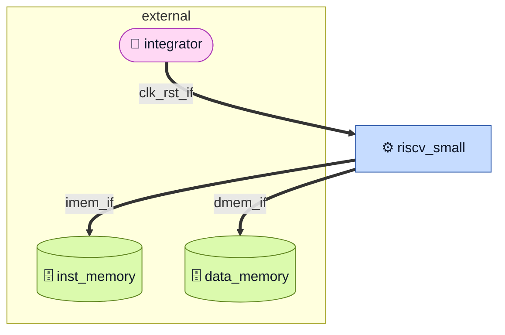
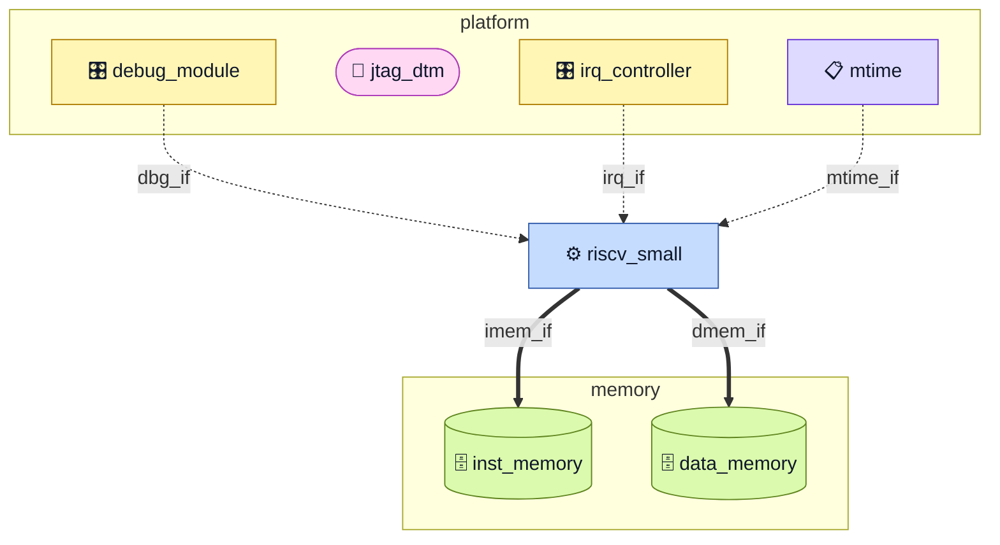
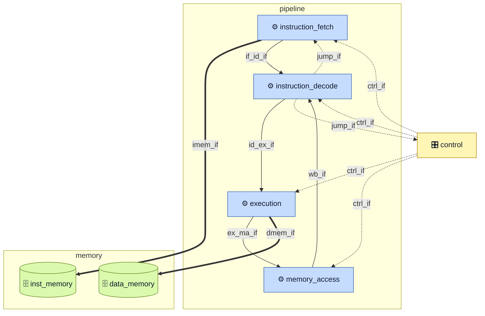
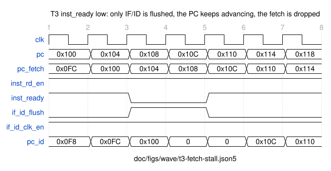
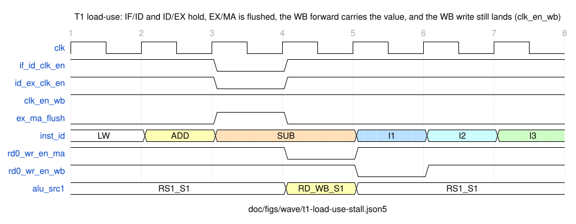
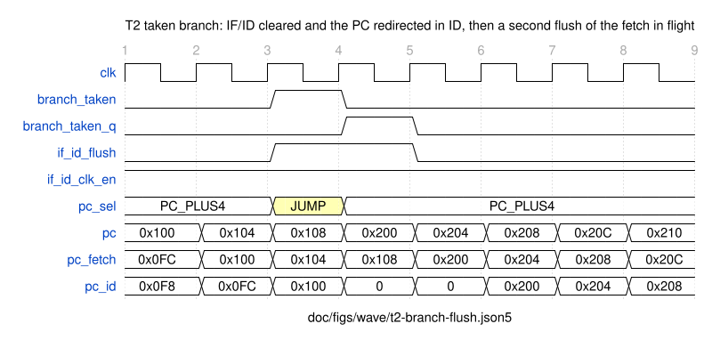
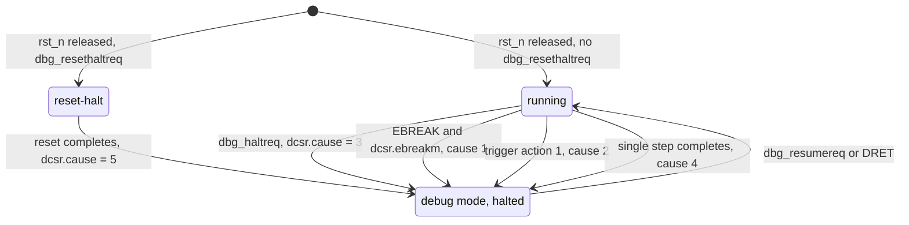

# riscv-small Microarchitecture

| Field | Value |
|---|---|
| Status | draft |
| Implements | [spec.md](spec.md) v0.7.9 |
| Baseline | the post-WP-6 tree the citations were read from: `rtl_digest` `sha256:f48ab029…b9586d` and `tb_digest` `sha256:ae4e6c79…8b5764` (2026-11-05). The project forbids automatic commits, so the content digest is the evidence key; `spec.md` still names `bb789bb` as its v0.1 as-built baseline, with v0.2..v0.7 adding intent only |
| Scope | as built: this document describes `rtl/*.sv`, not the target rows of `spec.md` §4 and §7.1; a v0.7 obligation that the RTL does not meet is written down as **target** and never as built |

Everything below is read from the RTL. Where a `file:line` citation is missing, the sentence is a
pointer to another section, not a behavioural claim. Where the target of `spec.md` differs from the
code, the difference is named with its existing gap ID and the code is described as it is. The
requirement table of `spec.md` v0.7.9 has 59 rows. The ten rows v0.7 added are target only: `FR-50`
(the CSR file and its address map), `FR-51` (`mscratch`), `FR-52` (`mtval`), `FR-53` (debug mode with
`dcsr`/`dpc`/`dscratch`), `FR-54` (run control), `FR-55` (abstract commands), `FR-56` (the program
buffer), `FR-57` (`Sdtrig` triggers), `FR-58` (single step) and `FR-59` (`dbg_auth` strap). No module,
port or register of the RTL implements any of them, and no sentence of this document claims
otherwise; the widened cause bus, the three interrupt inputs, `mtime` and the reset vector are target
in the same way.

## 1. Overview

`riscv_small` is a single-issue, in-order, five-stage RV32I core: instruction fetch (IF), instruction
decode (ID), execute (EX), memory access (MA), write back (WB). Both memories are outside the
boundary: the core presents an instruction address and a data address and expects the integrator to
answer (`rtl/riscv_small.sv:45-58`). There is no cache, no memory, and no bus fabric inside the core
(`C-03`).

Three properties shape the rest of the document. First, **branches and jumps are resolved in ID**:
`jump_decision` sits inside `instruction_decode` and drives `branch_taken` and `jump_addr` straight
back to the fetch stage (`rtl/instruction_decode.sv:178-189`), so a taken branch costs two fetch
slots: the fall-through and the fetch already in flight are both discarded (`rtl/control.sv:246-254`).
Second, **the pipeline has no valid bits**: a stage is empty when its `rd0_wr_en` is
zero, and every flush writes zeros into the pipeline register (for example
`rtl/instruction_decode.sv:97-113`). Third, **stalls are expressed as clock enables, not as a single
`stall` signal**: `control` drives four enables and three flushes independently
(`rtl/control.sv:107-113`).

Deliberately absent, and cited so that a reader does not look for them: no caches or line fills
(`G-15`), no CSR file and no `Zicsr` instruction (`G-13`), no interrupt subsystem — the only trap
request is the level-sensitive `exception` input (`G-14`, `rtl/riscv_small.sv:44`), no atomics and no
second hart (`G-16`), no illegal-instruction trap (`G-06`), and no misaligned split — the lane is
selected but an access crossing a word boundary is still one transaction (`G-22`). The trap vector is the constant 1000 (`G-01`, `rtl/control.sv:277`) and the trap cause
register is tied to zero (`G-02`, `rtl/control.sv:287`). The target for each of these is in
`spec.md` §4; none of it exists here. v0.7 adds ten further target obligations whose target statement
is recorded in §7.10–§7.12: the machine-mode CSR file and its address map (`FR-50`), `mscratch`
(`FR-51`) and `mtval` (`FR-52`), then debug mode with `dcsr`/`dpc`/`dscratch` (`FR-53`), the
run-control handshake (`FR-54`), abstract commands (`FR-55`), the program buffer (`FR-56`), `Sdtrig`
triggers (`FR-57`), single step (`FR-58`) and the `dbg_auth` strap (`FR-59`). v0.7 also records
four target changes to boundaries this core does not have: the trap request widens from one level to
the cause bus `exception[3:0]` (`FR-22`), the three level-sensitive interrupt inputs
`mtip`/`meip`/`msip` join the boundary (`FR-39`, `FR-40`), a 64-bit `mtime` input feeds
`time`/`timeh` (`FR-49`), and the target reset vector becomes the `RESET_VECTOR` parameter (`FR-41`).
The seven rows of the previous revision are target too — `M` (`FR-43`), `C` with `IALIGN=16`
(`FR-44`), `MRET` (`FR-45`), `WFI` (`FR-46`), the six `Zicsr` instructions (`FR-47`), machine
interrupt entry with the `mstatus` stack and the MEI > MSI > MTI priority (`FR-48`), and `Zicntr`
(`FR-49`) — and the core implements none of them, so every one of them is marked target where this
document touches it.

The context is small: one core, two external memories, four control inputs (H0).

*H0 — one core, two external memories, one interface per boundary. `trap_req_if` (`C10`) reaches
`control` directly and is not drawn here. Source: inline, section 1.*

The context is wider than H0 shows once the product is considered: Debug, the timer and the interrupt controller are platform blocks; the core reaches each through one named interface.

*H2 — target: Debug, the timer and the interrupt controller are platform blocks; the core reaches each
through one named interface. The three target interfaces drawn here are `dbg_if` (`C13`), `irq_if` (`C11`) and
`mtime_if` (`C12`); `imem_if` (`C5`) and `dmem_if` (`C6`) are the as-built memory boundaries. In the
target the JTAG DTM reaches the Debug Module over the DMI, which `C-13` keeps outside the core
boundary and therefore out of this figure. Source: inline, section 1.*

## 2. Diagram index

| ID | Claim | Level | Embedded in |
|---|---|---|---|
| H0 | The core owns no memory; instruction fetch and data access are two independent external ports | context | section 1 |
| H1 | Four pipeline stage modules and one control block are joined by one interface per stage boundary; the instruction and data memories stay outside, and write-back is not a module | top | section 6 |
| H2 | Debug, the timer and the interrupt controller are platform blocks; the core reaches each through one named interface | block | section 1 |
| S1 | Debug mode is entered from running by run control, a breakpoint, a trigger or a step, and left only by resume or DRET | state | section 7.12 |
| T1 | A load-use insertion is one cycle of `ex_ma_flush` with IF/ID and ID/EX held, and the WB write still commits because the register file is clocked by `clk_en_wb`, not by `id_ex_clk_en` | cycle | section 7.5 |
| T2 | A taken branch clears IF/ID and redirects the PC in ID, and a second flush discards the fetch in flight | cycle | section 7.5 |
| T3 | A withheld fetch grant deletes the fetch and the PC runs on; nothing is held | cycle | section 7.1 |

Seven figures exist. H0 and H1 are the as-built structure. H2 is target structure — the three
platform blocks the product adds and the interfaces the core will expose to them — and S1 is the
target debug state machine; both H2 and S1 are target, and neither describes a register of the RTL.
The three timing figures T1–T3 are hand-derived from the same
enable and flush expressions as section 9 — they are not captured from a simulation — and each draws
the as-built behaviour: T3 shows the `G-09` fetch defect, and T1 shows the post-WP-6 load-use
insertion, in which the WB write commits although `id_ex_clk_en` is low (section 7.5).

## 3. Parameters and typedefs

The core has **no module parameters**. Every width is literal or comes from the package
(`rtl/riscv_small.sv:38-58`). The two parameters in the repository belong to simulation models that
are not part of the DUT (`rtl/inst_memory.sv:42-47`, see section 7.9).

Reader-visible types, all from `rtl/riscv_definitions_pkg.sv`:

| Name | Kind | Width | Values / meaning | Cite |
|---|---|---|---|---|
| `dataBus_t` | typedef | 32 | address and data bus | `rtl/riscv_definitions_pkg.sv:398` |
| `dataBus_u` | packed union | 32 | one bus seen as `u_data`, `s_data`, `u_bytes[0:3]`, `u_half[0:1]`, `s_bytes[0:3]`, `s_half[0:1]` | `rtl/riscv_definitions_pkg.sv:399-406` |
| `regAddr_t` | typedef | 5 | architectural register index | `rtl/riscv_definitions_pkg.sv:124` |
| `instruction_u` | packed union | 32 | one word seen as `r_type`, `i_type`, `i_type_load`, `i_type_alu`, `s_type`, `b_type`, `u_type`, `j_type`, `memory_b`, `memory_w` | `rtl/riscv_definitions_pkg.sv:382-393` |
| `accessSize_e` | enum | 2 | `ACCESS_BYTE` `00`, `ACCESS_HALF` `01`, `ACCESS_WORD` `10` — the one width decode shared by `data_rd_wr_ctrl` and the store lane/strobe | `rtl/riscv_definitions_pkg.sv:264-268` |
| `nextPCType_e` | enum | 2 | `PC_PLUS4` `00`, `JUMP` `01`, `TRAP` `1?` (wildcard: `10` and `11` both select the trap) | `rtl/riscv_definitions_pkg.sv:50-54` |
| `aluSrc1_e` | enum | 1 | `PC` `0`, `RS1` `1` — decode-side operand 1 select | `rtl/riscv_definitions_pkg.sv:61-64` |
| `aluSrc2_e` | enum | 1 | `RS2` `0`, `IMM` `1` — decode-side operand 2 select | `rtl/riscv_definitions_pkg.sv:69-72` |
| `ctrlAluSrc1_e` | enum | 2 | `PC_S1` `00`, `RS1_S1` `01`, `RD_MA_S1` `10`, `RD_WB_S1` `11` — EX operand 1 select | `rtl/riscv_definitions_pkg.sv:77-82` |
| `ctrlAluSrc2_e` | enum | 2 | `RS2_S2` `00`, `IMM_S2` `01`, `RD_MA_S2` `10`, `RD_WB_S2` `11` — EX operand 2 and store-data select | `rtl/riscv_definitions_pkg.sv:87-92` |
| `ctrlCJmpSrc_e` | enum | 2 | `RD_ID` `00`, `RD_EX` `01`, `RD_MA` `10`, `RD_WB` `11` — branch operand select | `rtl/riscv_definitions_pkg.sv:97-102` |
| `aluOpType_e` | enum | 4 | see the ALU operation table in section 7.7 | `rtl/riscv_definitions_pkg.sv:108-121` |
| `opcodeType_e` | enum | 7 | the eleven decoded opcodes of section 7.2 | `rtl/riscv_definitions_pkg.sv:129-187` |
| `funct3RType_e`, `funct3ITypeALU_e`, `funct3ITypeLOAD_e`, `funct3SType_e`, `funct3BType_e` | enum | 3 | function fields per instruction format | `rtl/riscv_definitions_pkg.sv:193-258` |

Instruction-format overlays used by the decoder (`rs1` is always `[19:15]`, `rs2` always `[24:20]`,
`rd` always `[11:7]`, `opcode` always `[6:0]`):
`instRType_s` `rtl/riscv_definitions_pkg.sv:289-296`, `instIType_s` `:301-307`,
`instITypeLoad_s` `:312-318`, `instITypeALU_s` `:324-330`, `instSType_s` `:335-342`,
`instBType_s` `:347-356`, `instUType_s` `:361-365`, `instJType_s` `:370-377`.

The width decoder is one function, not a field test at each consumer: `access_size(logic [2:0])`
returns `ACCESS_BYTE` for `000`/`100`, `ACCESS_HALF` for `001`/`101`, `ACCESS_WORD` for `010` and for
the remaining encodings `011`/`110`/`111`, so a reserved `funct3` legalises to a word instead of
producing `X`
(`rtl/riscv_definitions_pkg.sv:276-283`). The top-level `data_rd_wr_ctrl` port and the store
lane/strobe in `execution` both call it (section 8).

## 4. Interfaces

Two views of the same boundary. The **catalogue** (§4.1–§4.3) groups the connections into named
interfaces with modports, so a figure can draw one line per connection; the **port table** (§4.4) is the
1:1 transcription of the module header and is the proof that the grouping loses nothing. No `interface`
construct exists in the RTL: the as-built names below are a documentation grouping of existing nets, and
every as-built modport row lists the as-built signals. Rows marked **target** are the v0.7 contract that
the RTL does not implement; the target rows are listed so that a figure or a block section can name the
connection, and they carry a requirement cite instead of an RTL cite.

### 4.1 Interface catalogue

| Interface | Initiator modport | Target modport | Payload | Handshake | Clock / reset | Edge |
|---|---|---|---|---|---|---|
| `clk_rst_if` | `integrator` | `core` | `clk`, `clk_en`, `rst_n` | none | — | C9 |
| `trap_req_if` | `integrator` | `control` | `exception` | level | `clk`, `rst_n` | C10 |
| `imem_if` | `fetch` | `memory` | `inst_addr`, `inst_rd_en` → `inst_data`, `inst_ready` | ready/valid | `clk`, `rst_n` | C5 |
| `dmem_if` | `execute` | `memory` | `data_addr`, `data_wr`, `data_wr_strb`, `data_rd_en_ma`, `data_wr_en_ma`, `data_rd_wr_ctrl` → `data_rd`, `data_ready` | grant on `ready` | `clk`, `rst_n` | C6 |
| `if_id_if` | `fetch` | `decode` | `pc_id`, `inst_id` | none (registered) | `clk`, `if_id_clk_en`, `rst_n` | C1 |
| `id_ex_if` | `decode` | `execute` | `pc_ex`, `rs1_ex`, `rs2_ex`, `imm_ex`, `alu_op_ex`, `alu_src1_ex`, `alu_src2_ex`, `rd0_addr_ex`, `rd0_wr_en_ex`, `data_rd_en_ex`, `data_wr_en_ex`, `funct3_ex`, `rs1_addr_ex`, `rs2_addr_ex` | none (registered) | `clk`, `id_ex_clk_en`, `rst_n` | C2 |
| `ex_ma_if` | `execute` | `memory` | `alu_ma`, `data_wr`, `data_wr_strb`, `rd0_addr_ma`, `rd0_wr_en_ma`, `data_rd_en_ma`, `data_wr_en_ma`, `rd_wr_ctrl` | none (registered) | `clk`, `ex_ma_clk_en`, `rst_n` | C3 |
| `ma_wb_if` | `memory` | `writeback` | `alu_wb`, `ld_data_wb`, `rd0_addr_wb`, `rd0_wr_en_wb`, `wb_mux_sel_wb` | none (registered) | `clk`, `ma_wb_clk_en`, `rst_n` | C4 |
| `wb_if` | `writeback` | `decode` | `rd0_addr_wb`, `rd0_data_wb`, `rd0_wr_en_wb` | none (combinational) | `clk`, `rst_n` | C4 |
| `ctrl_if` | `control` | `stage` | 4 enables, 3 flushes, `pc_sel`, `inst_rd_en`, `alu_src1`, `alu_src2`, `storage_src`, `jmp_src1`, `jmp_src2`, `trap_addr` | none (level) | `clk`, `rst_n` | C7 |
| `jump_if` | `decode` | `fetch`, `control` | `jump_addr`, `branch_taken`, `cond_jump` | redirect | `clk`, `rst_n` | C8 |
| `irq_if` — target | `irqctrl` | `core` | `mtip`, `meip`, `msip` | level-sensitive, one input per cause (`FR-39`, `FR-40`, `FR-48`) | `clk`, `rst_n` | C11 |
| `mtime_if` — target | `platform` | `core` | `mtime[63:0]` | none; a free-running platform counter (`FR-49`, `Q-42`) | `clk`, `rst_n` | C12 |
| `dbg_if` — target | `debug_module` | `hart` | 17 signals in three channels: 4 run-control inputs and 4 status outputs, 5 abstract-command signals, 4 program-buffer signals (§4.2; `FR-53`..`FR-58`, `C-13`) | request/status levels plus a command handshake | `clk`, `rst_n`, `dbg_dmactive` | C13 |
| `auth_if` — target | `integrator` | `core` | `dbg_auth` | none; a static platform strap, low means the hart ignores halt and reset-halt, never enters debug mode and reports `dbg_halted` = 0 (`FR-59`, `C-14`, `D-11`) | — | C16 |
| `csr_if` — target | `pipeline`, `control` | `csrfile` | a CSR address, an access qualifier and write data from the pipeline; the read value back (`FR-50`) | read-modify-write request and response | `clk`, `rst_n` | C14, C15 |

> **`trap_req_if` — target, not as built.** The row above is the as-built contract: one level-sensitive
> `exception` bit (`rtl/riscv_small.sv:44`) and a cause register tied to zero (`rtl/control.sv:287`,
> `G-02`). The target widens the same input to `exception[3:0]`, a cause bus that carries the reason of
> a synchronous request; the core captures that value at entry and does not re-read the bus afterwards
> (`FR-22`, `Q-35`). The as-built row is left unchanged because the one-bit input is what the RTL has.

> **`dmem_if` — target, not as built.** The row is the interface the RTL declares, and it now carries
> the byte strobes: `data_wr_strb[3:0]` is an output of the core and the EX/MA register drives it
> (`rtl/riscv_small.sv:58`, `rtl/execution.sv:115`), so the core places the store value in the addressed
> lane and the memory applies the strobes as received. Two parts of the contract remain target: an access
> that crosses a word boundary is still a single transaction, and the target splits it into two
> word-aligned beats (`FR-42`, `Q-29`, `G-22`); `SC` needs a success-or-failure indication on the response
> side, which the present `data_rd` / `data_ready` pair does not carry (`FR-35`); and misaligned atomics
> are excluded from the split, because `LR`, `SC` and `AMO` must be naturally aligned and otherwise take a
> misaligned or access-fault exception rather than a second beat (`FR-42`, `FR-35`).

`writeback` is not a module: it is the top-level mux at `rtl/riscv_small.sv:224`, which is why §4.3 has
one row for the pair `ma_wb_if`/`wb_if` and the H1 figure collapses both into a single `wb_if` edge.

### 4.2 Modport map

One row per side. Direction is from the modport's point of view; the signal names are the as-built nets,
except in the rows marked **target**, which name signals the target adds and the RTL does not have.

| Interface | Modport | Dir | Signals | Sampling / timing | Cite |
|---|---|---|---|---|---|
| `clk_rst_if` | `integrator` | out | `clk`, `clk_en`, `rst_n` | free-running; `rst_n` asserts and releases asynchronously (`G-21`) | `rtl/riscv_small.sv:41-43` |
| `clk_rst_if` | `core` | in | `clk`, `clk_en`, `rst_n` | every `always_ff` | `rtl/riscv_small.sv:41-43` |
| `trap_req_if` | `integrator` | out | `exception` | level, at least one edge | `rtl/riscv_small.sv:44` |
| `trap_req_if` | `control` | in | `exception` | overrides `branch_taken` | `rtl/control.sv:256` |
| `imem_if` | `fetch` | out | `inst_addr`, `inst_rd_en` | `inst_addr` is `pc`, or `pc_fetch` while `clk_en` is low | `rtl/instruction_fetch.sv:71` |
| `imem_if` | `memory` | out | `inst_data`, `inst_ready` | `inst_ready` low flushes IF/ID | `rtl/control.sv:262-265` |
| `dmem_if` | `execute` | out | `data_addr`, `data_wr`, `data_wr_strb`, `data_rd_en_ma`, `data_wr_en_ma`, `data_rd_wr_ctrl` | registered strobes; `data_wr` and `data_wr_strb` are lane-placed in EX | `rtl/riscv_small.sv:119-120`, `:196-203` |
| `dmem_if` | `memory` | out | `data_rd`, `data_ready` | `data_ready` low freezes on a load | `rtl/control.sv:267-273` |
| `if_id_if` | `fetch` | out | `pc_id`, `inst_id` | registered, held while `if_id_clk_en` is low | `rtl/instruction_fetch.sv:78-93` |
| `if_id_if` | `decode` | in | `pc_id`, `inst_id` | combinationally in ID | `rtl/instruction_decode.sv:46-47`, `:255` |
| `id_ex_if` | `decode` | out | see §4.1 | registered, cleared by `id_ex_flush` | `rtl/instruction_decode.sv:97-130` |
| `id_ex_if` | `execute` | in | see §4.1 | sampled on an enabled edge | `rtl/execution.sv:96-117` |
| `ex_ma_if` | `execute` | out | see §4.1 | registered, cleared by `ex_ma_flush` | `rtl/execution.sv:96-117` |
| `ex_ma_if` | `memory` | in | see §4.1 | strobes pass to `dmem_if` | `rtl/riscv_small.sv:195-203` |
| `ma_wb_if` | `memory` | out | see §4.1 | registered, never flushed | `rtl/memory_access.sv:71-87` |
| `ma_wb_if` | `writeback` | in | see §4.1 | muxed by `wb_mux_sel_wb` | `rtl/riscv_small.sv:224` |
| `wb_if` | `writeback` | out | see §4.1 | combinational | `rtl/riscv_small.sv:224` |
| `wb_if` | `decode` | in | see §4.1 | register-file write port | `rtl/reg_file.sv:94-105` |
| `ctrl_if` | `control` | out | see §4.1 | one `always_comb` | `rtl/control.sv:101-275` |
| `ctrl_if` | `stage` | in | see §4.1 | every stage | `rtl/riscv_small.sv:124-224` |
| `jump_if` | `decode` | out | `jump_addr`, `branch_taken`, `cond_jump` | combinational from `jump_decision` | `rtl/instruction_decode.sv:178-189` |
| `jump_if` | `fetch` | in | `jump_addr` | selected as the next PC | `rtl/instruction_fetch.sv:104-117` |
| `jump_if` | `control` | in | `branch_taken`, `cond_jump` | selects `JUMP`, flushes IF/ID | `rtl/control.sv:246-249` |
| `irq_if` — target | `irqctrl` | out | `mtip`, `meip`, `msip` | level; target samples every enabled edge | `spec.md` §6 (`FR-39`, `FR-40`) |
| `irq_if` — target | `core` | in | `mtip`, `meip`, `msip` | level; target feeds `mip` and the entry priority, never latched as an edge | `spec.md` §6 (`FR-48`) |
| `mtime_if` — target | `platform` | out | `mtime[63:0]` | free-running; target reads it as `time`/`timeh` with no memory access | `spec.md` §6 (`FR-49`, `Q-42`) |
| `mtime_if` — target | `core` | in | `mtime[63:0]` | target samples the counter in the CSR read path | `spec.md` §6 (`FR-49`) |
| `dbg_if` — target | `debug_module` | out | `dbg_dmactive`, `dbg_haltreq`, `dbg_resumereq`, `dbg_resethaltreq`, `dbg_command[31:0]`, `dbg_data0_wdata[31:0]`, `dbg_progbuf_inst[31:0]`, `dbg_progbuf_wr_en` | target: requests, command and program-buffer words | `spec.md` §6 (`FR-54`..`FR-56`) |
| `dbg_if` — target | `debug_module` | in | `dbg_halted`, `dbg_running`, `dbg_havereset`, `dbg_resumeack`, `dbg_data0_rdata[31:0]`, `dbg_busy`, `dbg_cmderr[2:0]`, `dbg_progbuf_ready`, `dbg_progbuf_done` | target: status and completion read back | `spec.md` §6 (`FR-54`..`FR-56`) |
| `dbg_if` — target | `hart` | in | the eight inputs listed above | target: sampled in debug mode or at an instruction boundary | `spec.md` §6 (`FR-54`) |
| `dbg_if` — target | `hart` | out | the nine outputs listed above | target: driven from debug state | `spec.md` §6 (`FR-53`, `FR-55`) |
| `auth_if` — target | `integrator` | out | `dbg_auth` | target: a static platform strap, sampled when the hart considers a halt or reset-halt request | `spec.md` §6 (`FR-59`, `C-14`, `D-11`) |
| `auth_if` — target | `core` | in | `dbg_auth` | target: low holds the hart out of debug mode and forces `dbg_halted` = 0 | `spec.md` §6 (`FR-59`, `D-11`) |
| `csr_if` — target | `pipeline` | out | CSR address, access qualifier and write data; target: ID decodes the `CSR*` word, EX supplies the write value, WB receives the read value | target: one request per `CSR*` instruction | `spec.md` §6 (`FR-47`, `FR-50`) |
| `csr_if` — target | `csrfile` | out | the CSR read value | target: the file answers the request | `spec.md` §6 (`FR-50`) |
| `csr_if` — target | `control` | out | the trap-entry state (`mepc`, `mcause`, `mstatus`) | target: written by `control` as the trap is taken | `spec.md` §6 (`FR-23`, `FR-48`) |

Four interfaces (`id_ex_if`, `ex_ma_if`, `ma_wb_if`, `ctrl_if`) repeat §4.1 rather than duplicating a
20-signal list four times; the payload is identical on both sides of a pipeline register by construction.

### 4.3 Connection table

One row per directed edge a figure may draw. `#` is stable and cited from figure captions.

| # | From | To | Interface | Modports | Edge style |
|---|---|---|---|---|---|
| C1 | `instruction_fetch` | `instruction_decode` | `if_id_if` | `fetch` → `decode` | solid |
| C2 | `instruction_decode` | `execution` | `id_ex_if` | `decode` → `execute` | solid |
| C3 | `execution` | `memory_access` | `ex_ma_if` | `execute` → `memory` | solid |
| C4 | `memory_access` | `instruction_decode` (via the write-back mux) | `ma_wb_if`, `wb_if` | `memory` → `writeback`, `writeback` → `decode` | solid |
| C5 | `instruction_fetch` | instruction memory | `imem_if` | `fetch` → `memory` | thick |
| C6 | `execution` | data memory | `dmem_if` | `execute` → `memory` | thick |
| C7 | `control` | every stage | `ctrl_if` | `control` → `stage` | dashed |
| C8 | `instruction_decode` | `instruction_fetch`, `control` | `jump_if` | `decode` → `fetch`, `decode` → `control` | dashed |
| C9 | integrator | core | `clk_rst_if` | `integrator` → `core` | thick |
| C10 | integrator | `control` | `trap_req_if` | `integrator` → `control` | dashed |
| C11 | interrupt controller (target) | core | `irq_if` | `irqctrl` → `core` | dashed |
| C12 | platform timer (target) | core | `mtime_if` | `platform` → `core` | dashed |
| C13 | external Debug Module (target) | core hart side | `dbg_if` | `debug_module` → `hart` | thick |
| C14 | pipeline, ID/EX/WB (target) | CSR file | `csr_if` | `pipeline` → `csrfile` | solid |
| C15 | `control` (target) | CSR file | `csr_if` | `control` → `csrfile` | dashed |
| C16 | platform strap (target) | core | `auth_if` | `integrator` → `core` | dashed |

Rows C11–C16 are target: no such net, port or module exists in `rtl/` (`rtl/riscv_small.sv:41-58`).
In the target, C13 is the hart side of an external Debug Module and carries no DMI, which `C-13` keeps
between the DTM and the Debug Module.

### 4.4 Top-level ports

Transcription of `rtl/riscv_small.sv:40-59`, one row per port, sixteen ports in header order.
Direction is from the core's point of view.

| Signal | Dir | Width | Producer | Consumer | Protocol / timing | Reset value |
|---|---|---|---|---|---|---|
| `clk` | in | 1 | integrator | every `always_ff` | rising edge; single domain (`C-01`) | — |
| `clk_en` | in | 1 | integrator | `control` (`rtl/riscv_small.sv:228`) and the register-file enable of `instruction_decode` (`:144`) | level; inside `control` it gates `sepc`/`scause` and `branch_taken_q` only (`G-12`) | — |
| `rst_n` | in | 1 | integrator | every `always_ff` | active low; assertion and release both asynchronous as built — no de-assertion synchroniser and no reset-style macro (`G-21`); target: asynchronous assertion, synchronous release through `RESET_SYNC_STAGES`, default 2 (`C-01`, `FR-41`, `A-06`) | — |
| `exception` | in | 1 | integrator | `control` | level; asserted for at least one `clk` edge redirects the PC to the trap constant | 0 |
| `inst_ready` | in | 1 | instruction memory | `control` | level; low flushes IF/ID for that cycle; the PC is **not** held (`G-09`) | — |
| `inst_data` | in | 32 | instruction memory | `instruction_fetch` | `instruction_u`; registered into `inst_id` on every enabled edge, regardless of `inst_ready` | — |
| `inst_addr` | out | 32 | `instruction_fetch` | instruction memory | `dataBus_t`; `pc` while the stage runs, `pc_fetch` while it is frozen (`rtl/instruction_fetch.sv:71`); changes only when IF/ID advances or the request falls back | 0 |
| `inst_rd_en` | out | 1 | `control` | instruction memory | combinational; tied to `1'b1`, never deasserted (`rtl/control.sv:115`) | 1 |
| `data_ready` | in | 1 | data memory | `control` | level; low freezes all four stages while the load indicator is set | — |
| `data_rd` | in | 32 | data memory | `memory_access` | `dataBus_u`; must be valid in the cycle the load commits in WB | — |
| `data_rd_en_ma` | out | 1 | `execution` (EX/MA register) | data memory | registered read strobe; one cycle per load unless a stall freezes MA | 0 |
| `data_wr_en_ma` | out | 1 | `execution` (EX/MA register) | data memory | registered write strobe; one cycle per store unless a stall freezes MA; **not** qualified by `data_ready` (`G-18`) | 0 |
| `data_wr` | out | 32 | `execution` (`rs2_ma`) | data memory | `dataBus_u`; store data after the `storage_src` mux, already rotated into the addressed lane by the store-lane block (`rtl/execution.sv:191-214`, wired at `rtl/riscv_small.sv:197`); meaningful only with `data_wr_strb != 4'b0000` | 0 |
| `data_addr` | out | 32 | `execution` (`alu_ma`) | data memory | `dataBus_u`; byte address, equals the ALU result of EX (`rtl/riscv_small.sv:120`) | 0 |
| `data_rd_wr_ctrl` | out | 2 | `execution` (`funct3_ma`) through `access_size` | data memory | `logic [1:0]`; `2'b00` byte, `2'b01` halfword, `2'b10` word (`rtl/riscv_small.sv:119`, `rtl/riscv_definitions_pkg.sv:276-283`); driven for every instruction (section 8) | 0 |
| `data_wr_strb` | out | 4 | `execution` (`data_wr_strb_ma`) | data memory | one bit per byte lane of `data_wr`; `4'b0001 << data_addr[1:0]` for `SB`, `4'b0011 << {data_addr[1],1'b0}` for `SH`, `4'b1111` for `SW`, `4'b0000` with no write (`rtl/execution.sv:191-214`, registered at `:115`) | 0 |

> **Target, not as built.** The sixteen rows above are the as-built port set of `rtl/riscv_small.sv:41-58`,
> and the as-built port count is therefore sixteen. `data_wr_strb[3:0]` is one of them: WP-6 added it, so
> the core places the store value in the addressed lane, asserts the strobes for the bytes it drives and
> the memory never shifts or justifies (`FR-11`, `Q-28`). The target widens the existing one-bit
> `exception` input to `exception[3:0]`, a cause bus
> carrying the reason of a synchronous request, rather than adding a new group (`FR-22`, `Q-35`); as
> built that input is one level-sensitive bit (`rtl/riscv_small.sv:44`). The target adds three
> level-sensitive interrupt inputs, `mtip`, `meip` and `msip`, one per machine interrupt source
> (`FR-39`, `FR-40`, `FR-36`, `FR-48`). The target adds the 64-bit `mtime[63:0]` input that `time` and
> `timeh` view (`FR-49`, `Q-42`). The target adds the debug group of eighteen signals — seventeen on
> `dbg_if`, the run-control, abstract-command and program-buffer channels, and one on `auth_if`, the
> `dbg_auth` strap from the platform (`FR-54`..`FR-56`, `FR-59`, `C-14`, `D-11`) — and
> that group is absent when `DEBUG_ENABLED` = 0 (`C-13`, `spec.md` §6). The target adds the
> store-conditional success indication on the data response side that `FR-35` requires, which is not
> one of the sixteen data-path signals. The "sixteen" of `spec.md` §6 is now exactly the as-built port
> set of this table and counts the data path only; it does not include the interrupt requests, the trap
> cause, the timer or the debug group, so the target port count of the whole core is larger than sixteen.

Two internal connections are part of this contract and are easy to miss:

- `data_rd_wr_ctrl` is the decoded width, not a cast:
  `assign data_rd_wr_ctrl = access_size(rd_wr_ctrl);` (`rtl/riscv_small.sv:119`), one function shared with
  the store lane/strobe (`rtl/execution.sv:195`). `funct3 = 010` therefore reads `2'b10` and a word
  access is distinguishable from a byte access; the reserved `3'b011`/`3'b110`/`3'b111` arms legalise to
  `2'b10` in the function's default (`rtl/riscv_definitions_pkg.sv:276-283`).
- `clk_en` reaches `control` and the register-file enable of `instruction_decode` and nothing else
  (`rtl/riscv_small.sv:228`, `:144`); inside `control` it gates `sepc`/`scause` and `branch_taken_q` only
  (`rtl/control.sv:92-99`, `:284`), and the pipeline is gated by `control`'s own enables (`G-12`).

## 5. Clocks and resets

| Clock | Nominal | Source | Domains |
|---|---|---|---|
| `clk` | not specified — no frequency target exists (`A-08`, `G-05`) | integrator | all registers; no divided or gated clock is generated |

| Reset | Kind | Polarity | Synchronization | Scope |
|---|---|---|---|---|
| `rst_n` | asynchronous as built — assertion **and** release (`G-21`); target: hybrid, asynchronous assertion with a synchronised release (`C-01`, `FR-41`, `A-06`, `D-09`) | active low | none in the code: every sequential block hardcodes `posedge clk or negedge rst_n` and there is no reset-style macro (`rtl/instruction_fetch.sv:78`, `rtl/control.sv:279`, `G-21`); target: `RESET_SYNC_STAGES` enabled edges, default 2 (`FR-41`) | every `always_ff`, listed below |

Reset de-assertion is the **core's** obligation, not the integrator's: `C-01` has the integrator drive
`rst_n` directly and add no second synchroniser, and `FR-41` requires the core to release reset through
`RESET_SYNC_STAGES` enabled edges, with `A-06` and the project decision `D-09` fixing the hybrid style
(`doc/spec.md` §0.1, §5.1, §5.2). None of that exists in `rtl/`: the release is as asynchronous as the
assertion, which is `G-21`. One further part of `FR-41` is target, not as built: the target first fetch
address after reset is the build-time parameter `RESET_VECTOR`, default `0x8000_0000`, whose value is
fixed by `Q-33` and which software cannot move because it is not a CSR (`FR-41`, `Q-33`, `spec.md`
§5.2). As built there is no such parameter and `pc` resets to 0, so the first fetch leaves at address 0
(`rtl/instruction_fetch.sv:100-103`).

The asynchronous reset appears in eight `always_ff` blocks, all with the same sensitivity list
`posedge clk or negedge rst_n`:

| Register(s) | Block | Reset value | Cite |
|---|---|---|---|
| `pc` | fetch program counter | 0 | `rtl/instruction_fetch.sv:100-103` |
| `pc_id`, `inst_id` | IF/ID | 0, 0 | `rtl/instruction_fetch.sv:78-93` |
| `rd0_wr_en_ex` and the remaining ID/EX fields | ID/EX | all 0, except `alu_src1_ex = RS1`, `alu_src2_ex = RS2`, `alu_op_ex = ALU_ADD`, `funct3_ex = LB` | `rtl/instruction_decode.sv:97-113` |
| `alu_ma`, `rd0_wr_en_ma`, `data_rd_en_ma`, `data_wr_en_ma`, `funct3_ma`, `rd0_addr_ma`, `rs2_ma`, `data_wr_strb_ma` | EX/MA | all 0, except `funct3_ma = LB` | `rtl/execution.sv:97-106` |
| `rd0_addr_wb`, `wb_mux_sel_wb`, `rd0_wr_en_wb`, `alu_wb` | MA/WB | all 0 | `rtl/memory_access.sv:71-78` |
| `regs[1:31]` | register file | `'X` — deliberately unspecified (`A-04`) | `rtl/reg_file.sv:94-98` |
| `branch_taken_q` | branch-resolved flop | 0 | `rtl/control.sv:92-99` |
| `sepc`, `scause` | trap state | 0 | `rtl/control.sv:279-283` |

`MA/WB` has no flush input: once an instruction reaches MA it always reaches WB
(`rtl/memory_access.sv:71-87`). That is why a trap cannot cancel the instruction already in EX or
beyond (section 7.5).

## 6. Pipeline and control

Four pipeline stage modules and one control block; the write-back stage is not a module (H1).

*H1 — One interface per stage boundary; control is the only fan-out. Both memory edges run from the
initiator to the memory (`C5`, `C6`) and are drawn once each: the data and the grant come back on the
same interface, so they are not a second edge. Source: inline, section 6.*

Every solid edge is one interface from §4.1 and the dashed ones are `jump_if` and `ctrl_if`; the
signal count per line is deliberately zero, because the payload lives in §4.2. The two thick memory
edges point from the initiator to the memory, matching `C5` and `C6`; the data and the grant return
inside the same interface. The `wb_if` edge collapses the write-back mux (`C4`): `memory_access`
produces `ma_wb_if`, the top-level mux turns it into `wb_if` (`rtl/riscv_small.sv:224`), and
`instruction_decode` consumes it at its `rd0_data_wb`/`rd0_wr_en`/`rd0_addr_wb` ports
(`rtl/riscv_small.sv:151-153`) and at the register-file write port
(`rtl/instruction_decode.sv:50-52`, `:201-212`).

**IF.** Holds `pc` and the IF/ID register. `inst_addr` is `pc`, or `pc_fetch` while `clk_en` is low
(`rtl/instruction_fetch.sv:71`), so the address and `inst_rd_en` appear in the same cycle while the
stage runs, and a frozen stage re-requests the address whose word is on the bus (section 7.1). On an
enabled edge `pc` advances by four, or takes `jump_addr`, or takes `trap_addr`, as `pc_sel` says
(`rtl/instruction_fetch.sv:104-117`); `inst_data` is registered into `inst_id` alongside `pc_id`
(`rtl/instruction_fetch.sv:88-91`). `flush` clears IF/ID at the edge, regardless of `clk_en`
(`rtl/instruction_fetch.sv:78`). Both the PC and IF/ID are gated by `if_id_clk_en`, which is how a
downstream stall freezes the fetch stream (`rtl/riscv_small.sv:126`).

**ID.** Reads `rs1`/`rs2` from the register file, generates the immediate, decodes the opcode into
`alu_op`, `alu_src1`, `alu_src2`, `data_rd_en`, `data_wr_en`, `rd0_wr_en`, `cond_jump`,
`uncond_jump` and `base_addr_sel` (`rtl/instruction_decode.sv:245-345`), and resolves the branch
through `jump_decision` (`rtl/instruction_decode.sv:178-189`). Branch operands pass through a
four-way forward mux before the comparison (`rtl/instruction_decode.sv:135-174`). The results are
registered into ID/EX, which is cleared by `flush` (`rtl/instruction_decode.sv:97-130`). The register
file writes on `clk_en_wb`, the global `clk_en`, not on the ID/EX enable (`rtl/instruction_decode.sv:44`,
`:203`).

**EX.** Selects both ALU operands from `pc`, `rs1`, `alu_ma` or the write-back data
(`rtl/execution.sv:122-161`), selects the store data into `rs2_pipeline` from `rs2`, `alu_ma` or the
write-back data (`rtl/execution.sv:166-183`), rotates the store value into the addressed lane and
derives the byte strobes (`rtl/execution.sv:191-214`), and runs `alu` combinationally
(`rtl/execution.sv:219-224`). `alu_ex` is the unregistered result for the ID forward path and
`alu_ma` is the registered one (`rtl/execution.sv:108`).

**MA.** Asserts the data strobes and the address, which are the registered EX outputs
(`rtl/execution.sv:108-115`, `rtl/riscv_small.sv:119-120`), and extends the load data according to
`rd_wr_ctrl_wb` and `alu_wb[1:0]` (`rtl/memory_access.sv:89-111`). Both strobes and the byte strobe are
EX/MA register outputs, so a frozen EX/MA holds them asserted (section 8).

**WB.** There is no WB module: `memory_access` registers the MA result into MA/WB
(`rtl/memory_access.sv:71-87`), the top-level mux picks memory data or the ALU result
(`assign rd0_data_wb = wb_mux_sel_wb? ld_data_wb : alu_wb;`, `rtl/riscv_small.sv:224`), and the
register file inside ID commits it on the next enabled edge (`rtl/reg_file.sv:94-105`).

**Control fan-out.** `control` is the only producer of `pc_sel`, `inst_rd_en`, the four stage enables
(`{if_id,id_ex,ex_ma,ma_wb}_clk_en`), the three flushes (`{if_id,id_ex,ex_ma}_flush`), the two ALU
selects, `storage_src`, the two jump selects and `trap_addr` (`rtl/control.sv:66-80`). Its defaults
are "run": every enable 1, every flush 0, `pc_sel = PC_PLUS4`, `inst_rd_en = 1`
(`rtl/control.sv:102-115`); every hazard is an override inside one `always_comb`
(`rtl/control.sv:101-275`). Because the overrides are ordered assignments in one block, the later
condition wins: `exception` (`rtl/control.sv:256`) overrides `branch_taken`
(`rtl/control.sv:246`), and the data stall (`rtl/control.sv:268`) overrides any enable set to 1
earlier.

## 7. Block sections

Block IDs, files and the instantiation that creates them. `BLK-REG` and `BLK-JMP` are instantiated
inside `instruction_decode`, not in the top (`rtl/instruction_decode.sv:178`, `:201`); `BLK-ALU` is
instantiated inside `execution` (`rtl/execution.sv:219`).

| ID | Module | File | Instance | Created by |
|---|---|---|---|---|
| BLK-TOP | `riscv_small` | `rtl/riscv_small.sv` | — (the boundary) | the integrator |
| BLK-IF | `instruction_fetch` | `rtl/instruction_fetch.sv` | `u_instruction_fetch` | `riscv_small` (`rtl/riscv_small.sv:124`) |
| BLK-ID | `instruction_decode` | `rtl/instruction_decode.sv` | `u_instruction_decode` | `riscv_small` (`rtl/riscv_small.sv:141`) |
| BLK-EX | `execution` | `rtl/execution.sv` | `u_exection` | `riscv_small` (`rtl/riscv_small.sv:176`) |
| BLK-MA | `memory_access` | `rtl/memory_access.sv` | `u_memory_access` | `riscv_small` (`rtl/riscv_small.sv:206`) |
| BLK-CTL | `control` | `rtl/control.sv` | `u_control` | `riscv_small` (`rtl/riscv_small.sv:226`) |
| BLK-REG | `reg_file` | `rtl/reg_file.sv` | `u_reg_file` | `instruction_decode` (`rtl/instruction_decode.sv:201`) |
| BLK-ALU | `alu` | `rtl/alu.sv` | `u_alu` | `execution` (`rtl/execution.sv:219`) |
| BLK-JMP | `jump_decision` | `rtl/jump_decision.sv` | `u_jump_decision` | `instruction_decode` (`rtl/instruction_decode.sv:178`) |

The instance name `u_exection` is the spelling in the RTL (`rtl/riscv_small.sv:176`).

Three further block IDs — `BLK-CSR`, `BLK-TRAP` and `BLK-DBG` — have no module, no file and no
instance: they are target blocks of v0.7 and are described in §7.10–§7.12, which is why they are absent
from the table above.

### 7.0 BLK-TOP — `riscv_small` (`rtl/riscv_small.sv`)

**Purpose.** Wiring only. It declares the external ports, connects the five stage modules to each
other and to the two memories, and holds the single write-back multiplexer. It contains no
sequential logic, so every timing property in this document belongs to one of the modules below.

**Interface.** Sixteen ports, transcribed 1:1 in section 4.4; every internal connection is one of the
catalogue interfaces in section 4.1 (`clk_rst_if`, `trap_req_if`, `imem_if`, `dmem_if`, `if_id_if`,
`id_ex_if`, `ex_ma_if`, `ma_wb_if`, `wb_if`, `ctrl_if`, `jump_if`). The top adds no port that the table
omits. Internally it also crosses the module boundaries with `pc_id`, `inst_id`, `jump_addr`,
`trap_addr`, `pc_sel`, `cond_jump`, `branch_taken` and the four stage-enable / three flush nets
(`rtl/riscv_small.sv:60-116`).

**State.** None. No `always_ff` and no register is declared in the top; every internal `logic`,
`dataBus_*` and enum is driven by a port of a submodule or by one of the two continuous assignments.

**Behaviour.** Five instantiations in pipeline order: `u_instruction_fetch` (`rtl/riscv_small.sv:124`),
`u_instruction_decode` (`:141`), `u_exection` (`:176`), `u_memory_access` (`:206`),
`u_control` (`:226`). Two continuous assignments complete the interface:
`data_rd_wr_ctrl = access_size(rd_wr_ctrl)` (`:119`) and `data_addr = alu_ma` (`:120`). The write-back mux
is `rd0_data_wb = wb_mux_sel_wb ? ld_data_wb : alu_wb` (`:224`). Three nets are pass-throughs worth
naming because they change stage on the way out: `data_wr` and `data_wr_strb` are driven by the
lane-placed EX/MA outputs (`:197-198`), `inst_rd_en` comes from `control` (`:259`), and `clk_en` is
wired to `control` (`:228`) and to the register-file enable `clk_en_wb` (`:144`).

**Corner cases.**

- Three modules of this document are *not* instantiated here: `reg_file` and `jump_decision` live
  inside `instruction_decode` (`rtl/instruction_decode.sv:178`, `:201`) and `alu` inside `execution`
  (`rtl/execution.sv:219`). The H1 figure shows the five top-level modules for that reason.
- The WB stage has no module: its register lives in `memory_access` and its mux lives in the top
  (`:224`).
- `clk_en` is passed to `control` (`:228`) and to the register-file enable of `instruction_decode`
  (`:144`); the stage clock enables are all generated inside `control` (`G-12`).

### 7.1 BLK-IF — `instruction_fetch` (`rtl/instruction_fetch.sv`)

**Purpose.** Owns the program counter and the IF/ID register. It decides nothing: the next PC comes
from `pc_sel`, and whether the stage advances comes from `clk_en`. It does not check `inst_ready`
and does not know that a fetch is outstanding.

**Interface.** 11 ports, transcribed from `rtl/instruction_fetch.sv:45-58`.

Interfaces: `clk_rst_if` (`core`), `imem_if` (`fetch`), `if_id_if` (`fetch`), `jump_if` (`fetch`), `ctrl_if` (`stage`).

| Signal | Dir | Width | Description |
|---|---|---|---|
| `clk` | in | 1 | clock |
| `clk_en` | in | 1 | wired to `if_id_clk_en`; gates both the PC and IF/ID (`rtl/riscv_small.sv:126`) |
| `rst_n` | in | 1 | asynchronous, active low |
| `inst_data` | in | 32 | `instruction_u` from the instruction memory |
| `flush` | in | 1 | wired to `if_id_flush`; clears IF/ID at the edge and ignores `clk_en` |
| `inst_addr` | out | 32 | `dataBus_t`; equals `pc`, or `pc_fetch` while `clk_en` is low (`rtl/instruction_fetch.sv:71`) |
| `inst_id` | out | 32 | `instruction_u` registered for ID |
| `pc_id` | out | 32 | `dataBus_t` of the instruction registered for ID |
| `jump_addr` | in | 32 | `dataBus_t` from `instruction_decode` |
| `trap_addr` | in | 32 | `dataBus_t` from `control` |
| `pc_sel` | in | 2 | `nextPCType_e` |

**State.** `pc` (32 bits, reset 0, `rtl/instruction_fetch.sv:100-103`) and one `always_ff` holding
`pc_fetch`, `pc_id` and `inst_id` (reset 0, `:78-93`). `pc_fetch` is the address of the fetch whose
word is on `inst_data`; `pc_id`/`inst_id` are what ID decodes, and `flush` clears the pair but not
`pc_fetch`. There is no valid bit: a flushed IF/ID holds `0`, which decodes as "no write" (section 7.2).

**Behaviour.**

- `inst_addr = clk_en ? pc : pc_fetch`, combinationally (`rtl/instruction_fetch.sv:71`). While the
  stage runs it presents `pc`; while IF/ID is paused it re-presents `pc_fetch`, the address whose word
  is on the bus. The memory answers one cycle after the address is presented, so the instruction on
  `inst_data` in cycle *n* belongs to the address presented in cycle *n-1*. `pc_fetch` is that
  address: it registers `pc` on every enabled edge (`:84`) and the IF/ID pair takes `pc_fetch` rather
  than `pc` (`:89`), which is what keeps `pc_id` aligned with `inst_id` — without it the decoder saw
  the next instruction's PC, the `branch target +4` of `G-27`.
  The mux is `G-29`'s fix: `pc_fetch` is gated by `if_id_clk_en` like the rest of the stage, while the
  external memory keeps answering the held `inst_addr`. Before the fix the release edge captured
  `pc_id = pc_fetch` (the old address) with `inst_id = inst_data` (the held address's word), so ID
  decoded `0x254` with the word of `0x258`; with the mux the request follows `pc_fetch` through the
  freeze and the release takes both halves from one address. `pc_fetch`, `pc_id`/`inst_id`, `flush`
  and `inst_rd_en` are unchanged. `G-29` is closed; `T-13`/`T-14` are its evidence (section 11).
- Next PC: `PC_PLUS4` adds four, `JUMP` takes `jump_addr`, `TRAP` takes `trap_addr`; the `default`
  arm also adds four (`rtl/instruction_fetch.sv:104-117`). `TRAP` is encoded as the wildcard `2'b1?`,
  so both `2'b10` and `2'b11` select it (`rtl/riscv_definitions_pkg.sv:53`).
- IF/ID is cleared by `flush` and loaded otherwise, both only when `clk_en`
  (`rtl/instruction_fetch.sv:83-92`). Reset clears `pc_fetch` and the IF/ID pair independent of
  `clk_en` (`:79-82`), and `pc` in its own block (`:100-103`).

**Corner cases.**

- `pc_fetch` is not cleared by `flush`: the flush path writes zero into `pc_id`/`inst_id` and still
  advances `pc_fetch <= pc` (`rtl/instruction_fetch.sv:84-87`). That is deliberate — the fetched
  address is a property of the bus, not of the decoded instruction — and it is why a second flush is
  needed when a branch discards two fetches (section 7.5).
- `inst_ready` is not an input of this block. When the memory withholds the grant, `control` flushes
  IF/ID but leaves `clk_en` high, so the PC advances and the pending instruction is dropped
  (`rtl/control.sv:262-265`, `G-09`). A memory that deasserts `inst_ready` cannot extend a fetch;
  it can only make the core skip an instruction.
- A `flush` in the same cycle as `jump_addr` changes nothing for IF/ID, which is cleared anyway; the
  redirect lands in `pc` at the same edge, and `pc_fetch` starts tracking it on the next enabled edge.
- The PC is gated by `if_id_clk_en`, so any stall that freezes IF/ID also freezes the address and the
  request falls back to `pc_fetch`. That is what makes the data-wait stall stop the fetch stream
  without a separate PC enable (`rtl/control.sv:268-269`, `rtl/riscv_small.sv:126`).

**Parcel alignment — target, not as built.** With `IALIGN=16` (`FR-44`) a 32-bit instruction may start
on a 2-mod-4 address, so the fetch must hold the previous word's trailing halfword — two bytes, the
minimum for a 2-mod-4 start, and buffering the line as `FR-27` asks removes the distinction — in order to
assemble the two parcels into one instruction. The as-built fetch presents one 32-bit
word per cycle (`rtl/instruction_fetch.sv:71`, `:88-91`) and the decoder picks its arm from that word's
`opcode` field alone (`rtl/instruction_decode.sv:46`, `:255`), so the parcel alignment does not exist and
a 32-bit instruction that begins at a 2-mod-4 address cannot be formed; `FR-20` is the per-word path that
would have to carry both parcels, `FR-27` the line fill that replaces it, and the missing length handling
is `G-06`.

Withholding the grant neither holds the fetch nor pauses the pipeline (T3).

*T3 — `inst_ready` low in cycles 3 and 4: `if_id_flush` covers exactly those two cycles, all four stage
enables stay 1, `inst_rd_en` stays 1, and `pc` runs on through `0x108` and `0x10C` while the fetches of
`0x104` and `0x108` are dropped, so neither word ever executes. This is what the RTL does (`rtl/control.sv:262-265`, `rtl/instruction_fetch.sv:100-119`);
the hold that `FR-28` specifies does not exist, which is `G-09` and the prerequisite for any cache in
front of this port. Source: `doc/figs/wave/t3-fetch-stall.json5`.*

### 7.2 BLK-ID — `instruction_decode` (`rtl/instruction_decode.sv`)

**Purpose.** Turns one 32-bit word into the control bundle for EX, reads the register file, generates
the immediate, and resolves branches through `jump_decision`. It is also where the register file and
the branch unit live; it is the only block that produces `branch_taken` and `jump_addr`.

**Interface.** 31 ports, transcribed from `rtl/instruction_decode.sv:42-73`.

Interfaces: `if_id_if` (`decode`), `id_ex_if` (`decode`), `wb_if` (`decode`), `jump_if` (`decode`), `ctrl_if` (`stage`).

| Signal | Dir | Width | Description |
|---|---|---|---|
| `clk` | in | 1 | clock |
| `clk_en` | in | 1 | wired to `id_ex_clk_en`; gates the ID/EX register (`rtl/riscv_small.sv:143`) |
| `clk_en_wb` | in | 1 | wired to the global `clk_en`; the register-file write enable (`rtl/riscv_small.sv:144`) |
| `rst_n` | in | 1 | asynchronous, active low |
| `inst` | in | 32 | `instruction_u` from IF |
| `pc` | in | 32 | `dataBus_t` from IF |
| `rd0_data_ex` | in | 32 | `alu_ex`, unregistered EX result, for the branch forward |
| `rd0_data_ma` | in | 32 | `alu_ma`, for the branch forward |
| `rd0_data_wb` | in | 32 | write-back data, for the branch forward |
| `rd0_wr_en` | in | 1 | `rd0_wr_en_wb`, write enable from WB |
| `rd0_addr_wb` | in | 5 | `regAddr_t`, destination of the WB instruction |
| `jmp_src1` | in | 2 | `ctrlCJmpSrc_e` from `control` |
| `jmp_src2` | in | 2 | `ctrlCJmpSrc_e` from `control` |
| `flush` | in | 1 | wired to `id_ex_flush`; clears ID/EX at the edge |
| `rd0_wr_en_ex` | out | 1 | registered write enable for EX |
| `alu_src1_ex` | out | 1 | `aluSrc1_e` |
| `alu_src2_ex` | out | 1 | `aluSrc2_e` |
| `pc_ex` | out | 32 | `dataBus_t`, PC of the instruction in EX |
| `rs1_ex` | out | 32 | `dataBus_t`, `rs1` value |
| `rs2_ex` | out | 32 | `dataBus_t`, `rs2` value |
| `imm_ex` | out | 32 | `dataBus_t`, generated immediate |
| `data_rd_en_ex` | out | 1 | registered load indicator |
| `data_wr_en_ex` | out | 1 | registered store indicator |
| `alu_op_ex` | out | 4 | `aluOpType_e` |
| `branch_taken` | out | 1 | combinational branch decision |
| `jump_addr` | out | 32 | combinational branch/jump target |
| `cond_jump` | out | 1 | combinational, current instruction is `BRCH_C` |
| `funct3_ex` | out | 3 | `funct3ITypeLOAD_e`, bits `[14:12]` of the word |
| `rd0_addr_ex` | out | 5 | `regAddr_t`, destination in EX |
| `rs1_addr_ex` | out | 5 | `regAddr_t`, `[19:15]` in EX |
| `rs2_addr_ex` | out | 5 | `regAddr_t`, `[24:20]` in EX |

**State.** The ID/EX pipeline register: `data_rd_en_ex`, `data_wr_en_ex`, `alu_src1_ex`,
`alu_src2_ex`, `alu_op_ex`, `pc_ex`, `rs1_ex`, `rs2_ex`, `imm_ex`, `rd0_addr_ex`, `rs1_addr_ex`,
`rs2_addr_ex`, `rd0_wr_en_ex`, `funct3_ex` (`rtl/instruction_decode.sv:97-130`). Reset and flush both
write the values at `rtl/instruction_decode.sv:98-113`; `funct3_ex` resets to `LB` (`3'b000`) and
`alu_op_ex` to `ALU_ADD`. `rs1`, `rs2`, `imm`, `cond_jump`, `uncond_jump`, `branch_taken` and
`jump_addr` are combinational.

**Behaviour.** The decoder is a priority-free `case` on the opcode with defaults applied first
(`rtl/instruction_decode.sv:246-254`): `uncond_jump = 0`, `cond_jump = 0`, `rd0_wr_en = 0`,
`base_addr_sel = PC`, `alu_src1 = RS1`, `alu_src2 = RS2`, `data_rd_en = 0`, `data_wr_en = 0`,
`alu_op = ALU_ADD`. Each opcode overrides a subset.

Decode table, quoted from `rtl/instruction_decode.sv:255-344`:

| Opcode | Instruction | `alu_op` | `alu_src1` | `alu_src2` | `rd0_wr_en` | `data_rd_en` | `data_wr_en` | `cond` | `uncond` | `base_addr_sel` | Cite |
|---|---|---|---|---|---|---|---|---|---|---|---|
| `0110111` | `LUI` | `ALU_BPS2` | `RS1` | `IMM` | 1 | 0 | 0 | 0 | 0 | `PC` | `:256-261` |
| `0010111` | `AUIPC` | `ALU_ADD` | `PC` | `IMM` | 1 | 0 | 0 | 0 | 0 | `PC` | `:262-268` |
| `1101111` | `JAL` | `ALU_ADD4` | `PC` | `RS2` | 1 | 0 | 0 | 0 | 1 | `PC` | `:269-276` |
| `1100111` | `JALR` | `ALU_ADD4` | `PC` | `RS2` | 1 | 0 | 0 | 0 | 1 | `RS1` | `:278-285` |
| `1100011` | `B<cond>` | `ALU_ADD` | `RS1` | `RS2` | 0 | 0 | 0 | 1 | 0 | `PC` | `:287-290` |
| `0000011` | `LB`/`LH`/`LW`/`LBU`/`LHU` | `ALU_ADD` | `RS1` | `IMM` | 1 | 1 | 0 | 0 | 0 | `PC` | `:291-304` |
| `0100011` | `SB`/`SH`/`SW` | `ALU_ADD` | `RS1` | `IMM` | 0 | 0 | 1 | 0 | 0 | `PC` | `:305-316` |
| `0010011` | `ADDI`..`ANDI`, `SLLI`, `SRLI`, `SRAI` | `{funct7[5], funct3}`, or `{1'b0, funct3}` when `funct3 != SRLI_SRAI` | `RS1` | `IMM` | 1 | 0 | 0 | 0 | 0 | `PC` | `:317-330` |
| `0110011` | `ADD`..`AND` | `{funct7[5], funct3}` | `RS1` | `RS2` | 1 | 0 | 0 | 0 | 0 | `PC` | `:331-337` |
| `0001111` | `FENCE`, `FENCE.I` | `ALU_ADD` | `RS1` | `RS2` | 0 | 0 | 0 | 0 | 0 | `PC` | `:338-340` |
| `1110011` | `ECALL`, `EBREAK`, `CSR*` | `ALU_ADD` | `RS1` | `RS2` | 0 | 0 | 0 | 0 | 0 | `PC` | `:341-343` |
| other | — | `ALU_ADD` | `RS1` | `RS2` | 0 | 0 | 0 | 0 | 0 | `PC` | `:246-254` |

The `ALUI_C` row is the only conditional one: `SRLI_SRAI` (`3'b101`) takes bit 5 of the register-form
function field, every other immediate-ALU `funct3` is used with a zero high bit
(`rtl/instruction_decode.sv:320-326`). `JAL` and `JALR` leave `alu_src2` at its `RS2` default, which
is harmless because `ALU_ADD4` ignores operand 2 (`rtl/alu.sv:83-85`).

Immediate generation is a second `case` on the opcode (`rtl/instruction_decode.sv:217-240`): I-type
forms take `imm0` sign-extended, S-type `{imm1, imm0}`, B-type `{imm4, imm3, imm2, imm1, 1'b0}`,
U-type `{imm1, 12'b0}`, J-type `{imm4, imm3, imm2, imm1, 1'b0}`; the default is zero.

The branch path is `rs1`/`rs2` → forward mux → `jump_decision` (`rtl/instruction_decode.sv:135-189`).
The forward mux selects `RD_ID` (the register-file value), `RD_EX` (`rd0_data_ex`), `RD_MA`
(`rd0_data_ma`) or `RD_WB` (`rd0_data_wb`) independently for each operand, under `jmp_src1`/`jmp_src2`
from `control` (`rtl/riscv_small.sv:154-155`). `RD_EX` is the unregistered ALU result, `alu_ex`
(`rtl/riscv_small.sv:149`, `rtl/execution.sv:230`), so a branch can compare against an operand the
instruction in EX is producing in the same cycle.

**Corner cases.**

- An unimplemented opcode is not trapped; it falls through with `rd0_wr_en = 0` and `ALU_ADD`, which
  is a no-operation (`G-06`). RV32M encodings share `0110011` and therefore execute as the base ALU
  operation selected by `funct7[5]` and `funct3` (`rtl/instruction_decode.sv:333`, `G-06`).
- After a flush, `inst = 0` and `pc = 0`; opcode `0` misses every arm, so the stage produces a
  no-write `ALU_ADD` with `rs1_addr_ex = rs2_addr_ex = rd0_addr_ex = 0`. The `!= '0` guards in
  `control` then suppress every forward (`rtl/control.sv:122`, `:158`, `:198`, `:219`).
- `rs1_ex`/`rs2_ex` are captured from the register file in the same cycle the word is registered, so
  a write-back in that cycle is already visible through the register-file bypass
  (`rtl/reg_file.sv:71-73`); `control` forwards from WB as well ("belt and braces",
  `rtl/control.sv:127-129`).
- `funct3_ex` is `inst.i_type_load.funct3` for every opcode (`rtl/instruction_decode.sv:126`), i.e.
  bits `[14:12]` of the word, not a decoded load type. Consequence in section 8.
- **Target, not as built.** The decoder is 32-bit-only and decodes only the RV32I base subset: `M`
  (`FR-43`), `C` (`FR-44`) and `MRET`/`WFI` (`FR-45`, `FR-46`) are absent, so today each of those
  encodings either aliases onto the base ALU (`rtl/instruction_decode.sv:333`) or falls through the
  no-write default (`rtl/instruction_decode.sv:246-254`, `:341-343`) (`G-06`, `G-13`). The target
  decode adds three groups this block does not have: the six `Zicsr` encodings of `FR-47`, which the
  target decodes into a `csr_if` request (§7.10); the `MRET`/`WFI` system encodings, which share the
  empty system arm at `rtl/instruction_decode.sv:341-343`; and the debug system encodings — `DRET`
  plus the `EBREAK` that enters debug mode — which are target items of §7.12 behind `DEBUG_ENABLED`
  (`FR-53`). Every one of those groups is target, and none of them is decoded by the RTL.

### 7.3 BLK-EX — `execution` (`rtl/execution.sv`)

**Purpose.** Applies the two operand selectors and the store-data selector, runs the ALU, and owns
the EX/MA pipeline register. It contains no control logic of its own.

**Interface.** 27 ports, transcribed from `rtl/execution.sv:41-68`.

Interfaces: `id_ex_if` (`execute`), `ex_ma_if` (`execute`), `dmem_if` (`execute`), `ctrl_if` (`stage`).

| Signal | Dir | Width | Description |
|---|---|---|---|
| `clk` | in | 1 | clock |
| `clk_en` | in | 1 | wired to `ex_ma_clk_en` |
| `rst_n` | in | 1 | asynchronous, active low |
| `alu_op` | in | 4 | `aluOpType_e` from ID |
| `alu_src1` | in | 2 | `ctrlAluSrc1_e` from `control` |
| `alu_src2` | in | 2 | `ctrlAluSrc2_e` from `control` |
| `storage_src` | in | 2 | `ctrlAluSrc2_e` from `control`, selects the store data |
| `pc` | in | 32 | `dataBus_u`, `pc_ex` |
| `rs1` | in | 32 | `dataBus_u`, `rs1_ex` |
| `rs2` | in | 32 | `dataBus_u`, `rs2_ex` |
| `imm` | in | 32 | `dataBus_u`, `imm_ex` |
| `rd0_data` | in | 32 | `dataBus_u`, `rd0_data_wb` |
| `rd0_wr_en` | in | 1 | write enable from ID |
| `data_rd_en` | in | 1 | load indicator from ID |
| `data_wr_en` | in | 1 | store indicator from ID |
| `funct3` | in | 3 | `funct3ITypeLOAD_e` from ID |
| `rd0_addr` | in | 5 | `regAddr_t` from ID |
| `flush` | in | 1 | wired to `ex_ma_flush`; clears EX/MA at the edge |
| `alu_ex` | out | 32 | `dataBus_u`, unregistered ALU result (ID forward only) |
| `alu_ma` | out | 32 | `dataBus_u`, registered ALU result |
| `rs2_ma` | out | 32 | `dataBus_u`, registered store data, already placed in the addressed lane; becomes `data_wr` |
| `data_wr_strb_ma` | out | 4 | registered byte write strobe; becomes `data_wr_strb` |
| `rd0_wr_en_ma` | out | 1 | registered write enable |
| `data_rd_en_ma` | out | 1 | registered load strobe |
| `data_wr_en_ma` | out | 1 | registered store strobe |
| `funct3_ma` | out | 3 | `funct3ITypeLOAD_e`, registered `funct3` |
| `rd0_addr_ma` | out | 5 | `regAddr_t` |

**State.** The EX/MA register: `alu_ma`, `rd0_wr_en_ma`, `data_rd_en_ma`, `data_wr_en_ma`,
`funct3_ma`, `rd0_addr_ma`, `rs2_ma`, `data_wr_strb_ma` (`rtl/execution.sv:96-117`). `alu_result`,
`alu_data1`, `alu_data2`, `rs2_pipeline`, `rs2_lane` and `data_wr_strb_ex` are combinational.

**Behaviour.** `alu_src1` selects `pc`, `rs1`, `alu_ma` or `rd0_data` (`rtl/execution.sv:122-139`);
`alu_src2` selects `rs2`, `imm`, `alu_ma` or `rd0_data` (`rtl/execution.sv:144-161`); `storage_src`
selects `rs2`, `alu_ma` or `rd0_data`, with `RS2_S2` as the default arm
(`rtl/execution.sv:166-183`). The ALU result is registered into MA when `clk_en`
(`rtl/execution.sv:108`). `alu_ex` is the same combinational result before that register:
`assign alu_ex = alu_result` (`rtl/execution.sv:230`), which is what makes the `RD_EX` arm of the
branch forward mux a driven value rather than an `X`.

The forwarding selectors themselves are not decoded here; they arrive from `control` as the encoded
value of the table in section 7.5.

**Store lane and byte strobe.** The lane is chosen in EX from the ALU result, which is the store's
effective address, and `data_wr` carries the rotated value; both are registered into EX/MA next to
`data_wr_en_ma` (`rtl/execution.sv:114-115`). The width is the shared `access_size(funct3)` decode,
the same function that drives the top-level `data_rd_wr_ctrl` (`rtl/execution.sv:195`,
`rtl/riscv_small.sv:119`), so a store cannot report one width and drive another. Quoted from
`rtl/execution.sv:191-214`:

| Instruction | Condition (`access_size(funct3)`) | `data_wr` | `data_wr_strb[3:0]` | Cite |
|---|---|---|---|---|
| `SB` | `ACCESS_BYTE` | `rs2_pipeline.u_data << {alu_result[1:0], 3'b000}` | `4'b0001 << alu_result[1:0]` | `:196-199` |
| `SH` | `ACCESS_HALF` | `rs2_pipeline.u_data << {alu_result[1], 4'b0000}` | `4'b0011 << {alu_result[1], 1'b0}` | `:200-203` |
| `SW` | `ACCESS_WORD` | `rs2_pipeline` unchanged | `4'b1111` | `:204-207` |
| no store (`data_wr_en = 0`) | any | `rs2_pipeline` unchanged | `4'b0000` | `:192-193` |
| reserved `funct3` (`011`/`110`/`111`) | `ACCESS_WORD`, the function's `default` arm | `rs2_pipeline` unchanged | `4'b1111` | `:204-207`, `rtl/riscv_definitions_pkg.sv:281` |

The `default` arm of the store-lane `case` (`rtl/execution.sv:208-211`) is unreachable: `access_size`
never returns a value outside the three enum members, so the reserved `funct3` encodings take the
`ACCESS_WORD` arm and are treated as a word store. That is the same legalisation the width port
applies (section 8), not a second rule.

`SH` at an odd address is a misaligned access and stays outside this WP's promise: the strobe is
`4'b0011` starting at byte 0 or 2, and an access that crosses a word boundary is `FR-42`/`G-22`
(section 8). `SB` and `SH` at aligned addresses are `FR-11`, and `T-13`/`T-14`/`T-15` are the
evidence that the lane and the strobes reach the memory.

**Corner cases.**

- `alu_ex` is the unregistered result and is used only by the branch forward path in ID
  (`rtl/riscv_small.sv:149`, `rtl/instruction_decode.sv:144-146`, `rtl/execution.sv:230`). It is
  labelled a critical path in the RTL (`rtl/execution.sv:59`).
- `RS_MA_S1`/`RD_MA_S2` forward `alu_ma`, which is the ALU result of the instruction in MA. For a
  load in MA, `alu_ma` is the *address*, not the data; `control` forbids that select while
  `data_rd_en_ma` is set (`rtl/control.sv:204-215`, `:228-243`).
- `flush` clears EX/MA at the edge regardless of `clk_en`, so a flush wins over a freeze in the
  same cycle.

### 7.4 BLK-MA — `memory_access` (`rtl/memory_access.sv`)

**Purpose.** Owns the MA/WB pipeline register and the load extension. It is the only block that
consumes the external `data_rd` port and produces the WB mux select. It drives no strobe: the strobes
and the address are EX/MA register outputs (section 7.3).

**Interface.** 14 ports, transcribed from `rtl/memory_access.sv:43-56`.

Interfaces: `ex_ma_if` (`memory`), `ma_wb_if` (`memory`), `ctrl_if` (`stage`).

| Signal | Dir | Width | Description |
|---|---|---|---|
| `clk` | in | 1 | clock |
| `clk_en` | in | 1 | wired to `ma_wb_clk_en` |
| `rst_n` | in | 1 | asynchronous, active low |
| `alu_result` | in | 32 | `dataBus_u`, `alu_ma` |
| `data` | in | 32 | `dataBus_u`, the external `data_rd` port |
| `rd0_wr_en` | in | 1 | `rd0_wr_en_ma` |
| `data_rd_en` | in | 1 | `data_rd_en_ma`, becomes `wb_mux_sel_wb` |
| `rd_wr_ctrl` | in | 3 | `funct3ITypeLOAD_e`, `funct3_ma` |
| `rd0_addr` | in | 5 | `regAddr_t`, `rd0_addr_ma` |
| `alu_wb` | out | 32 | `dataBus_u`, registered ALU result |
| `rd0_wr_en_wb` | out | 1 | registered write enable |
| `wb_mux_sel_wb` | out | 1 | registered load indicator; selects `ld_data_wb` at the WB mux |
| `ld_data_wb` | out | 32 | `dataBus_u`, combinational extension of `data` |
| `rd0_addr_wb` | out | 5 | `regAddr_t` |

**State.** `rd_wr_ctrl_wb`, `rd0_addr_wb`, `wb_mux_sel_wb`, `rd0_wr_en_wb`, `alu_wb`
(`rtl/memory_access.sv:71-87`). No flush input; reset writes zero to every field it assigns.

**Behaviour.** `wb_mux_sel_wb` is simply the registered `data_rd_en` (`rtl/memory_access.sv:83`), so
it marks a load for the WB mux (`rtl/riscv_small.sv:224`) and for the data-wait stall
(`rtl/control.sv:268`). The extension is combinational and keyed on the registered `funct3`, and the
lane comes from `ld_lane = alu_wb[1:0]` (`rtl/memory_access.sv:68-69`): `alu_wb` is the effective
address registered at the same edge as `rd_wr_ctrl_wb`, so it stays aligned with `data` while the
load commits in WB. `dataBus_u` declares its byte array as `[0:3]`, where index 0 holds bits
`[31:24]`, so the lane is taken from an indexed part-select of `u_data` and never from a byte-array
index: offset 0 is `data[7:0]` and offset 3 is `data[31:24]`.

| `rd_wr_ctrl_wb` | Lane used | Extension | Cite |
|---|---|---|---|
| `LB` `3'b000` | `data[8*lane +: 8]` | sign | `rtl/memory_access.sv:91-93` |
| `LH` `3'b001` | `data[16*lane[1] +: 16]` | sign | `:94-96` |
| `LW` `3'b010` | `data[31:0]` | none | `:97-99` |
| `LBU` `3'b100` | `data[8*lane +: 8]` | zero | `:100-102` |
| `LHU` `3'b101` | `data[16*lane[1] +: 16]` | zero | `:103-105` |
| any other | `data[31:0]` | none | `:106-108` |

**Corner cases.**

- `data_addr` is a **byte address** — the registered ALU result, `assign data_addr = alu_ma`
  (`rtl/riscv_small.sv:120`) — and the store path uses it twice: EX rotates `data_wr` into the lane
  and derives `data_wr_strb`, and both are registered into MA (`rtl/execution.sv:191-214`, `:114-115`,
  wired at `rtl/riscv_small.sv:197-198`). A **load** selects its lane from `data_addr[1:0]` (`T-06`),
  a **store** now writes exactly the bytes its strobe names, so `SB`/`SH`/`SW` no longer depend on a
  word-granular memory (`FR-11`, `T-13`/`T-14`/`T-15`). What is still absent is the split: an access
  that crosses a word boundary is issued as a single transaction, so `SH` at an odd address and a
  `SW` off-word cannot complete (`G-22`, `A-05`, `FR-42`, `Q-29`). The target adds the second beat.
  The target also excludes atomics from that path: with `ENABLE_A=1`, `LR`, `SC` and `AMO` are **not**
  split, and they must be naturally aligned or take a misaligned or access-fault exception
  (`FR-35`, `FR-42`).
- `ld_data_wb` is not registered, so the load data must be present on `data_rd` in the cycle the
  write-back commits. While `data_ready` is low that commit is postponed, and the whole pipeline is
  frozen (`rtl/control.sv:267-273`).
- `rd_wr_ctrl_wb` is not assigned in the reset branch (`rtl/memory_access.sv:72-78`), so it is `X`
  until the first enabled edge; `rd0_wr_en_wb` is 0 until then, which suppresses any use.
- Because there is no MA/WB flush, an instruction in MA always reaches WB and commits if
  `rd0_wr_en_wb` is set; neither a branch nor a trap can cancel it (`G-01`).

### 7.5 BLK-CTL — `control` (`rtl/control.sv`)

**Purpose.** Resolves forwarding, generates the four stage enables and the three flushes, selects the
next PC, drives `inst_rd_en`, and holds the trap state. It is the only writer of every one of those
signals. It is combinational except for three registers: `sepc`, `scause` and `branch_taken_q`
(`rtl/control.sv:92-99`, `:279-290`).

**Interface.** 40 ports, transcribed from `rtl/control.sv:41-80`.

Interfaces: `ctrl_if` (`control`), `jump_if` (`control`), `trap_req_if` (`control`), `clk_rst_if` (`core`).

| Signal | Dir | Width | Description |
|---|---|---|---|
| `clk` | in | 1 | clock |
| `clk_en` | in | 1 | the top-level `clk_en`; gates `sepc`/`scause` and `branch_taken_q` only (`G-12`) |
| `rst_n` | in | 1 | asynchronous, active low |
| `rs1_addr_id` | in | 5 | `inst_id.r_type.rs1` (`rtl/riscv_small.sv:230`) |
| `rs2_addr_id` | in | 5 | `inst_id.r_type.rs2` |
| `rs1_addr_ex` | in | 5 | `rs1_addr_ex` from ID |
| `rs2_addr_ex` | in | 5 | `rs2_addr_ex` from ID |
| `rd0_addr_ex` | in | 5 | destination in EX |
| `rd0_addr_ma` | in | 5 | destination in MA |
| `rd0_addr_wb` | in | 5 | destination in WB |
| `rd0_wr_en_ex` | in | 1 | write enable in EX |
| `rd0_wr_en_ma` | in | 1 | write enable in MA |
| `rd0_wr_en_wb` | in | 1 | write enable in WB |
| `data_rd_en_ex` | in | 1 | load indicator in EX |
| `data_rd_en_ma` | in | 1 | load indicator in MA |
| `data_wr_en_ex` | in | 1 | store indicator in EX |
| `mux_sel_rd_wb` | in | 1 | `wb_mux_sel_wb`, load indicator in WB |
| `cond_jump` | in | 1 | current ID instruction is a conditional branch |
| `branch_taken` | in | 1 | branch decision from ID |
| `exception` | in | 1 | trap request, level |
| `pc_ex` | in | 32 | `dataBus_u`, PC of the instruction in EX |
| `inst_ready` | in | 1 | fetch grant |
| `data_ready` | in | 1 | data grant |
| `alu_src1_ex` | in | 1 | `aluSrc1_e` from ID |
| `alu_src2_ex` | in | 1 | `aluSrc2_e` from ID |
| `alu_src1` | out | 2 | `ctrlAluSrc1_e` |
| `alu_src2` | out | 2 | `ctrlAluSrc2_e` |
| `storage_src` | out | 2 | `ctrlAluSrc2_e` |
| `jmp_src1` | out | 2 | `ctrlCJmpSrc_e` |
| `jmp_src2` | out | 2 | `ctrlCJmpSrc_e` |
| `pc_sel` | out | 2 | `nextPCType_e` |
| `trap_addr` | out | 32 | `dataBus_u`, constant 1000 (decimal) |
| `inst_rd_en` | out | 1 | instruction-memory read enable, tied high |
| `if_id_clk_en` | out | 1 | IF/ID and PC enable |
| `id_ex_clk_en` | out | 1 | ID/EX enable, also the register-file write enable |
| `ex_ma_clk_en` | out | 1 | EX/MA enable |
| `ma_wb_clk_en` | out | 1 | MA/WB enable |
| `if_id_flush` | out | 1 | insert NOP into IF/ID |
| `id_ex_flush` | out | 1 | insert NOP into ID/EX |
| `ex_ma_flush` | out | 1 | insert NOP into EX/MA |

**State.** `sepc` (32 bits), `scause` (32 bits) and `branch_taken_q` (1 bit). `sepc`/`scause` reset to
0 and update only when `clk_en` and `exception` are both true: `sepc <= pc_ex`, `scause <= 0`
(`rtl/control.sv:279-290`). Neither is exported, so both are write-only state today (`G-02`, `G-13`).
`branch_taken_q` resets to 0 and samples `branch_taken` on every `clk_en` edge
(`rtl/control.sv:92-99`); it is the "a branch was taken last cycle" flag that drives the second
`if_id_flush` at `:251-254`.

**Trap entry — target, not as built.** There is no `mstatus`, no `mie` and no `mip` — the port list
carries none of them and the only trap state is the pair above (`rtl/control.sv:41-80`, `:279-290`) —
so no interrupt-entry stack of `MIE`/`MPIE`/`MPP` exists, no evaluation point between instructions
exists, and no MEI-then-MSI-then-MTI priority exists; `MRET` does not exist either, because the system
opcode is an empty case (`rtl/instruction_decode.sv:341-343`). As built the vector is the constant and
the cause is tied to zero (`rtl/control.sv:277`, `:287`, `G-01`, `G-02`, `G-13`, `G-14`). The target is
`FR-45` for the return and `FR-48` for the entry state, the evaluation points and the priority, with the
shape of the request and cause signals fixed by `Q-35`: the cause travels on `exception[3:0]` and the
three interrupts are the level-sensitive `mtip`, `meip` and `msip` inputs.

**Behaviour.** The defaults are set first (`rtl/control.sv:102-115`) and then overwritten in this
order, so a later condition wins over an earlier one.

Forwarding, quoted from `rtl/control.sv`:

| Consumer | Producer | Condition (verbatim) | Result | Cite |
|---|---|---|---|---|
| branch `rs1` (ID) | WB | `rs1_addr_id == rd0_addr_wb && rd0_wr_en_wb` | `jmp_src1 = RD_WB` | `:127-129` |
| branch `rs1` (ID) | MA, not a load | `rs1_addr_id == rd0_addr_ma && rd0_wr_en_ma` and `!data_rd_en_ma` | `jmp_src1 = RD_MA` | `:131`, `:139-141` |
| branch `rs1` (ID) | MA, load in flight | same match and `data_rd_en_ma` | `ex_ma_flush = 1`, `if_id_clk_en = 0`, `id_ex_clk_en = 0` | `:133-137` |
| branch `rs1` (ID) | EX, not a load | `rs1_addr_id == rd0_addr_ex && rd0_wr_en_ex` and `!data_rd_en_ex` | `jmp_src1 = RD_EX` | `:144`, `:150-153` |
| branch `rs1` (ID) | EX, load in flight | same match and `data_rd_en_ex` | `id_ex_flush = 1`, `if_id_clk_en = 0` | `:146-149` |
| branch `rs2` (ID) | WB / MA / EX | mirror of `rs1` on `rs2_addr_id` | `jmp_src2`, same flushes | `:163-189` |
| ALU `rs1` (EX) | WB | `rs1_addr_ex == rd0_addr_wb && rd0_wr_en_wb && alu_src1_ex == RS1` | `alu_src1 = RD_WB_S1` | `:200-202` |
| ALU `rs1` (EX) | MA | `rs1_addr_ex == rd0_addr_ma && rd0_wr_en_ma && alu_src1_ex == RS1`, and `!data_rd_en_ma` | `alu_src1 = RD_MA_S1` | `:204`, `:212-214` |
| ALU `rs1` (EX) | MA, load in flight | same match and `data_rd_en_ma` | `ex_ma_flush = 1`, freeze IF/ID and ID/EX | `:206-210` |
| ALU `rs2` / store data (EX) | WB | `rs2_addr_ex == rd0_addr_wb && rd0_wr_en_wb` | `storage_src = RD_WB_S2`, and `alu_src2 = RD_WB_S2` when `alu_src2_ex == RS2` | `:221-226` |
| ALU `rs2` / store data (EX) | MA | `rs2_addr_ex == rd0_addr_ma && rd0_wr_en_ma && (alu_src2_ex == RS2 \|\| data_wr_en_ex)`, and `!data_rd_en_ma` | `alu_src2 = RD_MA_S2`, `storage_src = RD_MA_S2` | `:228`, `:236-241` |
| ALU `rs2` / store data (EX) | MA, load in flight | same match and `data_rd_en_ma` | `ex_ma_flush = 1`, freeze IF/ID and ID/EX | `:230-233` |

Reading rules for this table:

- `x0` never forwards: every address comparison is guarded by `!= '0` on that address
  (`rtl/control.sv:122`, `:158`, `:198`, `:219`).
- The branch rows also require `cond_jump` to be set (`rtl/control.sv:122`, `:158`); a `JAL`/`JALR`
  takes `jump_addr` from `base_addr_sel` and `imm` without reading a register for the branch
  comparison, but it still uses `rs1` for the `JALR` base (`rtl/jump_decision.sv:99-111`).
- The WB rows are redundant with the register-file bypass for the ID consumer
  (`rtl/reg_file.sv:71-73`); the RTL keeps them and says so (`rtl/control.sv:123-125`).
- The ALU `rs2`/WB row sets `storage_src` even when the instruction does not store
  (`rtl/control.sv:225`, marked `TODO:TBR` in the RTL); the value is unused unless
  `data_wr_en_ex` is set.

Stalls and flushes. Freezing is a clock enable of 0; flushing is a NOP inserted into a pipeline
register. They are different mechanisms and the table keeps them apart.

| Cause | Condition (verbatim) | `if_id_clk_en` | `id_ex_clk_en` | `ex_ma_clk_en` | `ma_wb_clk_en` | Flush | `pc_sel` | Cite |
|---|---|---|---|---|---|---|---|---|
| load in EX, branch consumer in ID | `rs1_addr_id == rd0_addr_ex && rd0_wr_en_ex` and `data_rd_en_ex` | 0 | 1 | 1 | 1 | `id_ex_flush` | `PC_PLUS4` | `:144-149` |
| load in MA, branch consumer in ID | `rs1_addr_id == rd0_addr_ma && rd0_wr_en_ma` and `data_rd_en_ma` | 0 | 0 | 1 | 1 | `ex_ma_flush` | `PC_PLUS4` | `:131-137` |
| load in MA, ALU `rs1` consumer in EX | `rs1_addr_ex == rd0_addr_ma && rd0_wr_en_ma && alu_src1_ex == RS1` and `data_rd_en_ma` | 0 | 0 | 1 | 1 | `ex_ma_flush` | `PC_PLUS4` | `:204-210` |
| load in MA, ALU `rs2` or store-data consumer in EX | `rs2_addr_ex == rd0_addr_ma && rd0_wr_en_ma && (alu_src2_ex == RS2 \|\| data_wr_en_ex)` and `data_rd_en_ma` | 0 | 0 | 1 | 1 | `ex_ma_flush` | `PC_PLUS4` | `:228-233` |
| branch taken | `branch_taken` | 1 | 1 | 1 | 1 | `if_id_flush` | `JUMP` | `:246-249` |
| branch taken in the previous cycle | `branch_taken_q` | 1 | 1 | 1 | 1 | `if_id_flush` | `PC_PLUS4` | `:251-254` |
| trap | `exception` | 1 | 1 | 1 | 1 | `if_id_flush`, `id_ex_flush` | `TRAP` | `:256-260` |
| fetch grant withheld | `!inst_ready` | 1 | 1 | 1 | 1 | `if_id_flush` | `PC_PLUS4` | `:262-265` |
| data grant withheld | `!data_ready && mux_sel_rd_wb` | 0 | 0 | 0 | 0 | none | `PC_PLUS4` | `:267-273` |

The `rs2` variants of the first and second rows are the same code at `rtl/control.sv:167-178` and
`:180-190`; the table lists the `rs1` twin and names the `rs2` one by citation.

Three notes that the table cannot hold:

- The fetch-grant row is not a stall. Every enable stays 1 and only the fetched instruction is
  discarded, so the program counter moves on without consuming it (`G-09`).
- The data-grant row is evaluated in the WB stage (`mux_sel_rd_wb` is `wb_mux_sel_wb`), not in MA.
  A load therefore reaches WB before it can wait, and the strobe was already issued in MA
  (section 8).
- The second branch row is the one the fetch unit forces: `control` cannot know that a fetch is in
  flight, so it repeats `if_id_flush` for one cycle after `branch_taken` and lets
  `instruction_fetch` discard the stale `pc_fetch`/`inst_data` pair (section 7.1).

The load-use row is the one a reader is most likely to mis-remember: it is not a four-enable freeze.
One insertion clears two enables and flushes EX/MA, and the register file is not one of its
casualties. T1 draws the as-built trace: in the stall cycle `id_ex_clk_en` is 0 while `clk_en_wb` stays
1, so the instruction in WB finishes its write (section 11.1).

*T1 — Load-use insertion, trace for `addi x5,x5,1; addi x7,x7,1; lw x1,0(x2); add x3,x1,x4;
sub x8,x9,x10; addi …`. In cycle 3 the load is in MA and `add` in EX, so `control` raises `ex_ma_flush`
and clears `if_id_clk_en` and `id_ex_clk_en` only: `ex_ma_clk_en` and `ma_wb_clk_en` stay 1
(`rtl/control.sv:207-209`). `add` is held in EX, EX/MA takes the bubble, and in cycle 4 the load is in
WB while `alu_src1` becomes `RD_WB_S1` (`rtl/control.sv:200-202`), so the value arrives by forward and
not from the register file. The fourth row is what WP-6 changed: the register file's clock enable is
`clk_en_wb`, the global `clk_en` (`rtl/riscv_small.sv:144`, `rtl/instruction_decode.sv:44`, `:203`),
not the ID/EX enable, so in cycle 3 the `addi x7` resident in WB (`rd0_wr_en_wb` = 1, `rd0_addr_wb` =
`x7`) commits at the edge that ends the stall although `id_ex_clk_en` is 0. Before WP-6 the register
file shared `id_ex_clk_en` and that write was lost — `G-19`, closed on 2026-11-05 (section 11.1). The
levels follow from those expressions; a cycle-accurate replay of the same window on `rtl/riscv_small`
reports `id_ex_clk_en=0`, `clk_en_wb=1` and `rd0_wr_en_wb=1` in the stall cycle, and prints
`RTL REG_WRITE: x7` at the edge that ends it.
Source: `doc/figs/wave/t1-load-use-stall.json5`.*

A taken branch costs two fetch slots. It resolves in ID, so the cycle that clears IF/ID is the cycle
that loads `jump_addr` into the PC; one cycle later `branch_taken_q` clears IF/ID again, which
discards the `pc_fetch`/`inst_data` pair the memory was already returning for the abandoned fetch
(`rtl/control.sv:246-254`, `rtl/instruction_fetch.sv:78-93`). The target therefore reaches ID two
cycles after the branch (T2).

*T2 — Taken branch with no operand hazard in the trace: in cycle 3 `branch_taken` raises `if_id_flush`
and `pc_sel = JUMP`, so the word fetched at `0x104` never enters IF/ID; the second `if_id_flush`, from
`branch_taken_q` in cycle 4, discards the fetch already in flight. ID holds the zero word in cycles 4
and 5 and the target `0x200` is in ID in cycle 6. `id_ex_flush` never rises and no stage enable
drops: two cycles lost, the two `branch taken` rows of the table above.
Source: `doc/figs/wave/t2-branch-flush.json5`.*

**Corner cases.**

- `trap_addr` is the decimal constant 1000 (`assign trap_addr = 1000;`, `rtl/control.sv:277`), so the
  handler entry is `0x0000_03E8` for every trap (`G-01`).
- `sepc` captures `pc_ex`, the PC of whatever instruction is in EX in the trap cycle, not the PC of a
  specific faulting instruction; the core has no notion of which instruction faulted, because
  `exception` is a bare input (`G-01`, `G-14`).
- A trap does not flush EX/MA or MA/WB, so the instruction in EX and the instruction in MA both
  complete and may write the register file (`rtl/control.sv:256-260`, `rtl/memory_access.sv:71-87`).
  The acceptance criterion of `FR-22` states it in the same words ("an instruction already past
  decode still completes") and `G-01` is the gap that governs the trap path.
- If `branch_taken` and `exception` are asserted together, `pc_sel` ends as `TRAP` because the
  exception block is later in the same `always_comb` (`rtl/control.sv:246`, `:248`); both flushes are
  asserted.
- Holding `exception` high for *n* cycles re-enters the trap *n* times and rewrites `sepc` each
  cycle; nothing latches the request.
- `clk_en` is used by this block only for `sepc`/`scause` and `branch_taken_q`
  (`rtl/control.sv:92-99`, `:284`). Deasserting it does not stop the core (`G-12`).

### 7.6 BLK-REG — `reg_file` (`rtl/reg_file.sv`)

**Purpose.** Thirty-one 32-bit registers with a hardwired zero register, a combinational read port
pair, one synchronous write port, and a same-cycle write-to-read bypass. It is instantiated inside
`instruction_decode` (`rtl/instruction_decode.sv:201-212`).

**Interface.** 10 ports, transcribed from `rtl/reg_file.sv:42-51`.

Interfaces: `wb_if` (`decode`); internal to `instruction_decode`, so it adds no edge of its own.

| Signal | Dir | Width | Description |
|---|---|---|---|
| `clk` | in | 1 | clock |
| `clk_en` | in | 1 | the register-file enable, `clk_en_wb` (the global `clk_en`), not the ID/EX enable (`rtl/riscv_small.sv:144`) |
| `rst_n` | in | 1 | asynchronous, active low |
| `rs1_addr` | in | 5 | `regAddr_t`, `inst.r_type.rs1` |
| `rs2_addr` | in | 5 | `regAddr_t`, `inst.r_type.rs2` |
| `rd0_addr` | in | 5 | `regAddr_t`, destination from WB |
| `rd0_wr_en` | in | 1 | write enable from WB |
| `rd0_data` | in | 32 | `dataBus_u`, write data from WB |
| `rs1` | out | 32 | `dataBus_u` |
| `rs2` | out | 32 | `dataBus_u` |

**State.** `dataBus_u regs [1:31]`, reset to `'X` (`rtl/reg_file.sv:58`, `:97`); contents after reset
are deliberately unspecified (`A-04`).

**Behaviour.** Reads are combinational (`rtl/reg_file.sv:64-89`): address 0 returns zero; otherwise,
if the write port targets the same register in this cycle, the read returns `rd0_data` (the bypass,
`:71-73` and `:83-85`); otherwise it returns `regs[addr]`. Writes commit on an enabled edge when
`rd0_wr_en && rd0_addr != '0` (`:99-103`).

**Corner cases.**

- `regs` is indexed `[1:31]`, so address 0 is never used as an array index; the guard in the read
  branch is what keeps `x0` out of the array (`rtl/reg_file.sv:67`, `:79`).
- The write path contains a `$display` (`rtl/reg_file.sv:101`). It prints one line per architectural
  write in simulation and is part of the observable behaviour of a run, not of the hardware.
- **The write is gated by the global `clk_en`, not by the ID/EX enable.** The register file's clock
  enable is `clk_en_wb`, which the top wires to the top-level `clk_en`
  (`rtl/riscv_small.sv:144`, `rtl/instruction_decode.sv:44`, `:203`, `rtl/reg_file.sv:99`). This is
  the `G-19` fix, closed 2026-11-05: before it, the write was gated by `id_ex_clk_en`, and all four
  insertions that flush EX/MA clear exactly that enable (`rtl/control.sv:136`, `:172`, `:209`, `:233`),
  so the instruction resident in WB in that cycle lost its architectural write. The RTL comment states
  why the global enable is safe: during the bubble WB holds a completed instruction, rewriting the
  same register on the next cycle is idempotent, and `rd0_wr_en` still qualifies the write
  (`rtl/instruction_decode.sv:191-199`). The data-wait stall clears all four stage enables, including
  `ma_wb_clk_en` (`rtl/control.sv:267-273`), so it holds the write-back and the register file
  together. The evidence is `T-13`/`T-14`, which show `x4` written inside the test-12 loop while
  `id_ex_clk_en` is 0 (`build/regress/2026-11-05T18-37-01Z/T-13.log`, cited by the `G-19` row of
  [verification.md](verification.md#gaps)), and `rv32ui-p-lb`/`-lbu` going green (section 11).
  The write enable is therefore no longer gated by the IF/ID freeze, and the safety of that rests
  on the memory holding the word until it grants, not on the enable — `rd0_data_wb` is the load data
  combinationally from `data_rd` (`rtl/memory_access.sv:91-108`, `rtl/riscv_small.sv:211`, `:224`) —
  so a wait-state memory that changed `data_rd` before `data_ready` would break it, and no test
  covers that (`E8`, `FR-42`).

### 7.7 BLK-ALU — `alu` (`rtl/alu.sv`)

**Purpose.** A combinational 32-bit integer ALU with two extra operations used by the control-flow
instructions. It has no state and no clock. It is instantiated inside `execution`
(`rtl/execution.sv:219-224`).

**Interface.** 4 ports, transcribed from `rtl/alu.sv:42-45`.

Interfaces: none; internal to `execution`.

| Signal | Dir | Width | Description |
|---|---|---|---|
| `alu_op` | in | 4 | `aluOpType_e` |
| `alu_data1` | in | 32 | `dataBus_u`, operand 1 |
| `alu_data2` | in | 32 | `dataBus_u`, operand 2 |
| `alu_result` | out | 32 | `dataBus_u` |

**State.** None.

**Behaviour.** One `case` over `alu_op` (`rtl/alu.sv:51-93`):

| `alu_op` | Value | Operation on the 32-bit operands | Cite |
|---|---|---|---|
| `ALU_ADD` | `4'b0000` | `alu_data1.s_data + alu_data2.s_data` | `rtl/alu.sv:53-55` |
| `ALU_SLL` | `4'b0001` | `alu_data1 << alu_data2[4:0]` | `:56-58` |
| `ALU_SLT` | `4'b0010` | `alu_data1.s_data < alu_data2.s_data`, zero-extended to 32 bits | `:59-61` |
| `ALU_SLTU` | `4'b0011` | `alu_data1.u_data < alu_data2.u_data` | `:62-64` |
| `ALU_XOR` | `4'b0100` | `alu_data1 ^ alu_data2` | `:65-67` |
| `ALU_SRL` | `4'b0101` | `alu_data1 >> alu_data2[4:0]` | `:68-70` |
| `ALU_OR` | `4'b0110` | `alu_data1 \| alu_data2` | `:71-73` |
| `ALU_AND` | `4'b0111` | `alu_data1 & alu_data2` | `:74-76` |
| `ALU_SUB` | `4'b1000` | `alu_data1 - alu_data2` | `:77-79` |
| `ALU_ADD4` | `4'b1001` | `alu_data1 + 4`, the link value | `:83-85` |
| `ALU_BPS2` | `4'b1010` | `alu_data2`, the `LUI` path | `:86-88` |
| `ALU_SRA` | `4'b1101` | `alu_data1.s_data >>> alu_data2[4:0]` | `:80-82` |
| any other | — | `alu_data2` (the `default` arm) | `:89-91` |

**Corner cases.**

- `4'b1011` and `4'b1100` have no enum name and fall into `default`, so they return operand 2. They
  are reachable only from an instruction whose `{funct7[5], funct3}` is `1011` or `1100`, for example
  a `0110011` word with `funct7[5] = 1` and `funct3 = 011` (`rtl/instruction_decode.sv:333`).
- `SLL`/`SRL`/`SRA` use `alu_data2[4:0]` only, so the shift amount is the low five bits of the
  immediate for `SLLI`/`SRLI`/`SRAI` and of `rs2` for the register forms (`rtl/alu.sv:57`, `:69`,
  `:81`).
- `SLT`/`SLTU` produce a 1-bit result in bit 0 of the 32-bit result.

### 7.8 BLK-JMP — `jump_decision` (`rtl/jump_decision.sv`)

**Purpose.** Computes the branch/jump target and decides whether the branch is taken. It is
combinational and is instantiated inside `instruction_decode` (`rtl/instruction_decode.sv:178-189`),
so both results are available in the same cycle as the decode.

**Interface.** 10 ports, transcribed from `rtl/jump_decision.sv:44-53`.

Interfaces: produces `jump_if` (`decode`); internal to `instruction_decode`.

| Signal | Dir | Width | Description |
|---|---|---|---|
| `rs1` | in | 32 | `dataBus_u`, already forwarded |
| `rs2` | in | 32 | `dataBus_u`, already forwarded |
| `imm` | in | 32 | `dataBus_u`, generated immediate |
| `pc` | in | 32 | `dataBus_u`, PC of the instruction in ID |
| `funct3` | in | 3 | `funct3BType_e`, `inst.b_type.funct3` |
| `cond_jump` | in | 1 | instruction is `BRCH_C` |
| `uncond_jump` | in | 1 | instruction is `JAL` or `JALR` |
| `base_addr_sel` | in | 1 | `aluSrc1_e`: `PC` or `RS1` |
| `jump_addr` | out | 32 | `dataBus_u` |
| `branch_taken` | out | 1 | redirect request |

**State.** None.

**Behaviour.** The comparison block computes `equal`, `less_u` and `less_s` from `rs1` and `rs2`
(`rtl/jump_decision.sv:67-91`). The address block selects `pc` or `rs1` as the base and adds the
immediate (`rtl/jump_decision.sv:98-112`). `imm` arrives already sign-extended to 32 bits
(`rtl/instruction_decode.sv:217-240`), so the sum is a full 32-bit add and a negative offset lands
below the base. The decision block evaluates the six `funct3` values when
`cond_jump` is set, and asserts `branch_taken` unconditionally when `uncond_jump` is set
(`rtl/jump_decision.sv:117-164`):

| `funct3` | Branch | Taken when | Cite |
|---|---|---|---|
| `000` | `BEQ` | `equal` | `rtl/jump_decision.sv:121-125` |
| `001` | `BNE` | `!equal` | `:126-130` |
| `100` | `BLT` | `less_s` | `:132-136` |
| `101` | `BGE` | `!less_s` | `:138-142` |
| `110` | `BLTU` | `less_u` | `:144-148` |
| `111` | `BGEU` | `!less_u` | `:150-154` |
| any other | — | never; the `default` arm leaves `branch_taken` low | `:155-157` |

**Corner cases.**

- `funct3` `010` and `011` on opcode `1100011` are not a branch of RV32I; they select the default
  arm and the branch is never taken, while `cond_jump` is still 1 (`rtl/instruction_decode.sv:288`).
  `control` may then forward operands for a branch that cannot be taken.
- `JALR` does not clear bit 0 of the target. The address is `rs1 + imm` with no mask
  (`rtl/jump_decision.sv:104`, `:111`, `G-07`).
- The target is `base_addr + imm` (`rtl/jump_decision.sv:111`) with the full sign-extended
  immediate, so forward and backward offsets are both exact within the ±1 MiB the `J`/`B` encodings
  can express. Until WP-4c the line added `imm[20:0]`, a 21-bit unsigned slice, and every negative
  offset was taken as a large positive one: that was `G-20`, closed 2026-11-04 and measured by
  `T-12` (`rv32ui-p-beq`) and the negative loop offsets in the `rv32ui` images.

### 7.9 Modules present in `rtl/` but not in the DUT

`rtl/inst_memory.sv` and `rtl/data_memory.sv` are simulation models. Neither is instantiated by
`riscv_small` and neither appears in `srclist/riscv_small.srclist`, which lists four stage libraries
(`memory_access`, `execution`, `instruction_decode`, `instruction_fetch`), `rtl/riscv_definitions_pkg.sv`,
`rtl/control.sv` and `rtl/riscv_small.sv` (`srclist/riscv_small.srclist:1-7`). They are recorded here so that the
module list is complete, not as part of the microarchitecture.

| Module | Parameters | Behaviour | Cite |
|---|---|---|---|
| `inst_memory` | `ADDR_WIDTH = 10`, `PROGRAM_HEX` | 1024-word combinational ROM, preloaded in an `initial` block from the `PROGRAM_HEX` file (`:56-61`); `inst_ready = addr < 1023` (`:63`); ignores `rd_en` and `clk_en` | `rtl/inst_memory.sv:42-70` |
| `data_memory` | none | 1024-word array; combinational read; `data_ready = addr.u_data <= 1023 \|\| !data_rd_en`; synchronous write when `clk_en && data_rd_en` | `rtl/data_memory.sv:37-79` |

Neither model implements the grant semantics of section 8: `inst_memory` never deasserts on the
address it is asked for, and `data_memory` grants on the address range only, writes on
`data_rd_en` rather than on a write strobe, and has no `data_wr_strb` input at all, so the byte
enables the core now drives reach no model in `rtl/` (`rtl/data_memory.sv:37-79`, `:66`, `:74-77`).
The DUT's real memory model is the testbench driver (`A-01`).

### 7.10 BLK-CSR — machine-mode CSR file (target)

**Purpose.** **Target, not as built.** This block is the CSR file that `FR-50` requires: the target
owns every machine-mode address the map lists, answers the six `Zicsr` instructions of `FR-47`, and
holds the software-visible trap and status state that §7.11 reads and writes. No such module exists in
`rtl/`: the system opcode is an empty arm (`rtl/instruction_decode.sv:341-343`) and the only trap
registers the core keeps, `sepc` and `scause`, are private to `control` and unreadable
(`rtl/control.sv:279-290`), which is `G-13`.

**Interface.** Target interfaces: `csr_if` (`pipeline` and `control` as initiators, `csrfile` as
target; `C14`, `C15`), `mtime_if` (`core`) for the two timer views, and `irq_if` (`core`) for the
three `mip` bits. The as-built core exposes none of the three: its port list carries no CSR, timer or
interrupt signal (`rtl/riscv_small.sv:41-58`).

The map of `FR-50` is written in five groups, and every register below is target. Four of the groups
are reachable from machine mode in every build; the fifth is target but conditional on `NUM_TRIGGERS`
and on debug mode.

| Group (`FR-50`) | Target addresses | Target access rule |
|---|---|---|
| machine trap and status | `mstatus` 0x300, `misa` 0x301, `mie` 0x304, `mtvec` 0x305, `mstatush` 0x310, `mscratch` 0x340, `mepc` 0x341, `mcause` 0x342, `mtval` 0x343, `mip` 0x344 | target: read/write addresses; `misa`, `mstatush` and `mip` hold only read-only bits, so a target write is accepted and ignored |
| machine counters | `mcycle` 0xB00, `minstret` 0xB02, `mcycleh` 0xB80, `minstreth` 0xB82, read/write; the views `cycle` 0xC00, `time` 0xC01, `instret` 0xC02, `cycleh` 0xC80, `timeh` 0xC81, `instreth` 0xC82, read-only | target: the four counters are writable; a target write to any of the six views traps, because `csr[11:10] = 2'b11`; `time`/`timeh` are target views of `mtime` (`FR-49`) |
| identification | `mvendorid` 0xF11, `marchid` 0xF12, `mimpid` 0xF13, `mhartid` 0xF14, `mconfigptr` 0xF15 | target: read-only; `mhartid` reports the hart identifier, the other four read zero |
| performance counters | `mhpmcounter3`–`mhpmcounter31` 0xB03–0xB1F and `mhpmevent3`–`mhpmevent31` 0x323–0x33F | target: read-only zero because only event 0 exists; a target write is accepted and ignored, because the addresses are not `2'b11` |
| triggers and debug | `tselect` 0x7A0, `tdata1` 0x7A1, `tdata2` 0x7A2, `tdata3` 0x7A3, `tinfo` 0x7A4; `dcsr` 0x7B0, `dpc` 0x7B1, `dscratch0` 0x7B2, `dscratch1` 0x7B3 | target: the trigger window exists only while `NUM_TRIGGERS` > 0 (`FR-57`), and the four debug addresses are reachable only in debug mode, so a target machine-mode access to any of them traps with cause 2 (`FR-50`, `FR-53`) |

**State.** **Target, not as built.** The target state is one register per implemented address plus the
`csr[11:10]` decode that decides whether a write traps. The target reset values that the requirements
fix are `mscratch` = 0 (`FR-51`, a project choice for determinism), `mtval` = 0 (`FR-52`), `misa` at
the maximal set of the build (`FR-37`), and `dcsr` = 0 with `dpc` = `RESET_VECTOR` while
`dbg_dmactive` is low (`FR-54`). As built there is no CSR state at all; the pair that does exist,
`sepc` and `scause`, resets to 0 and updates only when `clk_en` and `exception` are both true
(`rtl/control.sv:284-288`).

**Behaviour.**

- **Read and write by address, target.** The target rule is the one vol. II §1.1.1 draws at the
  address: a target write to a `csr[11:10] = 2'b11` address traps with cause 2, and a target write to a
  read/write address whose bits are read-only is accepted, ignored and does not trap (`FR-50`,
  `FR-52`). A target `CSRRS`/`CSRRC` with `rs1 = x0`, and a target `CSRRSI`/`CSRRCI` with `uimm = 0`,
  reads, writes nothing and raises no trap even on a read-only address (`FR-50`, `FR-47`).
- **WARL legalisation, target.** A target WARL field legalises a written value instead of trapping:
  `mstatus.MPP` accepts only `2'b11` (`FR-48`), `mtvec.MODE` ≥ 2 legalises to a supported mode
  (`FR-29`), `misa` legalises to the value it already holds (`FR-37`, `Q-30`), `mtval` legalises to
  zero (`FR-52`), and `tselect` legalises an index at or beyond `NUM_TRIGGERS` (`FR-57`).
- **Which stage supplies what, target.** The target decode point is ID, which recognises the six
  `Zicsr` encodings and raises the `csr_if` request; the target write commits from EX, where the
  source value and the set/clear mask are resolved; and the target read value returns in WB, where it
  joins the write-back path. As built no stage has a CSR port, so this stage split does not exist
  (`rtl/riscv_small.sv:41-58`).
- **Interaction with forwarding and hazards, target.** Because the target read returns in WB, a
  consumer of a `CSR*` destination is served by the same paths the as-built core already uses for an
  ALU or memory result — the WB forward in `control` (`rtl/control.sv:200-202`) and the register-file
  bypass (`rtl/reg_file.sv:71-73`). A `CSR*` that is followed by a read of the same CSR needs a hazard
  the as-built `control` does not compute, because its `always_comb` compares register addresses and no
  CSR address (`rtl/control.sv:101-275`); the target adds that comparison, and `G-13` is the gap that
  records its absence.

**Corner cases.**

- Target: an access to any address outside the map — `medeleg` 0x302, `mideleg` 0x303, every
  supervisor and hypervisor address, and 0x7A5–0x7AF — traps with cause 2 and `mepc` at the `CSR*`
  instruction (`FR-50`); the as-built core has no address decode at all (`G-13`).
- Target: with `NUM_TRIGGERS` = 0 the five trigger addresses are unimplemented and trap, which is the
  opposite of the target behaviour with a trigger unit built (`FR-57`).
- Target: `mip` is a read-only view of the three interrupt levels of `irq_if`, so a write to 0x344 is
  accepted and ignored rather than trapping (`FR-48`, `FR-50`).
- Target: `x0` as the destination of a `CSR*` discards the read value and still performs the write,
  exactly as the register file discards a write to `x0` today (`rtl/reg_file.sv:100-103`, `FR-14`).
- As built: none of the above exists, which is `G-13`; the trap state the core does keep is
  unreachable from software (`rtl/control.sv:279-290`).

### 7.11 BLK-TRAP — trap entry and exit (target)

**Purpose.** **Target, not as built.** This block is the target trap path of `FR-23`, `FR-45` and
`FR-48`: it writes the target entry state, picks the target entry address from `mtvec`, honours the
target mask and priority of the three machine interrupts, and restores state on `MRET`. As built the
same job is done by two registers inside `control` with a constant vector and a zeroed cause
(`rtl/control.sv:277-288`), which `G-01`, `G-02` and `G-14` record.

**Interface.** Target interfaces: `trap_req_if` (`integrator` → `control`, widened to
`exception[3:0]`; `C10`), `irq_if` (`irqctrl` → `core`; `C11`) and `csr_if` (`control` → `csrfile`;
`C15`). As built the whole trap boundary is the one level-sensitive `exception` bit
(`rtl/riscv_small.sv:44`) and the internal constant `trap_addr` (`rtl/control.sv:277`).

| Target register | Address | Written by the target on | Target value |
|---|---|---|---|
| `mepc` | 0x341 | every entry | the interrupted instruction address; bit 0 always zero, bit 1 zero while `IALIGN` = 32 (`FR-23`, `FR-48`) |
| `mcause` | 0x342 | every entry | the cause number, bit 31 set for an interrupt (`FR-48`) |
| `mtval` | 0x343 | never | read-only zero (`FR-52`) |
| `mstatus` | 0x300 | entry and `MRET` | entry: `MPIE` ← `MIE`, `MIE` ← 0, `MPP` ← `2'b11`; `MRET`: `MIE` ← `MPIE`, `MPIE` ← 1, `MPP` ← `2'b11` (`FR-45`, `FR-48`) |
| `mie` | 0x304 | software only | `MTIE`, `MSIE` and `MEIE` writable (`FR-48`) |
| `mip` | 0x344 | never | read-only view of `mtip`, `msip` and `meip` (`FR-48`) |
| `mtvec` | 0x305 | software only | `BASE` in `[XLEN-1:2]` plus `MODE`, direct or vectored (`FR-29`, `FR-30`) |

**State.** **Target, not as built.** The target state is the seven registers above plus the target
entry stack they form. As built the state is `sepc` and `scause` only: both reset to 0, `sepc`
captures `pc_ex` and `scause` is tied to zero whenever `clk_en` and `exception` are both true
(`rtl/control.sv:284-288`), and neither is exported (`G-02`).

**Behaviour.**

- **Target entry stack.** On a target entry the block writes `mepc`, `mcause`, the `mstatus` triple
  and the program counter, in that order of effect, so `MIE` reads 0 in the first handler instruction
  (`FR-48`).
- **Target entry address.** The target takes `mtvec.BASE` in direct mode, and `BASE + 4 × cause` for
  an interrupt in vectored mode while an exception still enters at `BASE` (`FR-29`, `FR-30`). As
  built the entry address is the decimal constant 1000 (`rtl/control.sv:277`, `G-01`).
- **Target priority.** With the three requests asserted together the target serves MEI, then MSI, then
  MTI, so the observed causes are 11, then 3, then 7 with bit 31 set (`FR-48`).
- **Target evaluation points.** The target evaluates pending interrupts between instructions,
  immediately after a `CSR*` that sets `MIE` or a `mie` bit, and immediately after `MRET`; it takes a
  request only while `mstatus.MIE` and the matching `mie` bit are both 1 and leaves it pending
  otherwise (`FR-48`).
- **Target return.** `MRET` restores `MIE`, `MPIE` and `MPP` and loads the program counter from
  `mepc`; as built `MRET` is not decoded at all, because the system opcode is an empty arm
  (`rtl/instruction_decode.sv:341-343`, `FR-45`).
- **Target interrupt inputs.** The three levels arrive on `irq_if`, and the target `mip` bits are views
  of those levels rather than latched state; the synchronous cause arrives on `exception[3:0]` and the
  target captures it at entry (`FR-39`, `FR-40`, `FR-48`, `Q-35`).
- **Target precision.** The target keeps the as-built imprecision that `FR-22` accepts: an instruction
  already past decode still completes, because the target flushes only IF/ID and ID/EX
  (`rtl/control.sv:256-260`, `G-01`).

**Corner cases.**

- Target: a request held high re-enters the handler after every `MRET` until the level drops, because
  `mtip`, `msip` and `meip` are levels and not edges (`FR-39`, `FR-40`); as built the same is true of
  `exception` (`rtl/control.sv:284-288`).
- Target: an interrupt raised while the hart is in debug mode stays pending and is taken only after
  `DRET`, and then only while `MIE` and the matching `mie` bit are both set (`FR-48`, §7.12).
- Target: a synchronous request withdrawn between assertion and entry still reports the cause it
  presented, because the target captures the bus at entry and does not re-read it (`FR-22`, `Q-35`).
- Target: writing `mstatus.MPP` with `2'b00` legalises to `2'b11` and does not trap, while `MPRV`,
  `TW`, `FS` and `XS` read zero whatever is written (`FR-48`).
- As built: the trap vector is a constant and the cause is zero, so every trap is indistinguishable
  (`G-01`, `G-02`); there is no interrupt input to enter on (`G-14`).

### 7.12 BLK-DBG — debug mode (target)

**Purpose.** **Target, not as built.** This block is the target hart side of the debug contract of
`FR-53`..`FR-59`: the target debug state (`dcsr`, `dpc`, `dscratch0`, `dscratch1`), the target
run-control handshake, the target abstract-command and program-buffer execution, the target trigger
unit and the target `dbg_auth` strap. As built there is no debug signal in the port list
(`rtl/riscv_small.sv:41-58`), no debug mode, and the system opcode group is a no-operation
(`rtl/instruction_decode.sv:341-343`), which is `G-23` and `G-24`.

**Interface.** Target interfaces: `dbg_if` (`debug_module` as initiator, `hart` as target; `C13`),
`auth_if` (`integrator` as initiator, `core` as target; `C16`), the target `csr_if` for the four debug
registers (`C14`), and the as-built `dmem_if` reused for a target abstract-command memory access
(`FR-55`). The target `dbg_if` carries seventeen signals in three channels, and with the one `dbg_auth`
signal on `auth_if` the debug group is eighteen signals; the whole group is absent when
`DEBUG_ENABLED` = 0 (`FR-54`..`FR-56`, `FR-59`, `C-13`, `C-14`).

| Target channel | Target signals | Target contract |
|---|---|---|
| run control and status | in `dbg_dmactive`, `dbg_haltreq`, `dbg_resumereq`, `dbg_resethaltreq`; out `dbg_halted`, `dbg_running`, `dbg_havereset`, `dbg_resumeack` | target: the hart side of Debug Spec v1.0 §3.1.5 (`FR-54`) |
| abstract commands | in `dbg_command[31:0]`, `dbg_data0_wdata[31:0]`; out `dbg_data0_rdata[31:0]`, `dbg_busy`, `dbg_cmderr[2:0]` | target: one command at a time, with a defined error instead of an outstanding command (`FR-55`) |
| program buffer | in `dbg_progbuf_inst[31:0]`, `dbg_progbuf_wr_en`; out `dbg_progbuf_ready`, `dbg_progbuf_done` | target: words run in order in debug mode and control returns to the Debug Module (`FR-56`) |
| authorization strap (`auth_if`) | in `dbg_auth` | target: the platform strap of `C-14`; low makes the hart ignore halt and reset-halt, never enter debug mode and report `dbg_halted` = 0 (`FR-59`, `D-11`) |

**State.** **Target, not as built.** The target state is `dcsr` (with `cause`, `prv`, `step` and
`ebreakm`), `dpc`, `dscratch0`, `dscratch1`, the target debug-mode flag, and a target program-buffer
program counter that is not the architectural `pc` (`FR-53`, `FR-56`, `FR-58`). The target
`dcsr.cause` is one of 1, 2, 3, 4 or 5 and never 6 (`FR-53`). As built none of that state exists
(`G-23`), and no trigger state exists either (`G-24`).

**Behaviour.**

- **Target run control.** A halt request is honoured at an instruction boundary, never in the middle
  of an instruction, and the target ignores a further request while halted; a resume request leaves
  debug mode and the target asserts `dbg_resumeack` only once `dbg_running` is high; a reset-halt
  request makes the target enter debug mode immediately after reset, before the first instruction
  retires (`FR-54`, `Q-40`).
- **Target `dbg_dmactive` gate.** While `dbg_dmactive` is low the target is never in debug mode,
  ignores `dbg_haltreq` and `dbg_resethaltreq`, does not remember them, reports `dbg_halted` = 0, and
  holds `dcsr` = 0 with `dpc` = `RESET_VECTOR` (`FR-54`).
- **Target `dbg_auth` strap (`auth_if`).** `dbg_auth` is a platform strap and not Debug Module state:
  while it is low the target ignores `dbg_haltreq` and `dbg_resethaltreq`, never enters debug mode and
  reports `dbg_halted` = 0. It is an additional hart-side gate beside the authentication Debug Spec
  v1.0 §3.1.12 places in the Debug Module, not a replacement for it (`FR-59`, `C-14`, `D-11`).
- **Target `dbg_havereset`.** The target reports a reset until the Debug Module acknowledges it, so a
  Debug Module can tell a reset from a halt (`FR-54`).
- **Target entry causes and `dpc`.** The target records `dcsr.cause` = 5 for a reset-halt, 3 for a halt
  request, 2 for a trigger, 1 for an `EBREAK` with `dcsr.ebreakm` set, and 4 for a completed single
  step; the target `dpc` holds the address Table 3 of Debug Spec v1.0 §4.1.9 fixes for that cause
  (`FR-53`).
- **Target abstract commands.** The target executes a command against a general-purpose register, a
  CSR of the §7.10 map, or a memory location, and places the result on `dbg_data0_rdata`; a command it
  cannot complete leaves a non-zero `dbg_cmderr` with `dbg_busy` low, so the target never leaves a
  command outstanding (`FR-55`).
- **Target program buffer.** The target runs the buffer words in the order they were placed, reports
  an exception as a command error rather than taking a trap, and returns control at the end of the
  buffer without executing the instruction at `dpc` (`FR-56`).
- **Target triggers.** The target implements `NUM_TRIGGERS` `mcontrol6` triggers matching an
  instruction address, a load/store address or store data; target action 0 raises cause 3 with `mepc`
  at the next instruction to execute, target action 1 enters debug mode with `dpc` at that same
  address and is legal only with `dmode` = 1, and the target never reads back `dmode` = 0 with
  action = 1 (`FR-57`, `Q-38`, Debug Spec v1.0 §5.1.2). The target fires no trigger while in debug
  mode (`FR-57`).
- **Target single step.** The target lets the debugger write `dcsr.step`, executes exactly one
  instruction per resume while it is set, leaves the bit alone, and re-enters debug mode with `dpc` at
  the next instruction; a target step over a trap records the trap and re-enters with cause 4, and a
  target step whose instruction fires an action-1 trigger re-enters with cause 2 (`FR-58`).
- **Target `dbg_auth` strap.** With the strap low the target ignores `dbg_haltreq` and
  `dbg_resethaltreq`, never enters debug mode, reports `dbg_halted` = 0, raises cause 3 for an
  `EBREAK` with `dcsr.ebreakm` set, and makes an action-1 trigger inert while an action-0 trigger
  still raises cause 3; the target strap is additional to the Debug Module's own authentication and
  replaces nothing (`FR-59`, `C-14`, `D-11`).

Debug mode is entered from running by run control, a breakpoint, a trigger or a step, and left only by resume or DRET.

*S1 — target: Debug mode is entered from running by run control, a breakpoint, a trigger or a step, and
left only by resume or DRET. Three target states and eight target edges carry the five entry causes
of `FR-53`; the as-built core has no state register here at all (`G-23`). Source: inline, section
7.12.*

**Corner cases.**

- Target: an interrupt raised while halted stays pending and is taken only after `DRET` (`FR-48`,
  `FR-53`); as built there is no debug state for a request to wait in (`G-23`).
- Target: a target instruction that would raise a synchronous exception in debug mode is reported on
  `dbg_cmderr` and is not taken as a trap (`FR-55`, `FR-56`).
- Target: with `NUM_TRIGGERS` = 0 the five trigger addresses trap, so a target debugger detects the
  absent unit exactly as `FR-57` prescribes (`G-24`).
- Target: an `EBREAK` with `dcsr.ebreakm` clear raises cause 3 instead of entering debug mode, and so
  does every `EBREAK` in the `DEBUG_ENABLED` = 0 build (`FR-25`, `FR-53`).
- Target: `dpc` is always 4-byte aligned while `IALIGN` = 32, so a target write of an address with bit
  0 or bit 1 set does not retain those bits (`FR-53`, `FR-44`).
- As built: none of the target state, ports or commands exists, which is `G-23` for the subsystem and
  `G-24` for the trigger unit.

## 8. External memory contract

The contract is one word per port per cycle, with a level grant. There is no burst, no beat count,
no last-beat signal and no write response (`G-15`, `A-10`).

**Instruction side.** `inst_addr` is `pc` while the fetch stage runs and `pc_fetch` while it is paused
(`rtl/instruction_fetch.sv:71`), and `inst_rd_en` is always 1
(`rtl/control.sv:115`). The core samples `inst_data` one cycle after
the address is presented: `pc_fetch` holds that address and IF/ID takes it together with the word
(`rtl/instruction_fetch.sv:62-65`, `:78-93`), so the memory is assumed to answer with one cycle of
latency. `inst_ready` low flushes IF/ID for that cycle and
does not hold the PC (`rtl/control.sv:262-265`). A memory that needs more than one cycle of latency
therefore cannot use `inst_ready` to extend a fetch: the instruction is dropped and the core
continues at the next address. That is `G-09`, and it is the reason a cache cannot be added without
changing this port.

**Data side.** `data_addr` is the registered ALU result and `data_rd_en_ma`/`data_wr_en_ma` are the
registered strobes (`rtl/riscv_small.sv:119-120`, `rtl/execution.sv:108-115`). `data_wr` is the
registered store data after the store-data mux and after the EX lane rotation, and `data_wr_strb` is
the registered byte enable derived from the same address and the same width decode
(`rtl/execution.sv:191-214`, `:114-115`). The memory therefore applies the strobes and never shifts
or justifies (`FR-11`, `Q-28`).

| Signal | When it is valid | How long it is held |
|---|---|---|
| `data_addr` | any cycle | one cycle per access, longer if `ex_ma_clk_en` is 0 |
| `data_rd_en_ma` | the MA cycle of a load | one cycle, longer if a data-wait stall freezes EX/MA |
| `data_wr_en_ma` | the MA cycle of a store | one cycle, longer if a data-wait stall freezes EX/MA; not qualified by `data_ready` (`G-18`) |
| `data_wr` | with `data_wr_en_ma` | same as the strobe; already in the addressed lane |
| `data_wr_strb` | with `data_wr_en_ma` | same as the strobe; `4'b0000` when the instruction is not a store |
| `data_rd_wr_ctrl` | every cycle; only meaningful with a strobe | decoded from `funct3_ma`: `00` byte, `01` halfword, `10` word |

`data_rd_wr_ctrl` encoding, from `access_size(funct3_ma)` at `rtl/riscv_small.sv:119` and
`rtl/riscv_definitions_pkg.sv:276-283`:

| `data_rd_wr_ctrl` | Access | Produced by | Cite |
|---|---|---|---|
| `2'b00` | byte | `SB` (`000`), `LB` (`000`), `LBU` (`100`) | `rtl/riscv_definitions_pkg.sv:255`, `:212`, `:215` |
| `2'b01` | halfword | `SH` (`001`), `LH` (`001`), `LHU` (`101`) | `:256`, `:213`, `:216` |
| `2'b10` | word | `SW` (`010`), `LW` (`010`), and the `default` arm for a reserved `funct3` | `:257`, `:214`, `:281` |

The port is declared two bits wide (`rtl/riscv_small.sv:57`) and `access_size` is the only producer,
so a word access reports `2'b10` and is distinguishable from a byte access; the remaining `funct3`
encodings `011`/`110`/`111` legalise to `2'b10` rather than producing `X`
(`rtl/riscv_definitions_pkg.sv:276-283`). The same function keys the store lane and strobe in EX
(`rtl/execution.sv:195`), so the width the memory reads and the bytes the core drives cannot
disagree; `riscv_small_strb_checker` checks that invariant on the monitor stream (§10). The
`cp_width.word_w` bin filled when this landed (section 10.1).

Loads and the grant: the read strobe is issued in MA and the core latches nothing from `data_rd`
until WB. The wait is implemented in WB: while `!data_ready && mux_sel_rd_wb` all four enables are
cleared, so the MA/WB register, the register file and the PC hold (`rtl/control.sv:267-273`). The
data must therefore be valid in the cycle in which the load commits, and the core can wait there
indefinitely. This is why a load whose grant is withheld consumes no extra strobe cycle beyond the
held one, but also why the strobe is issued before the memory has said it is ready.

Stores and the grant: `data_wr_en_ma` is not qualified by `data_ready`, and the stall condition
requires `mux_sel_rd_wb`, which is zero for a store. A store therefore asserts its strobe for one
cycle whatever the grant does (`G-18`). The contract in `spec.md` `FR-38` (a store completes on the
grant) is not what the RTL does.

**Target, not as built — the store-conditional response.** `SC` needs the memory to report whether the
conditional store succeeded, and the present read path carries only `data_rd` and `data_ready`
(`rtl/riscv_small.sv:51-52`). Without such a response the core cannot write 0 on success and a
non-zero value on failure to `rd`, so `FR-35` is unimplementable on this two-signal path.

**Target, not as built — the timer is not a memory access.** In the target, `time` (0xC01) and
`timeh` (0xC81) are read-only views of the `mtime[63:0]` input on `mtime_if`, sampled in the CSR read
path of §7.10 (`FR-49`, `Q-42`). The target issues no data-port transaction to read the timer, and the
as-built core has neither a timer input nor an address that could read one (`rtl/riscv_small.sv:41-58`,
`G-13`).

Alignment is not checked. `data_addr` is a byte address and `data_addr[1:0]` selects the lane on
both ports: the load extension reads the addressed byte or halfword (`rtl/memory_access.sv:91-105`)
and the store path rotates the data and asserts the strobe for the addressed byte or halfword
(`rtl/execution.sv:191-214`). An access that crosses a word boundary is passed through as one
transaction, so it cannot complete; the target splits it into two word-aligned beats
(`FR-42`, `G-22`, `A-05`, `Q-29`). Stores also do not wait for the data grant (`G-18`).

## 9. Performance

Every number below is counted from the enable and flush expressions in `control.sv`, not measured.
No CPI, frequency or area exists for this core (`G-05`, `A-08`), and the timing figures T1–T3 are
hand-derived from those same expressions rather than captured from a simulation, so the claims here
are derived from the RTL rather than observed. Two of those derivations were contradicted by the
`T-08` run before WP-4c — operand forwarding (`G-26`) and the first instruction at a taken branch
target (`G-27`); both are fixed, and the cycles below are re-counted from the new expressions.

| Event | Cycles added | Where it comes from | Cite |
|---|---|---|---|
| straight line, no hazard | 0 | one instruction per stage per enabled edge; `inst_rd_en` is always 1 | `rtl/control.sv:107-115` |
| taken branch or jump | 2 | `branch_taken` clears IF/ID and redirects the PC in the same cycle; `branch_taken_q` clears IF/ID on the next one, so the fetch already in flight is discarded too | `rtl/control.sv:246-254`, `rtl/instruction_fetch.sv:78-93` |
| not-taken branch | 0 | `pc_sel` stays `PC_PLUS4`; the branch is decoded in ID and writes nothing | `rtl/jump_decision.sv:155-157`, `rtl/instruction_decode.sv:287-290` |
| trap | 2 | `if_id_flush` and `id_ex_flush` discard the two instructions behind the trap; anything in MA or WB completes | `rtl/control.sv:256-260`, `rtl/memory_access.sv:71-87` |
| load-use, ALU or store-data consumer one instruction behind | 1 | consumer held in EX, `ex_ma_flush` inserts the bubble, value arrives by the WB forward on the next cycle | `rtl/control.sv:204-210`, `:228-233`, `:200-202` |
| load-use, branch consumer one instruction behind | 2 | one `id_ex_flush` while the load is in EX, then one `ex_ma_flush` while it is in MA, then the WB forward | `rtl/control.sv:144-149`, `:131-137` |
| load-use, consumer two instructions behind | 0 | the consumer reaches EX in the load's WB cycle and forwards from WB | `rtl/control.sv:200-202`, `:221-226` |
| load data grant withheld | as long as `data_ready` is low | WB is frozen with the rest of the pipeline; the load commits on the first granted cycle | `rtl/control.sv:267-273` |
| fetch grant withheld | not a stall — one instruction lost per withheld cycle | only IF/ID is flushed; the PC keeps advancing | `rtl/control.sv:262-265`, `G-09` |

Two consequences worth stating explicitly:

- The load-use penalty is paid **before** the data grant is considered. A load that is granted
  immediately still costs one cycle before a dependent ALU consumer, because the value is forwarded
  from WB rather than from MA.
- A store never waits for the data grant (`G-18`), so a data memory with variable latency is not
  back-pressured by a store, and the core will issue the next access regardless.

No workload CPI is quoted: the only directed test (`T-01`) withdraws 31 loads, 5 NOPs, 31 stores and
5 NOPs with an immediately granting memory, and no cycle count is recorded for it (`T-01`, `G-05`).

## 10. Verification hooks

Observability is the port list of section 4 plus two simulation-only artefacts:

| Hook | What it shows | Cite |
|---|---|---|
| `inst_addr`, `inst_rd_en`, `inst_data` | the fetch stream, one address per cycle | `rtl/riscv_small.sv:46-49` |
| `data_addr`, `data_wr`, `data_wr_strb`, `data_rd_en_ma`, `data_wr_en_ma`, `data_rd_wr_ctrl` | every data access with its width, its byte strobes and its direction | `rtl/riscv_small.sv:51-58` |
| `data_rd` | the value the core will commit for a load | `rtl/riscv_small.sv:52` |
| `$display("RTL REG_WRITE: x%0d = 0x%0h", ...)` | one line per architectural register write | `rtl/reg_file.sv:101` |

There is no trap output: `trap_addr` is an internal constant and `sepc`/`scause` are never exported
(`rtl/control.sv:277-290`, `G-01`, `G-02`). A test can observe a trap only by watching the fetch
address jump to 1000.

The sanity harness is the one testbench path that does not come from a sequence of directed
transactions, and it is split by responsibility rather than concentrated in the driver. The test owns
the configuration, the objection and the timeout: `riscv_small_sanity_test` reads
`+HEX`/`+TOHOST`/`+MAX_CYCLES`/`+TRACE` and publishes `sanity_mode`, `tohost`, `image_name` and
`trace` through `uvm_config_db` (`tb/tests/riscv_small_sanity_test.sv:55-89`), then waits
`+MAX_CYCLES` on `vif.clk` and calls `sanity_checker.report_timeout()` if no verdict has arrived
(`:95-116`). The sequence owns the image: `riscv_small_sanity_seq` is the only component that calls
`$readmemh`, builds the program item from the non-zero words as `program_addr[]`/`program_data[]`
(`tb/tests/sequence_lib/riscv_small_sanity_seq.sv:30-56`), publishes it on the environment
`program_port` (`:65-69`) and sends the same item on the sequencer (`:59-60`). The driver is a memory
BFM and nothing else: `run_image_mode()` clears its 64K-word `mem`, loads the item word by word,
completes the item and then hands the phase to `run_memory_responder()`, which answers the instruction
and data ports for the rest of the phase
(`tb/env/agents/riscv_small_agent/riscv_small_driver.sv:208-216`, `:218-292`); it reads no plusarg,
decodes no verdict address and raises no report error (`:17`, `:59-62`). A store is a
read-modify-write of the byte lanes its `data_wr_strb` names (`:74-92`, `:277-280`), so the BFM
applies the DUT's strobes and neither judges nor derives them. The monitor publishes **both** the
instruction fetch and the data transaction on `mon2sb_port`, including the strobe
(`tb/env/agents/riscv_small_agent/riscv_small_monitor.sv:39-47`, `:50-68`) and prints them only under
`+TRACE` (`:29-30`, `:44-45`). The driver prints its own `TRACE[<cycle>] IFETCH`/`DREAD`/`DWRITE`
lines under the same `+TRACE` (`tb/env/agents/riscv_small_agent/riscv_small_driver.sv:250-251`,
`:269-270`, `:288-289`); its `cycles` counter is incremented on every post-reset clock edge and read
only by those three prints (`:223-231`), so it labels the trace and nothing else; `+MAX_CYCLES` is
the test's budget and the driver holds neither. The sanity checker owns the verdict: it subscribes to
the monitor (`tb/env/top/riscv_small_sanity_checker.sv:61-63`), decodes the data write to `tohost`,
prints `SANITY: PASS` for 1 and `SANITY: FAIL testnum=n` for `(n << 1) | 1`, prints `SANITY: TIMEOUT`
when the test reports the cycle budget exhausted, raises `uvm_error` on FAIL and TIMEOUT and triggers
`done` in all three cases (`:106-128`). The environment builds the checker — and no reference model
and no scoreboard — only in sanity mode, and owns `program_port`
(`tb/env/top/riscv_small_env.sv:57-73`, `:36`, `:61`); in directed mode the reference model is fed
from `program_port`, that is by the sequence and never by the driver (`:84-88`). The environment also
builds `riscv_small_strb_checker` in **both** modes and connects it to the same monitor port
(`tb/env/top/riscv_small_env.sv:64-66`, `:83`): it checks that every observed write carries strobes
that agree with the width the DUT reported — one bit for byte, two adjacent for halfword, `4'b1111`
for word — and raises `STRB_WIDTH` on a mismatch (`tb/env/top/riscv_small_strb_checker.sv:37-62`).
That checker is the functional witness for `FR-11`: without it `cp_width.word_w` would only prove
that `2'b10` appeared somewhere. It is pattern-based, not position-based — it accepts any one-bit
strobe for a byte and either `4'b0011` or `4'b1100` for a halfword, without comparing either against
`data_addr[1:0]` (`tb/env/top/riscv_small_strb_checker.sv:49-54`) — so a strobe raised on the wrong
lane passes it, and the lane position is proved by the images instead, where `T-13` (`rv32ui-p-sb`)
and `T-14` (`rv32ui-p-sh`) store at every byte and halfword offset and read each one back
(`src/riscv-tests/isa/rv64ui/sb.S:20-30`, `src/riscv-tests/isa/rv64ui/sh.S:20-30`). The agent
honours `is_active`: active is monitor, driver and sequencer, passive is the monitor alone
(`tb/env/agents/riscv_small_agent/riscv_small_agent.sv:44-53`), which `T-09` proves
(`tb/tests/riscv_small_passive_test.sv:32-48`) while `T-08` runs the active sanity topology. None of
this is RTL: the program item and the memory model live in the testbench, so every block description
of section 7 is unchanged. The harness, the image build and the measurement history are in
[verification.md](verification.md) and `doc/measurements/NFR-05-riscv-tests.md`.

The WP-6 run measured **38 pass / 4 fail of 42** at RTL `sha256:f48ab029…b9586d` and TB
`sha256:ae4e6c79…8b5764` (`build/sanity/summary.json`, 2026-11-05). Eleven images are tests in their
own right, listed in `scripts/verify/tests.tsv` with a `sanity:<image>` column: `T-08`
(`rv32ui-p-simple`), `T-10` (`rv32ui-p-and`, the branch redirect of `G-27`), `T-11`
(`rv32ui-p-addi`, the operand forwarding of `G-26`), `T-12` (`rv32ui-p-beq`, the negative branch
offset of `G-20`), `T-13` (`rv32ui-p-sb`), `T-14` (`rv32ui-p-sh`) and `T-15` (`rv32ui-p-st_ld`), the
last three the store-lane/strobe evidence of `FR-11`. The four failures are `rv32ui-p-fence_i`
(`G-15`), `rv32ui-p-jalr` (`G-07`), `rv32ui-p-ld_st` (`testnum=2`, `G-30`) and `rv32ui-p-ma_data`
(`testnum=1`, `FR-42`/`G-22`). `rv32ui-p-lb`, `rv32ui-p-lbu`, `rv32ui-p-sb`, `rv32ui-p-sh` and
`rv32ui-p-st_ld` pass, so the `G-19` write-back effect and the `G-08` store lane are both
closed on this digest.

`rv32ui-p-ld_st` no longer passes, and the pass was never real: it was a false positive of the
pre-WP-6 alignment defect `G-29`, whose stale PC at `0xa4` resolved to `0xee4` and reached `<pass>`
with `tohost=1`. With `G-29` closed the branch target is correct and the image fails honestly with
`testnum=2`, which is the red of `G-30` — a branch evaluated while the load is still unresolved
(section 11).

Three further tests are target and none of them exists; the registered set is `T-01`, `T-02`, `T-06`
(sub-word loads, `FR-12`), `T-08` (the sanity harness above), `T-09` (`riscv_small_passive_test`, the
passive-agent topology), `T-10`/`T-11`/`T-12` (the same sanity test against `rv32ui-p-and`,
`rv32ui-p-addi` and `rv32ui-p-beq`) and `T-13`/`T-14`/`T-15` (`rv32ui-p-sb`, `rv32ui-p-sh` and
`rv32ui-p-st_ld`, the `FR-11` store lane, strobe and width). `T-03`..`T-05` are registered as
`deferred` in `doc/verification.md` and none of the three is implemented, and every row below is absent with the gap that keeps it absent.

| ID | Scope | Status |
|---|---|---|
| `T-03` | target: the `FR-50` address map, `misa`, `mepc`/`mcause`/`mtval`, `mscratch`, the reset vector | target, absent (`G-13`) |
| `T-04` | target: `mtip`/`meip`/`msip`, `mie`/`mip`/`mstatus`, the entry stack and the priority order | target, absent (`G-14`) |
| `T-05` | target: hart-side run control, abstract commands, the program buffer, triggers, single step and the `dbg_auth` strap; it needs a Debug Module model | target, absent (`G-23`) |

Requirement-to-block mapping is the `Traces to` column of `spec.md` §4; the test evidence and the
canonical gap table are in [verification.md](verification.md). This document does not duplicate
either.

### 10.1 Functional coverage — what a bin proves

Coverage is collected by `riscv_small_coverage`, a `uvm_subscriber` on the monitor's analysis port
(`tb/env/top/riscv_small_coverage.sv:19`). Every sample is an observed DUT port, never a value the
reference model predicted: the monitor publishes an accepted fetch (`inst_rd_en && inst_ready`) and every
data transaction (`data_rd_en || data_wr_en`) on the same port
(`tb/env/agents/riscv_small_agent/riscv_small_monitor.sv:39-47`, `:50-66`), and `write()` routes the first
to `cg_inst` and returns, so only a data transaction reaches `cg_mem`
(`tb/env/top/riscv_small_coverage.sv:244-256`).

| Covergroup | Coverpoint | Bins | Sampled value | Cite |
|---|---|---|---|---|
| `cg_mem` | `cp_width` | 3 (`byte_w`, `half_w`, `word_w`) | `captured_data_wr_ctrl[1:0]` | `tb/env/top/riscv_small_coverage.sv:149-153`, `:253` |
| `cg_mem` | `cp_lane` | 4 (`lane0`..`lane3`) | `captured_data_addr[1:0]` | `:155-160`, `:254` |
| `cg_mem` | `cp_dir` | 2 (`read`, `write`) | `op_is_data_write` | `:162-165`, `:255` |
| `cg_mem` | `cp_subword_lane` | 4, `iff (width != 2'b10)` | `captured_data_addr[1:0]` | `:170-175`, `:254` |
| `cg_inst` | `cp_inst` | 37, one per instruction of `spec.md` §4.1 | `decode_inst(captured_inst_data)` | `:197-235`, `:249` |

The decoder reads `word[6:0]` (`opcode`), `word[14:12]` (`funct3`) and `word[30]` (`funct7` bit 5) — the
fields `rtl/instruction_decode.sv` examines — and lives inside the collector, so it touches neither the
monitor nor the reference model (`tb/env/top/riscv_small_coverage.sv:68-80`). A word outside §4.1 (an
opcode with no decode arm, an unlisted `funct3`, `FENCE`/`FENCE.I`, `ECALL`/`EBREAK`/`CSR*`) returns
`INST_NONE = 6'h3f` (`:66`, `:140-142`), a value that names no bin, so such a fetch is counted by nothing
instead of being folded into a neighbour (`:184-186`). The 37 bins are the instruction rows of
`doc/spec.md:505-513`; the two no-operation rows of that table (`FENCE`, and `ECALL`/`EBREAK`/`CSR*`) carry no
bin, because the RTL decodes them as no-operations (`G-06`, `G-13`).

Measured 2026-11-05 by `make coverage` over the eleven manifest tests at RTL `sha256:f48ab029…b9586d`
and TB `sha256:ae4e6c79…8b5764` (`build/cov_report/summary.json`): `coverpoints=5`,
`bins_covered=31`, `bins_total=50`, `bins_parsed=50`, and an `xcrg` **score** of `74.3243 %`, the mean
of `cg_mem` 100 and `cg_inst` 48.6486
(`build/cov_report/functionalCoverageReport/xcrg_func_cov_report.txt:23`, `:31-32`) — not a bin
ratio. `cg_mem` is 13 of 13, so `cp_width`, `cp_lane`, `cp_dir` and `cp_subword_lane` are all
closed; `cp_inst` is 18 of 37 — `lui`, `auipc`, `jal`, `beq`, `bne`, `lb`, `lh`, `lw`, `lbu`, `lhu`,
`sb`, `sh`, `sw`, `addi`, `slli`, `ori`, `add` and `and_`. The `A-09` bar is **40** bins, the 37
instructions plus the three widths, not the report's 50, which also sums the ten
`cp_lane`/`cp_dir`/`cp_subword_lane` bins; against the bar the measurement is **21 of 40** (18
`cp_inst` + 3 `cp_width`). 31/50 is the report sum and 21/40 is the bar: neither is a closure
claim, and a hit verifies no `FR`.

Of the 19 open `cp_inst` bins, all belong to `E4` and all are stimulus: `jalr`, the four remaining
branches (`blt`, `bge`, `bltu`, `bgeu`), the six remaining immediates (`slti`, `sltiu`, `xori`,
`srli`, `srai`, `andi`) and the eight remaining ALU operations (`sub`, `sll`, `slt`, `sltu`, `xor_`,
`srl`, `sra`, `or_`). `sb`, `sh` and `auipc` are hit on this digest, and `cp_width.word_w` closed with
WP-6, which is why the width port now carries the decoded value `2'b10` for a word
(`rtl/riscv_small.sv:119`, `FR-11`).

**A hit is a fetch, not a retire.** A `cp_inst` bin proves the instruction class **was accepted on the
fetch handshake**, because the monitor samples `inst_rd_en && inst_ready`
(`tb/env/agents/riscv_small_agent/riscv_small_monitor.sv:38-47`); it does not prove execution, and it does
not prove the word entered IF/ID either, because `if_id_flush` zeroes `pc_id`/`inst_id` in the same cycle
(`rtl/instruction_fetch.sv:85-87`). A flush discards an accepted fetch on a taken branch, on the registered
`branch_taken_q` and on `exception` (`rtl/control.sv:246-258`), after the monitor has already published it.
That is `G-28`, opened by `Q-43`/`C-16` and owned by `E3`: the retire/commit observation does not exist, so
no `cp_inst` bin may be read as "the instruction executed".

The bar is executable. `scripts/verify/coverage.cmake` publishes `coverpoints`, `bins_covered`,
`bins_total` and the qualified `uncovered` names from the `xcrg` text report (`:482-500`) and
`--require-bins <cp.bin,...>` fails two different ways: a bin **absent from the report** (the covergroup never
declared it) and a bin **present with zero hits** (declared, unstimulated) are reported separately, both
exit 1 (`:432-480`, `:515`). A report whose table yields no bin is a fatal parse error, never a published
0/0 (`:372`).

`and`, `or` and `xor` are SystemVerilog reserved words, so three bins carry a trailing underscore (`and_`,
`or_`, `xor_`) and they are the only names that differ from the §4.1 mnemonic. An escaped identifier
(`\and`) compiles, but `xcrg` prints the backslash and the collector publishes bin names verbatim into
`summary.json`, where a bare backslash is invalid JSON (`tb/env/top/riscv_small_coverage.sv:188-193`).

## 11. Open issues

RTL-behaviour gaps, summarised from the canonical table in [verification.md](verification.md#gaps);
owner and target are the commitments of `A-09`, confirmed by the designer on 2026-10-28 under `Q-12`,
not proposals. The release blockers are `G-03`, `G-04`, `G-07` and `G-11` (`doc/spec.md:827` and the
`A-09` cell at `doc/spec.md:866`, both re-worded by `spec.md` v0.7.9): `G-03`, `G-04` and `G-11`
because the `Q-11` signoff bar cannot be met without them, and `G-07` because `Q-06` fixed the two
ISA deviations and `JALR`'s bit-0 clear is the one that remains open — `G-08`'s store half closed
with `FR-11` in v0.7.9 and left the §9 list and the `A-09` cell with it, so what stays underneath
that defect is the misaligned split (`G-22`) and the store-grant wait (`G-18`), not the lane. `G-28`
is not one of them — its own consequence cell calls it **not a release
blocker** in the `Q-11` sense. The gate's `release-blocker gaps:` field once listed it, and that
was a substring-match defect, fixed in `scripts/verify/signoff_check.cmake:587-591`, not a status.
Every other gap is a dated commitment. All thirty rows are canonical in
`doc/verification.md`; this summary mirrors them. `G-10` and `G-25` are closed 2026-10-30 by WP-4;
`G-26`, `G-27` and `G-20` are closed 2026-11-04 by WP-4c, the work package that also found `G-19` in
the open; `G-08`, `G-19` and `G-29` are closed 2026-11-05 by WP-6, which opened `G-30`. `G-23` and
`G-24` are the v0.7 debug gaps: the first covers the target debug subsystem of
`FR-53`..`FR-56`, `FR-58` and `FR-59`, the second the target trigger unit of `FR-57`.

- **G-01** — `trap_addr` is hardcoded to 1000 (`rtl/control.sv:277`); the target is the `mtvec` CSR with
  direct and vectored modes (`FR-29`, `FR-30`). Consequence as built: every trap lands at the same
  address and the vector cannot be changed by software. Owner: designer. Target: 2026-12-31.
- **G-02** — `scause` is tied to zero (`rtl/control.sv:287`); the target is `mcause` per the ratified
  privileged specification (`FR-23`). Consequence as built: no trap cause is reported, so a handler
  cannot tell a timer tick from an illegal instruction. Owner: designer. Target: 2026-12-31.
- **G-03** — coverage is not closed on the instruction set, though the model now exists: `cg_inst`/`cp_inst`
  (`tb/env/top/riscv_small_coverage.sv:194-236`) declares one bin per instruction of `spec.md` §4.1 and the
  monitor samples it on each accepted fetch. WP-5 measured **15 of 37** instruction bins — **17 of 40**
  against the `A-09` bar — and WP-6 took it to **18 of 37** — **21 of 40**, which is the current number
  (§10.1; the delta is `cp_inst.sb`, `.sh`, `.auipc` and `cp_width.word_w`). The 19 open instruction
  bins are all `E4` bins (`jalr`, four branches, six immediates, eight ALU operations) with no stimulus
  yet; `cp_width` is now 3 of 3, because the width port carries the decoded value
  (`rtl/riscv_small.sv:119`, `FR-11`). A hit is a fetch, not a retire
  (`G-28`, `E3`). Consequence: `NFR-06` stays `partial`, and because `A-09`/`Q-11` require bins **hit**,
  not bins declared, this stays a **release blocker**. Owner: verification lead. Target: 2026-12-31.
- **G-04** — the reference model and the scoreboard cover only `LW`/`SW`. Consequence: other opcodes are
  not checked, so the fifteen as-built requirements outside `LW`/`SW` cannot become `verified`. Owner:
  verification lead. Target: 2026-12-31.
- **G-05** — no timing, area or power measurement exists. Consequence: `NFR-01` to `NFR-04` and `NFR-07`
  cannot be verified, and no frequency or part is recorded (`A-08`, `Q-08`). Owner: designer. Target:
  2026-12-31.
- **G-06** — unimplemented encodings execute as no-operations: unknown opcodes and RV32M aliases fall
  through the decode default (`rtl/instruction_decode.sv:246-254`, `:333`), `FENCE` is an empty case
  (`:338-340`) and `ECALL`/`EBREAK`/CSR are an empty case (`:341-343`). Consequence: no
  illegal-instruction trap, so `FR-24`, `FR-25` and `FR-26` stay `deferred`, `M` and `C` cannot be
  claimed in phase 1 because this gap blocks `FR-43` and `FR-44` outright, and since `Q-05`
  (2026-10-28) requires every unimplemented encoding to trap this is a conformance blocker rather than
  a scope choice, with the `FENCE` half now phase-1 `FR-26` blocked only by this decoder gap (`Q-15`).
  Owner: designer. Target: 2026-12-31.
- **G-07** — `JALR` does not clear bit 0 of the target address (`rtl/jump_decision.sv:111`).
  Consequence: a non-conformant indirect jump for odd targets; a **release blocker** since `Q-06`
  (2026-10-28), decided by `FR-07`'s acceptance. Owner: designer. Target: 2026-12-31.
- **G-08** — **closed 2026-11-05 by WP-6**: a sub-word store drove one lane whatever
  `data_addr[1:0]` said, with no byte strobes and a width output that carried `funct3[0]`. The store
  path now places the value in the lane `data_addr[1:0]` selects, raises `data_wr_strb[3:0]` for
  exactly the bytes it drives and reports the width decoded from `funct3`
  (`rtl/execution.sv:191-214`, `rtl/riscv_small.sv:119` and `:197-198`), the `FR-11` behaviour
  `T-13` (`rv32ui-p-sb`), `T-14` (`rv32ui-p-sh`) and `T-15` (`rv32ui-p-st_ld`) observe, with the
  mutants `store-lane-offset` and `store-strb-all` each failing their own test under check 11. The
  load half closed earlier in v0.7.4 under `T-06` (`rtl/memory_access.sv:68-69`, `:91-105`).
  Consequence: closed; `FR-11` is `verified` in `spec.md` v0.7.9 and the row left the release-blocker
  list of `Q-06`/`A-09` with it. What remains outside it is the misaligned split (`G-22`, `FR-42`)
  and the store-grant wait (`G-18`), not the lane. Owner: designer. Target: closed 2026-11-05.
- **G-09** — no fetch stall exists: while the fetch grant is withheld only the IF/ID registers are
  flushed (`rtl/control.sv:262-265`) and the program counter keeps advancing unless IF/ID is held
  (`rtl/instruction_fetch.sv:100-119`). Consequence: a cache miss cannot hold the program counter, which
  makes this the prerequisite for the instruction cache; `FR-28` is the requirement that closes it.
  Owner: designer. Target: 2026-12-31.
- **G-10** — **closed 2026-10-30 by WP-4**: the sanity flow compiles each `rv32ui-p-*` with the
  project environment (`scripts/verify/sanity/`), extracts `tohost` from the ELF and runs the image
  through `riscv_small_sanity_test` with `+HEX`/`+TOHOST`. The harness is UVM-separated: the sequence
  reads the image with `$readmemh` and builds the program item
  (`tb/tests/sequence_lib/riscv_small_sanity_seq.sv:30-56`), the driver loads that item into its
  memory and answers the ports (`tb/env/agents/riscv_small_agent/riscv_small_driver.sv:208-216`), and
  the sanity checker decides the verdict from the monitor
  (`tb/env/top/riscv_small_sanity_checker.sv:66-128`). Consequence: `NFR-05` (RISC-V suite
  conformance) is **measured**, at 38 passes in 42 images (WP-6); the remaining failures are `G-07`,
  `G-15`, `G-30` and `FR-42`/`G-22`. Owner: verification lead. Target: closed 2026-10-30.
- **G-11** — `T-02` adds no stimulus: `riscv_small_corner_seq::body()` only calls `super.body()`
  (`tb/tests/sequence_lib/riscv_small_corner_seq.sv:31`), so it repeats `T-01`. Consequence: no
  requirement can cite `T-02`, and boundary values are untested. Owner: verification lead. Target:
  2026-12-31.
- **G-12** — the top-level `clk_en` reaches `control` (`rtl/riscv_small.sv:228`) and the register-file
  enable `clk_en_wb` (`:144`) and nothing else; inside `control` it gates the trap-state registers
  (`rtl/control.sv:284`) and `branch_taken_q` (`rtl/control.sv:96`), and the stage enables are generated
  inside `rtl/control.sv`. Consequence:
  `C-02` is a description of the port, not a promise, and integrators cannot pause the core with
  `clk_en`. Owner: designer. Target: 2026-12-31.
- **G-13** — no CSR file and no CSR instruction: `CSR*` is decoded as a no-operation
  (`rtl/instruction_decode.sv:341-343`) and the trap state registers are unreadable
  (`rtl/control.sv:279-290`). Consequence: `FR-23`, `FR-24`, `FR-25`, `FR-29`, `FR-30`, `FR-32`,
  `FR-37`, `FR-50`, `FR-51`, `FR-52`, and `Zicsr`/`Zicntr` in §7.1 of the specification, stay
  `deferred`, and this gap also blocks
  `FR-45` (the `mstatus` restoration has no register to restore), `FR-46` (`mstatus.TW` has no
  register), `FR-47` (the six instructions have no CSR port) and `FR-49` (no counter and no CSR read
  path). Owner: designer. Target: 2026-12-31.
- **G-14** — no machine-mode interrupt subsystem: the only trap request is the level-sensitive
  `exception` input (`rtl/riscv_small.sv:44`), with no `mip`/`mie`, no timer and no external controller
  interface. Consequence: `FR-36`, `FR-39`, `FR-40`, `FR-48` and the vectored mode of `FR-30` stay
  `deferred`, `FR-48` has no request to enter on and no `mip`/`mie` to mask with, and `D-01`'s
  preemption cannot be demonstrated. Owner: designer. Target: 2026-12-31.
- **G-15** — no instruction cache and no line-based fetch: `rtl/instruction_fetch.sv:71-93` drives one
  word address per cycle with no burst and no last-beat signal, and neither `ICACHE_BYTES` nor
  `ICACHE_LINE` exists. Consequence: `FR-27`, `FR-28`, `FR-31` and `FR-34` stay `deferred`, §5.2 of the
  specification is a target rather than a description of the RTL, and `NFR-02`'s condition cannot be
  met. Owner: designer. Target: 2026-12-31.
- **G-16** — no multi-hart support: the top is a single hart (`rtl/riscv_small.sv:38-58`) with no
  hart-identity input, no `NUM_HARTS`, no `A` encodings (`rtl/riscv_definitions_pkg.sv:129-187`) and no
  software interrupt. Consequence: `FR-32`, `FR-33`, `FR-35` and `FR-36` stay `deferred`, and the
  `MCU_SMP` configuration of §5.2 cannot be built. Owner: designer. Target: 2026-12-31.
- **G-17** — no decision log: `doc/decisions.md` does not exist, so `D-01` to `D-11` live in
  `doc/spec.md` §0.1. Consequence: decisions are not indexed beside the requirements they justify, and
  a superseded decision has nowhere to be retired. Owner: designer. Target: 2026-12-31.
- **G-18** — stores do not wait for the data grant: the stall condition at `rtl/control.sv:268` also
  requires a load destination, so a store asserts its strobe for one cycle whatever `data_ready` does.
  Consequence: `FR-38` stays `deferred`; the store contract is the testbench's, which grants every
  access immediately, so the difference is invisible today. Owner: designer. Target: 2026-12-31.
- **G-19** — **closed 2026-11-05 by WP-6**: a load-use insertion cleared `id_ex_clk_en`, which was
  also the register file's clock enable (the pre-WP-6 form of `rtl/instruction_decode.sv:203` and
  `rtl/riscv_small.sv:144`), at all four EX/MA insertion sites (`rtl/control.sv:136`, `:172`,
  `:209`, `:233`), while `ma_wb_clk_en` is cleared only by the `data_ready` stall
  (`rtl/control.sv:110`, `:272`), so the instruction resident in WB during that cycle lost its
  write. The fix gives the register file its own enable: `instruction_decode` takes `clk_en_wb`
  (`rtl/instruction_decode.sv:44`), wired to the global `clk_en` at the top
  (`rtl/riscv_small.sv:144`) and to `u_reg_file.clk_en` (`rtl/instruction_decode.sv:203`), and the
  ID/EX register keeps `id_ex_clk_en`. The RTL comment records why the global enable is safe
  (`rtl/instruction_decode.sv:191-199`). Consequence: closed; `T-13`/`T-14` show `x4` written inside
  the test-12 loop while `id_ex_clk_en` is 0, and `rv32ui-p-lb`/`-lbu` go green. Owner: designer.
  Target: closed 2026-11-05.
- **G-20** — **closed 2026-11-04 by WP-4c**: the branch and jump target added `imm[20:0]`, a 21-bit
  unsigned slice, so every negative offset landed at `base + (imm mod 2^21)`. The fix is
  `jump_addr = base_addr + imm` (`rtl/jump_decision.sv:111`), the full sign-extended immediate the
  generator already produces (`rtl/instruction_decode.sv:217-240`). Consequence: closed; `T-12`
  (`rv32ui-p-beq`) and the backward loops of the `rv32ui` images pass. Owner: designer. Target: closed
  2026-11-04.
- **G-21** — reset is asynchronous on both edges: every DUT module hardcodes `or negedge rst_n`
  (`rtl/instruction_fetch.sv:78`, `rtl/control.sv:279`) and there is no de-assertion synchroniser and no
  `ASYNC_RESET`-style macro selection, while `D-09` and `FR-41` require async assertion with a
  synchronised release. Consequence: the release edge is asynchronous, so a de-assertion that arrives
  close to a clock edge can release different registers on different edges, and the FPGA
  synchronous-reset variant cannot be built at all. Owner: designer. Target: 2026-12-31.
- **G-22** — no misaligned split, taken from the RTL: the byte strobes now exist and are the store
  contract (`rtl/riscv_small.sv:58`, `rtl/execution.sv:191-214`), but there is no second-beat logic —
  `control` holds no beat counter (`rtl/control.sv:101-275`) and `data_addr` is still the registered
  ALU result (`rtl/riscv_small.sv:120`).
  Consequence: an access crossing a word boundary cannot complete on a one-word port; the target is
  the two-beat split, with the address advanced and the strobes recomputed for the second beat
  (`FR-42`, `Q-29`). The strobe-and-lane half closed with WP-6 (`FR-11`, `G-08`). Owner:
  designer. Target: 2026-12-31.
- **G-23** — no debug subsystem: the DUT has no debug port, no debug mode, no `dcsr`/`dpc`/`dscratch`
  and no abstract-command or program-buffer path (`rtl/riscv_small.sv:41-58`,
  `rtl/instruction_decode.sv:341-343`). Consequence: `FR-53` to `FR-56`, `FR-58` and `FR-59` stay
  `deferred`, the target debug block of §7.12 has no RTL to describe, and `T-05` cannot exist until a
  Debug Module model is built. Owner: designer. Target: 2026-12-31.
- **G-24** — no trigger unit: `tselect`, `tdata1`, `tdata2`, `tdata3` and `tinfo` are not decoded and
  no address or store-data comparator exists (`rtl/instruction_decode.sv:341-343`). Consequence:
  `FR-57` stays `deferred`, the target trigger unit of §7.12 is absent, and breakpoints and watchpoints
  cannot be observed in any configuration. Owner: designer. Target: 2026-12-31.
- **G-25** — **closed 2026-10-30 by WP-4**: the MA forward block forced `alu_src2` to the store data,
  so a store's address became `rs1 + rs2` instead of `rs1 + imm` and `sw gp,tohost` went to `0x1`
  (`rtl/control.sv:228`, `:237-241`). Consequence: closed; `T-08` and `rv32ui-p-simple` pass. Owner:
  verification lead. Target: closed 2026-10-30.
- **G-26** — **closed 2026-11-04 by WP-4c**: the branch comparison read the register file whatever the
  producer's stage, because `instruction_decode`'s `jmp_src1`/`jmp_src2` inputs were unconnected and the
  mux stayed on its `RD_ID` arm. The fix wires them from `control` (`rtl/riscv_small.sv:154-155`) into
  the forward mux (`rtl/instruction_decode.sv:135-174`) and drives the `RD_EX` source with
  `assign alu_ex = alu_result` (`rtl/execution.sv:230`). Consequence: closed; `T-11` (`rv32ui-p-addi`)
  passes, and the `li`-expanded operand setup that failed on almost every image now works. Owner:
  verification lead. Target: closed 2026-11-04.
- **G-27** — **closed 2026-11-04 by WP-4c**: the decoder's PC was the *next* fetch's address, so the
  word fetched at a taken branch target was decoded under `target + 4` and the instruction the branch
  targeted was dropped. The fix registers `pc_fetch` and has IF/ID take `pc_fetch` with `inst_data`
  (`rtl/instruction_fetch.sv:78-93`), and adds the `branch_taken_q` flush that discards the fetch in
  flight (`rtl/control.sv:251-254`). Consequence: closed; `T-10` (`rv32ui-p-and`) passes and the
  `RVTEST_FAIL` path reports the true `testnum` again. Owner: designer. Target: closed 2026-11-04.
- **G-28** — **no retire/commit observation**, so nothing at the DUT ports says an instruction was executed: the
  only instruction-level visibility is the accepted fetch (`tb/env/agents/riscv_small_agent/riscv_small_monitor.sv:38-47`,
  `inst_rd_en && inst_ready`), and an accepted fetch can still be discarded by `if_id_flush`
  (`rtl/control.sv:246-258`). This is a **verification-architecture** gap, not an RTL one, opened 2026-11-04 by
  `Q-43`/`C-16`. Consequence: (a) a `cp_inst` bin is satisfied on the fetch, not the retire (§10.1), and (b) the
  reference model cannot be driven by the monitor, so it is still fed by `program_port` from the sequence
  (`tb/env/top/riscv_small_env.sv:36`, `:86`) instead of from the observation
  (`tb/env/ref_model/riscv_small_ref_model.sv:48`), which blocks passive reuse and the Spike commit-trace seam.
  Not a release blocker in the `Q-11` sense, for the reason given above. Owner: verification lead.
  Target: 2026-12-31 (`E3`).
- **G-29** — **closed 2026-11-05 by WP-6**: `pc_fetch` and therefore the IF/ID pair were gated by
  `if_id_clk_en`, while the external instruction memory kept answering the held `inst_addr`. On a
  load-use release the register captured `pc_id` from one address and `inst_id` from another — the
  trace shows `pc_id = 0x254` with the word of `0x258` — so the instruction at `0x254` never decoded.
  The fix is `assign inst_addr = clk_en ? pc : pc_fetch;` (`rtl/instruction_fetch.sv:71`): while the
  stage is frozen the request re-presents `pc_fetch`, the address whose word is on the bus, and the
  release takes both halves from that one address. `pc_fetch`, `pc_id`/`inst_id`, `flush` and
  `inst_rd_en` are unchanged. Consequence: closed; `T-13`/`T-14` pass with the aligned pair and the
  regression is 11/11. The same defect was manufacturing a false PASS in `rv32ui-p-ld_st` (stale PC at
  `0xa4` reached `<pass>` with `tohost=1`), which is why that image flipped to an honest failure when
  this closed. Owner: verification lead. Target: closed 2026-11-05.
- **G-30** — a load-use freeze evaluates a branch with the load result still unresolved. At `0xa4` in
  `rv32ui-p-ld_st` the branch compare samples its operand while the load that produces it is stalled
  by `!data_ready`; `branch_taken` pulses on that cycle, `branch_taken_q` registers it, and the second
  `if_id_flush` then discards a valid in-flight fetch (`rtl/control.sv:92-99`, `:246-254`). The
  data-wait stall freezes the pipeline (`rtl/control.sv:267-273`), but it does not suppress the branch
  decision taken in ID, so the redirect is based on a stale operand. Consequence: `rv32ui-p-ld_st`
  fails with `testnum=2` (`tohost=5`) and is this gap's red; `NFR-05` stays `partial`. It is a
  `control.sv` hazard, not a fetch or store defect, and it is owned by the next work package
  (`E4`). Owner: verification lead. Target: 2026-12-31.

### 11.1 Observed while writing this document

Two behaviours below follow mechanically from the cited lines. They were found while writing this
document and are recorded as `G-19` and `G-20` in the canonical gap table. `G-20` closed on
2026-11-04 with the WP-4c signed-immediate fix; `G-19` closed on 2026-11-05 with the WP-6
register-file enable, and its derivation is kept here because no other section records how the write
could be lost; T1 now draws the post-WP-6 trace, in which it is not.

1. **G-19 — a write-back could be suppressed by a load-use insertion (closed).** The register file's
   clock enable *was* `id_ex_clk_en` (the pre-WP-6 form of `rtl/riscv_small.sv:144`,
   `rtl/instruction_decode.sv:203`, `rtl/reg_file.sv:99`), and all four insertions that flush EX/MA clear exactly that
   enable while leaving `ma_wb_clk_en` high (`rtl/control.sv:136`, `:172`, `:209`, `:233`); the two
   branch cases where the load is still in EX clear only `if_id_clk_en` (`:146-149`, `:182-185`) and
   did not lose the write. In each of those four cycles the instruction resident in WB was not
   written and was then dropped from MA/WB, so its architectural write was lost. The data-wait stall
   was not affected because it clears all four enables (`rtl/control.sv:267-273`). WP-6 moved the
   register file to `clk_en_wb` (`rtl/instruction_decode.sv:44`, `:203`, `rtl/riscv_small.sv:144`),
   and the sanity images that exposed it (`rv32ui-p-lb`, `-lbu`) pass.
2. **G-20 — the branch/jump target used an unsigned 21-bit slice of the immediate (closed).**
   `jump_addr = base_addr + imm[20:0]` (`rtl/jump_decision.sv:111` before WP-4c) dropped the sign
   extension of a negative offset, so a backward `JAL`/`JALR`/`B<cond>` did not reach `pc + offset`;
   the line now reads `+ imm` and `JALR` still lacks the bit-0 clear of `G-07`.

## 12. References

- `doc/spec.md` — requirements, decoded subset (§4.1), interfaces (§6), target ISA and phases (§7.1).
- `doc/verification.md` — test evidence and the canonical gap table.
- `rtl/riscv_small.sv` — top level and port list; `rtl/control.sv` — forwarding, enables, flushes.
- `rtl/riscv_definitions_pkg.sv` — every type, opcode and function field used above.
- RISC-V ISA manual, unprivileged volume, RV32I; privileged volume for the trap target the gaps name.
