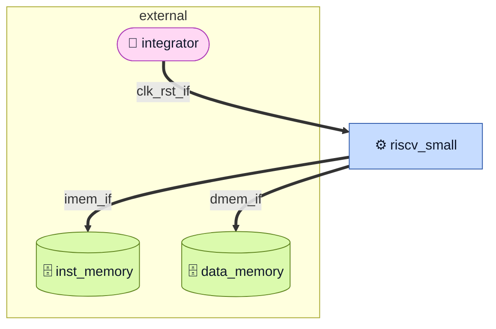
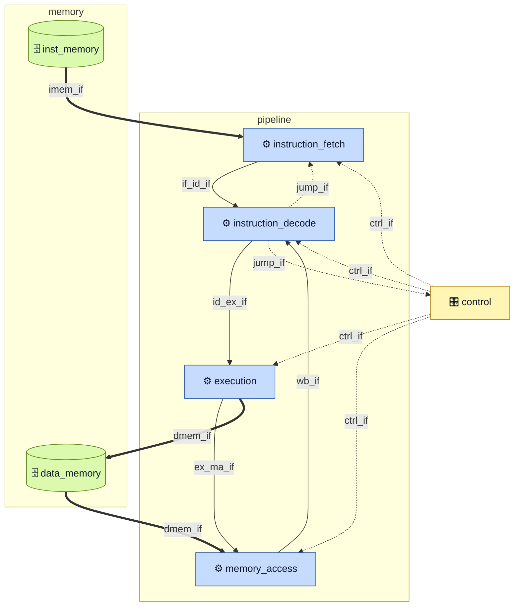

# riscv-small Microarchitecture

| Field | Value |
|---|---|
| Status | draft |
| Implements | [spec.md](spec.md) v0.2 |
| Baseline | commit `bb789bb` (same baseline as the specification; the RTL was read at this commit) |
| Scope | as built: this document describes `rtl/*.sv`, not the target rows of `spec.md` §4 and §7.1 |

Everything below is read from the RTL. Where a `file:line` citation is missing, the sentence is a
pointer to another section, not a behavioural claim. Where the target of `spec.md` differs from the
code, the difference is named with its existing gap ID and the code is described as it is.

## 1. Overview

`riscv_small` is a single-issue, in-order, five-stage RV32I core: instruction fetch (IF), instruction
decode (ID), execute (EX), memory access (MA), write back (WB). Both memories are outside the
boundary: the core presents an instruction address and a data address and expects the integrator to
answer (`rtl/riscv_small.sv:45-57`). There is no cache, no memory, and no bus fabric inside the core
(`C-03`).

Three properties shape the rest of the document. First, **branches and jumps are resolved in ID**:
`jump_decision` sits inside `instruction_decode` and drives `branch_taken` and `jump_addr` straight
back to the fetch stage (`rtl/instruction_decode.sv:177-188`), so a taken branch costs one fetch slot
rather than two. Second, **the pipeline has no valid bits**: a stage is empty when its `rd0_wr_en` is
zero, and every flush writes zeros into the pipeline register (for example
`rtl/instruction_decode.sv:97-112`). Third, **stalls are expressed as clock enables, not as a single
`stall` signal**: `control` drives four enables and three flushes independently
(`rtl/control.sv:93-99`).

Deliberately absent, and cited so that a reader does not look for them: no caches or line fills
(`G-15`), no CSR file and no `Zicsr` instruction (`G-13`), no interrupt subsystem — the only trap
request is the level-sensitive `exception` input (`G-14`, `rtl/riscv_small.sv:44`), no atomics and no
second hart (`G-16`), no illegal-instruction trap (`G-06`), and no misaligned-access checking
(`G-08`). The trap vector is the constant 1000 (`G-01`, `rtl/control.sv:255`) and the trap cause
register is tied to zero (`G-02`, `rtl/control.sv:265`). The target for each of these is in
`spec.md` §4; none of it exists here.

The context is small: one core, two external memories, four control inputs (H0).

*H0 — one core, two external memories, one interface per boundary. `trap_req_if` (`C10`) reaches
`control` directly and is not drawn here. Source: inline, section 1.*

## 2. Diagram index

| ID | Claim | Level | Embedded in |
|---|---|---|---|
| H0 | The core owns no memory; instruction fetch and data access are two independent external ports | context | section 1 |
| H1 | Five pipeline modules are wired by one control block; the instruction and data memories stay outside | top | section 6 |

Two figures exist. No H2 is drawn: every block in this core is either a table (decode, forwarding,
stalls) or a single registered stage. No timing figure is published yet — the cycle costs in section 9
are derived from the enable and flush expressions, not from a waveform.

## 3. Parameters and typedefs

The core has **no module parameters**. Every width is literal or comes from the package
(`rtl/riscv_small.sv:38-58`). The two parameters in the repository belong to simulation models that
are not part of the DUT (`rtl/inst_memory.sv:42-47`, see section 7.9).

Reader-visible types, all from `rtl/riscv_definitions_pkg.sv`:

| Name | Kind | Width | Values / meaning | Cite |
|---|---|---|---|---|
| `dataBus_t` | typedef | 32 | address and data bus | `rtl/riscv_definitions_pkg.sv:373` |
| `dataBus_u` | packed union | 32 | one bus seen as `u_data`, `s_data`, `u_bytes[0:3]`, `u_half[0:1]`, `s_bytes[0:3]`, `s_half[0:1]` | `rtl/riscv_definitions_pkg.sv:374-381` |
| `regAddr_t` | typedef | 5 | architectural register index | `rtl/riscv_definitions_pkg.sv:124` |
| `instruction_u` | packed union | 32 | one word seen as `r_type`, `i_type`, `i_type_load`, `i_type_alu`, `s_type`, `b_type`, `u_type`, `j_type`, `memory_b`, `memory_w` | `rtl/riscv_definitions_pkg.sv:357-368` |
| `nextPCType_e` | enum | 2 | `PC_PLUS4` `00`, `JUMP` `01`, `TRAP` `1?` (wildcard: `10` and `11` both select the trap) | `rtl/riscv_definitions_pkg.sv:50-54` |
| `aluSrc1_e` | enum | 1 | `PC` `0`, `RS1` `1` — decode-side operand 1 select | `rtl/riscv_definitions_pkg.sv:61-64` |
| `aluSrc2_e` | enum | 1 | `RS2` `0`, `IMM` `1` — decode-side operand 2 select | `rtl/riscv_definitions_pkg.sv:69-72` |
| `ctrlAluSrc1_e` | enum | 2 | `PC_S1` `00`, `RS1_S1` `01`, `RD_MA_S1` `10`, `RD_WB_S1` `11` — EX operand 1 select | `rtl/riscv_definitions_pkg.sv:77-82` |
| `ctrlAluSrc2_e` | enum | 2 | `RS2_S2` `00`, `IMM_S2` `01`, `RD_MA_S2` `10`, `RD_WB_S2` `11` — EX operand 2 and store-data select | `rtl/riscv_definitions_pkg.sv:87-92` |
| `ctrlCJmpSrc_e` | enum | 2 | `RD_ID` `00`, `RD_EX` `01`, `RD_MA` `10`, `RD_WB` `11` — branch operand select | `rtl/riscv_definitions_pkg.sv:97-102` |
| `aluOpType_e` | enum | 4 | see the ALU operation table in section 7.7 | `rtl/riscv_definitions_pkg.sv:108-121` |
| `opcodeType_e` | enum | 7 | the eleven decoded opcodes of section 7.2 | `rtl/riscv_definitions_pkg.sv:129-187` |
| `funct3RType_e`, `funct3ITypeALU_e`, `funct3ITypeLOAD_e`, `funct3SType_e`, `funct3BType_e` | enum | 3 | function fields per instruction format | `rtl/riscv_definitions_pkg.sv:193-258` |

Instruction-format overlays used by the decoder (`rs1` is always `[19:15]`, `rs2` always `[24:20]`,
`rd` always `[11:7]`, `opcode` always `[6:0]`):
`instRType_s` `rtl/riscv_definitions_pkg.sv:264-271`, `instIType_s` `:276-282`,
`instITypeLoad_s` `:287-293`, `instITypeALU_s` `:299-305`, `instSType_s` `:310-317`,
`instBType_s` `:322-331`, `instUType_s` `:336-340`, `instJType_s` `:345-352`.

## 4. Interfaces

Two views of the same boundary. The **catalogue** (§4.1–§4.3) groups the connections into named
interfaces with modports, so a figure can draw one line per connection; the **port table** (§4.4) is the
1:1 transcription of the module header and is the proof that the grouping loses nothing. No `interface`
construct exists in the RTL: the names below are a documentation grouping of existing nets, and every
modport row lists the as-built signals.

### 4.1 Interface catalogue

| Interface | Initiator modport | Target modport | Payload | Handshake | Clock / reset | Edge |
|---|---|---|---|---|---|---|
| `clk_rst_if` | `integrator` | `core` | `clk`, `clk_en`, `rst_n` | none | — | C9 |
| `trap_req_if` | `integrator` | `control` | `exception` | level | `clk`, `rst_n` | C10 |
| `imem_if` | `fetch` | `memory` | `inst_addr`, `inst_rd_en` → `inst_data`, `inst_ready` | ready/valid | `clk`, `rst_n` | C5 |
| `dmem_if` | `execute` | `memory` | `data_addr`, `data_wr`, `data_rd_en_ma`, `data_wr_en_ma`, `data_rd_wr_ctrl` → `data_rd`, `data_ready` | grant on `ready` | `clk`, `rst_n` | C6 |
| `if_id_if` | `fetch` | `decode` | `pc_id`, `inst_id` | none (registered) | `clk`, `if_id_clk_en`, `rst_n` | C1 |
| `id_ex_if` | `decode` | `execute` | `pc_ex`, `rs1_ex`, `rs2_ex`, `imm_ex`, `alu_op_ex`, `alu_src1_ex`, `alu_src2_ex`, `rd0_addr_ex`, `rd0_wr_en_ex`, `data_rd_en_ex`, `data_wr_en_ex`, `funct3_ex`, `rs1_addr_ex`, `rs2_addr_ex` | none (registered) | `clk`, `id_ex_clk_en`, `rst_n` | C2 |
| `ex_ma_if` | `execute` | `memory` | `alu_ma`, `data_wr`, `rd0_addr_ma`, `rd0_wr_en_ma`, `data_rd_en_ma`, `data_wr_en_ma`, `rd_wr_ctrl` | none (registered) | `clk`, `ex_ma_clk_en`, `rst_n` | C3 |
| `ma_wb_if` | `memory` | `writeback` | `alu_wb`, `ld_data_wb`, `rd0_addr_wb`, `rd0_wr_en_wb`, `wb_mux_sel_wb` | none (registered) | `clk`, `ma_wb_clk_en`, `rst_n` | C4 |
| `wb_if` | `writeback` | `decode` | `rd0_addr_wb`, `rd0_data_wb`, `rd0_wr_en_wb` | none (combinational) | `clk`, `rst_n` | C4 |
| `ctrl_if` | `control` | `stage` | 4 enables, 3 flushes, `pc_sel`, `inst_rd_en`, `alu_src1`, `alu_src2`, `storage_src`, `jmp_src1`, `jmp_src2`, `trap_addr` | none (level) | `clk`, `rst_n` | C7 |
| `jump_if` | `decode` | `fetch`, `control` | `jump_addr`, `branch_taken`, `cond_jump` | redirect | `clk`, `rst_n` | C8 |

`writeback` is not a module: it is the top-level mux at `rtl/riscv_small.sv:219`, which is why §4.3 has
one row for the pair `ma_wb_if`/`wb_if` and the H1 figure collapses both into a single `wb_if` edge.

### 4.2 Modport map

One row per side. Direction is from the modport's point of view; the signal names are the as-built nets.

| Interface | Modport | Dir | Signals | Sampling / timing | Cite |
|---|---|---|---|---|---|
| `clk_rst_if` | `integrator` | out | `clk`, `clk_en`, `rst_n` | free-running; `rst_n` asynchronous | `rtl/riscv_small.sv:41-43` |
| `clk_rst_if` | `core` | in | `clk`, `clk_en`, `rst_n` | every `always_ff` | `rtl/riscv_small.sv:41-43` |
| `trap_req_if` | `integrator` | out | `exception` | level, at least one edge | `rtl/riscv_small.sv:44` |
| `trap_req_if` | `control` | in | `exception` | overrides `branch_taken` | `rtl/control.sv:234` |
| `imem_if` | `fetch` | out | `inst_addr`, `inst_rd_en` | `inst_addr` combinational from `pc` | `rtl/instruction_fetch.sv:63` |
| `imem_if` | `memory` | in | `inst_data`, `inst_ready` | `inst_ready` low flushes IF/ID | `rtl/control.sv:241-243` |
| `dmem_if` | `execute` | out | `data_addr`, `data_wr`, `data_rd_en_ma`, `data_wr_en_ma`, `data_rd_wr_ctrl` | registered strobes | `rtl/riscv_small.sv:118-119`, `:193-198` |
| `dmem_if` | `memory` | in | `data_rd`, `data_ready` | `data_ready` low freezes on a load | `rtl/control.sv:246-251` |
| `if_id_if` | `fetch` | out | `pc_id`, `inst_id` | registered, held while `if_id_clk_en` is low | `rtl/instruction_fetch.sv:69-77` |
| `if_id_if` | `decode` | in | `pc_id`, `inst_id` | combinationally in ID | `rtl/instruction_decode.sv:144-145` |
| `id_ex_if` | `decode` | out | see §4.1 | registered, cleared by `id_ex_flush` | `rtl/instruction_decode.sv:96-129` |
| `id_ex_if` | `execute` | in | see §4.1 | sampled on an enabled edge | `rtl/execution.sv:89-98` |
| `ex_ma_if` | `execute` | out | see §4.1 | registered, cleared by `ex_ma_flush` | `rtl/execution.sv:89-106` |
| `ex_ma_if` | `memory` | in | see §4.1 | strobes pass to `dmem_if` | `rtl/riscv_small.sv:193-198` |
| `ma_wb_if` | `memory` | out | see §4.1 | registered, never flushed | `rtl/memory_access.sv:62-77` |
| `ma_wb_if` | `writeback` | in | see §4.1 | muxed by `wb_mux_sel_wb` | `rtl/riscv_small.sv:219` |
| `wb_if` | `writeback` | out | see §4.1 | combinational | `rtl/riscv_small.sv:219` |
| `wb_if` | `decode` | in | see §4.1 | register-file write port | `rtl/reg_file.sv:94-105` |
| `ctrl_if` | `control` | out | see §4.1 | one `always_comb` | `rtl/control.sv:87-253` |
| `ctrl_if` | `stage` | in | see §4.1 | every stage | `rtl/riscv_small.sv:123-216` |
| `jump_if` | `decode` | out | `jump_addr`, `branch_taken`, `cond_jump` | combinational from `jump_decision` | `rtl/instruction_decode.sv:177-188` |
| `jump_if` | `fetch` | in | `jump_addr` | selected as the next PC | `rtl/instruction_fetch.sv:88-101` |
| `jump_if` | `control` | in | `branch_taken`, `cond_jump` | selects `JUMP`, flushes IF/ID | `rtl/control.sv:229-232` |

Four interfaces (`id_ex_if`, `ex_ma_if`, `ma_wb_if`, `ctrl_if`) repeat §4.1 rather than duplicating a
20-signal list four times; the payload is identical on both sides of a pipeline register by construction.

### 4.3 Connection table

One row per directed edge a figure may draw. `#` is stable and cited from figure captions.

| # | From | To | Interface | Modports | Edge style |
|---|---|---|---|---|---|
| C1 | `instruction_fetch` | `instruction_decode` | `if_id_if` | `fetch` → `decode` | solid |
| C2 | `instruction_decode` | `execution` | `id_ex_if` | `decode` → `execute` | solid |
| C3 | `execution` | `memory_access` | `ex_ma_if` | `execute` → `memory` | solid |
| C4 | `memory_access` | `instruction_decode` (via the write-back mux) | `ma_wb_if`, `wb_if` | `memory` → `writeback`, `writeback` → `decode` | solid |
| C5 | `instruction_fetch` | instruction memory | `imem_if` | `fetch` → `memory` | thick |
| C6 | `execution` | data memory | `dmem_if` | `execute` → `memory` | thick |
| C7 | `control` | every stage | `ctrl_if` | `control` → `stage` | dashed |
| C8 | `instruction_decode` | `instruction_fetch`, `control` | `jump_if` | `decode` → `fetch`, `decode` → `control` | dashed |
| C9 | integrator | core | `clk_rst_if` | `integrator` → `core` | thick |
| C10 | integrator | `control` | `trap_req_if` | `integrator` → `control` | dashed |

### 4.4 Top-level ports

Transcription of `rtl/riscv_small.sv:40-58`, one row per port, fifteen ports in header order.
Direction is from the core's point of view.

| Signal | Dir | Width | Producer | Consumer | Protocol / timing | Reset value |
|---|---|---|---|---|---|---|
| `clk` | in | 1 | integrator | every `always_ff` | rising edge; single domain (`C-01`) | — |
| `clk_en` | in | 1 | integrator | `control` only (`rtl/riscv_small.sv:223`) | level; gates `sepc`/`scause` only (`G-12`) | — |
| `rst_n` | in | 1 | integrator | every `always_ff` | asynchronous, active low, no internal synchroniser (`C-01`, `A-06`) | — |
| `exception` | in | 1 | integrator | `control` | level; asserted for at least one `clk` edge redirects the PC to the trap constant | 0 |
| `inst_ready` | in | 1 | instruction memory | `control` | level; low flushes IF/ID for that cycle; the PC is **not** held (`G-09`) | — |
| `inst_data` | in | 32 | instruction memory | `instruction_fetch` | `instruction_u`; registered into `inst_id` on every enabled edge, regardless of `inst_ready` | — |
| `inst_addr` | out | 32 | `instruction_fetch` | instruction memory | `dataBus_t`; combinational copy of `pc`; changes only when IF/ID advances | 0 |
| `inst_rd_en` | out | 1 | `control` | instruction memory | combinational; tied to `1'b1`, never deasserted (`rtl/control.sv:101`) | 1 |
| `data_ready` | in | 1 | data memory | `control` | level; low freezes all four stages while the load indicator is set | — |
| `data_rd` | in | 32 | data memory | `memory_access` | `dataBus_u`; must be valid in the cycle the load commits in WB | — |
| `data_rd_en_ma` | out | 1 | `execution` (EX/MA register) | data memory | registered read strobe; one cycle per load unless a stall freezes MA | 0 |
| `data_wr_en_ma` | out | 1 | `execution` (EX/MA register) | data memory | registered write strobe; one cycle per store unless a stall freezes MA; **not** qualified by `data_ready` (`G-18`) | 0 |
| `data_wr` | out | 32 | `execution` (`rs2_ma`) | data memory | `dataBus_u`; store data after the `storage_src` mux; not lane-shifted (`G-08`) | 0 |
| `data_addr` | out | 32 | `execution` (`alu_ma`) | data memory | `dataBus_u`; byte address, equals the ALU result of EX (`rtl/riscv_small.sv:119`) | 0 |
| `data_rd_wr_ctrl` | out | 2 | `execution` (`funct3_ma`), truncated | data memory | `logic [1:0]`; `funct3_ma[1:0]`, driven for every instruction (section 8) | 0 |

Two internal connections are part of this contract and are easy to miss:

- `data_rd_wr_ctrl` is the low two bits of `funct3_ma` after a width cast, not a decoded field:
  `assign data_rd_wr_ctrl = logic'(rd_wr_ctrl);` (`rtl/riscv_small.sv:118`).
- `clk_en` reaches exactly one register pair in the whole core, `sepc`/`scause`
  (`rtl/riscv_small.sv:223`, `rtl/control.sv:262`); the pipeline is gated by `control`'s own enables
  (`G-12`).

## 5. Clocks and resets

| Clock | Nominal | Source | Domains |
|---|---|---|---|
| `clk` | not specified — no frequency target exists (`A-08`, `G-05`) | integrator | all registers; no divided or gated clock is generated |

| Reset | Kind | Polarity | Synchronization | Scope |
|---|---|---|---|---|
| `rst_n` | asynchronous | active low | none inside the core; deassertion must be synchronised by the integrator (`C-01`, `A-06`) | every `always_ff`, listed below |

The asynchronous reset appears in seven `always_ff` blocks, all with the same sensitivity list
`posedge clk or negedge rst_n`:

| Register(s) | Block | Reset value | Cite |
|---|---|---|---|
| `pc` | fetch program counter | 0 | `rtl/instruction_fetch.sv:84-87` |
| `pc_id`, `inst_id` | IF/ID | 0, 0 | `rtl/instruction_fetch.sv:69-77` |
| `rd0_wr_en_ex` and the remaining ID/EX fields | ID/EX | all 0, except `alu_src1_ex = RS1`, `alu_src2_ex = RS2`, `alu_op_ex = ALU_ADD`, `funct3_ex = LB` | `rtl/instruction_decode.sv:96-112` |
| `alu_ma`, `rd0_wr_en_ma`, `data_rd_en_ma`, `data_wr_en_ma`, `funct3_ma`, `rd0_addr_ma`, `rs2_ma` | EX/MA | all 0, except `funct3_ma = LB` | `rtl/execution.sv:89-98` |
| `rd0_addr_wb`, `wb_mux_sel_wb`, `rd0_wr_en_wb`, `alu_wb` | MA/WB | all 0 | `rtl/memory_access.sv:62-69` |
| `regs[1:31]` | register file | `'X` — deliberately unspecified (`A-04`) | `rtl/reg_file.sv:94-98` |
| `sepc`, `scause` | trap state | 0 | `rtl/control.sv:257-261` |

`MA/WB` has no flush input: once an instruction reaches MA it always reaches WB
(`rtl/memory_access.sv:62-78`). That is why a trap cannot cancel the instruction already in EX or
beyond (section 7.5).

## 6. Pipeline and control

Five modules and one control block; the write-back stage is not a module (H1).

*H1 — One interface per stage boundary; control is the only fan-out. Source: inline, section 6.*

Every solid edge is one interface from §4.1 and the dashed ones are `jump_if` and `ctrl_if`; the
signal count per line is deliberately zero, because the payload lives in §4.2. The `wb_if` edge
collapses the write-back mux (`C4`): `memory_access` produces `ma_wb_if`, the top-level mux turns it
into `wb_if`, and `instruction_decode` consumes it
(`rtl/instruction_decode.sv:186-187`, `rtl/riscv_small.sv:135`, `rtl/riscv_small.sv:219`,
`rtl/riscv_small.sv:240`).

**IF.** Holds `pc` and the IF/ID register. `inst_addr` is a combinational copy of `pc`
(`rtl/instruction_fetch.sv:63`), so the address and `inst_rd_en` appear in the same cycle. On an
enabled edge `pc` advances by four, or takes `jump_addr`, or takes `trap_addr`, as `pc_sel` says
(`rtl/instruction_fetch.sv:88-101`); `inst_data` is registered into `inst_id` alongside `pc_id`
(`rtl/instruction_fetch.sv:73-76`). `flush` clears IF/ID at the edge, regardless of `clk_en`
(`rtl/instruction_fetch.sv:70`). Both the PC and IF/ID are gated by `if_id_clk_en`, which is how a
downstream stall freezes the fetch stream (`rtl/riscv_small.sv:125`).

**ID.** Reads `rs1`/`rs2` from the register file, generates the immediate, decodes the opcode into
`alu_op`, `alu_src1`, `alu_src2`, `data_rd_en`, `data_wr_en`, `rd0_wr_en`, `cond_jump`,
`uncond_jump` and `base_addr_sel` (`rtl/instruction_decode.sv:237-337`), and resolves the branch
through `jump_decision` (`rtl/instruction_decode.sv:177-188`). Branch operands pass through a
four-way forward mux before the comparison (`rtl/instruction_decode.sv:134-173`). The results are
registered into ID/EX, which is cleared by `flush` (`rtl/instruction_decode.sv:96-129`).

**EX.** Selects both ALU operands from `pc`, `rs1`, `alu_ma` or the write-back data
(`rtl/execution.sv:113-152`), selects the store data into `rs2_pipeline` from `rs2`, `alu_ma` or the
write-back data (`rtl/execution.sv:157-174`), and runs `alu` combinationally
(`rtl/execution.sv:179-184`). `alu_ex` is the unregistered result for the ID forward path and
`alu_ma` is the registered one (`rtl/execution.sv:100`).

**MA.** Asserts the data strobes and the address, which are the registered EX outputs
(`rtl/execution.sv:100-106`, `rtl/riscv_small.sv:119`), and extends the load data according to
`rd_wr_ctrl_wb` (`rtl/memory_access.sv:80-102`). Both strobes are the EX/MA register outputs, so a
frozen EX/MA holds them asserted (section 8).

**WB.** There is no WB module: `memory_access` registers the MA result into MA/WB
(`rtl/memory_access.sv:70-77`), the top-level mux picks memory data or the ALU result
(`assign rd0_data_wb = wb_mux_sel_wb? ld_data_wb : alu_wb;`, `rtl/riscv_small.sv:219`), and the
register file inside ID commits it on the next enabled edge (`rtl/reg_file.sv:94-105`).

**Control fan-out.** `control` is the only producer of `pc_sel`, `inst_rd_en`, the four stage enables
(`{if_id,id_ex,ex_ma,ma_wb}_clk_en`), the three flushes (`{if_id,id_ex,ex_ma}_flush`), the two ALU
selects, `storage_src`, the two jump selects and `trap_addr` (`rtl/control.sv:66-80`). Its defaults
are "run": every enable 1, every flush 0, `pc_sel = PC_PLUS4`, `inst_rd_en = 1`
(`rtl/control.sv:93-101`); every hazard is an override inside one `always_comb`
(`rtl/control.sv:87-253`). Because the overrides are ordered assignments in one block, the later
condition wins: `exception` (`rtl/control.sv:234`) overrides `branch_taken`
(`rtl/control.sv:229`), and the data stall (`rtl/control.sv:246`) overrides any enable set to 1
earlier.

## 7. Block sections

Block IDs, files and the instantiation that creates them. `BLK-REG` and `BLK-JMP` are instantiated
inside `instruction_decode`, not in the top (`rtl/instruction_decode.sv:177`, `:193`); `BLK-ALU` is
instantiated inside `execution` (`rtl/execution.sv:179`).

| ID | Module | File | Instance | Created by |
|---|---|---|---|---|
| BLK-TOP | `riscv_small` | `rtl/riscv_small.sv` | — (the boundary) | the integrator |
| BLK-IF | `instruction_fetch` | `rtl/instruction_fetch.sv` | `u_instruction_fetch` | `riscv_small` (`rtl/riscv_small.sv:123`) |
| BLK-ID | `instruction_decode` | `rtl/instruction_decode.sv` | `u_instruction_decode` | `riscv_small` (`rtl/riscv_small.sv:140`) |
| BLK-EX | `execution` | `rtl/execution.sv` | `u_exection` | `riscv_small` (`rtl/riscv_small.sv:172`) |
| BLK-MA | `memory_access` | `rtl/memory_access.sv` | `u_memory_access` | `riscv_small` (`rtl/riscv_small.sv:201`) |
| BLK-CTL | `control` | `rtl/control.sv` | `u_control` | `riscv_small` (`rtl/riscv_small.sv:221`) |
| BLK-REG | `reg_file` | `rtl/reg_file.sv` | `u_reg_file` | `instruction_decode` (`rtl/instruction_decode.sv:193`) |
| BLK-ALU | `alu` | `rtl/alu.sv` | `u_alu` | `execution` (`rtl/execution.sv:179`) |
| BLK-JMP | `jump_decision` | `rtl/jump_decision.sv` | `u_jump_decision` | `instruction_decode` (`rtl/instruction_decode.sv:177`) |

The instance name `u_exection` is the spelling in the RTL (`rtl/riscv_small.sv:172`).

### 7.0 BLK-TOP — `riscv_small` (`rtl/riscv_small.sv`)

**Purpose.** Wiring only. It declares the external ports, connects the five stage modules to each
other and to the two memories, and holds the single write-back multiplexer. It contains no
sequential logic, so every timing property in this document belongs to one of the modules below.

**Interface.** Fifteen ports, transcribed 1:1 in section 4.4; every internal connection is one of the
catalogue interfaces in section 4.1 (`clk_rst_if`, `trap_req_if`, `imem_if`, `dmem_if`, `if_id_if`,
`id_ex_if`, `ex_ma_if`, `ma_wb_if`, `wb_if`, `ctrl_if`, `jump_if`). The top adds no port that the table
omits. Internally it also crosses the module boundaries with `pc_id`, `inst_id`, `jump_addr`,
`trap_addr`, `pc_sel`, `cond_jump`, `branch_taken` and the four stage-enable / three flush nets
(`rtl/riscv_small.sv:60-116`).

**State.** None. No `always_ff` and no register is declared in the top; every internal `logic`,
`dataBus_*` and enum is driven by a port of a submodule or by one of the two continuous assignments.

**Behaviour.** Five instantiations in pipeline order: `u_instruction_fetch` (`rtl/riscv_small.sv:123`),
`u_instruction_decode` (`:140`), `u_exection` (`:172`), `u_memory_access` (`:201`),
`u_control` (`:221`). Two continuous assignments complete the interface:
`data_rd_wr_ctrl = logic'(rd_wr_ctrl)` (`:118`) and `data_addr = alu_ma` (`:119`). The write-back mux
is `rd0_data_wb = wb_mux_sel_wb ? ld_data_wb : alu_wb` (`:219`). Three nets are pass-throughs worth
naming because they change stage on the way out: `data_wr` is driven directly by `rs2_ma` (`:193`),
`inst_rd_en` comes from `control` (`:254`), and `clk_en` is wired to `control` and to nothing else
(`:223`).

**Corner cases.**

- Three modules of this document are *not* instantiated here: `reg_file` and `jump_decision` live
  inside `instruction_decode` (`rtl/instruction_decode.sv:177`, `:193`) and `alu` inside `execution`
  (`rtl/execution.sv:179`). The H1 figure shows the five top-level modules for that reason.
- The WB stage has no module: its register lives in `memory_access` and its mux lives in the top
  (`:219`).
- `clk_en` is passed to `control` (`:223`), not to the stage modules; the stage clock enables are all
  generated there (`G-12`).

### 7.1 BLK-IF — `instruction_fetch` (`rtl/instruction_fetch.sv`)

**Purpose.** Owns the program counter and the IF/ID register. It decides nothing: the next PC comes
from `pc_sel`, and whether the stage advances comes from `clk_en`. It does not check `inst_ready`
and does not know that a fetch is outstanding.

**Interface.** 11 ports, transcribed from `rtl/instruction_fetch.sv:45-58`.

Interfaces: `clk_rst_if` (`core`), `imem_if` (`fetch`), `if_id_if` (`fetch`), `jump_if` (`fetch`), `ctrl_if` (`stage`).

| Signal | Dir | Width | Description |
|---|---|---|---|
| `clk` | in | 1 | clock |
| `clk_en` | in | 1 | wired to `if_id_clk_en`; gates both the PC and IF/ID (`rtl/riscv_small.sv:125`) |
| `rst_n` | in | 1 | asynchronous, active low |
| `inst_data` | in | 32 | `instruction_u` from the instruction memory |
| `flush` | in | 1 | wired to `if_id_flush`; clears IF/ID at the edge and ignores `clk_en` |
| `inst_addr` | out | 32 | `dataBus_t`; equals `pc` |
| `inst_id` | out | 32 | `instruction_u` registered for ID |
| `pc_id` | out | 32 | `dataBus_t` of the instruction registered for ID |
| `jump_addr` | in | 32 | `dataBus_t` from `instruction_decode` |
| `trap_addr` | in | 32 | `dataBus_t` from `control` |
| `pc_sel` | in | 2 | `nextPCType_e` |

**State.** `pc` (32 bits, reset 0, `rtl/instruction_fetch.sv:84-87`) and the IF/ID pair `pc_id`,
`inst_id` (reset 0, cleared by `flush`, `rtl/instruction_fetch.sv:69-77`). There is no valid bit: a
flushed IF/ID holds `0`, which decodes as "no write" (section 7.2).

**Behaviour.**

- `inst_addr = pc`, combinationally (`rtl/instruction_fetch.sv:63`). The address for cycle *n* is
  therefore visible for the whole of cycle *n*, and `inst_data` presented in that cycle is the
  instruction at that address.
- Next PC: `PC_PLUS4` adds four, `JUMP` takes `jump_addr`, `TRAP` takes `trap_addr`; the `default`
  arm also adds four (`rtl/instruction_fetch.sv:88-101`). `TRAP` is encoded as the wildcard `2'b1?`,
  so both `2'b10` and `2'b11` select it (`rtl/riscv_definitions_pkg.sv:53`).
- IF/ID is cleared when `!rst_n || flush`, otherwise loaded when `clk_en`
  (`rtl/instruction_fetch.sv:70-76`). The clear is unconditional with respect to `clk_en`.

**Corner cases.**

- `inst_ready` is not an input of this block. When the memory withholds the grant, `control` flushes
  IF/ID but leaves `clk_en` high, so the PC advances and the pending instruction is dropped
  (`rtl/control.sv:241-243`, `G-09`). A memory that deasserts `inst_ready` cannot extend a fetch;
  it can only make the core skip an instruction.
- A `flush` in the same cycle as `jump_addr` changes nothing for IF/ID, which is cleared anyway; the
  redirect lands in `pc` at the same edge.
- The PC is gated by `if_id_clk_en`, so any stall that freezes IF/ID also freezes the address. That
  is what makes the data-wait stall stop the fetch stream without a separate PC enable
  (`rtl/control.sv:247`, `rtl/riscv_small.sv:125`).

### 7.2 BLK-ID — `instruction_decode` (`rtl/instruction_decode.sv`)

**Purpose.** Turns one 32-bit word into the control bundle for EX, reads the register file, generates
the immediate, and resolves branches through `jump_decision`. It is also where the register file and
the branch unit live; it is the only block that produces `branch_taken` and `jump_addr`.

**Interface.** 30 ports, transcribed from `rtl/instruction_decode.sv:42-72`.

Interfaces: `if_id_if` (`decode`), `id_ex_if` (`decode`), `wb_if` (`decode`), `jump_if` (`decode`), `ctrl_if` (`stage`).

| Signal | Dir | Width | Description |
|---|---|---|---|
| `clk` | in | 1 | clock |
| `clk_en` | in | 1 | wired to `id_ex_clk_en`; gates ID/EX **and** the register-file write (`rtl/riscv_small.sv:142`) |
| `rst_n` | in | 1 | asynchronous, active low |
| `inst` | in | 32 | `instruction_u` from IF |
| `pc` | in | 32 | `dataBus_t` from IF |
| `rd0_data_ex` | in | 32 | `alu_ex`, unregistered EX result, for the branch forward |
| `rd0_data_ma` | in | 32 | `alu_ma`, for the branch forward |
| `rd0_data_wb` | in | 32 | write-back data, for the branch forward |
| `rd0_wr_en` | in | 1 | `rd0_wr_en_wb`, write enable from WB |
| `rd0_addr_wb` | in | 5 | `regAddr_t`, destination of the WB instruction |
| `jmp_src1` | in | 2 | `ctrlCJmpSrc_e` from `control` |
| `jmp_src2` | in | 2 | `ctrlCJmpSrc_e` from `control` |
| `flush` | in | 1 | wired to `id_ex_flush`; clears ID/EX at the edge |
| `rd0_wr_en_ex` | out | 1 | registered write enable for EX |
| `alu_src1_ex` | out | 1 | `aluSrc1_e` |
| `alu_src2_ex` | out | 1 | `aluSrc2_e` |
| `pc_ex` | out | 32 | `dataBus_t`, PC of the instruction in EX |
| `rs1_ex` | out | 32 | `dataBus_t`, `rs1` value |
| `rs2_ex` | out | 32 | `dataBus_t`, `rs2` value |
| `imm_ex` | out | 32 | `dataBus_t`, generated immediate |
| `data_rd_en_ex` | out | 1 | registered load indicator |
| `data_wr_en_ex` | out | 1 | registered store indicator |
| `alu_op_ex` | out | 4 | `aluOpType_e` |
| `branch_taken` | out | 1 | combinational branch decision |
| `jump_addr` | out | 32 | combinational branch/jump target |
| `cond_jump` | out | 1 | combinational, current instruction is `BRCH_C` |
| `funct3_ex` | out | 3 | `funct3ITypeLOAD_e`, bits `[14:12]` of the word |
| `rd0_addr_ex` | out | 5 | `regAddr_t`, destination in EX |
| `rs1_addr_ex` | out | 5 | `regAddr_t`, `[19:15]` in EX |
| `rs2_addr_ex` | out | 5 | `regAddr_t`, `[24:20]` in EX |

**State.** The ID/EX pipeline register: `data_rd_en_ex`, `data_wr_en_ex`, `alu_src1_ex`,
`alu_src2_ex`, `alu_op_ex`, `pc_ex`, `rs1_ex`, `rs2_ex`, `imm_ex`, `rd0_addr_ex`, `rs1_addr_ex`,
`rs2_addr_ex`, `rd0_wr_en_ex`, `funct3_ex` (`rtl/instruction_decode.sv:96-129`). Reset and flush both
write the values at `rtl/instruction_decode.sv:98-111`; `funct3_ex` resets to `LB` (`3'b000`) and
`alu_op_ex` to `ALU_ADD`. `rs1`, `rs2`, `imm`, `cond_jump`, `uncond_jump`, `branch_taken` and
`jump_addr` are combinational.

**Behaviour.** The decoder is a priority-free `case` on the opcode with defaults applied first
(`rtl/instruction_decode.sv:238-246`): `uncond_jump = 0`, `cond_jump = 0`, `rd0_wr_en = 0`,
`base_addr_sel = PC`, `alu_src1 = RS1`, `alu_src2 = RS2`, `data_rd_en = 0`, `data_wr_en = 0`,
`alu_op = ALU_ADD`. Each opcode overrides a subset.

Decode table, quoted from `rtl/instruction_decode.sv:247-336`:

| Opcode | Instruction | `alu_op` | `alu_src1` | `alu_src2` | `rd0_wr_en` | `data_rd_en` | `data_wr_en` | `cond` | `uncond` | `base_addr_sel` | Cite |
|---|---|---|---|---|---|---|---|---|---|---|---|
| `0110111` | `LUI` | `ALU_BPS2` | `RS1` | `IMM` | 1 | 0 | 0 | 0 | 0 | `PC` | `:248-253` |
| `0010111` | `AUIPC` | `ALU_ADD` | `PC` | `IMM` | 1 | 0 | 0 | 0 | 0 | `PC` | `:254-260` |
| `1101111` | `JAL` | `ALU_ADD4` | `PC` | `RS2` | 1 | 0 | 0 | 0 | 1 | `PC` | `:261-268` |
| `1100111` | `JALR` | `ALU_ADD4` | `PC` | `RS2` | 1 | 0 | 0 | 0 | 1 | `RS1` | `:270-277` |
| `1100011` | `B<cond>` | `ALU_ADD` | `RS1` | `RS2` | 0 | 0 | 0 | 1 | 0 | `PC` | `:279-282` |
| `0000011` | `LB`/`LH`/`LW`/`LBU`/`LHU` | `ALU_ADD` | `RS1` | `IMM` | 1 | 1 | 0 | 0 | 0 | `PC` | `:283-296` |
| `0100011` | `SB`/`SH`/`SW` | `ALU_ADD` | `RS1` | `IMM` | 0 | 0 | 1 | 0 | 0 | `PC` | `:297-308` |
| `0010011` | `ADDI`..`ANDI`, `SLLI`, `SRLI`, `SRAI` | `{funct7[5], funct3}`, or `{1'b0, funct3}` when `funct3 != SRLI_SRAI` | `RS1` | `IMM` | 1 | 0 | 0 | 0 | 0 | `PC` | `:309-322` |
| `0110011` | `ADD`..`AND` | `{funct7[5], funct3}` | `RS1` | `RS2` | 1 | 0 | 0 | 0 | 0 | `PC` | `:323-329` |
| `0001111` | `FENCE`, `FENCE.I` | `ALU_ADD` | `RS1` | `RS2` | 0 | 0 | 0 | 0 | 0 | `PC` | `:330-332` |
| `1110011` | `ECALL`, `EBREAK`, `CSR*` | `ALU_ADD` | `RS1` | `RS2` | 0 | 0 | 0 | 0 | 0 | `PC` | `:333-335` |
| other | — | `ALU_ADD` | `RS1` | `RS2` | 0 | 0 | 0 | 0 | 0 | `PC` | `:238-246` |

The `ALUI_C` row is the only conditional one: `SRLI_SRAI` (`3'b101`) takes bit 5 of the register-form
function field, every other immediate-ALU `funct3` is used with a zero high bit
(`rtl/instruction_decode.sv:312-318`). `JAL` and `JALR` leave `alu_src2` at its `RS2` default, which
is harmless because `ALU_ADD4` ignores operand 2 (`rtl/alu.sv:83-85`).

Immediate generation is a second `case` on the opcode (`rtl/instruction_decode.sv:209-232`): I-type
forms take `imm0` sign-extended, S-type `{imm1, imm0}`, B-type `{imm4, imm3, imm2, imm1, 1'b0}`,
U-type `{imm1, 12'b0}`, J-type `{imm4, imm3, imm2, imm1, 1'b0}`; the default is zero.

The branch path is `rs1`/`rs2` → forward mux → `jump_decision` (`rtl/instruction_decode.sv:134-188`).
The forward mux selects `RD_ID` (the register-file value), `RD_EX` (`rd0_data_ex`), `RD_MA`
(`rd0_data_ma`) or `RD_WB` (`rd0_data_wb`) independently for each operand.

**Corner cases.**

- An unimplemented opcode is not trapped; it falls through with `rd0_wr_en = 0` and `ALU_ADD`, which
  is a no-operation (`G-06`). RV32M encodings share `0110011` and therefore execute as the base ALU
  operation selected by `funct7[5]` and `funct3` (`rtl/instruction_decode.sv:325`, `G-06`).
- After a flush, `inst = 0` and `pc = 0`; opcode `0` misses every arm, so the stage produces a
  no-write `ALU_ADD` with `rs1_addr_ex = rs2_addr_ex = rd0_addr_ex = 0`. The `!= '0` guards in
  `control` then suppress every forward (`rtl/control.sv:108`, `:144`, `:184`, `:205`).
- `rs1_ex`/`rs2_ex` are captured from the register file in the same cycle the word is registered, so
  a write-back in that cycle is already visible through the register-file bypass
  (`rtl/reg_file.sv:71-73`); `control` forwards from WB as well ("belt and braces",
  `rtl/control.sv:113-115`).
- `funct3_ex` is `inst.i_type_load.funct3` for every opcode (`rtl/instruction_decode.sv:125`), i.e.
  bits `[14:12]` of the word, not a decoded load type. Consequence in section 8.

### 7.3 BLK-EX — `execution` (`rtl/execution.sv`)

**Purpose.** Applies the two operand selectors and the store-data selector, runs the ALU, and owns
the EX/MA pipeline register. It contains no control logic of its own.

**Interface.** 26 ports, transcribed from `rtl/execution.sv:41-67`.

Interfaces: `id_ex_if` (`execute`), `ex_ma_if` (`execute`), `dmem_if` (`execute`), `ctrl_if` (`stage`).

| Signal | Dir | Width | Description |
|---|---|---|---|
| `clk` | in | 1 | clock |
| `clk_en` | in | 1 | wired to `ex_ma_clk_en` |
| `rst_n` | in | 1 | asynchronous, active low |
| `alu_op` | in | 4 | `aluOpType_e` from ID |
| `alu_src1` | in | 2 | `ctrlAluSrc1_e` from `control` |
| `alu_src2` | in | 2 | `ctrlAluSrc2_e` from `control` |
| `storage_src` | in | 2 | `ctrlAluSrc2_e` from `control`, selects the store data |
| `pc` | in | 32 | `dataBus_u`, `pc_ex` |
| `rs1` | in | 32 | `dataBus_u`, `rs1_ex` |
| `rs2` | in | 32 | `dataBus_u`, `rs2_ex` |
| `imm` | in | 32 | `dataBus_u`, `imm_ex` |
| `rd0_data` | in | 32 | `dataBus_u`, `rd0_data_wb` |
| `rd0_wr_en` | in | 1 | write enable from ID |
| `data_rd_en` | in | 1 | load indicator from ID |
| `data_wr_en` | in | 1 | store indicator from ID |
| `funct3` | in | 3 | `funct3ITypeLOAD_e` from ID |
| `rd0_addr` | in | 5 | `regAddr_t` from ID |
| `flush` | in | 1 | wired to `ex_ma_flush`; clears EX/MA at the edge |
| `alu_ex` | out | 32 | `dataBus_u`, unregistered ALU result (ID forward only) |
| `alu_ma` | out | 32 | `dataBus_u`, registered ALU result |
| `rs2_ma` | out | 32 | `dataBus_u`, registered store data; becomes `data_wr` |
| `rd0_wr_en_ma` | out | 1 | registered write enable |
| `data_rd_en_ma` | out | 1 | registered load strobe |
| `data_wr_en_ma` | out | 1 | registered store strobe |
| `funct3_ma` | out | 3 | `funct3ITypeLOAD_e`, registered `funct3` |
| `rd0_addr_ma` | out | 5 | `regAddr_t` |

**State.** The EX/MA register: `alu_ma`, `rd0_wr_en_ma`, `data_rd_en_ma`, `data_wr_en_ma`,
`funct3_ma`, `rd0_addr_ma`, `rs2_ma` (`rtl/execution.sv:89-108`). `alu_result`, `alu_data1`,
`alu_data2` and `rs2_pipeline` are combinational.

**Behaviour.** `alu_src1` selects `pc`, `rs1`, `alu_ma` or `rd0_data` (`rtl/execution.sv:113-130`);
`alu_src2` selects `rs2`, `imm`, `alu_ma` or `rd0_data` (`rtl/execution.sv:135-152`); `storage_src`
selects `rs2`, `alu_ma` or `rd0_data`, with `RS2_S2` as the default arm
(`rtl/execution.sv:157-174`). The ALU result is registered into MA when `clk_en`
(`rtl/execution.sv:100`).

The forwarding selectors themselves are not decoded here; they arrive from `control` as the encoded
value of the table in section 7.5.

**Corner cases.**

- `alu_ex` is the unregistered result and is used only by the branch forward path in ID
  (`rtl/riscv_small.sv:147`, `rtl/instruction_decode.sv:143-145`). It is labelled a critical path in
  the RTL (`rtl/execution.sv:59`).
- `RS_MA_S1`/`RD_MA_S2` forward `alu_ma`, which is the ALU result of the instruction in MA. For a
  load in MA, `alu_ma` is the *address*, not the data; `control` forbids that select while
  `data_rd_en_ma` is set (`rtl/control.sv:190-200`, `:214-226`).
- `flush` clears EX/MA at the edge regardless of `clk_en`, so a flushes wins over a freeze in the
  same cycle.

### 7.4 BLK-MA — `memory_access` (`rtl/memory_access.sv`)

**Purpose.** Owns the MA/WB pipeline register and the load extension. It is the only block that
consumes the external `data_rd` port and produces the WB mux select. It drives no strobe: the strobes
and the address are EX/MA register outputs (section 7.3).

**Interface.** 14 ports, transcribed from `rtl/memory_access.sv:43-56`.

Interfaces: `ex_ma_if` (`memory`), `ma_wb_if` (`memory`), `ctrl_if` (`stage`).

| Signal | Dir | Width | Description |
|---|---|---|---|
| `clk` | in | 1 | clock |
| `clk_en` | in | 1 | wired to `ma_wb_clk_en` |
| `rst_n` | in | 1 | asynchronous, active low |
| `alu_result` | in | 32 | `dataBus_u`, `alu_ma` |
| `data` | in | 32 | `dataBus_u`, the external `data_rd` port |
| `rd0_wr_en` | in | 1 | `rd0_wr_en_ma` |
| `data_rd_en` | in | 1 | `data_rd_en_ma`, becomes `wb_mux_sel_wb` |
| `rd_wr_ctrl` | in | 3 | `funct3ITypeLOAD_e`, `funct3_ma` |
| `rd0_addr` | in | 5 | `regAddr_t`, `rd0_addr_ma` |
| `alu_wb` | out | 32 | `dataBus_u`, registered ALU result |
| `rd0_wr_en_wb` | out | 1 | registered write enable |
| `wb_mux_sel_wb` | out | 1 | registered load indicator; selects `ld_data_wb` at the WB mux |
| `ld_data_wb` | out | 32 | `dataBus_u`, combinational extension of `data` |
| `rd0_addr_wb` | out | 5 | `regAddr_t` |

**State.** `rd_wr_ctrl_wb`, `rd0_addr_wb`, `wb_mux_sel_wb`, `rd0_wr_en_wb`, `alu_wb`
(`rtl/memory_access.sv:62-78`). No flush input; reset writes zero to every field it assigns.

**Behaviour.** `wb_mux_sel_wb` is simply the registered `data_rd_en` (`rtl/memory_access.sv:74`), so
it marks a load for the WB mux (`rtl/riscv_small.sv:219`) and for the data-wait stall
(`rtl/control.sv:246`). The extension is combinational and keyed on the registered `funct3`:
`LB`/`LH` take `data.s_bytes[0]`/`s_half[0]`, `LBU`/`LHU` take `u_bytes[0]`/`u_half[0]`, `LW` takes
the whole word, and the default arm also takes the whole word (`rtl/memory_access.sv:80-102`).

| `rd_wr_ctrl_wb` | Lane used | Extension | Cite |
|---|---|---|---|
| `LB` `3'b000` | `data[7:0]` | sign | `rtl/memory_access.sv:82-84` |
| `LH` `3'b001` | `data[15:0]` | sign | `:85-87` |
| `LW` `3'b010` | `data[31:0]` | none | `:88-90` |
| `LBU` `3'b100` | `data[7:0]` | zero | `:91-93` |
| `LHU` `3'b101` | `data[15:0]` | zero | `:94-96` |
| any other | `data[31:0]` | none | `:97-99` |

**Corner cases.**

- The lane is always the lowest, whatever `data_addr[1:0]` says; no byte rotation on load or store
  (`G-08`, `A-05`).
- `ld_data_wb` is not registered, so the load data must be present on `data_rd` in the cycle the
  write-back commits. While `data_ready` is low that commit is postponed, and the whole pipeline is
  frozen (`rtl/control.sv:246-251`).
- `rd_wr_ctrl_wb` is not assigned in the reset branch (`rtl/memory_access.sv:63-69`), so it is `X`
  until the first enabled edge; `rd0_wr_en_wb` is 0 until then, which suppresses any use.
- Because there is no MA/WB flush, an instruction in MA always reaches WB and commits if
  `rd0_wr_en_wb` is set; neither a branch nor a trap can cancel it (`G-01`).

### 7.5 BLK-CTL — `control` (`rtl/control.sv`)

**Purpose.** Resolves forwarding, generates the four stage enables and the three flushes, selects the
next PC, drives `inst_rd_en`, and holds the trap state. It is the only writer of every one of those
signals. It is entirely combinational except for `sepc`/`scause`.

**Interface.** 40 ports, transcribed from `rtl/control.sv:41-80`.

Interfaces: `ctrl_if` (`control`), `jump_if` (`control`), `trap_req_if` (`control`), `clk_rst_if` (`core`).

| Signal | Dir | Width | Description |
|---|---|---|---|
| `clk` | in | 1 | clock |
| `clk_en` | in | 1 | the top-level `clk_en`; gates `sepc`/`scause` only (`G-12`) |
| `rst_n` | in | 1 | asynchronous, active low |
| `rs1_addr_id` | in | 5 | `inst_id.r_type.rs1` (`rtl/riscv_small.sv:225`) |
| `rs2_addr_id` | in | 5 | `inst_id.r_type.rs2` |
| `rs1_addr_ex` | in | 5 | `rs1_addr_ex` from ID |
| `rs2_addr_ex` | in | 5 | `rs2_addr_ex` from ID |
| `rd0_addr_ex` | in | 5 | destination in EX |
| `rd0_addr_ma` | in | 5 | destination in MA |
| `rd0_addr_wb` | in | 5 | destination in WB |
| `rd0_wr_en_ex` | in | 1 | write enable in EX |
| `rd0_wr_en_ma` | in | 1 | write enable in MA |
| `rd0_wr_en_wb` | in | 1 | write enable in WB |
| `data_rd_en_ex` | in | 1 | load indicator in EX |
| `data_rd_en_ma` | in | 1 | load indicator in MA |
| `data_wr_en_ex` | in | 1 | store indicator in EX |
| `mux_sel_rd_wb` | in | 1 | `wb_mux_sel_wb`, load indicator in WB |
| `cond_jump` | in | 1 | current ID instruction is a conditional branch |
| `branch_taken` | in | 1 | branch decision from ID |
| `exception` | in | 1 | trap request, level |
| `pc_ex` | in | 32 | `dataBus_u`, PC of the instruction in EX |
| `inst_ready` | in | 1 | fetch grant |
| `data_ready` | in | 1 | data grant |
| `alu_src1_ex` | in | 1 | `aluSrc1_e` from ID |
| `alu_src2_ex` | in | 1 | `aluSrc2_e` from ID |
| `alu_src1` | out | 2 | `ctrlAluSrc1_e` |
| `alu_src2` | out | 2 | `ctrlAluSrc2_e` |
| `storage_src` | out | 2 | `ctrlAluSrc2_e` |
| `jmp_src1` | out | 2 | `ctrlCJmpSrc_e` |
| `jmp_src2` | out | 2 | `ctrlCJmpSrc_e` |
| `pc_sel` | out | 2 | `nextPCType_e` |
| `trap_addr` | out | 32 | `dataBus_u`, constant 1000 (decimal) |
| `inst_rd_en` | out | 1 | instruction-memory read enable, tied high |
| `if_id_clk_en` | out | 1 | IF/ID and PC enable |
| `id_ex_clk_en` | out | 1 | ID/EX enable, also the register-file write enable |
| `ex_ma_clk_en` | out | 1 | EX/MA enable |
| `ma_wb_clk_en` | out | 1 | MA/WB enable |
| `if_id_flush` | out | 1 | insert NOP into IF/ID |
| `id_ex_flush` | out | 1 | insert NOP into ID/EX |
| `ex_ma_flush` | out | 1 | insert NOP into EX/MA |

**State.** `sepc` (32 bits) and `scause` (32 bits), both reset to 0 (`rtl/control.sv:257-261`) and
updated only when `clk_en` and `exception` are both true: `sepc <= pc_ex`, `scause <= 0`
(`rtl/control.sv:262-266`). Neither is exported, so both are write-only state today (`G-02`,
`G-13`).

**Behaviour.** The defaults are set first (`rtl/control.sv:88-101`) and then overwritten in this
order, so a later condition wins over an earlier one.

Forwarding, quoted from `rtl/control.sv`:

| Consumer | Producer | Condition (verbatim) | Result | Cite |
|---|---|---|---|---|
| branch `rs1` (ID) | WB | `rs1_addr_id == rd0_addr_wb && rd0_wr_en_wb` | `jmp_src1 = RD_WB` | `:113-115` |
| branch `rs1` (ID) | MA, not a load | `rs1_addr_id == rd0_addr_ma && rd0_wr_en_ma` and `!data_rd_en_ma` | `jmp_src1 = RD_MA` | `:117`, `:125-127` |
| branch `rs1` (ID) | MA, load in flight | same match and `data_rd_en_ma` | `ex_ma_flush = 1`, `if_id_clk_en = 0`, `id_ex_clk_en = 0` | `:119-123` |
| branch `rs1` (ID) | EX, not a load | `rs1_addr_id == rd0_addr_ex && rd0_wr_en_ex` and `!data_rd_en_ex` | `jmp_src1 = RD_EX` | `:130`, `:136-139` |
| branch `rs1` (ID) | EX, load in flight | same match and `data_rd_en_ex` | `id_ex_flush = 1`, `if_id_clk_en = 0` | `:132-135` |
| branch `rs2` (ID) | WB / MA / EX | mirror of `rs1` on `rs2_addr_id` | `jmp_src2`, same flushes | `:149-175` |
| ALU `rs1` (EX) | WB | `rs1_addr_ex == rd0_addr_wb && rd0_wr_en_wb && alu_src1_ex == RS1` | `alu_src1 = RD_WB_S1` | `:186-188` |
| ALU `rs1` (EX) | MA | `rs1_addr_ex == rd0_addr_ma && rd0_wr_en_ma && alu_src1_ex == RS1`, and `!data_rd_en_ma` | `alu_src1 = RD_MA_S1` | `:190`, `:198-200` |
| ALU `rs1` (EX) | MA, load in flight | same match and `data_rd_en_ma` | `ex_ma_flush = 1`, freeze IF/ID and ID/EX | `:192-196` |
| ALU `rs2` / store data (EX) | WB | `rs2_addr_ex == rd0_addr_wb && rd0_wr_en_wb` | `storage_src = RD_WB_S2`, and `alu_src2 = RD_WB_S2` when `alu_src2_ex == RS2` | `:207-212` |
| ALU `rs2` / store data (EX) | MA | `rs2_addr_ex == rd0_addr_ma && rd0_wr_en_ma && (alu_src2_ex == RS2 \|\| data_wr_en_ex)`, and `!data_rd_en_ma` | `alu_src2 = RD_MA_S2`, `storage_src = RD_MA_S2` | `:214`, `:222-225` |
| ALU `rs2` / store data (EX) | MA, load in flight | same match and `data_rd_en_ma` | `ex_ma_flush = 1`, freeze IF/ID and ID/EX | `:216-220` |

Reading rules for this table:

- `x0` never forwards: every address comparison is guarded by `!= '0` on that address
  (`rtl/control.sv:108`, `:144`, `:184`, `:205`).
- The branch rows also require `cond_jump` to be set (`rtl/control.sv:108`, `:144`); a `JAL`/`JALR`
  takes `jump_addr` from `base_addr_sel` and `imm` without reading a register for the branch
  comparison, but it still uses `rs1` for the `JALR` base (`rtl/jump_decision.sv:99-111`).
- The WB rows are redundant with the register-file bypass for the ID consumer
  (`rtl/reg_file.sv:71-73`); the RTL keeps them and says so (`rtl/control.sv:109-111`).
- The ALU `rs2`/WB row sets `storage_src` even when the instruction does not store
  (`rtl/control.sv:211`, marked `TODO:TBR` in the RTL); the value is unused unless
  `data_wr_en_ex` is set.

Stalls and flushes. Freezing is a clock enable of 0; flushing is a NOP inserted into a pipeline
register. They are different mechanisms and the table keeps them apart.

| Cause | Condition (verbatim) | `if_id_clk_en` | `id_ex_clk_en` | `ex_ma_clk_en` | `ma_wb_clk_en` | Flush | `pc_sel` | Cite |
|---|---|---|---|---|---|---|---|---|
| load in EX, branch consumer in ID | `rs1_addr_id == rd0_addr_ex && rd0_wr_en_ex` and `data_rd_en_ex` | 0 | 1 | 1 | 1 | `id_ex_flush` | `PC_PLUS4` | `:130-135` |
| load in MA, branch consumer in ID | `rs1_addr_id == rd0_addr_ma && rd0_wr_en_ma` and `data_rd_en_ma` | 0 | 0 | 1 | 1 | `ex_ma_flush` | `PC_PLUS4` | `:117-123` |
| load in MA, ALU `rs1` consumer in EX | `rs1_addr_ex == rd0_addr_ma && rd0_wr_en_ma && alu_src1_ex == RS1` and `data_rd_en_ma` | 0 | 0 | 1 | 1 | `ex_ma_flush` | `PC_PLUS4` | `:190-196` |
| load in MA, ALU `rs2` or store-data consumer in EX | `rs2_addr_ex == rd0_addr_ma && rd0_wr_en_ma && (alu_src2_ex == RS2 \|\| data_wr_en_ex)` and `data_rd_en_ma` | 0 | 0 | 1 | 1 | `ex_ma_flush` | `PC_PLUS4` | `:214-220` |
| branch taken | `branch_taken` | 1 | 1 | 1 | 1 | `if_id_flush` | `JUMP` | `:229-232` |
| trap | `exception` | 1 | 1 | 1 | 1 | `if_id_flush`, `id_ex_flush` | `TRAP` | `:234-238` |
| fetch grant withheld | `!inst_ready` | 1 | 1 | 1 | 1 | `if_id_flush` | `PC_PLUS4` | `:241-243` |
| data grant withheld | `!data_ready && mux_sel_rd_wb` | 0 | 0 | 0 | 0 | none | `PC_PLUS4` | `:246-251` |

The `rs2` variants of the first and second rows are the same code at `rtl/control.sv:153-164` and
`:166-176`; the table lists the `rs1` twin and names the `rs2` one by citation.

Two notes that the table cannot hold:

- The fetch-grant row is not a stall. Every enable stays 1 and only the fetched instruction is
  discarded, so the program counter moves on without consuming it (`G-09`).
- The data-grant row is evaluated in the WB stage (`mux_sel_rd_wb` is `wb_mux_sel_wb`), not in MA.
  A load therefore reaches WB before it can wait, and the strobe was already issued in MA
  (section 8).

**Corner cases.**

- `trap_addr` is the decimal constant 1000 (`assign trap_addr = 1000;`, `rtl/control.sv:255`), so the
  handler entry is `0x0000_03E8` for every trap (`G-01`).
- `sepc` captures `pc_ex`, the PC of whatever instruction is in EX in the trap cycle, not the PC of a
  specific faulting instruction; the core has no notion of which instruction faulted, because
  `exception` is a bare input (`G-01`, `G-14`).
- A trap does not flush EX/MA or MA/WB, so the instruction in EX and the instruction in MA both
  complete and may write the register file (`rtl/control.sv:234-238`, `A-01` in `spec.md` §9).
- If `branch_taken` and `exception` are asserted together, `pc_sel` ends as `TRAP` because the
  exception block is later in the same `always_comb` (`rtl/control.sv:229`, `:234`); both flushes are
  asserted.
- Holding `exception` high for *n* cycles re-enters the trap *n* times and rewrites `sepc` each
  cycle; nothing latches the request.
- `clk_en` is used by this block only for `sepc`/`scause` (`rtl/control.sv:262`). Deasserting it does
  not stop the core (`G-12`).

### 7.6 BLK-REG — `reg_file` (`rtl/reg_file.sv`)

**Purpose.** Thirty-one 32-bit registers with a hardwired zero register, a combinational read port
pair, one synchronous write port, and a same-cycle write-to-read bypass. It is instantiated inside
`instruction_decode` (`rtl/instruction_decode.sv:193-204`).

**Interface.** 10 ports, transcribed from `rtl/reg_file.sv:42-51`.

Interfaces: `wb_if` (`decode`); internal to `instruction_decode`, so it adds no edge of its own.

| Signal | Dir | Width | Description |
|---|---|---|---|
| `clk` | in | 1 | clock |
| `clk_en` | in | 1 | the ID/EX enable (`id_ex_clk_en`), not the WB enable (`rtl/riscv_small.sv:142`) |
| `rst_n` | in | 1 | asynchronous, active low |
| `rs1_addr` | in | 5 | `regAddr_t`, `inst.r_type.rs1` |
| `rs2_addr` | in | 5 | `regAddr_t`, `inst.r_type.rs2` |
| `rd0_addr` | in | 5 | `regAddr_t`, destination from WB |
| `rd0_wr_en` | in | 1 | write enable from WB |
| `rd0_data` | in | 32 | `dataBus_u`, write data from WB |
| `rs1` | out | 32 | `dataBus_u` |
| `rs2` | out | 32 | `dataBus_u` |

**State.** `dataBus_u regs [1:31]`, reset to `'X` (`rtl/reg_file.sv:58`, `:97`); contents after reset
are deliberately unspecified (`A-04`).

**Behaviour.** Reads are combinational (`rtl/reg_file.sv:64-89`): address 0 returns zero; otherwise,
if the write port targets the same register in this cycle, the read returns `rd0_data` (the bypass,
`:71-73` and `:83-85`); otherwise it returns `regs[addr]`. Writes commit on an enabled edge when
`rd0_wr_en && rd0_addr != '0` (`:99-103`).

**Corner cases.**

- `regs` is indexed `[1:31]`, so address 0 is never used as an array index; the guard in the read
  branch is what keeps `x0` out of the array (`rtl/reg_file.sv:67`, `:79`).
- The write path contains a `$display` (`rtl/reg_file.sv:101`). It prints one line per architectural
  write in simulation and is part of the observable behaviour of a run, not of the hardware.
- **The write is gated by `id_ex_clk_en`**, the ID/EX enable, because the top wires the register
  file's clock enable from `instruction_decode`'s `clk_en`, which is `id_ex_clk_en`
  (`rtl/riscv_small.sv:142`, `rtl/instruction_decode.sv:195`, `rtl/reg_file.sv:99`). Three of the four
  load-use insertions clear exactly that enable (`rtl/control.sv:122`, `:158`, `:195`, `:219`), so the
  write-back instruction resident in WB during such a cycle loses its architectural write, and the
  MA/WB register advances at the same edge because `ma_wb_clk_en` stays 1. The data-wait stall is
  safe because it clears all four enables, including `ma_wb_clk_en` (`rtl/control.sv:246-251`).
  No registered test creates a back-to-back dependency that would expose this: `T-01` separates the
  load phase from the store phase with five NOPs "to drain the 5-stage pipeline"
  (`tb/tests/sequence_lib/riscv_small_basic_load_store_seq.sv:10-13`), and `T-02` repeats `T-01`
  (`G-11`). Flagged in section 11.1.

### 7.7 BLK-ALU — `alu` (`rtl/alu.sv`)

**Purpose.** A combinational 32-bit integer ALU with two extra operations used by the control-flow
instructions. It has no state and no clock. It is instantiated inside `execution`
(`rtl/execution.sv:179-184`).

**Interface.** 4 ports, transcribed from `rtl/alu.sv:42-45`.

Interfaces: none; internal to `execution`.

| Signal | Dir | Width | Description |
|---|---|---|---|
| `alu_op` | in | 4 | `aluOpType_e` |
| `alu_data1` | in | 32 | `dataBus_u`, operand 1 |
| `alu_data2` | in | 32 | `dataBus_u`, operand 2 |
| `alu_result` | out | 32 | `dataBus_u` |

**State.** None.

**Behaviour.** One `case` over `alu_op` (`rtl/alu.sv:51-93`):

| `alu_op` | Value | Operation on the 32-bit operands | Cite |
|---|---|---|---|
| `ALU_ADD` | `4'b0000` | `alu_data1.s_data + alu_data2.s_data` | `rtl/alu.sv:53-55` |
| `ALU_SLL` | `4'b0001` | `alu_data1 << alu_data2[4:0]` | `:56-58` |
| `ALU_SLT` | `4'b0010` | `alu_data1.s_data < alu_data2.s_data`, zero-extended to 32 bits | `:59-61` |
| `ALU_SLTU` | `4'b0011` | `alu_data1.u_data < alu_data2.u_data` | `:62-64` |
| `ALU_XOR` | `4'b0100` | `alu_data1 ^ alu_data2` | `:65-67` |
| `ALU_SRL` | `4'b0101` | `alu_data1 >> alu_data2[4:0]` | `:68-70` |
| `ALU_OR` | `4'b0110` | `alu_data1 \| alu_data2` | `:71-73` |
| `ALU_AND` | `4'b0111` | `alu_data1 & alu_data2` | `:74-76` |
| `ALU_SUB` | `4'b1000` | `alu_data1 - alu_data2` | `:77-79` |
| `ALU_ADD4` | `4'b1001` | `alu_data1 + 4`, the link value | `:83-85` |
| `ALU_BPS2` | `4'b1010` | `alu_data2`, the `LUI` path | `:86-88` |
| `ALU_SRA` | `4'b1101` | `alu_data1.s_data >>> alu_data2[4:0]` | `:80-82` |
| any other | — | `alu_data2` (the `default` arm) | `:89-91` |

**Corner cases.**

- `4'b1011` and `4'b1100` have no enum name and fall into `default`, so they return operand 2. They
  are reachable only from an instruction whose `{funct7[5], funct3}` is `1011` or `1100`, for example
  a `0110011` word with `funct7[5] = 1` and `funct3 = 011` (`rtl/instruction_decode.sv:325`).
- `SLL`/`SRL`/`SRA` use `alu_data2[4:0]` only, so the shift amount is the low five bits of the
  immediate for `SLLI`/`SRLI`/`SRAI` and of `rs2` for the register forms (`rtl/alu.sv:57`, `:69`,
  `:81`).
- `SLT`/`SLTU` produce a 1-bit result in bit 0 of the 32-bit result.

### 7.8 BLK-JMP — `jump_decision` (`rtl/jump_decision.sv`)

**Purpose.** Computes the branch/jump target and decides whether the branch is taken. It is
combinational and is instantiated inside `instruction_decode` (`rtl/instruction_decode.sv:177-188`),
so both results are available in the same cycle as the decode.

**Interface.** 10 ports, transcribed from `rtl/jump_decision.sv:44-53`.

Interfaces: produces `jump_if` (`decode`); internal to `instruction_decode`.

| Signal | Dir | Width | Description |
|---|---|---|---|
| `rs1` | in | 32 | `dataBus_u`, already forwarded |
| `rs2` | in | 32 | `dataBus_u`, already forwarded |
| `imm` | in | 32 | `dataBus_u`, generated immediate |
| `pc` | in | 32 | `dataBus_u`, PC of the instruction in ID |
| `funct3` | in | 3 | `funct3BType_e`, `inst.b_type.funct3` |
| `cond_jump` | in | 1 | instruction is `BRCH_C` |
| `uncond_jump` | in | 1 | instruction is `JAL` or `JALR` |
| `base_addr_sel` | in | 1 | `aluSrc1_e`: `PC` or `RS1` |
| `jump_addr` | out | 32 | `dataBus_u` |
| `branch_taken` | out | 1 | redirect request |

**State.** None.

**Behaviour.** The comparison block computes `equal`, `less_u` and `less_s` from `rs1` and `rs2`
(`rtl/jump_decision.sv:67-91`). The address block selects `pc` or `rs1` as the base and adds the
immediate (`rtl/jump_decision.sv:98-112`). The decision block evaluates the six `funct3` values when
`cond_jump` is set, and asserts `branch_taken` unconditionally when `uncond_jump` is set
(`rtl/jump_decision.sv:117-164`):

| `funct3` | Branch | Taken when | Cite |
|---|---|---|---|
| `000` | `BEQ` | `equal` | `rtl/jump_decision.sv:121-125` |
| `001` | `BNE` | `!equal` | `:126-130` |
| `100` | `BLT` | `less_s` | `:132-136` |
| `101` | `BGE` | `!less_s` | `:138-142` |
| `110` | `BLTU` | `less_u` | `:144-148` |
| `111` | `BGEU` | `!less_u` | `:150-154` |
| any other | — | never; the `default` arm leaves `branch_taken` low | `:155-157` |

**Corner cases.**

- `funct3` `010` and `011` on opcode `1100011` are not a branch of RV32I; they select the default
  arm and the branch is never taken, while `cond_jump` is still 1 (`rtl/instruction_decode.sv:279`).
  `control` may then forward operands for a branch that cannot be taken.
- `JALR` does not clear bit 0 of the target. The address is `rs1 + imm[20:0]` with no mask
  (`rtl/jump_decision.sv:111`, `G-07`).
- The target is `base_addr + imm[20:0]` (`rtl/jump_decision.sv:111`). `imm[20:0]` is a 21-bit
  unsigned slice of the 32-bit union, so the sum is formed with the slice zero-extended into 32 bits;
  the sign extension produced by the immediate generator (`rtl/instruction_decode.sv:218-226`) is not
  part of this expression. A forward offset (up to +1 MiB for `JAL`) is exact; a backward one is not,
  because its offset appears as a large positive number. No registered test
  executes a branch or a jump (`G-04`, `G-10`), so the expression has never been observed. Flagged in
  section 11.1.

### 7.9 Modules present in `rtl/` but not in the DUT

`rtl/inst_memory.sv` and `rtl/data_memory.sv` are simulation models. Neither is instantiated by
`riscv_small` and neither appears in `srclist/riscv_small.srclist`, which lists only the five stage
libraries, the package and the top (`srclist/riscv_small.srclist`). They are recorded here so that the
module list is complete, not as part of the microarchitecture.

| Module | Parameters | Behaviour | Cite |
|---|---|---|---|
| `inst_memory` | `ADDR_WIDTH = 10`, `PROGRAM_HEX` | 1024-word combinational ROM filled by `$readmemh`; `inst_ready = addr < 1023`; ignores `rd_en` and `clk_en` | `rtl/inst_memory.sv:42-70` |
| `data_memory` | none | 1024-word array; combinational read; `data_ready = addr.u_data <= 1023 \|\| !data_rd_en`; synchronous write when `clk_en && data_rd_en` | `rtl/data_memory.sv:37-79` |

Neither model implements the grant semantics of section 8: `inst_memory` never deasserts on the
address it is asked for, and `data_memory` grants on the address range only, and writes on
`data_rd_en` rather than on a write strobe (`rtl/data_memory.sv:66`, `:74-77`). The DUT's real memory
model is the testbench driver (`A-01`).

## 8. External memory contract

The contract is one word per port per cycle, with a level grant. There is no burst, no beat count,
no last-beat signal and no write response (`G-15`, `A-10`).

**Instruction side.** `inst_addr` is `pc` and `inst_rd_en` is always 1
(`rtl/instruction_fetch.sv:63`, `rtl/control.sv:101`). The memory presents `inst_data` for that
address in the same cycle; the core registers it into IF/ID on every enabled edge regardless of
`inst_ready` (`rtl/instruction_fetch.sv:73-76`). `inst_ready` low flushes IF/ID for that cycle and
does not hold the PC (`rtl/control.sv:241-243`). A memory that needs more than zero cycles of latency
therefore cannot use `inst_ready` to extend a fetch: the instruction is dropped and the core
continues at the next address. That is `G-09`, and it is the reason a cache cannot be added without
changing this port.

**Data side.** `data_addr` is the registered ALU result and `data_rd_en_ma`/`data_wr_en_ma` are the
registered strobes (`rtl/riscv_small.sv:118-119`, `rtl/execution.sv:100-106`). `data_wr` is the
registered `rs2` after the store-data mux; it is not rotated to the lane implied by
`data_addr[1:0]` (`G-08`).

| Signal | When it is valid | How long it is held |
|---|---|---|
| `data_addr` | any cycle | one cycle per access, longer if `ex_ma_clk_en` is 0 |
| `data_rd_en_ma` | the MA cycle of a load | one cycle, longer if a data-wait stall freezes EX/MA |
| `data_wr_en_ma` | the MA cycle of a store | one cycle, longer if a data-wait stall freezes EX/MA |
| `data_wr` | with `data_wr_en_ma` | same as the strobe |
| `data_rd_wr_ctrl` | every cycle; only meaningful with a strobe | follows `funct3_ma[1:0]` |

`data_rd_wr_ctrl` encoding, from the width cast at `rtl/riscv_small.sv:118` applied to the low two
bits of `funct3`:

| `data_rd_wr_ctrl` | Access | Produced by | Cite |
|---|---|---|---|
| `2'b00` | byte | `SB` (`000`), `LB` (`000`), `LBU` (`100`) | `rtl/riscv_definitions_pkg.sv:255`, `:212`, `:215` |
| `2'b01` | halfword | `SH` (`001`), `LH` (`001`), `LHU` (`101`) | `:256`, `:213`, `:216` |
| `2'b10` | word | `SW` (`010`), `LW` (`010`) | `:257`, `:214` |

The two upper bits of `funct3` are discarded, so `LBU` and `LB` are indistinguishable on this port;
the load extension inside the core is what separates them (section 7.4).

Loads and the grant: the read strobe is issued in MA and the core latches nothing from `data_rd`
until WB. The wait is implemented in WB: while `!data_ready && mux_sel_rd_wb` all four enables are
cleared, so the MA/WB register, the register file and the PC hold (`rtl/control.sv:246-251`). The
data must therefore be valid in the cycle in which the load commits, and the core can wait there
indefinitely. This is why a load whose grant is withheld consumes no extra strobe cycle beyond the
held one, but also why the strobe is issued before the memory has said it is ready.

Stores and the grant: `data_wr_en_ma` is not qualified by `data_ready`, and the stall condition
requires `mux_sel_rd_wb`, which is zero for a store. A store therefore asserts its strobe for one
cycle whatever the grant does (`G-18`). The contract in `spec.md` `FR-38` (a store completes on the
grant) is not what the RTL does.

Alignment is not checked. `data_addr` is a byte address and address bits `[1:0]` are never used to
select a lane on either port (`G-08`, `A-05`). Misaligned accesses are passed through unchanged.

## 9. Performance

Every number below is counted from the enable and flush expressions in `control.sv`, not measured.
No CPI, frequency or area exists for this core (`G-05`, `A-08`), and no timing figure has been
published yet, so the claims here are derived from the RTL rather than observed in a waveform.

| Event | Cycles added | Where it comes from | Cite |
|---|---|---|---|
| straight line, no hazard | 0 | one instruction per stage per enabled edge; `inst_rd_en` is always 1 | `rtl/control.sv:93-101` |
| taken branch or jump | 1 | `branch_taken` clears IF/ID and redirects the PC in the same cycle, so the instruction fetched at the fall-through address is discarded | `rtl/control.sv:229-232`, `rtl/instruction_fetch.sv:92-94` |
| not-taken branch | 0 | `pc_sel` stays `PC_PLUS4`; the branch is decoded in ID and writes nothing | `rtl/jump_decision.sv:155-157`, `rtl/instruction_decode.sv:279-282` |
| trap | 2 | `if_id_flush` and `id_ex_flush` discard the two instructions behind the trap; anything in MA or WB completes | `rtl/control.sv:234-238`, `rtl/memory_access.sv:62-78` |
| load-use, ALU or store-data consumer one instruction behind | 1 | consumer held in EX, `ex_ma_flush` inserts the bubble, value arrives by the WB forward on the next cycle | `rtl/control.sv:190-196`, `:214-220`, `:186-188` |
| load-use, branch consumer one instruction behind | 2 | one `id_ex_flush` while the load is in EX, then one `ex_ma_flush` while it is in MA, then the WB forward | `rtl/control.sv:130-135`, `:117-123` |
| load-use, consumer two instructions behind | 0 | the consumer reaches EX in the load's WB cycle and forwards from WB | `rtl/control.sv:186-188`, `:207-212` |
| load data grant withheld | as long as `data_ready` is low | WB is frozen with the rest of the pipeline; the load commits on the first granted cycle | `rtl/control.sv:246-251` |
| fetch grant withheld | not a stall — one instruction lost per withheld cycle | only IF/ID is flushed; the PC keeps advancing | `rtl/control.sv:241-243`, `G-09` |

Two consequences worth stating explicitly:

- The load-use penalty is paid **before** the data grant is considered. A load that is granted
  immediately still costs one cycle before a dependent ALU consumer, because the value is forwarded
  from WB rather than from MA.
- A store never waits for the data grant (`G-18`), so a data memory with variable latency is not
  back-pressured by a store, and the core will issue the next access regardless.

No workload CPI is quoted: the only registered test withdraws 31 loads, 5 NOPs, 31 stores and 5 NOPs
with an immediately granting memory, and no cycle count is recorded for it (`T-01`, `G-05`).

## 10. Verification hooks

Observability is the port list of section 4 plus two simulation-only artefacts:

| Hook | What it shows | Cite |
|---|---|---|
| `inst_addr`, `inst_rd_en`, `inst_data` | the fetch stream, one address per cycle | `rtl/riscv_small.sv:47-49` |
| `data_addr`, `data_wr`, `data_rd_en_ma`, `data_wr_en_ma`, `data_rd_wr_ctrl` | every data access with its width and direction | `rtl/riscv_small.sv:52-57` |
| `data_rd` | the value the core will commit for a load | `rtl/riscv_small.sv:52` |
| `$display("RTL REG_WRITE: x%0d = 0x%0h", ...)` | one line per architectural register write | `rtl/reg_file.sv:101` |

There is no trap output: `trap_addr` is an internal constant and `sepc`/`scause` are never exported
(`rtl/control.sv:255-268`, `G-01`, `G-02`). A test can observe a trap only by watching the fetch
address jump to 1000.

Requirement-to-block mapping is the `Traces to` column of `spec.md` §4; the test evidence and the
canonical gap table are in [verification.md](verification.md). This document does not duplicate
either.

## 11. Open issues

RTL-behaviour gaps, summarised from the canonical table in [verification.md](verification.md#gaps);
owner and target are the proposed assignments of `A-09`, not commitments.

- **G-01** — `trap_addr` is the constant 1000 (`rtl/control.sv:255`), so every trap enters at
  `0x0000_03E8` and software cannot move the vector. Owner: designer. Target: 2026-12-31.
- **G-02** — `scause` is written as zero on every trap (`rtl/control.sv:265`) and neither it nor
  `sepc` is readable, so a handler cannot tell one trap from another. Owner: designer. Target:
  2026-12-31.
- **G-06** — unimplemented encodings are no-operations: the decode `case` has no illegal arm
  (`rtl/instruction_decode.sv:238-246`), `FENCE` is empty (`:330-332`), `ECALL`/`EBREAK`/`CSR*` are
  empty (`:333-335`), and RV32M shares the base opcode (`:325`). Owner: designer. Target:
  2026-12-31.
- **G-07** — `JALR` does not clear bit 0 of the target (`rtl/jump_decision.sv:111`). Owner:
  designer. Target: 2026-12-31.
- **G-08** — sub-word accesses always use the lowest lane; `data_addr[1:0]` selects nothing
  (`rtl/memory_access.sv:80-102`, `rtl/execution.sv:157-174`). Owner: designer. Target: 2026-12-31.
- **G-09** — there is no fetch stall: `inst_ready` low flushes IF/ID while the PC advances
  (`rtl/control.sv:241-243`, `rtl/instruction_fetch.sv:84-103`). Owner: designer. Target:
  2026-12-31.
- **G-10** — no testbench path consumes the sanity-test hex image, so no instruction outside
  `T-01`/`T-02` is executed in simulation. Owner: verification lead. Target: 2026-12-31.
- **G-11** — `T-02` repeats `T-01` and adds no stimulus. Owner: verification lead. Target:
  2026-12-31.
- **G-12** — `clk_en` reaches only `sepc`/`scause` (`rtl/riscv_small.sv:223`,
  `rtl/control.sv:262`); deasserting it does not pause the pipeline. Owner: designer. Target:
  2026-12-31.

### 11.1 Observed while writing this document

Two behaviours below follow mechanically from the cited lines. They were found while writing this
document and are now recorded as `G-19` and `G-20` in the canonical gap table; neither is exercised by
a registered test (`G-04`, `G-10`, `G-11`).

1. **G-19 — a write-back can be suppressed by a load-use insertion.** The register file's clock enable is
   `id_ex_clk_en` (`rtl/riscv_small.sv:142`, `rtl/instruction_decode.sv:195`,
   `rtl/reg_file.sv:99`), and three of the four load-use insertions clear exactly that enable while
   leaving `ma_wb_clk_en` high (`rtl/control.sv:122`, `:158`, `:195`, `:219`). In such a cycle the
   instruction resident in WB is not written and is then dropped from MA/WB, so its architectural
   write is lost. The data-wait stall is not affected because it clears all four enables
   (`rtl/control.sv:246-251`).
2. **G-20 — the branch/jump target uses an unsigned 21-bit slice of the immediate.** `jump_addr = base_addr
   + imm[20:0]` (`rtl/jump_decision.sv:111`) drops the sign extension of a negative offset, so a
   backward `JAL`/`JALR`/`B<cond>` would not reach `pc + offset`, and `JALR` additionally lacks the
   bit-0 clear of `G-07`.

## 12. References

- `doc/spec.md` — requirements, decoded subset (§4.1), interfaces (§6), target ISA and phases (§7.1).
- `doc/verification.md` — test evidence and the canonical gap table.
- `rtl/riscv_small.sv` — top level and port list; `rtl/control.sv` — forwarding, enables, flushes.
- `rtl/riscv_definitions_pkg.sv` — every type, opcode and function field used above.
- RISC-V ISA manual, unprivileged volume, RV32I; privileged volume for the trap target the gaps name.
